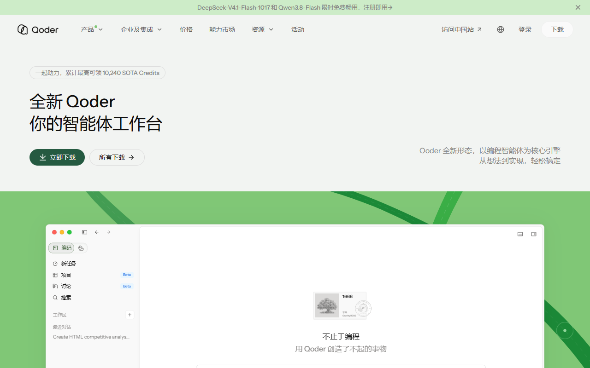
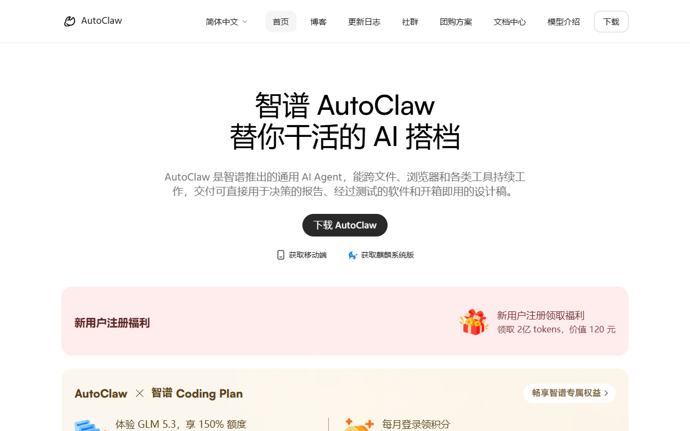
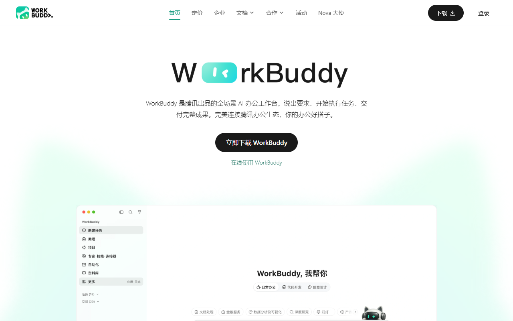

# Qoder 明天到期，这 8 个 AI 额度月底清零

这波免费额度散在各家，到期日全都不一样，记混了容易白忙。按到期日排了一遍：最急的是 Qoder 那笔，10 月 24 日就结束；其余七笔在 10 月 25 日到 31 日之间陆续到期。

## 明天就到期（10 月 24 日）

**Qoder · DeepSeek-V4.1-Flash-1017**

- 给什么：全天免费，消耗系数 0x。账号 Credits 是 0 也能跑，写代码、跑 agent 都行。
- 怎么领：qoder.com 或 qoder.cn 下载客户端，登录后在模型选择器里选 DeepSeek-Flash 直接用，不用领也不用报名。
- 截止：2026 年 10 月 24 日。
- 坑在哪：公告只覆盖个人版，团队版、企业标准版和企业专属版照常按倍率扣 Credits。

## 还剩两天（10 月 25 日）

**阶跃 × WorkBuddy · Step 5 Preview**

- 给什么：阶跃的旗舰模型在 WorkBuddy 独家限免，消耗系数 0.00x。适合复杂分析、长文档理解和代码工程这类硬活。
- 怎么领：装好 WorkBuddy 国内版，在模型列表里选中 Step 5 Preview，直接开任务。
- 截止：2026 年 10 月 25 日（10 月 12 日起的两周限免）。
- 坑在哪：忙时可能排队；图片、视频生成会切到别的模型，积分照常扣。

**智谱 AutoClaw · 每日登录送 Token**

- 给什么：国内版每天登录领 500 积分，付费会员 800；国际版每天 500 credits，约 500 万 Tokens。
- 怎么领：国内版 autoclaw.zhipuai.cn、国际版 autoclaw.z.ai，登录后按活动页提示领。新老用户都行，不用拉新也不用实名。
- 截止：2026 年 10 月 25 日。
- 坑在哪：两边规则不一样——国际版的 credits 当天 24:00 就过期，囤不了；国内版是领取后 7 天内有效。国内用户用国内版更划算。

**火山方舟 · Kimi-K3 五折**

- 给什么：Agent 场景的调用系数从 10 折到 5。
- 怎么领：控制台正常调用，折扣自动生效，没有领取动作。
- 截止：2026 年 10 月 25 日。
- 坑在哪：这是系数折扣不是免费，跑之前先看清单价，别当成白嫖。

**智谱 AutoClaw · 新用户注册福利**

- 给什么：新用户注册领 2 亿 tokens，官网标价 120 元。
- 怎么领：autoclaw.zhipuai.cn 下载桌面端，注册并登录后在活动页领取。
- 截止：官网横幅未见明确截止日，滚动，以页面显示为准。
- 坑在哪：仅限新用户，每账号一次；领取后 7 天内有效。

## 月底前结束（10 月 30–31 日）

**腾讯 WorkBuddy · Hy3 与 Hy4 preview**

- 给什么：Hy3 全天限免，适合日常写作、资料整理和推理；Hy4 preview 每晚 23:00 到次日 8:00 免费，适合长文档和带图的活。
- 怎么领：WorkBuddy 国内版模型列表里直接选，看带「限时免费」标识的那两款。
- 截止：2026 年 10 月 31 日。
- 坑在哪：Hy4 preview 只在夜里免费，白天照常扣积分；它没有多模态，图像和视频类任务会自动切到别的模型，积分照扣。

**腾讯 WorkBuddy · 新人 2000 积分**

- 给什么：通过老用户邀请链接注册并完成首次有效对话，送 2000 积分。
- 怎么领：走邀请链接注册（普通官网注册不一定触发），完成一次对话或任务后到个人中心的用量页查看。
- 截止：2026 年 10 月 31 日。
- 坑在哪：已注册过的账号领不了；积分有有效期，具体日期看积分明细。

**MiniMax · 天猫 M Plan 首月五折**

- 给什么：Go 档 24.5 元、Explore 档 59.5 元、Build 档 234.5 元，对应官网原价 49 / 119 / 469。
- 怎么领：天猫 MiniMax 官方旗舰店下单，选连续包月。
- 截止：2026 年 10 月 31 日。
- 坑在哪：这是连续包月的渠道拉新价，次月回到原价。不想一直订的，第二次扣款前记得取消自动续费。

**基元律动 / 火山方舟 · 两笔折扣**

- 给什么：基元律动 Qwen3.8-Flash 单价从 0.8 折到 0.4；火山方舟 deepseek-v4.1-flash 的 Coding/Agent 系数 1.25。
- 怎么领：各自控制台正常调用，折扣自动生效。
- 截止：2026 年 10 月 30 日。
- 坑在哪：都是折扣不是免费，单价本身不高，量大才省得出差别。

## 不赶时间，长期能领

- **智谱**：GLM-4.7-Flash、GLM-4-Flash、GLM-4.6V-Flash 输入输出全免费，长期有效。
- **百度千帆**：ERNIE-Speed、ERNIE-Lite 永久免费，但有限速。
- **腾讯混元**：Lite 长期不限量。
- **讯飞**：Spark Lite 永久免费 API；星辰 MaaS 开源模型 0 元无限量。
- **阿里 Qoder**：Qwen3.8-Flash 免费，系数 0x，官方说结束时间另行公告。
- **火山方舟**：豆包 Seed 实名后每日自动发放 200 万 Tokens。
- **国家超算互联网**：普惠词元单人上限 3000 万，需实名申领。

## 这些已经没了，别白跑

- **AutoClaw v2.1.0 版本活动的 2 亿档**：领取窗口 10 月 21 日就关了。官网现在挂着的是新用户注册那条长期福利，不是同一档，别弄混。
- **WorkBuddy DeepSeek 故障补偿 500 积分**：10 月 22 日 24:00 截止，要手动领，过期不补。
- **WorkBuddy 新用户 14 天免费额度**：资格要求在 10 月 10 日 23:59 前首次开启 Hy4 preview，窗口已经过了。

---

额度都是有时效的，看到就先去点一下。

发现哪条已经结束了，欢迎在评论区指正。
