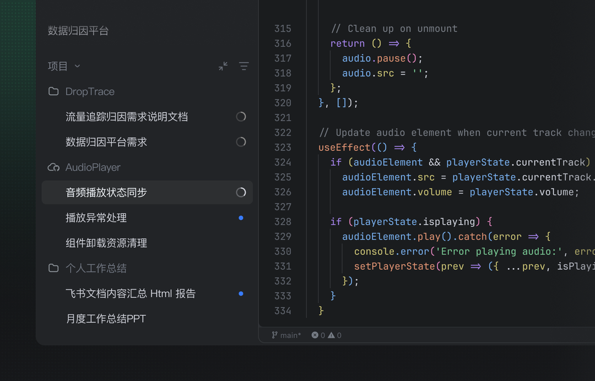
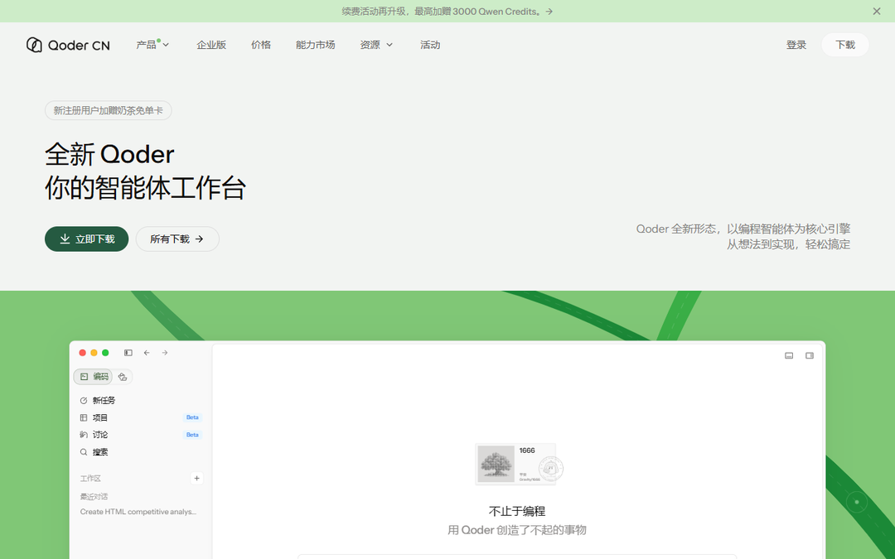
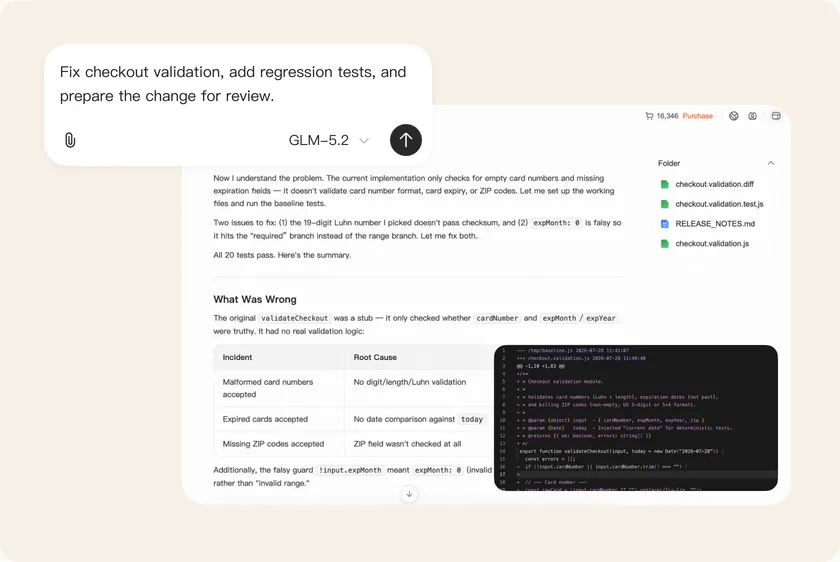
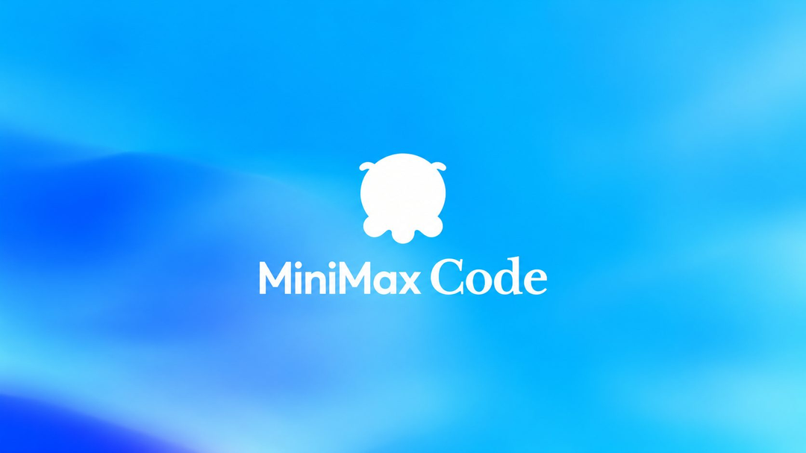
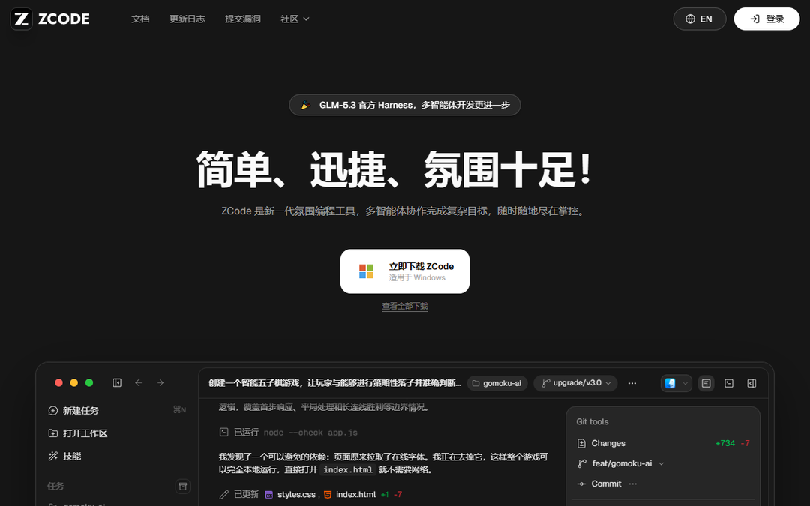
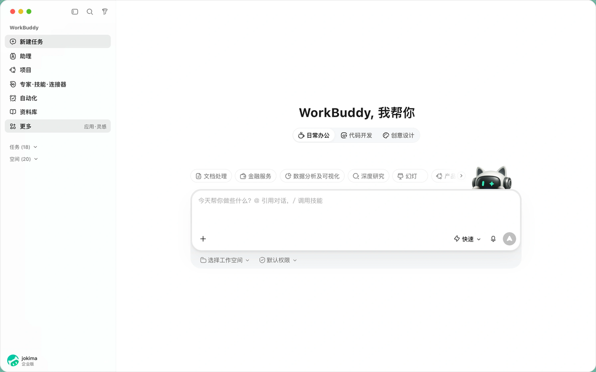

# TRAE 今晚关窗，10 个 AI 额度最晚用到 11 月

今天真正赶时间的就两条。TRAE 的 1024 打卡 18:00 停签到，Qoder 的 DeepSeek-Flash 限免今晚 24 点结束。剩下 8 条我按到期时间排了一遍，能拖到 11 月的只有一条。

## 今天 18 点前

**TRAE · 1024 打卡抽锦鲤**

- 给什么：每天签到一次随机奖励。大概率是 10 元连续包月券（92.5%），往下是 20 元券（2.4%）、88 积分（0.5%）、888 积分（0.04%）。签过到就自动进候选池，今晚 19:00 直播抽一个人送 100 万积分。
- 怎么领：打开 TRAE 中国版客户端，登录后首页会自动弹活动窗，点「签到参与抽奖」。没弹窗的点右上角头像，下拉面板的活动区里也有入口。
- 截止：2026 年 10 月 24 日 18:00 停止签到。券能用到 10 月 31 日 23:59，签到积分发放后 1 个月有效。
- 坑在哪：只算中国区账号，一人一号，同一手机号下的多个账号按一个人处理。旧版客户端没有活动入口，漏签不补。

## 今晚 24 点，也就是 10 月 25 日零点

**Qoder · DeepSeek-V4.1-Flash-1017 全免**

- 给什么：这个模型在个人版里计费系数从 0.1x 降到 0x，调用不扣 Credits，余额是 0 也能跑，1M 上下文和「最大」档思考强度都开得起来。
- 怎么领：qoder.cn 或 qoder.com 下客户端，登录后在模型选择器里选 DeepSeek-Flash，确认倍率显示 0x 再开任务。不用领券，不用报名。
- 截止：2026 年 10 月 25 日 00:00（北京时间），之后回到 0.1x。
- 坑在哪：只覆盖个人版，团队版和企业版照常扣。海报写「免费用到 10.24」，容易读成 24 号傍晚就没了，其实 24 号一整天都算，别提前收工。

## 10 月 25 日，还有三条

**智谱 AutoClaw · 每日登录 500 credits**

- 给什么：每天登录领 500 credits。官方口径 1 credit = 1 万 tokens，折合约 500 万 Tokens。
- 怎么领：autoclaw.zhipuai.cn（国内版）或 autoclaw.z.ai（国际版），登录后在活动入口点领取。新老用户都行，不用拉新和实名。
- 截止：2026 年 10 月 25 日。当天的额度当天 24:00 清零。
- 坑在哪：国内版和国际版是两套规则。国际版的 credits 当天清零，国内版领取后 7 天内有效。别想着囤，领了就用。

**阶跃 Step 5 Preview · 在 WorkBuddy 里零积分**

- 给什么：600B 参数的旗舰模型，在 WorkBuddy 里倍率 0.00x，跑多重的任务都不扣积分。
- 怎么领：装 WorkBuddy 国内版，模型列表里找标注「独家限免」的 Step 5 Preview，直接选。
- 截止：2026 年 10 月 25 日（10 月 12 日开启的两周限免）。
- 坑在哪：忙时可能排队。图片、视频类任务会自动切到别的模型，那些照常扣。

**MiniMax Code · M3.1 Flash 不限量**

- 给什么：订阅用户在客户端里用 M3.1 Flash 不限次数、不扣额度。1M 上下文，输出最长 512K。
- 怎么领：code.minimaxi.com 或下载 MiniMax Code 桌面端，登录后确认账号有订阅，模型列表选 M3.1 Flash，直接开任务。
- 截止：2026 年 10 月 25 日 23:59。
- 坑在哪：必须有订阅，没订阅这条用不上。只能在客户端里用，走 API 照常按 token 计费。

## 周一早上清零，10 月 26 日

**智谱 ZCode · 5 亿 Tokens**

- 给什么：一份 5 亿 Tokens 的礼包，GLM-5.3 和 GLM-5.3-Flash 共用，20 万份先到先得。
- 怎么领：zcode.z.ai/cn 下最新版客户端（3.16.3 以上），登录后等「1024 Dev Day」弹窗，点「打开大礼包」。没弹窗就退出账号重登一次。
- 截止：2026 年 10 月 26 日 09:00。额度固定在这个点清零，晚领不顺延。
- 坑在哪：只能在 ZCode 客户端内消耗。页面下方那张 Start Plan 卡片（GLM-5.3 每日 300 万、Flash 每日 500 万）是另一个套餐，别当成这次额度。

## 月底前，10 月 30 到 31 日

**国家超算互联网 · Auto 模型夜间免费**

- 给什么：订阅 Token Plan 的用户，每晚 21:00 到次日 09:00 调用 Auto 模型不收费。
- 怎么领：订阅 Token Plan 后，到点时段正常调用 Auto，没有领取动作。
- 截止：2026 年 10 月 30 日。
- 坑在哪：只对订阅用户开放，只限 Auto 这一档，白天照常计费。

**腾讯 WorkBuddy · Hy3 全天、Hy4 preview 夜间**

- 给什么：Hy3 全天不限时零积分；Hy4 preview 每晚 23:00 到次日 08:00 免费。
- 怎么领：WorkBuddy 国内版模型列表里直接选带「限时免费」标识的那两款。
- 截止：2026 年 10 月 31 日。
- 坑在哪：Hy4 preview 白天照常扣积分，它没有多模态，图像视频任务会切模型、照扣。

**MiniMax · M Plan 首月五折**

- 给什么：Go 24.5 元、Explore 59.5 元、Build 234.5 元，对应原价 49 / 119 / 469。天猫官方旗舰店同一档价。
- 怎么领：MiniMax 官网或天猫旗舰店，选连续包月下单。
- 截止：2026 年 10 月 31 日 23:59。
- 坑在哪：次月回原价。不打算长期订的，第二次扣款前记得取消自动续费。

## 11 月才到期

**DeepSeek · Search 和 Fetch 接口免调用费**

- 给什么：自研的搜索和网页抓取接口，在 Harness、Claude Code、Codex 里调用不计费。标准价 5 元一千次。
- 怎么领：不用领。用这几个客户端调 DeepSeek API 时自动走免单。
- 截止：2026 年 11 月 1 日 00:00。
- 坑在哪：只免这两个接口，模型本身的 token 照常算钱。

## 领了才开始计时

- **讯飞 Spark-X2.6**：10 亿 Tokens，实名后在 maas.xfyun.cn 的模型页领，从领取当天起 31 天内用完，每人一次。领取时别勾「额度用尽转按量计费」。
- **智谱 GLM Coding Plan 体验卡**：2000 积分，领取后第 7 天到期，用不完作废。只给从没订阅过 Coding Plan 的账号，每天限 1 万张，入口在 bigmodel.cn/activity/trial-card/。

## 不赶时间，长期能领

- **智谱**：GLM-4.7-Flash、GLM-4-Flash、GLM-4.6V-Flash 输入输出全免费。
- **阿里 Qoder**：Qwen3.8-Flash 系数 0x，结束时间官方提前公告；每天 10:00 还能手动领 100 Credits，30 天有效。
- **火山方舟**：豆包 Seed 实名后每天自动发 200 万 Tokens，单模型另给 50 万基础额度。
- **腾讯混元**：Lite 长期不限量。**讯飞**：Spark Lite 永久免费 API。**百度千帆**：ERNIE-Speed、ERNIE-Lite 永久免费，但有限速。
- **商汤 SenseNova**：Token Plan 长期免费公测，不绑卡不充值，每 5 小时刷新配额。
- **国家超算互联网**：普惠词元单人上限 3000 万，需实名申领。

## 这些已经没了，别白跑

这三条我查过页面，都已确认关停。

- **Qoder 2000 SOTA Credits**：只给个人订阅用户，窗口是 10 月 14 日 18:00 到 10 月 24 日 10:00，今天上午就关了。
- **智谱 AutoClaw v2.1.0 的 2 亿 Tokens**：领取截止 10 月 21 日。官网现在挂的每日登录是另一套，别弄混。
- **WorkBuddy DeepSeek 故障补偿 500 积分**：10 月 22 日 24:00 截止，要手动领，过期不补。

---

额度都是有时效的，看到就先去点一下。

发现哪条已经结束了，欢迎在评论区指正。
