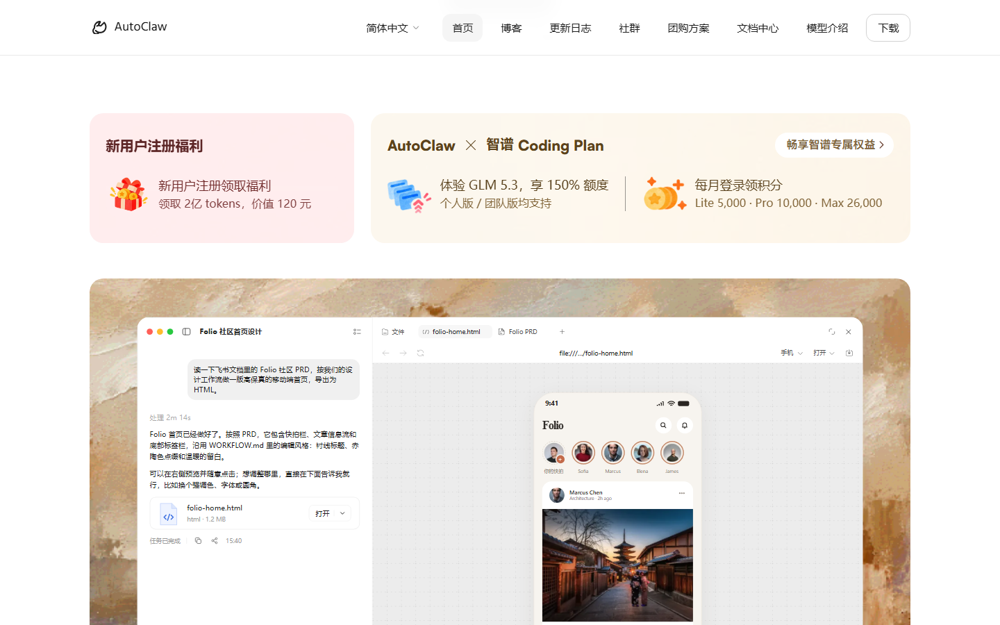
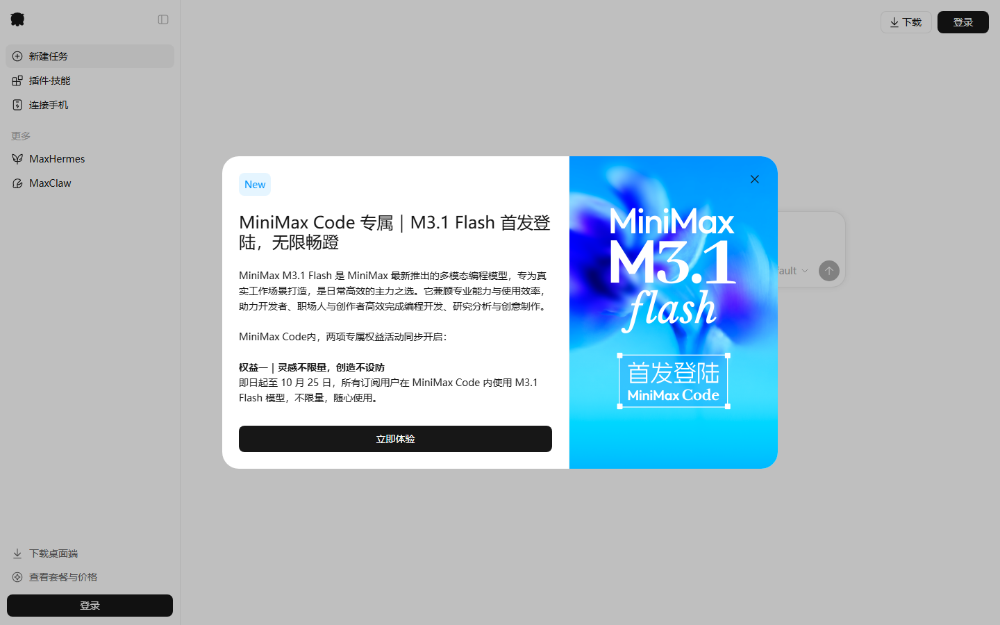
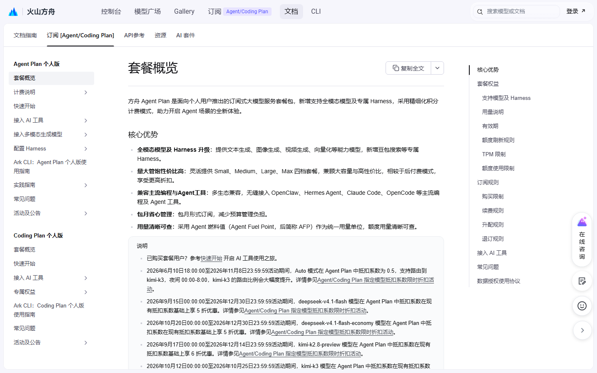
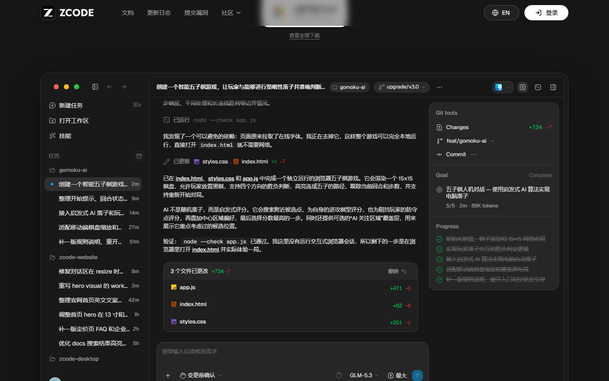
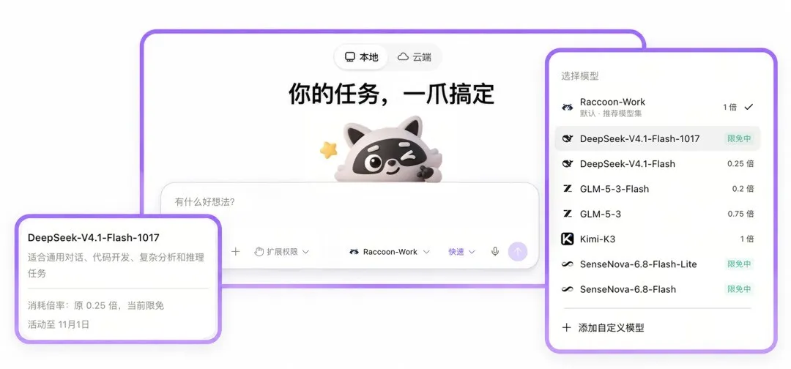

# 四个 AI 额度今晚清零，七牛云每天送 1 亿

今天到期的四条我按急的程度放最前：AutoClaw 的 500 credits，WorkBuddy 里的 Step 5 Preview，MiniMax Code 的 M3.1 Flash，还有方舟 kimi-k3 的五折。全卡在今天 24 点。明天早上 9 点，ZCode 那 5 亿 Tokens 也一刀归零。

## 今晚 24 点前，10 月 25 日

**智谱 AutoClaw · 每日登录 500 credits**

- 给什么：每天登录领 500 credits。1 credit 约等于 1 万 tokens，折合约 500 万 Tokens。
- 怎么领：autoclaw.zhipuai.cn 或 autoclaw.z.ai，登录后点活动入口领取。不用拉新，不用实名。
- 截止：2026 年 10 月 25 日，今天是最后一天，当天额度当天 24:00 清零。
- 坑在哪：国际版当天清零，国内版领后 7 天内有效，两套规则别走错门。

**阶跃 Step 5 Preview · 在 WorkBuddy 里零积分**

- 给什么：600B 参数旗舰模型，倍率 0.00x，跑多重的任务都不扣积分。
- 怎么领：装 WorkBuddy 国内版，模型列表里选标注「独家限免」的 Step 5 Preview。
- 截止：2026 年 10 月 25 日，10 月 12 日开的两周限免。
- 坑在哪：忙时会排队。图片、视频任务会自动切模型，那些照常扣。

**MiniMax Code · M3.1 Flash 不限量**

- 给什么：订阅用户在客户端里用 M3.1 Flash 不限次数、不扣额度。1M 上下文，输出最长 512K。
- 怎么领：code.minimaxi.com 或桌面端，确认订阅有效后选 M3.1 Flash 直接开任务。
- 截止：2026 年 10 月 25 日 23:59。
- 坑在哪：没订阅这条等于不存在。只在客户端里生效，走 API 照常按 token 计费。

**火山方舟 · kimi-k3 抵扣系数五折**

- 给什么：kimi-k3 在 Agent Plan 里的抵扣系数从 10 降到 5，同额度能跑两倍量。
- 怎么领：不用领。订阅了 Agent Plan 个人版，在支持的工具里选 kimi-k3，自动按折后系数扣。
- 截止：2026 年 10 月 25 日 23:59:59。
- 坑在哪：降的是套餐内抵扣系数，不是 API 人民币价。没订阅套餐的用不上。

## 明早 9 点，10 月 26 日

**智谱 ZCode · 5 亿 Tokens**

- 给什么：5 亿 Tokens 礼包，GLM-5.3 和 GLM-5.3-Flash 共用，20 万份先到先得。
- 怎么领：zcode.z.ai/cn 下 3.16.3 以上的客户端，登录后点「1024 Dev Day」弹窗里的大礼包。没弹窗就退账号重登。
- 截止：2026 年 10 月 26 日 09:00，固定这个点清零，晚领不顺延。
- 坑在哪：今晚才领，5 亿只有 9 小时。只能在客户端内消耗，转不成 API。页面下方那张 Start Plan 卡片是另一份，别混。

## 10 月 30 到 31 日

**腾讯 WorkBuddy · Hy3 全天、Hy4 preview 夜间**

- 给什么：Hy3 全天不限时零积分；Hy4 preview 每晚 23:00 到次日 08:00 免费。
- 怎么领：WorkBuddy 国内版模型列表里选带「限时免费」标识的那两款。
- 截止：2026 年 10 月 31 日。
- 坑在哪：Hy4 preview 白天照常扣，它没有多模态，图像视频任务会切模型、照扣。

**MiniMax · M Plan 首月五折**

- 给什么：Go 24.5 元、Explore 59.5 元、Build 234.5 元，原价分别是 49 / 119 / 469。
- 怎么领：MiniMax 官网或天猫旗舰店，选连续包月下单。
- 截止：2026 年 10 月 31 日 23:59。
- 坑在哪：次月回原价。不打算长期订的，第二次扣款前取消自动续费。

**商汤小浣熊 · DeepSeek-V4.1-Flash-1017 零积分**

- 给什么：桌面端 v1.1.0 起这款系数 0x，不扣积分。同面板 SenseNova-6.8-Flash 两档也标着「限免中」。
- 怎么领：升级小浣熊桌面端到 v1.1.0，模型选择面板里挑带「限免中」的那几款。
- 截止：2026 年 10 月 31 日。客户端卡片写「活动至 11 月 1 日」，差一天，以客户端为准。
- 坑在哪：限免只覆盖这三款。Raccoon-Work 默认模型集和 Kimi-K3 照常按倍率扣。

## 11 月才到期

**DeepSeek · Search 和 Fetch 接口免调用费**

- 给什么：自研的搜索和网页抓取接口，在 Harness、Claude Code、Codex 里调用不计费。标准价 5 元一千次。
- 怎么领：不用领。用这几个客户端调 DeepSeek API 时自动走免单。
- 截止：2026 年 11 月 1 日 00:00（北京时间）。
- 坑在哪：只免这两个接口，模型本身的 token 照常算钱。

**火山方舟 · kimi-k3.1-pro 抵扣系数五折**

- 给什么：抵扣系数从 7 降到 3.5。这是 10 月 24 日文档刚更新的一条。
- 怎么领：订阅 Agent Plan 个人版后选这个模型，自动按折后系数扣。
- 截止：2026 年 11 月 9 日 23:59:59。
- 坑在哪：同上，降的是套餐抵扣系数，不是按量价减半。

**七牛云 · Conatus 每天 1 亿 Token**

- 给什么：实名认证后每天 1 亿 Token；账号有过一笔大于 100 元且已到账的充值，升到每天 10 亿。1M 上下文，128K 输出，能读图。
- 怎么领：qiniu.com 控制台完成实名认证，再到模型页建 API Key。调用时模型 ID 填 qiniu/conatus-free，BaseURL 填 api.qnaigc.com/v1。
- 截止：2026 年 11 月 30 日 23:59。额度每天 00:00 重置，不结转。
- 坑在哪：额度用完请求直接被拒，不扣余额也不切模型。缓存命中的输入照样计额度。我觉得 1 亿对个人够用了，别为 10 亿去充那 100 块。12 月 1 日起这个模型直接停。

## 领了才开始计时

- **讯飞 Spark-X2.6**：10 亿 Tokens，实名后在 maas.xfyun.cn 领，从领取当天起 31 天内用完，每人一次。别勾「额度用尽转按量计费」。
- **智谱 Coding Plan 体验卡**：2000 积分，领取后第 7 天到期。只给没订阅过的账号，每天限 1 万张，入口 bigmodel.cn/activity/trial-card/。
- **讯飞 AStudio**：新用户下载登录领 1000 积分，3 个月有效；之后每天登录再领 100，每次 31 天。

## 不赶时间，长期能领

- **智谱**：GLM-4.7-Flash、GLM-4-Flash、GLM-4.6V-Flash 输入输出全免费。
- **阿里 Qoder**：Qwen3.8-Flash 系数 0x，结束时间官方提前公告；Qoder CN 每天 10:00 还能领 100 Credits，30 天有效。
- **火山方舟**：豆包 Seed 实名后每天自动发 200 万 Tokens。
- **商汤小浣熊**：网页端、桌面端、移动端登录各领 3000 积分，三端叠加 9000。

## 这些已经没了，别白跑

这五条我查过页面，都已确认关停。

- **TRAE 1024 打卡抽锦鲤**：10 月 24 日 18:00 就停了签到。
- **Qoder 国内版 DeepSeek-V4.1-Flash-1017 限免**：国内版口径是 10 月 25 日 0 点，此刻已过。
- **腾讯 OrcaTerm 敲 1024 送 3 个月专业版**：10 月 24 日 23:59 截止。
- **Qoder 2000 SOTA Credits**：窗口 10 月 14 日 18:00 到 10 月 24 日 10:00，已关。
- **国家超算 GLM-5.3-Flash 特惠量包**：5 亿 Tokens 99 元，10 月 24 日截止。

---

额度都是有时效的，看到就先去点一下。

发现哪条已经结束了，欢迎在评论区指正。
