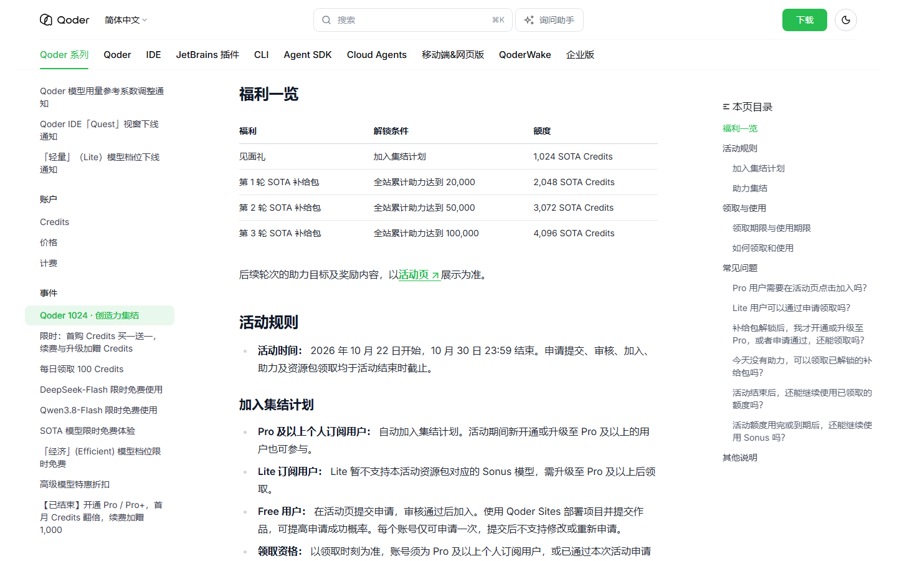
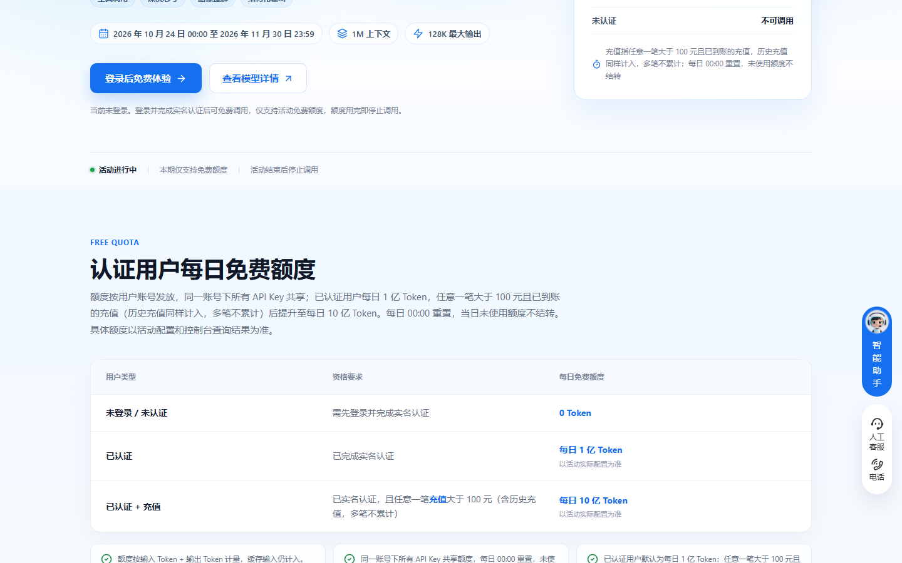
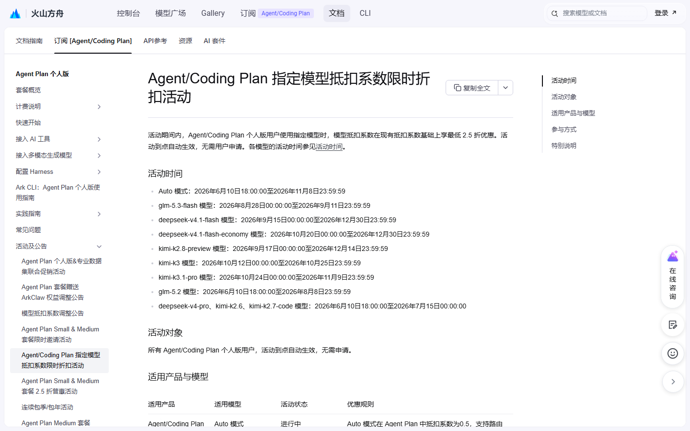

# Qoder 还剩 3 天关窗，Auto 夜间免费也快收了

今天最急的是两件事。国家超算互联网的 Auto 夜间免费，官方公众号写的窗口到 10 月 28 日，今晚 21 点以后是最后一个夜场。Qoder 国际版的 1024 集结 10 月 30 日 23:59 收口，申请、审核、助力一起停。

其余十条我都追到了官方页面，按截止日排。

## 今晚 21 点起，最后一个夜场

**国家超算互联网 · Token Plan 夜间 Auto 免费**

- 给什么：订阅 Token Plan 后，每晚 21:00 到次日 09:00 调 Auto 模型不扣 Credits。
- 怎么领：scnet.cn 控制台 → 模型服务 → 开通 Token Plan → 模型选 Auto。夜里直接调，没有券要领。
- 截止：官方公众号写 10 月 21 日至 28 日，10 月 23 日那批媒体稿都写「至 30 日」。两处不一致，我按早的那个算。
- 坑在哪：只给 Token Plan 订阅用户。按量计费的账号夜里照扣，白天也照扣。

## 10 月 30 日 23:59，Qoder 收口

**阿里 Qoder 国际版 · 1024 创造力集结**

- 给什么：加入集结领 1,024 SOTA Credits 见面礼。全站助力到 2 万、5 万、10 万，再各解锁 2,048 / 3,072 / 4,096，满额 10,240。
- 怎么领：Pro 及以上自动加入，但资源包得在端内手动点。0.4.8 之后是左下角头像 → 权益中心 → 领取，CLI 里敲 `/claim`。
- 截止：2026 年 10 月 30 日 23:59。申请、审核、加入、助力、领取同时停。
- 坑在哪：见面礼能用到 10 月 31 日 23:59，补给包领到手只有 24 小时。只有国际版，和国内版账号不通用。

## 10 月 31 日，两条一起停

**商汤小浣熊 · 三款模型零积分**

- 给什么：DeepSeek-V4.1-Flash-1017、SenseNova-6.8-Flash、SenseNova-6.8-Flash-Lite 三款在活动期内不扣积分，系数 0x。
- 怎么领：桌面端升到 v1.1.0 以上，模型面板里挑带「限免中」标识的那三款，直接开任务。
- 截止：2026 年 10 月 31 日。
- 坑在哪：只覆盖这三款。Raccoon-Work 默认模型集和 Kimi-K3 照常按倍率扣，整面板不全免费。

**腾讯 WorkBuddy · Hy3 全天、Hy4 preview 夜间**

- 给什么：Hy3 全天不限时零积分；Hy4 preview 每晚 23:00 到次日 08:00 免费。
- 怎么领：国内版客户端，点输入框右下角的模型名，选带「限时免费」标识的那两款。
- 截止：2026 年 10 月 31 日。
- 坑在哪：Hy4 preview 白天按 0.29x 扣。它没有多模态，图片视频任务会自动切走，那些照扣。

## 11 月 1 日零点，两条一起停

**DeepSeek · Search 和 Fetch 免调用费**

- 给什么：自研的网页搜索和抓取接口，在 Harness、Claude Code、Codex 里调用不计费。标准价 5 元一千次。
- 怎么领：不用领。这几个客户端调 DeepSeek API 时自动走免单。
- 截止：2026 年 11 月 1 日 00:00（北京时间）。
- 坑在哪：只免这两个接口，模型 token 照常算钱。

**阿里 Qoder 国际版 · DeepSeek-V4.1-Flash-1017 零倍率**

- 给什么：计费系数 0x，余额为 0 也能跑，1M 上下文照开。
- 怎么领：模型选择器切到 DeepSeek-V4.1-Flash-1017，确认倍率显示 0x，直接开任务。
- 截止：2026 年 11 月 1 日 00:00（UTC+8）。原定 10 月 24 日，官方后来延期。
- 坑在哪：只国际版。国内版那档 10 月 25 日 0 点就结束了，两边账号不通用。

## 11 月上中旬，火山方舟两条

**火山方舟 · Auto 模式抵扣系数 0.5**

- 给什么：Agent Plan 个人版里 Auto 的抵扣系数算 0.5，同样的额度能跑两倍量。夜里 00:00 到 08:00 路由到 kimi-k3 的比例会大幅提高。
- 怎么领：订阅 Agent Plan 个人版，模型选 Auto，到点自动生效，不用申请。
- 截止：2026 年 11 月 8 日 23:59:59。
- 坑在哪：Coding Plan 里 Auto 的系数是 1，不打折。想省得买 Agent Plan。

**火山方舟 · kimi-k3.1-pro 五折**

- 给什么：抵扣系数在现有基础上打 5 折，可用配额是原用量的 200%。
- 怎么领：Agent 或 Coding Plan 个人版里选 kimi-k3.1-pro，自动按折后系数扣。
- 截止：2026 年 11 月 9 日 23:59:59。10 月 24 日 0 点开的。
- 坑在哪：降的是套餐内抵扣系数，不是 API 人民币价。没订阅套餐的用不上。

## 11 月底到 12 月，可以缓

**七牛云 · Conatus Free 每天 1 亿 Token**

- 给什么：实名认证后每天 1 亿 Token；有一笔大于 100 元且已到账的充值，升到每天 10 亿。1M 上下文，128K 输出，能读图。
- 怎么领：qiniu.com 控制台实名，建 API Key，模型 ID 填 `qiniu/conatus-free`，BaseURL 填 `api.qnaigc.com/v1`。
- 截止：2026 年 11 月 30 日 23:59。每天 00:00 重置，不结转。
- 坑在哪：额度用完请求直接被拒，不扣余额也不切模型，缓存命中的输入照样算。12 月 1 日起这个模型停。

**火山方舟 · kimi-k2.8-preview 六折**

- 给什么：抵扣系数 6 折，可用配额是原用量的 166%。
- 怎么领：Agent/Coding Plan 个人版里选这个模型，自动生效。
- 截止：2026 年 12 月 14 日 23:59:59。
- 坑在哪：同下面那条，降的是套餐抵扣系数。预览版偶尔会掉格式，正式活儿别全押它。

**火山方舟 · deepseek-v4.1-flash 五折**

- 给什么：系数 5 折，可用配额 200%。economy 版同规则。
- 怎么领：订阅 Agent/Coding Plan 个人版后选这个模型，自动按折后系数扣。
- 截止：2026 年 12 月 30 日 23:59:59。
- 坑在哪：这是窗口最长的一档，别急着囤套餐。

**腾讯云 TokenHub · 新人包每个模型 100 万 Tokens**

- 给什么：语言模型每个 100 万 Tokens，有效期 1 年，每个账号每个模型领一次。
- 怎么领：TokenHub 控制台开通服务，进模型广场，点右上角「新用户福利免费体验」，勾模型领取。
- 截止：2026 年 12 月 31 日。
- 坑在哪：每领一个模型冻结 10 美元授信，余额不足就领失败。额度按主账号共享，不按子账号。

## 长期能领，不用赶

- **国家超算互联网**：新用户注册直接给 1000 万 Tokens 量包。
- **阿里 Qoder**：国内版每天 10:00 能领 100 通用 Credits，30 天有效；Qwen3.8-Flash 系数 0，结束时间官方没公布。
- **智谱**：GLM-4.7-Flash、GLM-4-Flash、GLM-4.6V-Flash 输入输出全免费。
- **火山方舟**：豆包 Seed 实名后每天自动发 200 万 Tokens。
- **讯飞**：Spark Lite 永久免费 API，星辰 MaaS 开源模型 0 元无限量。
- **商汤**：SenseNova Token Plan 长期免费公测，不绑卡，每 5 小时刷新配额。

## 这些已经没了，别白跑

- **智谱 ZCode 5 亿 Tokens**：固定 10 月 26 日 09:00 清零，额度是 0，礼包页面还挂着。
- **智谱 AutoClaw 每日 500 credits**：10 月 25 日 24:00 停，当天额度当天清。
- **阶跃 Step 5 Preview 在 WorkBuddy 零积分**：两周限免，10 月 25 日结束。
- **MiniMax Code M3.1 Flash 不限量**：只给订阅用户，10 月 25 日 23:59 结束。
- **火山方舟 kimi-k3 五折**：10 月 25 日 23:59 到期，接棒的是 k3.1-pro 那条。

---

额度都是有时效的，看到就先去点一下。

发现哪条已经结束了，欢迎在评论区指正。
