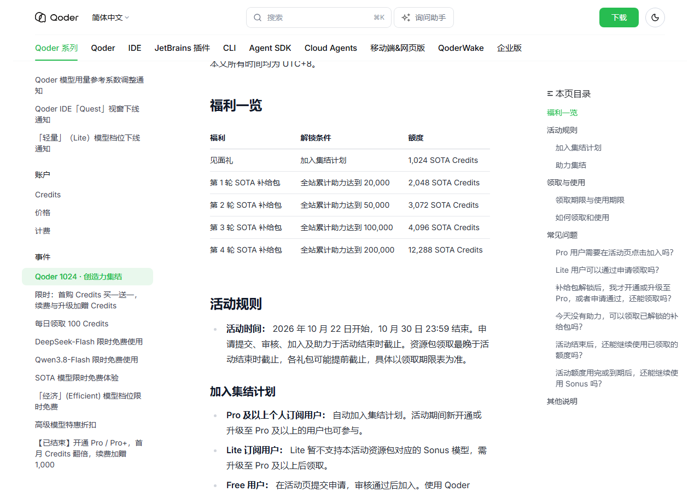
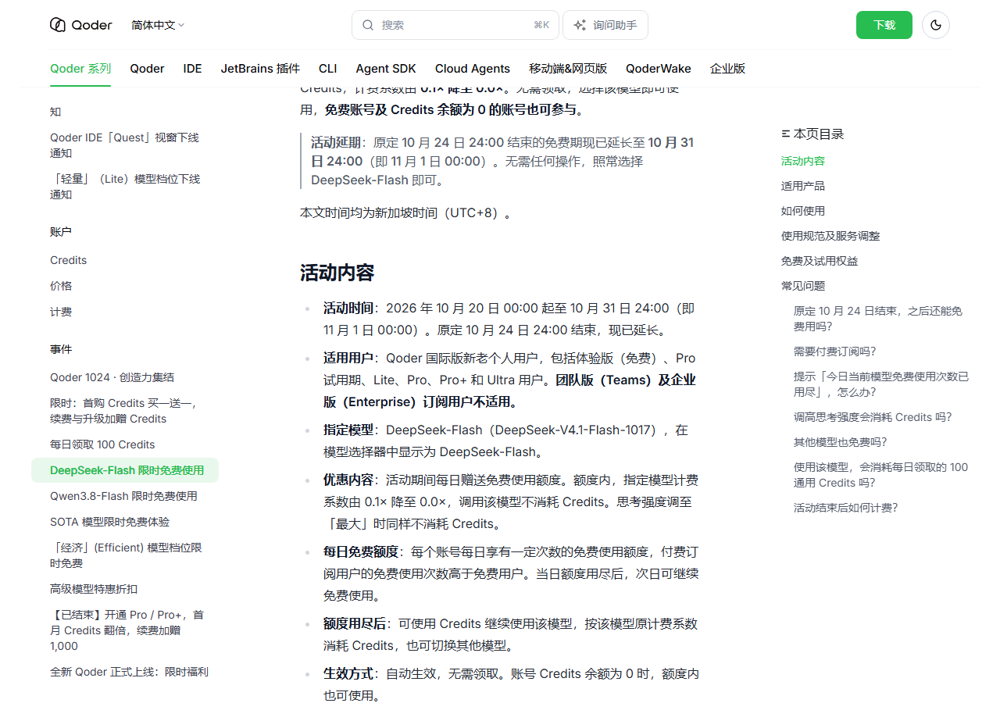
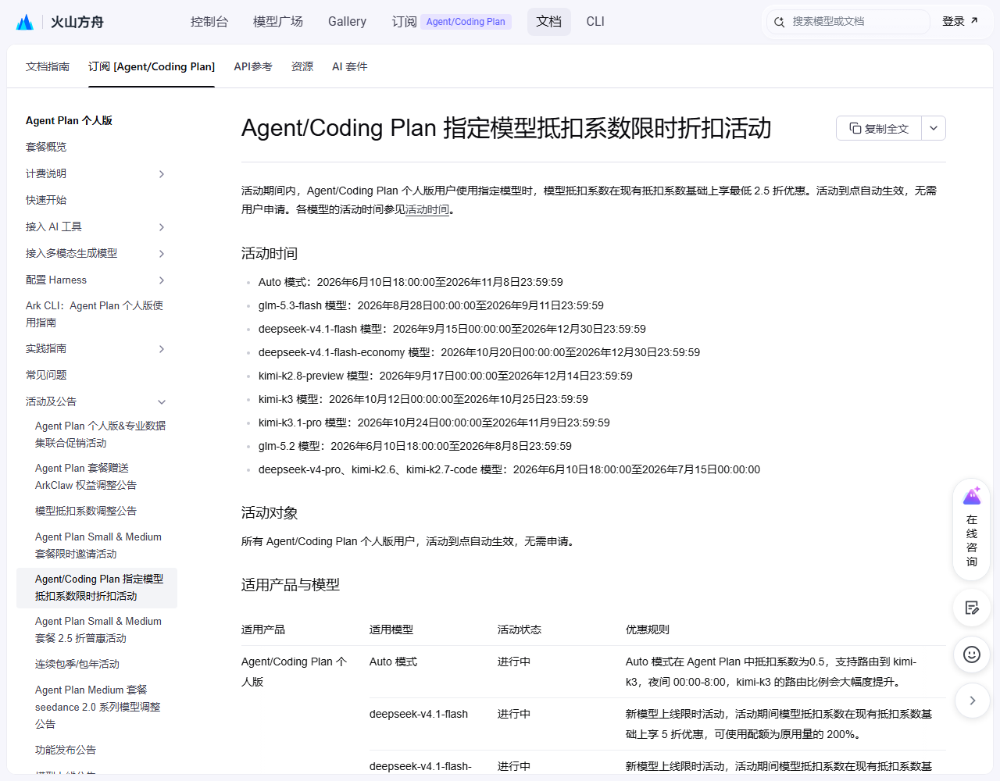
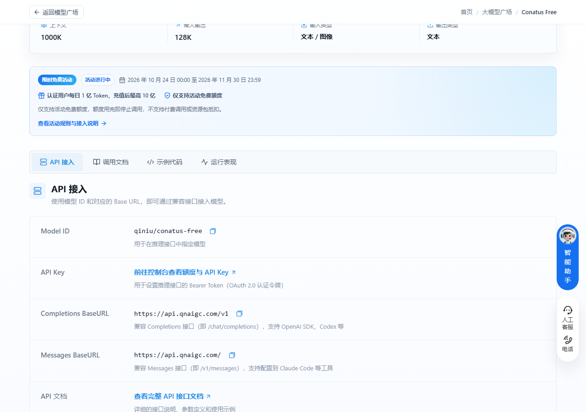
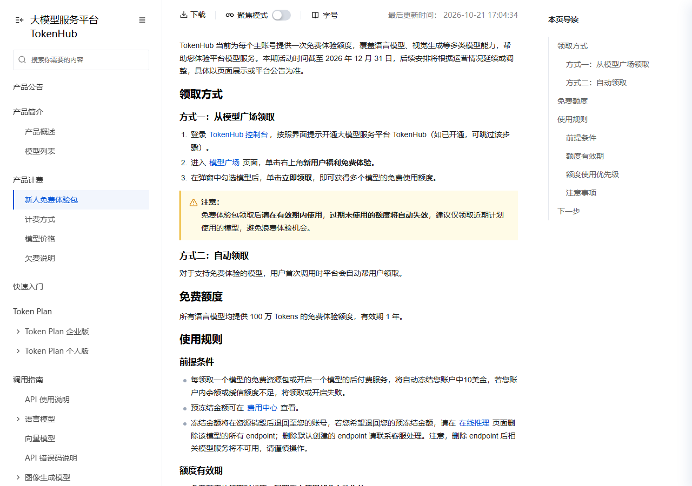
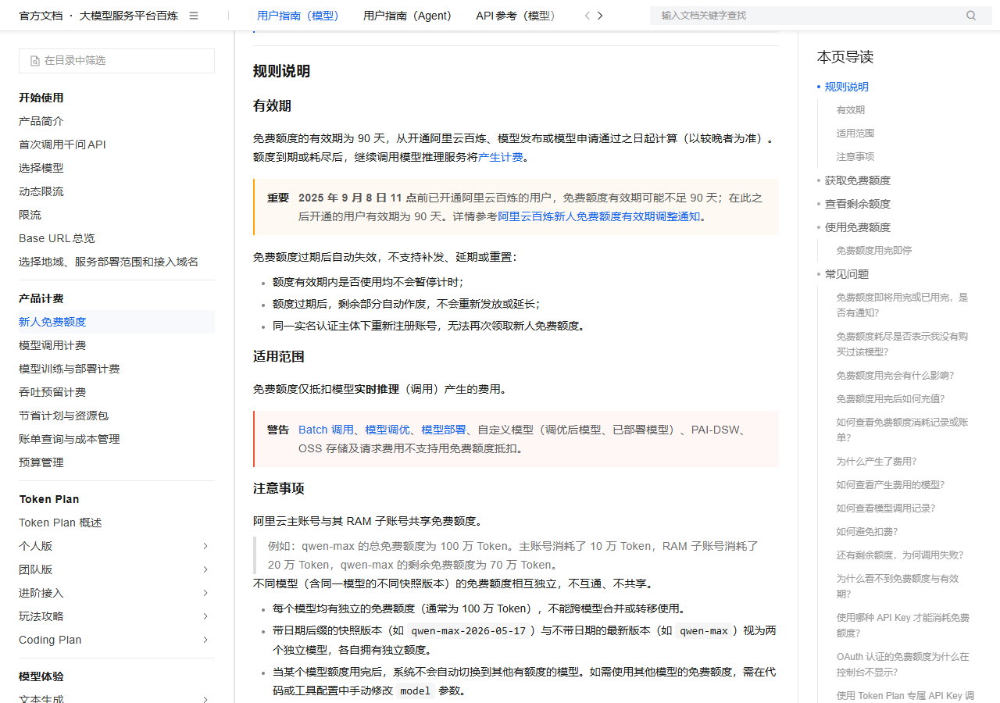

# Qoder 今天放出 4096 Credits，当天不用就作废

今天到期的只有一个：Qoder 第 4 轮补给包，零点开的，今晚 23:59 连同没用完的额度一起作废。

另一个今晚还能用、但截止日两处说法打架的，我按早的算。

## 今天 23:59，领了就得用完

**Qoder 第 4 轮 SOTA 补给包 · 4,096 Credits**

- 给什么：4,096 SOTA Credits，只能用在 Sonus 模型。10 月 28、29、30 每天零点各开一份，三天共 12,288。
- 怎么领：桌面端左下角头像 → 权益中心 → 领取。IDE 在右下角用量面板点，CLI 敲 `/claim`。每账号每天限一份。
- 截止：2026 年 10 月 28 日 23:59 停止领取，额度也在这天 23:59 失效，不结转。
- 坑在哪：剩多少废多少。昨天漏领的那份补不回来。

## 今晚 21 点还有一场，但截止日存疑

**国家超算互联网 · Token Plan 夜间 Auto 免费**

- 给什么：订阅 Token Plan 后，每晚 21:00 到次日 09:00 调 Auto 不扣 Credits。
- 怎么领：scnet.cn 控制台 → 模型服务 → 开通 Token Plan → 模型选 Auto。没有券要领。
- 截止：界面新闻、环球网 10 月 23 日那批稿子统一写「10 月 21 日至 30 日」，我上期在官方公众号看到的是到 10 月 28 日。两处对不上，按早的算，今晚这场两种口径都成立。
- 坑在哪：只给 Token Plan 订阅用户。按量计费的账号夜里照扣，白天也照扣。

## 10 月 30 日 23:59，集结收口

**Qoder 1024 集结 · 领取到 10 月 30 日，见面礼用到 10 月 31 日**

- 给什么：见面礼 1,024 SOTA Credits。全站助力到 2 万、5 万、10 万，再各解锁 2,048 / 3,072 / 4,096。
- 怎么领：Pro 及以上自动加入，资源包仍要手动领，路径同上。Free 用户先在活动页提申请，审核通过才算。
- 截止：2026 年 10 月 30 日 23:59，申请、审核、加入、助力、领取一起停。
- 坑在哪：补给包到手只有 24 小时。Lite 档用不了 Sonus，得升 Pro 才能领。

## 10 月 31 日 24:00，Qoder 那条限免收口

**Qoder 国际版 · DeepSeek-Flash 每日免费额度**

- 给什么：每天一定次数的免费调用，额度内系数 0.0×，思考强度开到「最大」也不扣。付费用户次数多于免费用户。
- 怎么领：客户端把模型选成 DeepSeek-Flash，自动生效，不用领。
- 截止：2026 年 10 月 31 日 24:00，即 11 月 1 日 00:00。原定 10 月 24 日结束，后来延了。
- 坑在哪：只限国际版个人用户，团队版和企业版不参加。额度按天走，用不完不留给明天。

## 11 月 1 日零点，DeepSeek 开始按次收费

**DeepSeek · Search 和 Fetch 免调用费**

- 给什么：自研的网页搜索和抓取接口，在 Harness、Claude Code、Codex 里走服务端调用不计费。标准价 5 元一千次。
- 怎么领：不用领。这几个客户端调 DeepSeek API 时自动走免单。
- 截止：2026 年 11 月 1 日 00:00（北京时间）。
- 坑在哪：只免这两个接口，模型 token 照常算钱。

## 11 月 8 日和 9 日，火山两条先后停

**火山方舟 · Auto 模式 0.5 系数**

- 给什么：Agent Plan 里调 Auto，抵扣系数 0.5，同样套餐额度能用出两倍量。夜里路由到 kimi-k3 的比例会调高。
- 怎么领：订阅 Agent/Coding Plan 个人版后自动生效，不用申请。
- 截止：2026 年 11 月 8 日 23:59:59。
- 坑在哪：Auto 是路由，不是指定模型，落到哪个你控制不了。

**火山方舟 · kimi-k3.1-pro 五折**

- 给什么：抵扣系数打五折，套餐额度可用出原来的 200%。
- 怎么领：同上，到点自动生效。
- 截止：2026 年 11 月 9 日 23:59:59。
- 坑在哪：只在 Agent Plan 和 Coding Plan 个人版里算数，按量付费不享受。

## 11 月 30 日，七牛云这台每天重开

**七牛云 · Conatus Free**

- 给什么：实名认证后每天 1 亿 Token，充值超 100 元升到每天 10 亿。1M 上下文，支持图像输入。
- 怎么领：控制台拿 API Key，模型 ID 填 `qiniu/conatus-free`。BaseURL 用 `https://api.qnaigc.com/v1`。
- 截止：2026 年 11 月 30 日 23:59。
- 坑在哪：每日 0 点重置，不结转。额度用完请求直接被拒，不扣余额也不帮你切模型。

## 12 月还留着两条

**火山方舟 · deepseek-v4.1-flash 与 flash-economy 五折**

- 给什么：两款模型各打五折，额度可用出 200%。economy 那款 10 月 20 日才加进来。
- 怎么领：自动生效，两款分开算名额。
- 截止：都是 2026 年 12 月 30 日 23:59:59。
- 坑在哪：两张活动同一个截止日，容易记成一条。

**腾讯云 TokenHub · 新人免费体验包**

- 给什么：每个语言模型 100 万 Tokens，有效期 1 年。视觉生成类也在范围内。
- 怎么领：控制台开通 TokenHub → 模型广场 → 右上角「新用户福利免费体验」→ 勾模型 → 领取。
- 截止：本期到 2026 年 12 月 31 日，之后看平台公告。
- 坑在哪：每领一个模型冻结账户 10 美金，余额不足直接领不了。

## 长期可领，不用赶

**阿里云百炼 · 新人免费额度**：每个模型独立的 100 万 Token，互不共享。首次开通时自动发放，想纯免费就在控制台开「免费额度用完即停」。有效期从开通日起算 90 天，不按统一日期。只有华北 2（北京）有额度。

**Qoder · 每日 100 Credits 与 Qwen3.8-Flash 免费**：每天 100 通用 Credits，全系产品通用，每笔 30 天有效可跨天攒；Qwen3.8-Flash 系数 0.0×，余额为 0 也能用。每天 10:00 开新一轮，桌面端用量面板 → 礼物图标手动领，窗口只到次日 10:00，错过不补。两项官方都写「另行公告」，没给日期。

**智谱 · GLM-4.7-Flash 和 GLM-4.6V-Flash**：输入、输出、缓存全免费，文本款 200K 上下文，视觉款能吃图片。bigmodel.cn 拿 API Key 直接调，价格表单价写的就是「免费」，没写截止日。注意同系列 FlashX 是要钱的。

## 这些已经没了，别白跑

- 智谱 ZCode 5 亿 Tokens：10 月 26 日 09:00 到期归零。
- 智谱 AutoClaw 每日 500 万：10 月 25 日收口。
- 阶跃 Step 5 Preview：WorkBuddy 里的零积分限免 10 月 25 日结束，现在按 0.33 倍率扣。
- MiniMax Code 订阅用户 M3.1-Flash 不限量：10 月 25 日结束。
- 火山方舟 kimi-k3 五折：官方时间表写到 10 月 25 日 23:59。

---

额度都是有时效的，看到就先去点一下。
发现哪条已经结束了，欢迎在评论区指正。
