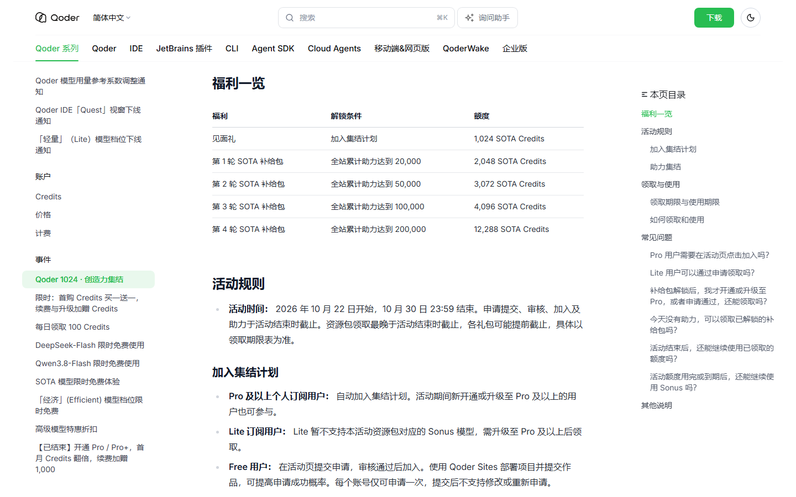
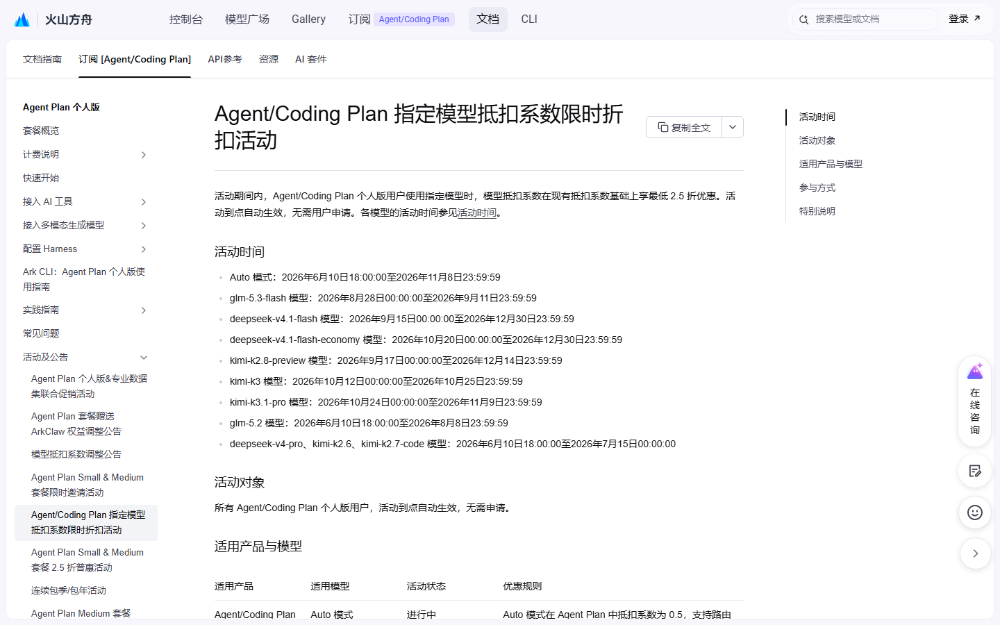
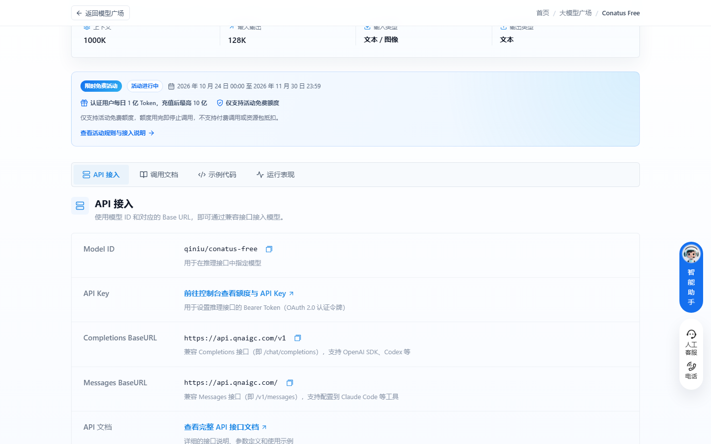
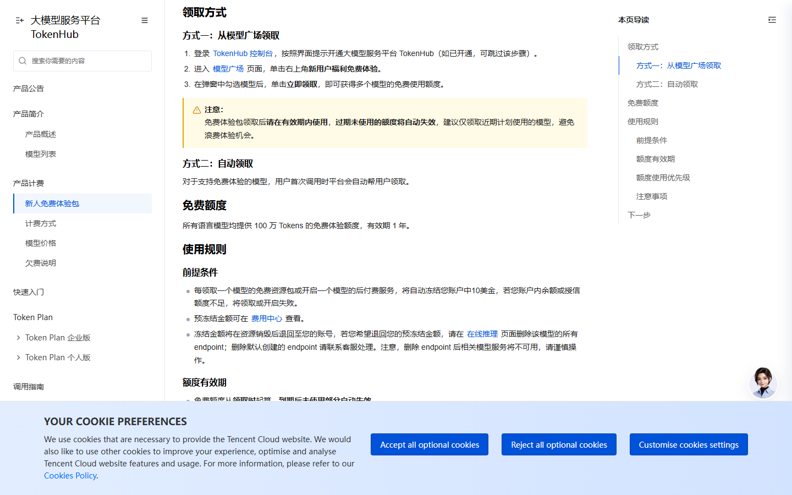
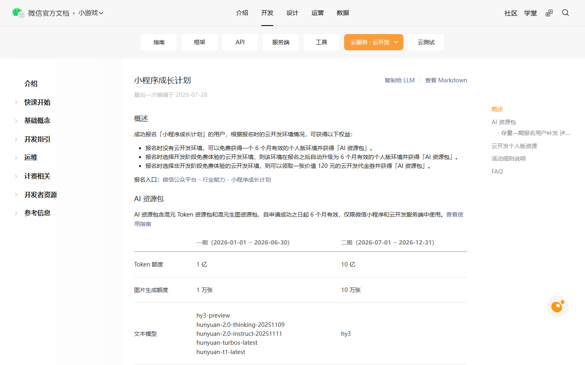

# Qoder 4096 今晚 23:59 作废，腾讯云明天中午恢复原价

今晚 23:59，Qoder 第 4 轮补给包里今天这份 4,096 Credits 到期，不用就归零。明天中午 12 点，腾讯云那档积分优惠价也涨回原价。

我数了一下，10 月 31 日之前还有四份要停，全挤在这三天。

## 今晚 23:59，今天这份不用就没了

**Qoder 第 4 轮 SOTA 补给包 · 4,096 Credits**

- 给什么：4,096 SOTA Credits，只能用在 Sonus 模型，换别的模型不抵扣。三天各放一份，合计 12,288。
- 怎么领：桌面端左下角头像 → 权益中心 → 领取；旧版是左下角用量面板点礼物图标；CLI 敲 `/claim`。每天限一份。
- 截止：2026 年 10 月 29 日 23:59 停止领取，同一时刻额度失效，不结转。
- 坑在哪：昨天漏领的补不回来。今天这份和明天那份是两笔账，明天零点还会再开一份。

## 明天中午 12 点，腾讯云涨回原价

**腾讯云 Token Plan · 个人版积分价优惠**

- 给什么：套餐内调 GLM-5.3-Flash，每百万输入 17 积分、输出 55 积分；GLM-5.2 是 99 和 310；Kimi K3 是 352 和 1,758。
- 怎么领：订了 Token Plan 个人版就自动生效，不用报名也不用申请。
- 截止：2026 年 10 月 30 日 12:00。之后按刊例价走，GLM-5.3-Flash 回到 23.438 和 78.125。
- 坑在哪：我核过一遍，这是套餐内积分折扣，不是白送额度。没订套餐的人沾不到，看到「折扣」容易误会。

## 明天 23:59，见面礼停止领取

**Qoder 1024 集结 · 见面礼 1,024 Credits**

- 给什么：1,024 SOTA Credits，同样只给 Sonus。全站助力到 2 万、5 万、10 万，再各解锁 2,048 / 3,072 / 4,096。
- 怎么领：Pro 及以上自动入集结，资源包仍要手动领；Free 用户先在活动页提交申请，审核过了才有资格。
- 截止：领取到 2026 年 10 月 30 日 23:59，能用 10 月 31 日 23:59。
- 坑在哪：申请要审核，今天不交材料，明天就来不及。Lite 档用不了 Sonus，得先升 Pro。

## 10 月 31 日 08:00，极致档 2 折收口

**Qoder · 「极致」档位错峰折扣**

- 给什么：夜里 22:00 到次日 08:00 选极致档，倍率从 2× 降到 0.4×，等于打两折。
- 怎么领：更新到最新版，模型选择器里选「极致」，不用领。
- 截止：2026 年 10 月 31 日 08:00，新加坡时间与北京时间一致。最后一个折扣时段是 10 月 30 日 22:00 到 31 日 08:00。
- 坑在哪：Lite 套餐没有这个档位，升到 Pro 才有。折扣只改 Credits 计价，不额外送额度。

## 10 月 31 日 24:00，DeepSeek-Flash 免费结束

**Qoder 国际版 · DeepSeek-Flash 每日免费额度**

- 给什么：每天一定次数的免费调用，额度内系数 0.0×，思考强度开到最大也不扣。
- 怎么领：模型选择器选 DeepSeek-Flash，自动生效，余额为 0 也能用。
- 截止：2026 年 10 月 31 日 24:00，即 11 月 1 日 00:00。原定 10 月 24 日结束，延过一次。
- 坑在哪：只给国际版个人用户，团队版、企业版不参加。额度按天算，用不完不留给明天。

## 11 月 1 日零点，DeepSeek 开始按次收费

**DeepSeek · Search 和 Fetch 免调用费**

- 给什么：自研的网页搜索与抓取接口，在 Harness、Claude Code、Codex 里走服务端调用不计费。标准价每千次成功请求 5 元。
- 怎么领：不用领，这几个工具调 DeepSeek API 时自动走免单。
- 截止：2026 年 11 月 1 日 00:00，北京时间。
- 坑在哪：只免这两个接口，模型 token 照常算钱。搜索无结果、超时不计费，但照样占 QPS，Search 每秒 100 次、Fetch 每秒 25 次。

## 11 月 8 日和 9 日，火山两条先后停

**火山方舟 · Auto 模式 0.5 系数**

- 给什么：Agent Plan 里调 Auto，抵扣系数 0.5，同样的套餐额度能用出两倍量。
- 怎么领：订 Agent 或 Coding Plan 个人版，到点自动生效。
- 截止：2026 年 11 月 8 日 23:59:59。
- 坑在哪：Auto 是路由，落到哪个模型我控制不了。

**火山方舟 · kimi-k3.1-pro 五折**

- 给什么：系数打五折，配额能用出原来的 200%。
- 怎么领：同上，不用申请。
- 截止：2026 年 11 月 9 日 23:59:59。
- 坑在哪：只在个人版套餐里算数，按量付费不享受。

## 11 月 30 日，七牛云每天重开

**七牛云 · Conatus Free**

- 给什么：实名认证后每天 1 亿 Token，充值超过 100 元升到 10 亿。1M 上下文，能吃图片。
- 怎么领：控制台拿 API Key，模型 ID 填 `qiniu/conatus-free`，Base URL 用 `https://api.qnaigc.com/v1`。
- 截止：2026 年 11 月 30 日 23:59。
- 坑在哪：每天零点重置，不结转。额度用完请求直接被拒，不扣余额，也不帮你切模型。

## 12 月 31 日，两条大的

**腾讯云 TokenHub · 新人免费体验包**

- 给什么：每个语言模型 100 万 Tokens，有效期 1 年，视觉生成类也算在内。
- 怎么领：控制台开通 TokenHub → 模型广场 → 右上角「新用户福利免费体验」→ 勾模型 → 领取。
- 截止：本期到 2026 年 12 月 31 日。
- 坑在哪：每领一个模型冻结账户 10 美金，余额不够直接领不了。

**微信 · 小程序成长计划二期 AI 资源包**

- 给什么：10 亿混元 Token 加 10 万张生图额度，自申请成功起 6 个月有效。
- 怎么领：微信公众平台 → 行业能力 → 小程序成长计划，报名后额度自动到账。
- 截止：二期报名到 2026 年 12 月 31 日。
- 坑在哪：只能在小程序和云开发服务端里用，拿去跑自己的 API 项目会触发治理。

## 长期可领，不用赶

**智谱 · GLM-4.7-Flash 和 GLM-4.6V-Flash**：输入、输出、缓存全免费，文本款 200K 上下文。bigmodel.cn 拿 Key 直接调，价格页问答里写的就是「免费」，没写截止日。同系列的 FlashX 是要钱的。

**Qoder · 经济档、每日 100 Credits、Qwen3.8-Flash**：经济档系数从 0.3× 降到 0.0×，付费用户自动生效，结束时间写「待定」。每天 10:00 还能领 100 通用 Credits，桌面端手动点，30 天有效。Qwen3.8-Flash 也是 0.0×，官方只写「结束时间提前公告」。三条都没有硬截止，别慌。

## 这些已经没了，别白跑

- 国家超算 Auto 夜间免费：官方公众号写 10 月 21 日到 28 日，媒体稿统一写 30 日。我按早的算，昨晚就结束了。
- 火山方舟 kimi-k3 五折：文档里状态还写着「进行中」，活动时间却到 10 月 25 日 23:59。页面没改，别照着状态试。
- 智谱 ZCode 5 亿 Tokens：10 月 26 日 09:00 归零。
- AutoClaw 每日 500 万 Tokens：10 月 25 日关窗。
- 阶跃 Step 5 Preview：WorkBuddy 里的零积分限免 10 月 25 日结束。

---

额度都是有时效的，看到就先去点一下。
发现哪条已经结束了，欢迎在评论区指正。
