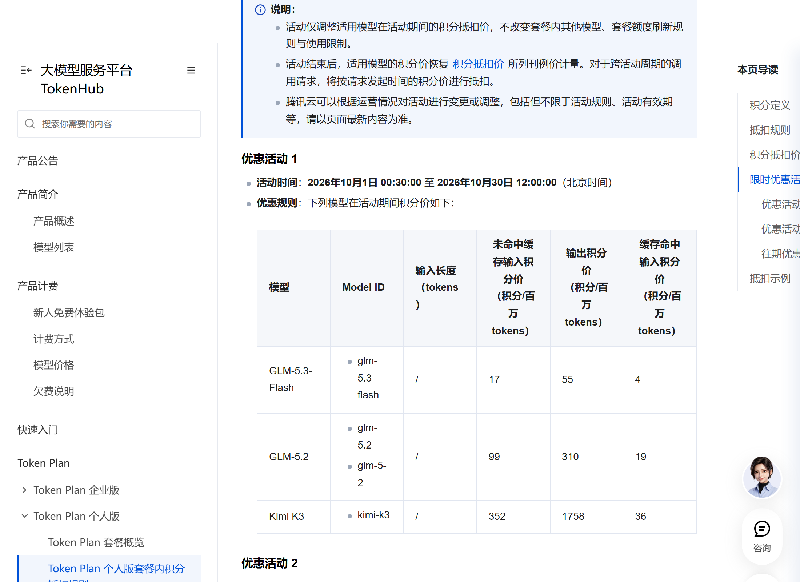
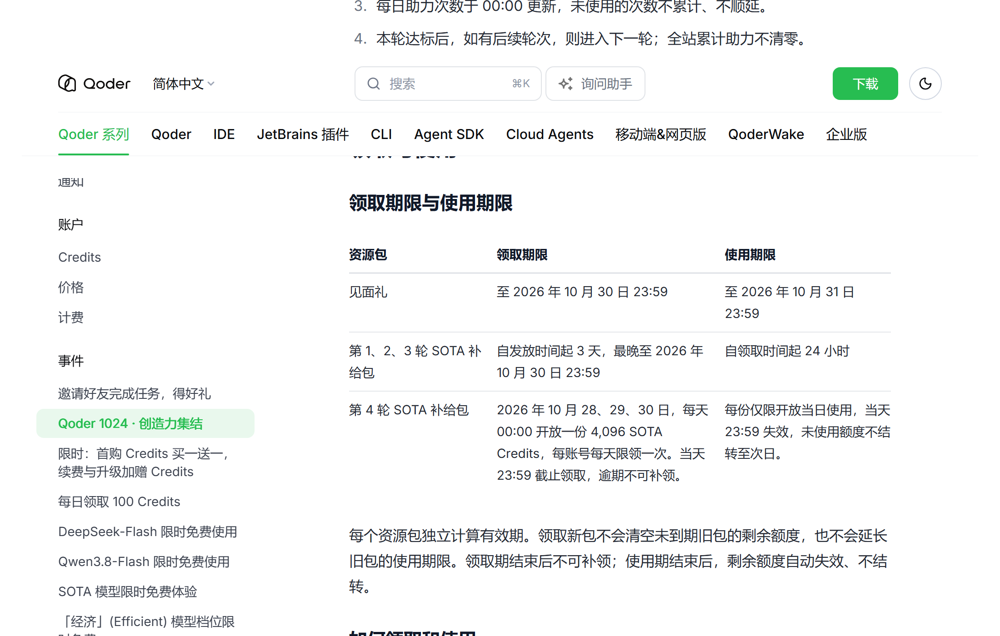
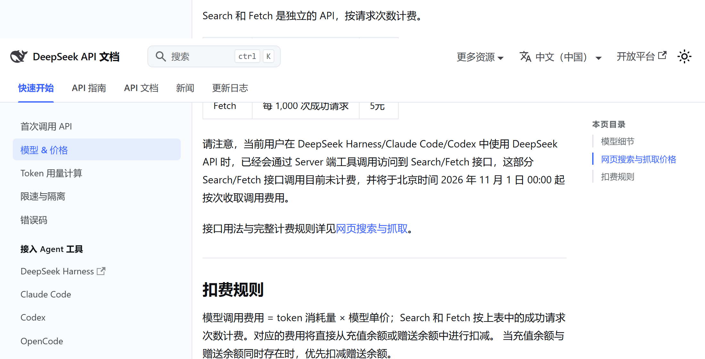
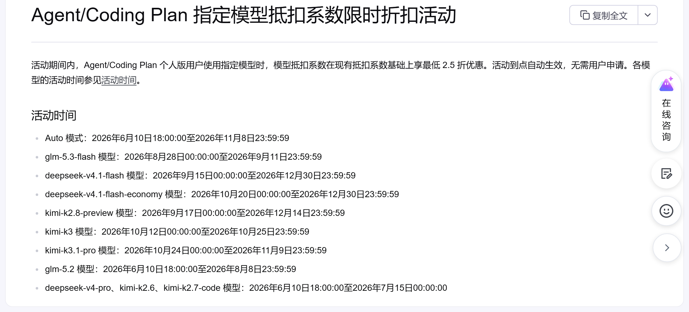
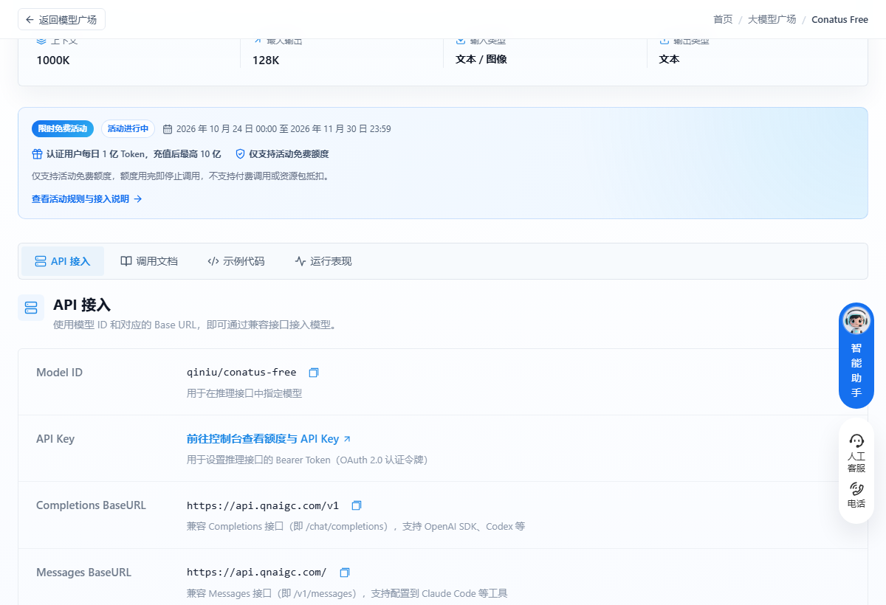
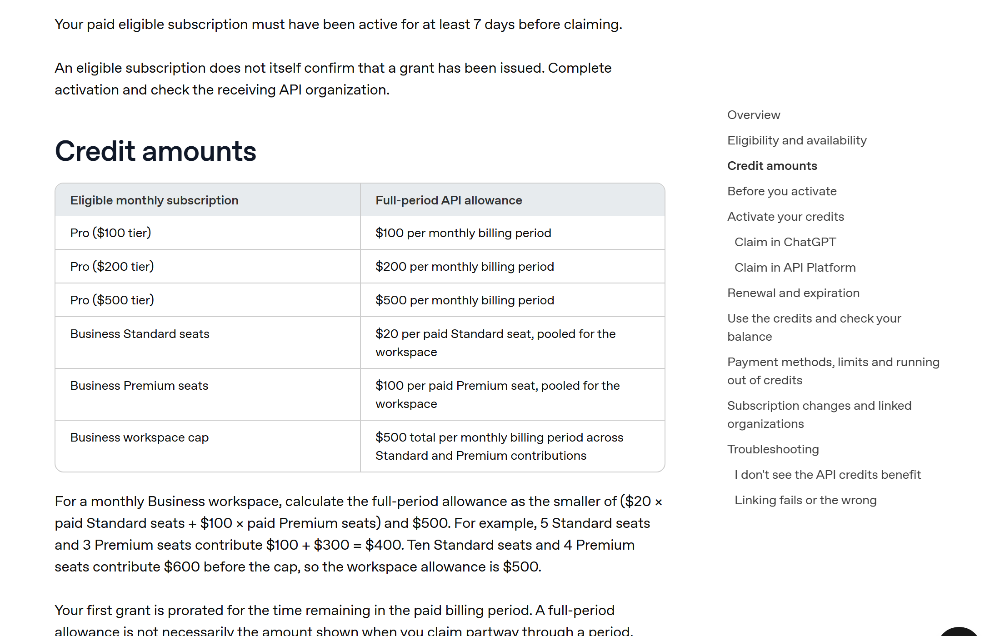

# Qoder 1024 集结今晚 23:59 关窗，最后一份 4096 别留过夜

今天有三件事按钟点排着队。腾讯云 Token Plan 的十月积分价中午 12:00 恢复刊例；国家超算的 Auto 夜间免费只剩今晚这一轮；Qoder 1024 集结今晚 23:59 停止领取，第 4 轮那份 4,096 是日包，过夜就没了。

## 腾讯云

**Token Plan 十月积分价**

给什么：GLM-5.3-Flash 17 / 55 / 4，GLM-5.2 99 / 310 / 19，Kimi K3 352 / 1758 / 36，单位是积分每百万 tokens，依次为未命中缓存输入、输出、缓存命中。

怎么领：已订阅的直接用，按请求发起那一刻的积分价结算。

截止：10 月 30 日 12:00 恢复刊例价。

坑在哪：12:00 之后发起的请求就按新价算，跨点的批量任务最好拆开跑。新的五折档外面在传，文档里活动 2 还停在 10 月 15 日那一版，没挂出来。

## 国家超算互联网

**Auto 模型夜间免费**

给什么：订阅 Token Plan 的用户，每晚 21:00 到次日 09:00 调 Auto 不计量。

怎么领：在平台上订阅 Token Plan，选 Auto 发起请求，不用申请。

截止：活动写的是 10 月 21 日到 10 月 30 日，今晚是最后一个窗口，一直到 10 月 31 日 09:00。

坑在哪：白天照样计费。另外口径有出入，官方公众号早前写 10 月 28 日收，10 月 23 日之后几篇媒体稿统一写 30 日，我按 30 日写，也没实测过 28 日之后还能不能用。

## Qoder

**第 4 轮 4,096 SOTA Credits**

给什么：4,096 SOTA Credits，只能用在 Sonus 模型上，等于把这一档的推理额度全免。

怎么领：Qoder 0.4.8 及以后版本，左下角头像 → 权益中心 → 领取；旧版走左下角用量面板的礼物图标；CLI 输 `/claim`；JetBrains 插件在右上角用量面板领。

截止：10 月 30 日 23:59 停止领取，同一时刻失效，不结转。

坑在哪：这是日包，不是活动总额。10 月 28、29、30 每天零点各放一份，前两天没领的今天补不了。领取资格限 Pro 及以上个人订阅，或已在活动页申请通过。

**见面礼 1,024 Credits**

给什么：1,024 SOTA Credits，同样只给 Sonus。

怎么领：跟上面同一入口，手动点，不会自动到账。

截止：今晚 23:59 前领到手，可以用到 10 月 31 日 23:59。

坑在哪：Free 账号要先在活动页提交申请，审核过了才有资格；Lite 订阅不支持 Sonus，得先升到 Pro。

**极致档错峰 2 折**

给什么：Ultimate 档在错峰时段按 2 折扣 Credits。

怎么领：更新到最新版，模型选择器切「极致」，在 22:00 到次日 08:00 之间发起请求。

截止：10 月 31 日 08:00。

坑在哪：减的是扣费，不是送额度；Lite 方案没有极致档，切不过去。

**DeepSeek-Flash 不扣 Credits**

给什么：DeepSeek-V4.1-Flash-1017 计费系数从 0.1× 降到 0.0×，每天有免费次数，付费用户比免费用户多。

怎么领：模型选择器切到 DeepSeek-Flash，不用领。

截止：10 月 31 日 24:00，也就是 11 月 1 日零点。

坑在哪：只限国际版个人账号，Teams 和企业版不参加；免费次数用完后接着用会按原系数扣 Credits。

## WorkBuddy

**混元 Hy3 全天、Hy4-preview 夜间限免**

给什么：Hy3 限免期内不计积分，Hy4-preview 每晚 23:00 到次日 08:00 不计积分。

怎么领：客户端模型选择器切过去，不需要领。

截止：10 月 31 日。

坑在哪：前提是账号里还有可用额度；Hy3 是纯文字模型，让它生图照样扣积分。

## DeepSeek

**Search / Fetch 工具链免调用费**

给什么：Harness、Claude Code、Codex 里通过服务端工具调用走的搜索与抓取，现在不收钱。

怎么领：不用领，正常用这几个客户端就会走。

截止：11 月 1 日 00:00 起按次收费，Search 与 Fetch 各 5 元每千次成功请求。

坑在哪：只算成功请求，失败的不要钱；跑批的脚本今晚跑完最省。

## 火山方舟

**Auto 模式抵扣系数 0.5**

给什么：Agent/Coding Plan 个人版用 Auto，抵扣系数 0.5，可用配额翻倍。

怎么领：订阅后在客户端选 Auto，自动生效。

截止：11 月 8 日 23:59:59。

坑在哪：夜间 00:00 到 08:00 路由到 kimi-k3.1-pro 的比例会大幅提升，输出长度和消耗都会变。

**kimi-k3.1-pro 五折**

给什么：抵扣系数 7 打五折到 3.5，可用配额约为原来的两倍。

怎么领：同上，手动选 kimi-k3.1-pro。

截止：11 月 9 日 23:59:59。

坑在哪：同一张表里 kimi-k3 的时间写到 10 月 25 日，状态列却还标「进行中」，别拿状态列当依据。

## 七牛云

**Conatus Free**

给什么：实名后每天 1 亿 Token，1M 上下文；充值满 100 元升到 10 亿。

怎么领：qiniu.com 注册并实名，进 Conatus 模型页领，每天零点重置。

截止：11 月 30 日 23:59。

坑在哪：当天额度不结转，零点清零；只抵扣免费额度，用完即停止调用，不自动转付费。我一般早上就把活排进去，拖到晚上容易来不及。

## 领了才开始计时

**讯飞 Spark-X2.6 十亿 Token**

给什么：10 亿 Token，只绑 Spark-X2.6 一个模型，按现价六折折算大约 900 到 3600 元。

怎么领：maas.xfyun.cn 注册并实名，首页「零门槛领取 10 亿 tokens」→ 建 API Key → 确认领取。

截止：官方没写活动结束日，从点下领取那一刻起 31 天，到期清零。

坑在哪：领取弹窗最底下有一行「额度用尽自动切换按量计费」，默认勾着，不取消就会在烧完之后真扣钱。

**OpenAI 订阅送 API 额度**

给什么：ChatGPT Pro 每月返 100、200 或 500 美元 API 额度，按你订的档位；Business 每个 Standard 席位 20 美元、Premium 席位 100 美元，工作区每月封顶 500。

怎么领：ChatGPT 设置 → 账单 → API credits，选定接收额度的 API 组织并确认；ChatGPT 和 API 账号要用同一个邮箱。

截止：官方没给统一截止日，额度到当期账单周期结束就作废。

坑在哪：订阅要满 7 天，Plus、Go、免费版和试用订阅都不在名单里；首笔按剩余周期折算，可能比表里少一截。

## 长期可领，不用赶

智谱的 GLM-4.7-Flash 和 GLM-4.6V-Flash，输入、输出、缓存全免费，价格页的问答里就写着，没有截止日。

Qoder 的 Qwen3.8-Flash 系数 0.0×，「经济」档从 0.3× 降到 0.0×，都不扣 Credits；另外每天 10:00 在桌面端手动领 100 通用 Credits，30 天有效。这两项的结束时间，官方都写「待定」。

## 这些已经没了，别白跑

- 火山 kimi-k3 五折：时间表写到 10 月 25 日 23:59，状态列还挂着「进行中」。
- 智谱 ZCode 5 亿 Token：10 月 26 日 09:00 已归零。
- 智谱 AutoClaw 每日 500 credits：10 月 25 日结束。
- 阶跃 Step 5 Preview 零积分：10 月 25 日在 WorkBuddy 内结束。
- 腾讯云 Token Plan 的 Hy4-preview 优惠：10 月 15 日 12:00 已结束。

---

额度都是有时效的，看到就先去点一下。
发现哪条已经结束了，欢迎在评论区指正。
