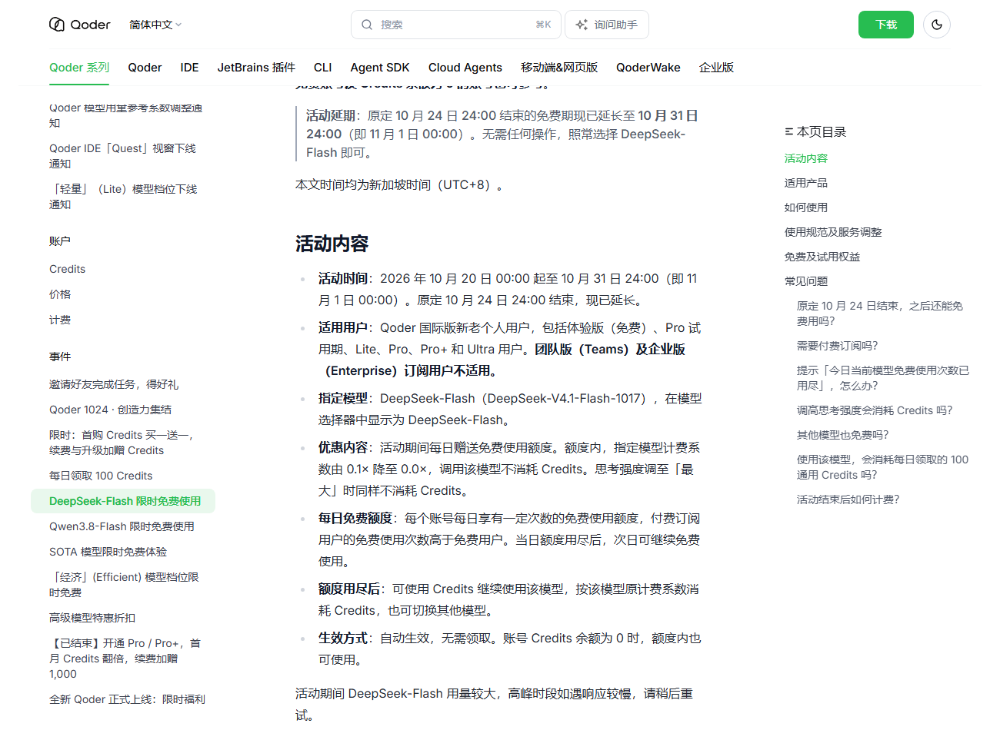
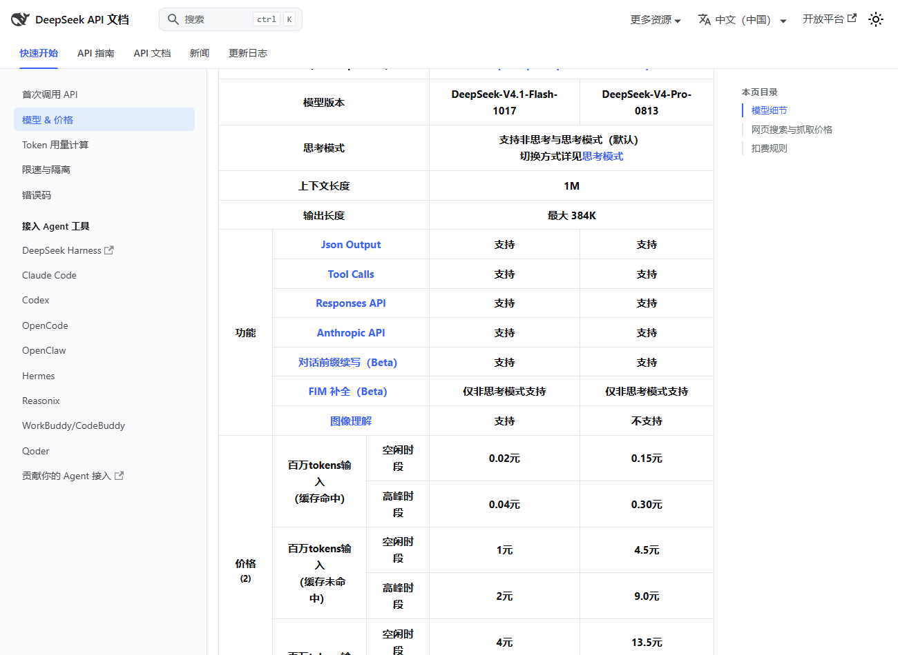
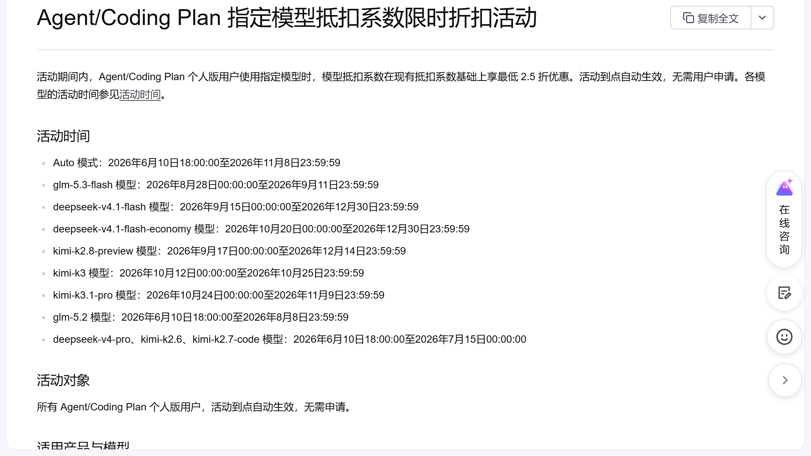
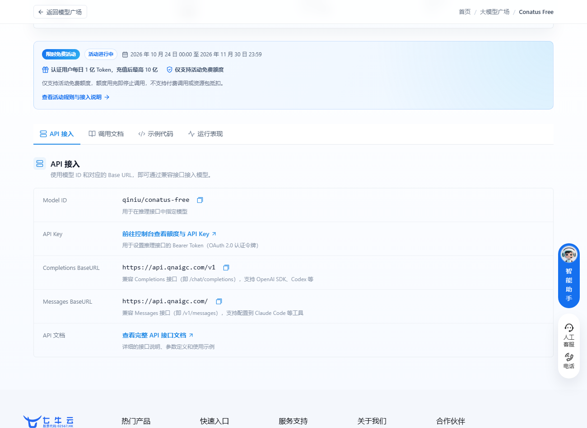
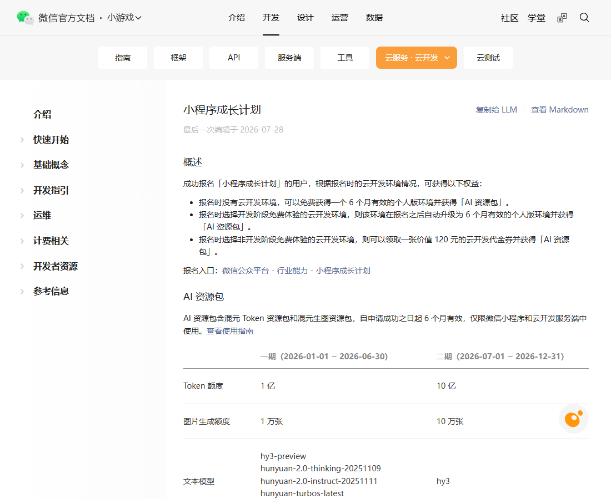
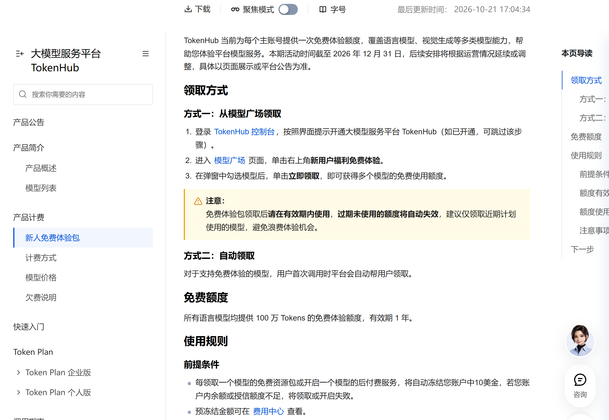

# Qoder DeepSeek 今晚停免，11 项福利最早今天到期

今天有两处免费按钟点关：Qoder 国际版的 DeepSeek-Flash 免费到今晚 24:00，WorkBuddy 的混元限免也写在 10 月 31 日。明天零点起，DeepSeek 的 Search 和 Fetch 开始按次收费。下面 11 项有固定截止日的福利，按到期时间排好了。

## Qoder

**DeepSeek-Flash 每日免费额度**

给什么：DeepSeek-V4.1-Flash-1017 系数从 0.1× 降到 0.0×，每天送一档免费次数，额度内不扣 Credits，免费账号和余额为 0 都能用。

怎么领：不用领，模型选择器切到 DeepSeek-Flash 就行。

截止：10 月 31 日 24:00，也就是 11 月 1 日 00:00。原定 24 日结束，已延期一次。

坑在哪：只限国际版个人账号，Teams 和企业版不参加；当日次数用完继续用，按原系数扣 Credits。

## WorkBuddy

**混元 Hy3 全天、Hy4-preview 夜间限免**

给什么：Hy3 限免期内不计积分，Hy4-preview 每晚 23:00 到次日 08:00 不计积分。

怎么领：客户端模型选择器切过去。

截止：10 月 31 日，以客户端显示为准。

坑在哪：账号里得还有可用额度；Hy3 是纯文字模型，让它生图照样扣积分。我没查到延期公告，赶今天用最稳。

## DeepSeek

**Search / Fetch 工具链免调用费**

给什么：Harness、Claude Code、Codex 里走服务端工具调用的搜索与抓取，现在不收钱。

怎么领：不用领，正常用这几个客户端就会走到。

截止：11 月 1 日 00:00 起按次收费，Search 和 Fetch 各 5 元每千次成功请求。

坑在哪：只算成功请求，失败的不要钱，跑批脚本今晚跑完最省。

## 火山方舟

**Auto 模式抵扣系数 0.5**

给什么：Agent/Coding Plan 个人版用 Auto，系数 0.5，可用配额翻倍。

怎么领：订阅后客户端选 Auto，自动生效。

截止：11 月 8 日 23:59:59。

坑在哪：夜间 00:00 到 08:00 路由到 kimi-k3.1-pro 的比例大幅提升，输出和消耗都会变。

**kimi-k3.1-pro 五折**

给什么：系数打五折，可用配额约为原来的两倍。

怎么领：手动选 kimi-k3.1-pro，不用申请。

截止：11 月 9 日 23:59:59。

坑在哪：同一张表里 kimi-k3 写到 10 月 25 日，状态列还标「进行中」，别拿状态列当依据。

**kimi-k2.8-preview 六折、v4.1-flash 两款五折**

给什么：kimi-k2.8-preview 系数六折；deepseek-v4.1-flash 和 economy 版五折，配额都能翻倍。

怎么领：手动选对应模型，自动生效。

截止：kimi-k2.8-preview 到 12 月 14 日，两款 v4.1-flash 到 12 月 30 日，都是 23:59:59。

坑在哪：官方写明保留调整活动的权利，别把年底的折扣当成永久价。

## 七牛云

**Conatus Free**

给什么：实名后每天 1 亿 Token，充值满 100 元升到 10 亿；1M 上下文。

怎么领：qiniu.com 注册并实名，进 Conatus 模型页领，每天零点重置。

截止：11 月 30 日 23:59。

坑在哪：当天额度不结转；只抵扣免费额度，用完即停止调用，不自动转付费。我一般早上就把活排进去，拖到晚上容易来不及。

## 微信小程序

**小程序成长计划二期**

给什么：10 亿混元 Token 加 10 万张生图额度，自申请成功起 6 个月有效。

怎么领：微信公众平台 → 行业能力 → 小程序成长计划，报名时选自己的云开发环境。

截止：二期报名到 12 月 31 日。

坑在哪：一个小程序账号只能参与一次；资源包仅限小程序和云函数里用，别处调不了。

## 腾讯云

**TokenHub 新人免费体验包**

给什么：语言模型每款 100 万 Tokens，有效期 1 年。

怎么领：TokenHub 控制台 → 模型广场 → 右上角「新用户福利免费体验」，勾选模型领取。

截止：本期活动到 12 月 31 日。

坑在哪：每领一个模型自动冻结 10 美金，余额不足直接领不了；额度过期作废，只领近期要用的。

## 领了才开始计时

**讯飞 Spark-X2.6 十亿 Token**：maas.xfyun.cn 注册实名后领，从领取日起 31 天。坑在弹窗最底下「额度用尽自动切换按量计费」默认勾着，不取消会真扣钱。

**OpenAI 订阅送 API 额度**：ChatGPT Pro 每月返 100、200 或 500 美元，设置 → 账单 → API credits 领，到当期账单周期作废。订阅满 7 天才有，Plus 和免费版不在名单。

**Qoder 每日 100 通用 Credits**：桌面端每天 10:00 后手动领，30 天有效，不领不补。

## 长期可领，不用赶

智谱的 GLM-4.7-Flash 和 GLM-4.6V-Flash，输入、输出、缓存全免费，价格页问答里写着，没写截止。Qoder 的 Qwen3.8-Flash 系数 0.0×，「经济」档也从 0.3× 降到 0.0×，结束时间待定。邀请好友活动 10 月 29 日开始，走完注册、活跃、首购三步最高得 1150 Credits，结束时间待定。

## 这些已经没了，别白跑

- Qoder 1024 集结整场：10 月 30 日 23:59 全部停领，见面礼 1,024 和第 4 轮 4,096 没有新份额，已领的见面礼用到今晚 23:59。
- Qoder 极致档错峰 2 折：今早 08:00 结束。
- 国家超算 Auto 夜间免费：最后一轮到今早 09:00。
- 腾讯云 Token Plan 十月积分价：10 月 30 日 12:00 恢复刊例。
- 火山 kimi-k3 五折：时间表写到 10 月 25 日，状态列还挂着「进行中」。
- 智谱 ZCode 5 亿 Token、AutoClaw 每日 500 credits：分别于 10 月 26 日、25 日结束。

---

额度都是有时效的，看到就先去点一下。
发现哪条已经结束了，欢迎在评论区指正。
