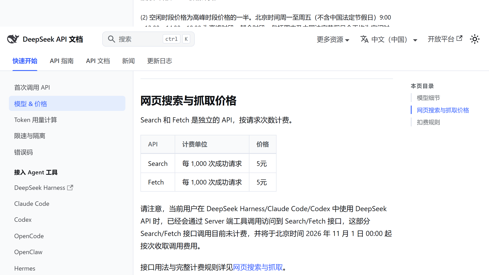
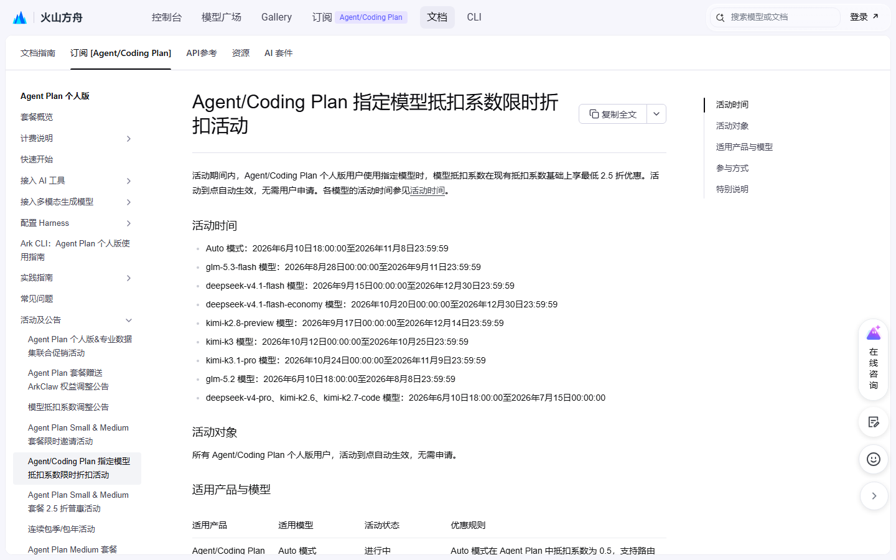
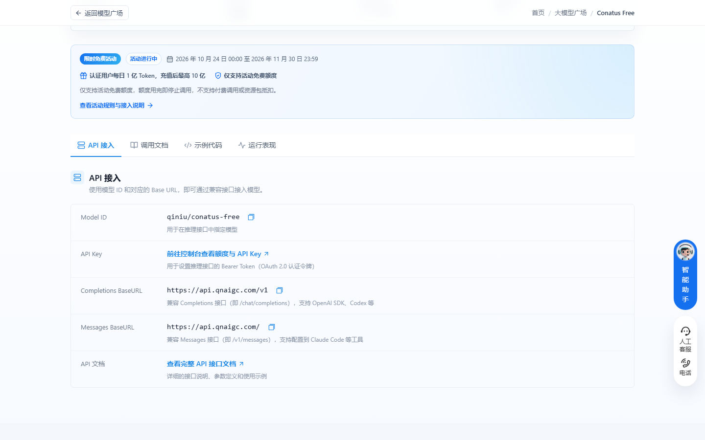
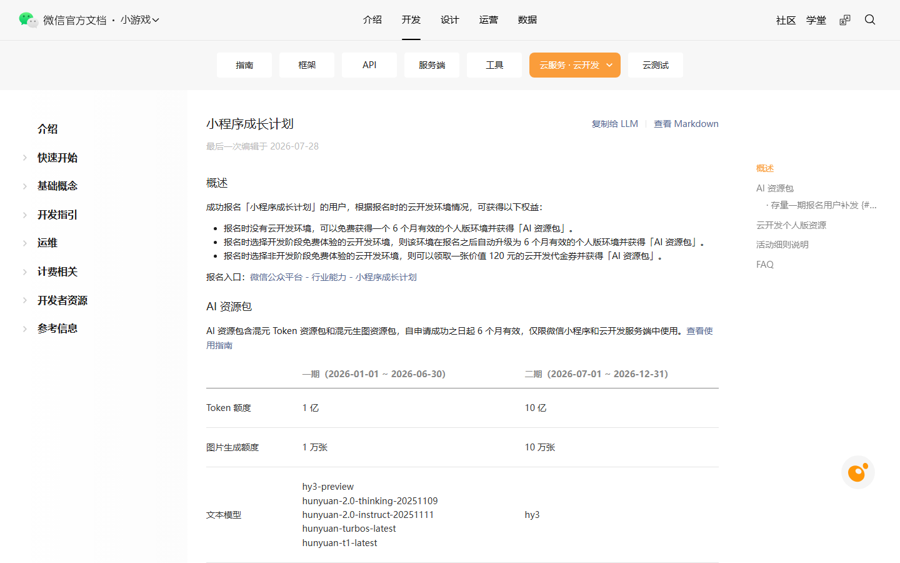
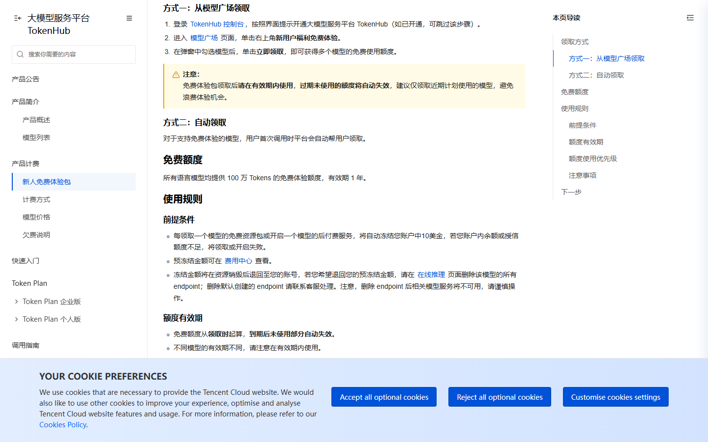
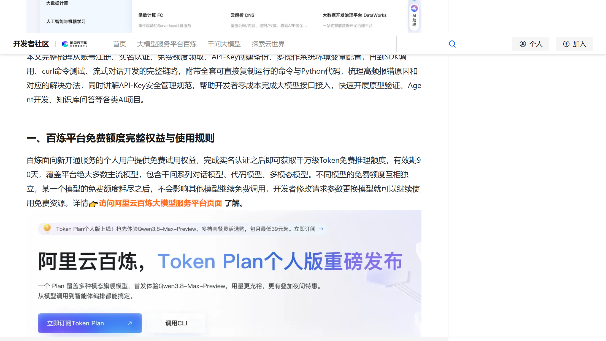
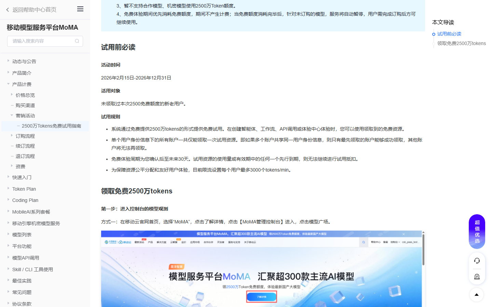

# DeepSeek 今起收费，10 项福利最晚用到 12 月底

DeepSeek 的网页搜索和抓取从今天零点起按次收费，每千次成功请求 5 元，10 月里白用的这段到此为止。还开着的福利里，最急的是火山方舟 Auto 0.5 系数，11 月 8 日到期。下面 10 项按截止日排好，最早的一周后关窗。

## 火山方舟

**Auto 模式抵扣系数 0.5**

给什么：Agent/Coding Plan 个人版用 Auto，系数 0.5，可用配额翻倍。

怎么领：订阅后客户端选 Auto，自动生效。

截止：11 月 8 日 23:59:59。

坑在哪：夜间 00:00 到 08:00 路由到 kimi-k3.1-pro 的比例大幅提升，输出和消耗都会变。

**kimi-k3.1-pro 五折**

给什么：系数打五折，可用配额约为原来的两倍。

怎么领：手动选 kimi-k3.1-pro，不用申请。

截止：11 月 9 日 23:59:59。

坑在哪：同一张表里 kimi-k3 写到 10 月 25 日，状态列还挂着「进行中」，别拿状态列当依据。

**kimi-k2.8-preview 六折、v4.1-flash 两款五折**

给什么：kimi-k2.8-preview 系数六折；deepseek-v4.1-flash 和 economy 版五折，配额都能翻倍。

怎么领：手动选对应模型，自动生效。

截止：k2.8 到 12 月 14 日，两款 v4.1-flash 到 12 月 30 日，都是 23:59:59。

坑在哪：官方写明保留调整活动的权利，别把年底的折扣当成永久价。

## 七牛云

**Conatus Free**

给什么：实名后每天 1 亿 Token，充值满 100 元升到 10 亿；1M 上下文。

怎么领：qiniu.com 注册并实名，进 Conatus 模型页领，每天零点重置。

截止：11 月 30 日 23:59。

坑在哪：当天额度不结转；只抵扣免费额度，用完即停止调用，不自动转付费。我一般早上就把跑量的活排进去，拖到晚上容易来不及。

## 微信小程序

**小程序成长计划二期**

给什么：10 亿混元 Token 加 10 万张生图额度，自申请成功起 6 个月有效。

怎么领：微信公众平台 → 行业能力 → 小程序成长计划，报名时选自己的云开发环境。

截止：二期报名到 12 月 31 日。

坑在哪：一个小程序账号只能参与一次；资源包仅限小程序和云函数里用，别处调不了。

## 腾讯云

**TokenHub 新人免费体验包**

给什么：语言模型每款 100 万 Tokens，有效期 1 年。

怎么领：TokenHub 控制台 → 模型广场 → 右上角「新用户福利免费体验」，勾选模型领取。

截止：本期活动到 12 月 31 日。

坑在哪：每领一个模型自动冻结 10 美金，余额不足直接领不了；额度过期作废，只领近期要用的。

## 领了才开始计时

**阿里云百炼新人额度**：实名后在百炼控制台首页领，超 7000 万 Token，每款主流模型约 100 万，90 天有效。坑在实名账号额度耗尽会自动转按量付费，记得开「额度用尽即停止调用」。

**移动云 MoMA 2500 万 Token**：MoMA 控制台模型广场点「新用户2500wTokens免费体验」领。体验期从确认起 30 天，活动窗口到 12 月 31 日。限流 3000 tokens 每分钟，跑批会慢。

**讯飞 Spark-X2.6 十亿 Token**：maas.xfyun.cn 注册实名后领，从领取日起 31 天。坑在弹窗最底下「额度用尽自动切换按量计费」默认勾着，不取消会真扣钱。

**Qoder 每日 100 通用 Credits**：桌面端每天 10:00 后手动领，30 天有效，不领不补。

## 长期可领，不用赶

智谱的 GLM-4.7-Flash 和 GLM-4.6V-Flash，输入、输出、缓存全免费，价格页问答里写着，没写截止。Qoder 的 Qwen3.8-Flash 系数 0.0×，「经济」档也从 0.3× 降到 0.0×，结束时间待定；邀请好友走完注册、活跃、首购三步最高得 1150 Credits。OpenAI 订阅用户每月最高返 500 美元 API 额度，设置 → 账单 → API credits 领，到当期账单周期作废。这一组我留着当兜底，不赶时间。

## 这些已经没了，别白跑

- DeepSeek Search / Fetch 免费调用：今晨零点起按次收费，两项各 5 元每千次成功请求，跑批脚本别再挂默认配置。
- Qoder DeepSeek-Flash 限免：10 月 31 日 24:00 结束，没等到第二次延期。
- WorkBuddy 混元 Hy3 全天、Hy4-preview 夜间限免：上一期写在 10 月 31 日。我看到有自媒体贴出客户端截图称 Hy3 延到 11 月 15 日，但没找到官方一手说明，按过期处理，以你客户端显示为准。
- Qoder 1024 集结、极致档错峰 2 折：分别于 10 月 30 日、31 日结束。
- 国家超算 Auto 夜间免费、腾讯云 Token Plan 十月积分价：最后窗口都已过。
- 火山 kimi-k3 五折、智谱 ZCode 5 亿、AutoClaw 每日 500 credits：10 月下旬陆续清零。

---

额度都是有时效的，看到就先去点一下。
发现哪条已经结束了，欢迎在评论区指正。
