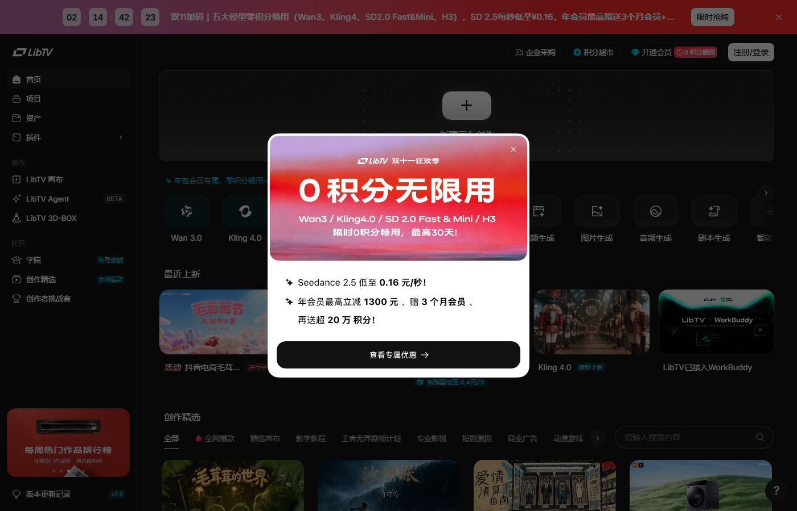
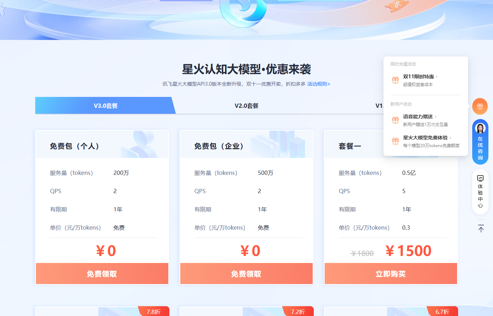
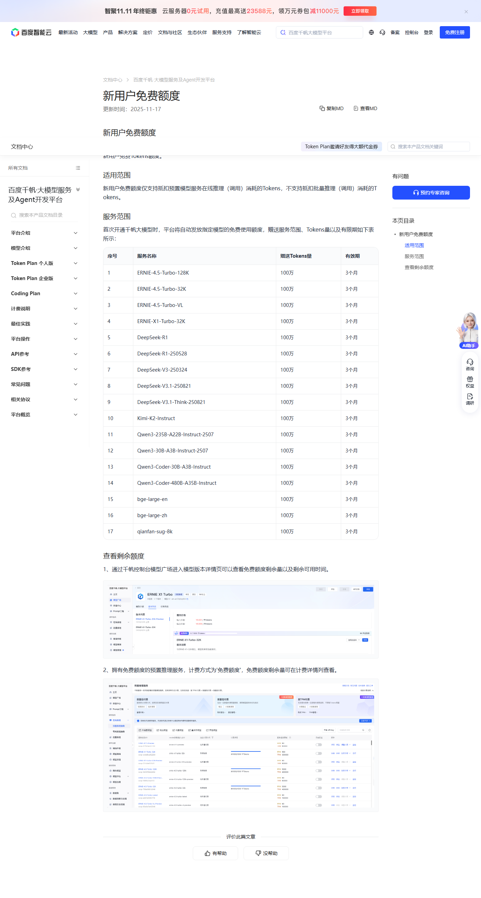

# 双11 五大视频模型 0 积分畅用，这 3 条新福利看清门槛

双 11 这波新福利里最值的是 LibTV：Wan3、Kling4.0、SD 2.0 Fast&Mini、H3 五个视频模型 0 积分随便生成，最长 30 天，当前领取档的倒计时只剩两天多。本期只收 3 条新上线的，方舟、七牛云、TokenHub 那些老面孔这期没变化，就不占篇幅了。

## 本期最大羊毛：LibTV 五大视频模型 0 积分

**它到底给什么。** 官网弹窗原文是「Wan3 / Kling4.0 / SD 2.0 Fast & Mini / H3，限时 0 积分畅用，最高 30 天」。注意官方口径是五大模型，Wan3 和 Kling4.0 各算一个，SD 2.0 拆成 Fast 和 Mini 两档，再加 MiniMax H3。顶部活动横幅挂着倒计时，11 月 3 日上午截图时剩 2 天 14 小时，这一档加码到 11 月 5 日晚上截止。

**真实价值算一笔。** 我按站内另一款模型 Seedance 2.5 的活动价折算，0.16 元一秒，生成 30 秒就是 4.8 元。Kling 4.0 和 Wan 3.0 平时的积分消耗比它高，做短剧的人一天重拍二十条镜头是常态，照这个量级，30 天省下的生成费用在几百到上千元。对刚入门的人来说，这更像一张无限试错卡，镜头不满意随便重来。

**怎么领。** 打开 liblib.tv，首页直接弹双 11 活动窗，点「查看专属优惠」按引导领取 0 积分权益，领完在账户里能看到每个模型剩余的畅用天数。要注册账号，不用绑卡，权益本身不收费。

**坑在哪。** 一是「最高 30 天」不等于每款都给满，以站内显示为准；二是活动分阶段，这档倒计时清零前没领就得等下一档；三是 0 积分只在 LibTV 站内生效，导不出 API，接不进剪映这类外部工具；四是年会员立减 1300 元、加赠 20 万积分都是付费项，只想白嫖的别顺手下单。

**适合谁。** 做 AI 短剧、广告素材、账号日更的人最该领，平时每条生成都在心疼积分，这 30 天正好把舍不得试的高难度镜头全跑一遍。我自己的用法是先拿 0 积分的 Kling 4.0 反复试镜，定稿再用降价后的 Seedance 2.5 出成片。

## 讯飞星火

**双 11 免费包**

给什么：个人 200 万 Tokens、企业 500 万 Tokens，有效期 1 年，QPS 2，页面标价 0 元。

怎么领：xfyun.cn 的星火大模型活动页，登录后对着「免费包（个人）」点免费领取。

截止：活动页没写领取截止，额度本身 1 年有效，按双 11 档期估计，以页面显示为准。

坑在哪：和之前那个 10 亿 Token 的 Spark-X2.6 额度是两回事，别领混了；讯飞家「额度用尽自动切换按量计费」默认勾选的老坑还在，领完记得去控制台取消。

## 百度千帆

**新用户免费额度**

给什么：17 款模型每款 100 万 Tokens，ERNIE-4.5 系列、DeepSeek-R1、DeepSeek-V3.1、Kimi-K2、Qwen3 都在内，合计 1700 万。

怎么领：首次开通千帆大模型平台，同意用户协议后系统自动发放，控制台配额管理里看余额。

截止：政策长期在架，额度自发放起 3 个月有效。

坑在哪：只抵扣在线推理，不抵批量推理；不保障并发，跑生产要另买资源包。这条一直有，之前几期篇幅没排进来，这期补上。

## 这些已经没了，别白跑

- 智谱 ZCode 周末包 5 亿 GLM-5.3-Flash：11 月 2 日 09:00 清零，上周末追送的档。
- 腾讯云 Hy3 五折、Auto 统一积分、GLM-5.3-Flash 七折这批折扣档：官方延期到 11 月 2 日零点，已回收。
- Qoder DeepSeek-Flash 限免、WorkBuddy Hy3 全天 / Hy4-preview 夜间限免：10 月 31 日 24:00 结束。
- DeepSeek Search / Fetch 免费调用：11 月 1 日起按次收费，两项各 5 元每千次成功请求。

---

额度都是有时效的，看到就先去点一下。
发现哪条已经结束了，欢迎在评论区指正。
