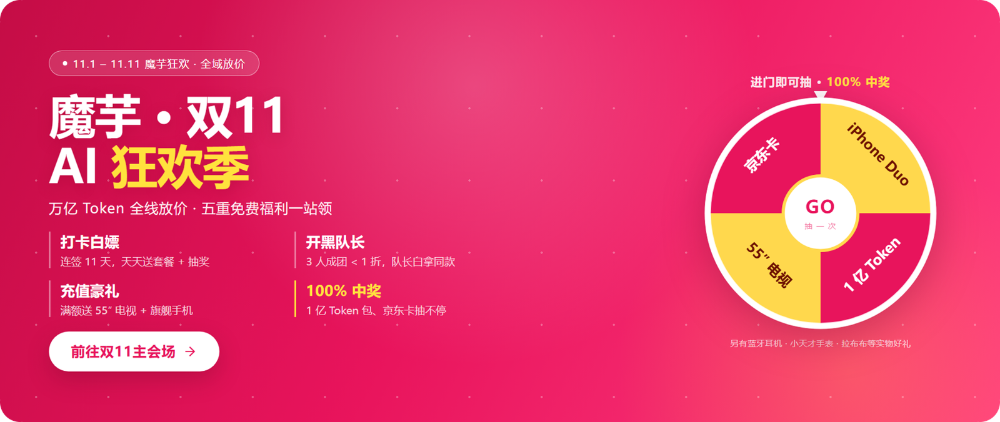
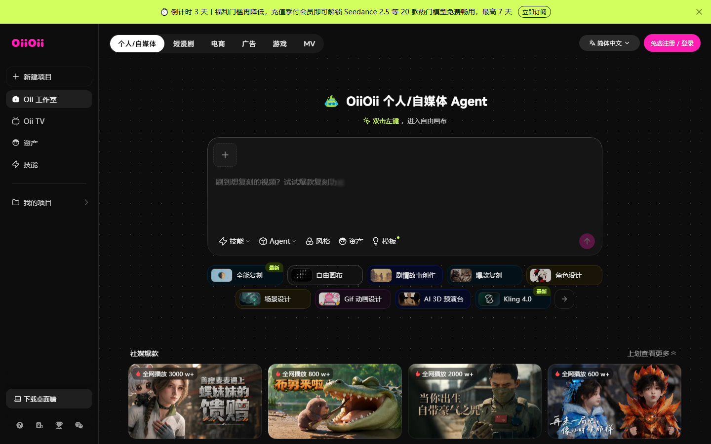
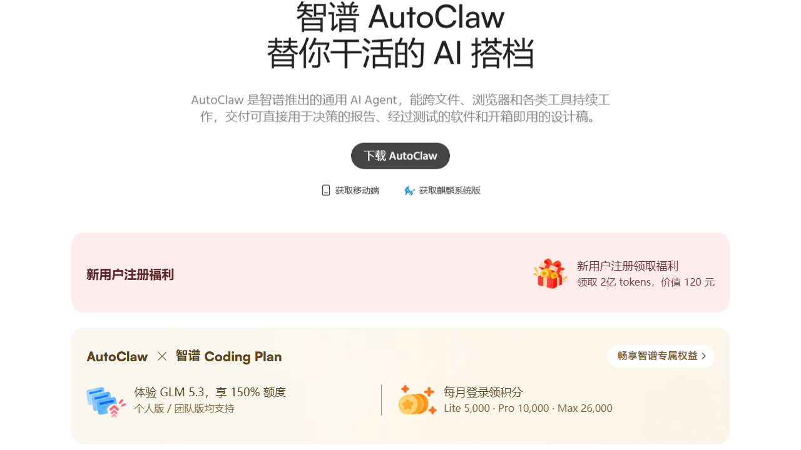
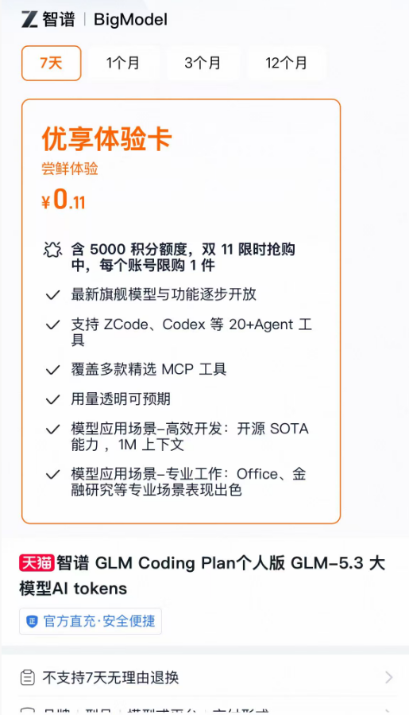
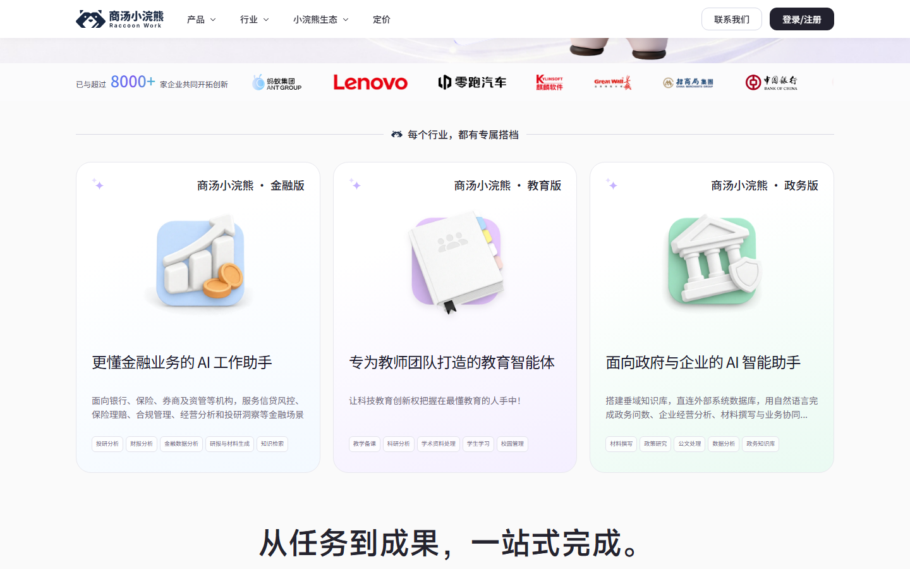
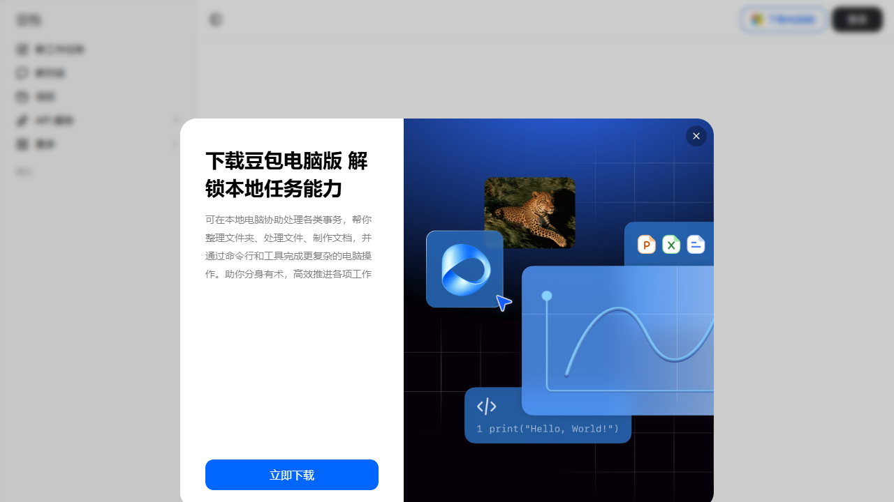

# 魔芋 2.7 亿双十一开领，OiiOii 剩 3 天

今天这期只收新发和有变的：上面六条，除了一条刚延期的，全是本周新冒出来或刚改规则、我重新核过一手源的。最大的那头在前面拆透，其余按截止日从近到远排。先说最急的——OiiOii 双十一官方横幅今天挂出「倒计时 3 天」，而多个渠道说 11 月 4 日截止，两说不一致就按保守口径办，新客首开会员白用 20 款模型 7 天，老用户没份；智谱 AutoClaw 的 5000 万则在 11 月 8 日清零。最肥的其实是魔芋 AI，双十一实名就送，全任务叠满最高 2.7 亿 Token，领到 11 月 11 日。

## 头条：魔芋 AI 双十一，实名就送、全任务最高 2.7 亿

① 它到底给什么（活动页原文怎么写）
魔芋 AI（moyu.cn）是聚合 500+ 模型的平台，双十一活动 11 月 1 日到 11 月 11 日。官方活动图文写得很直白：个人新客完成实名，直接领 1000 万 Token；30 天没消费的老用户回归，领 5000 万；企业认证送 1 亿；连续签到 11 天再领 1000 万；邀请好友最高 1.6 亿。官方口径的"全任务合计最高 2.7 亿"，是把上面几项加满后的上限。

② 真实价值测算
对个人来说，最实在的是实名那 1000 万，不用拉人、不用做任务。按大模型调用均价粗算，1000 万 Token 约等于写 200 篇 3000 字长文，或者日常问答几千次，够大多数轻度用户玩一两个月。企业认证那 1 亿，给小团队做内部工具或测试 Agent 很够用。至于邀请拉满的 1.6 亿，要真有人注册才到账，别为它纠结。

③ 领取全流程 step-by-step
去 moyu.cn 注册账号 → 完成实名认证 → 进双十一主会场，逐个任务点"领取"。签到那 1000 万要连着 11 天，今天才上车基本来不及，把实名 1000 万和老用户回归先领掉更划算。每天 10:00、14:00、20:00 三场秒杀，优惠包低到 0.1 折，顺手蹲就行。

④ 隐藏门槛
全部任务 11 月 11 日截止，过期作废，不结转。签到满 11 天对今天才注册的人基本赶不上。邀请类奖励要好友真注册，专门拉人头不划算。额度以你账号里实际显示为准，平台随时可能改规则。

⑤ 适用人群 + 怎么最大化
个人新客、想试多模型又不想每家都注册的人，实名 1000 万闭眼领；做 Agent、跑批量任务的小团队，企业认证 1 亿更值。我的判断是：先把实名档领了，别为了凑 2.7 亿去拉人。

⑥ 对比与风险
同档双十一里，魔芋的量级最大（2.7 亿上限），但它是聚合平台，模型体验和原生厂商有差距；重度推理还是留给付费旗舰。看到"内部渠道额度""通用兑换码"一律当骗子，这活动官方免费入口就在 moyu.cn 主会场。

## 其余新发 / 有变

### OiiOii 双十一（横幅倒计时 3 天，按 11 月 7 日前办完）

给什么：新客首次开通会员，Seedance 2.5 等 20 款热门模型免费畅用 7 天，生成这些模型本身是 0 盒饭。
怎么领：去 oiioii.tv 活动页，新客首次开通会员即可，老用户不参与。
截止到什么时候：官网横幅今天挂「倒计时 3 天」，多个渠道却称 11 月 4 日截止，两说不一致，以页面实际倒计时为准，按保守口径 11 月 7 日前办完。
坑在哪：门槛是"新客 + 首开会员"，会员本身收不收费活动页没写清，开之前点开价格页看一眼；"免费畅用"指的是模型调用权，生成的视频仍按条消耗盒饭（实测一条 100–280 盒饭）。

### 智谱 AutoClaw 5000 万（11 月 8 日 23:59 清零）

给什么：登录客户端领 50M Tokens（折合 5000 积分），每账号一次。
怎么领：去 autoclaw.zhipuai.cn 下客户端，用智谱账号登录，活动提示里点领取——官网首页没有入口，公告在官方博客，领取动作只能发生在客户端里。
截止到什么时候：11 月 8 日 23:59，领了不给你"再用 7 天"，哪怕 8 号晚上 10 点领，两小时后没用完照样清零。
坑在哪：额度只能在 AutoClaw 客户端里花，官方没承诺能转成通用 API 额度；别和 ZCode 搞混（ZCode 是编程客户端，每晚发 3 亿、次日 9 点清）。另外官网首页还挂着"新用户注册领 2 亿 tokens、标价 120 元"的新人礼，与本周 5000 万是两份东西，能否叠加官方没明说，以登录后客户端显示为准。

### 智谱优享体验卡 0.11 元抢 5000 积分（双 11 限时）

给什么：GLM Coding Plan 7 天优享体验卡，官网价 39.9 元，双 11 期间智谱天猫官方旗舰店独家 0.11 元抢，含 5000 积分额度，GLM-5.3 旗舰模型可用，支持 ZCode、Codex 等 20+ 主流 Agent 工具和多款 MCP。等于花一毛一省下约 40 元。
怎么领：淘宝或天猫搜"智谱"，认准"智谱官方旗舰店"里标价 0.11 元的商品，选"7天卡"，填 BigModel 绑定的手机号，下单即充值到账。
截止到什么时候：页面只写"双 11 限时抢购中"，没给精确截止日，按双 11 节点（11 月 11 日前后）处理，想抢就趁早，以页面实际为准。
坑在哪：这是 0.11 元付费抢购、不是纯白送，且不支持 7 天无理由退换；每账号限购 1 件；5000 积分是 Coding Plan 的计量单位，不是 5000 万 Token，从到账起 7 天有效，过期作废；搜索结果里混着其他商家的月卡，别点混。

### 商汤小浣熊限免（12 月 1 日截止）

给什么：SenseNova 6.8 Flash 在小浣熊桌面端限免，每天还送 300 积分打底。
怎么领：去 xiaohuanxiong.com 下桌面端，注册登录即用，模型选 SenseNova-6.8-Flash。
截止到什么时候：官方 11 月 3 日明确延到 12 月 1 日，之后恢复 0.5 倍计费。
坑在哪：限免的是"模型调用费"，账号每日积分额度照扣、当天没用完清零；3D 和动态海报生成慢，别卡在截止前一小时才开跑；客户端只支持 Win / macOS。

### 豆包工作免费问答 + 签到（新规 11 月 3 日起）

给什么：个人用户日常简单问答不再消耗付费额度；每日签到 200 额度、周一翻倍，30 天滚动累计最高 8800 额度；新用户首次登录电脑版再领 30 天免费体验套餐。
怎么领：打开豆包电脑版或豆包工作电脑版，左下角签到弹窗，没弹就点头像进侧边栏找"免费用豆包"。
截止到什么时候：签到是滚动窗口（30 天循环），新客 30 天套餐领了即用。
坑在哪："简单问答"由豆包判断，生成文档、做 PPT、深度研究仍可能计费；签到入口只在电脑端，手机端没有。

## 这些已经没了，别白跑

智谱 ZCode 周末包（5 亿 GLM-5.3-Flash）：11 月 2 日 09:00 已结束，本周不再有这一档。

---

额度都是有时效的，看到就先去点一下。
发现哪条已经结束了，欢迎在评论区指正。
