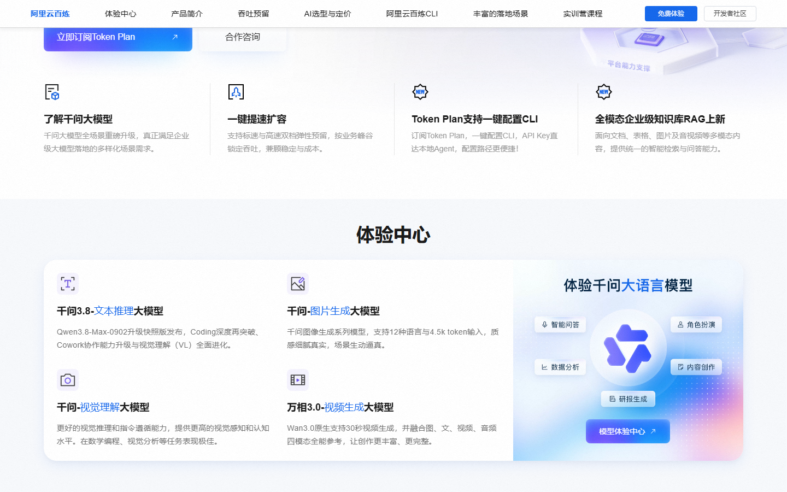
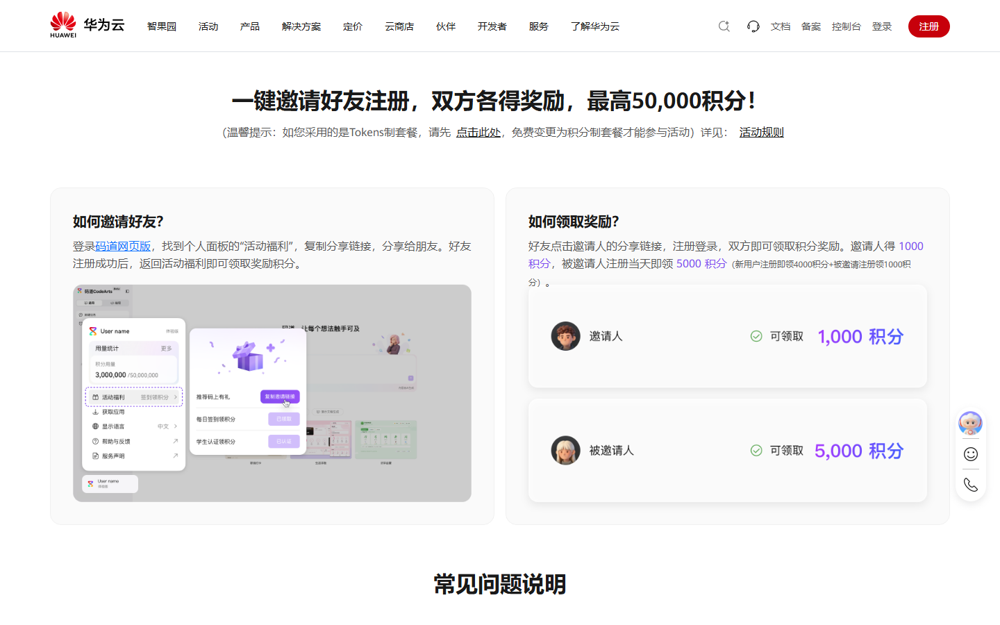
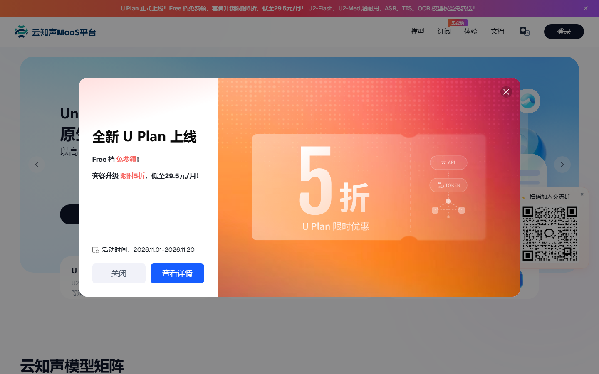

# 阿里云千问 AI 双 11，免费额度与五折到月底

阿里云在 11 月 5 日把「千问 AI 双 11」会场正式开了，顺手把 Token Plan 打到新客五折。本期只收 3 条新发或有变的福利：阿里云会场、华为云码道、云知声 U2-Flash。魔芋、OiiOii、AutoClaw、火山方舟、七牛云这些老面孔这期没有新变化，就不占篇幅了。

## 头条拆解：阿里云千问 AI 双 11 会场（这期最大羊毛）

我翻了阿里云开发者社区 11 月 5 日的官宣长文，把条款读全了，不只看摘要。

**① 它到底给什么。** 会场从 10 月下旬开到 11 月 30 日。免费部分：新用户实名后领超 7000 万 Token，90 天有效，每款主流模型各约 100 万、额度独立。折扣部分（这是新加的）：Token Plan 新客首购 5 折，Lite 档约 19.5 元/月（官方原价 39）；150 余款模型通享「节省计划」新客月包 5 折、首购 10 元起，季包 4.5 折 27 元起；千问办公 29.9 / 69.9；Qoder 首月 19.9 加签到 30 天再送 3000 积分；夜间 Qwen3.8-Max 4 折。

**② 真实价值测算。** 7000 万 Token 对个人开发者够跑两三个月轻量 API 调用，等于白拿一份原型验证额度。Token Plan 5 折最实在：Lite 每月省 19.5 元，重度用户走 150 款模型的 4.5 折，调用成本直接砍半。

**③ 领取全流程。** 打开阿里云双 11 会场或百炼产品页 → 账号完成实名认证 → 免费额度约两小时内自动到账，不用手动领 → 想用 5 折 Token Plan 就开通对应订阅，Qoder 首月要下载客户端并连续签到。

**④ 隐藏门槛。** 免费 7000 万只限华北 2（北京）地域，不支持模型微调和超高并发批量推理；同一实名主体不能重复领；带日期后缀的快照模型算独立模型，额度分开算。付费套餐开通后记得看自动续费开关，免费额度耗尽会自动切按量付费，建议打开「用完即停」。

**⑤ 谁最该领、怎么用最划算。** 个人开发者和小团队先领免费的 7000 万把接口跑通、验证业务，再决定要不要买 5 折 Plan。轻量原型用 Lite 19.5 那档就够，别一上来冲 Pro。

**⑥ 对比与提醒。** 平时按量付费，Qwen3.8-Flash 输入约 0.8 元/百万 Token；5 折 Plan 把这部分成本压到一半。宣传里「全系叠满超 1 亿」看看就好，实际到手以你控制台免费额度页为准，别为凑数去重复注册。

## 两笔新福利，按截止日排

### 华为云码道 CodeArts（11-15 截止）
- **给什么**：活动 10 月 27 日到 11 月 15 日。新用户买个人版即领 4000 积分，每日登录再领 100–200 积分；你每邀一个好友注册成功，双方各得 1000 积分，单人累计上限 5 万。学生认证到 12 月 31 日另领 4000 积分（90 天）。
- **怎么领**：登录华为云码道，点头像 →「活动福利」→「推荐码上有礼」生成专属链接发好友；新用户走链接注册即到账。
- **截止到什么时候**：2026-11-15 23:59。
- **坑在哪**：Tokens 制套餐得先免费换成积分制才能参与；积分到账起 1 个月有效，过期清零，别攒着不用。

### 云知声 U2-Flash（有效期以页面为准）
- **给什么**：注册并登录云知声 MaaS 平台，领 1 亿 Token 免费额度，模型本身是高密度 MoE（266B 总参、激活约 10B），主打代码与 Agent 场景。
- **怎么领**：进 maas.unisound.com → 注册登录 → 控制台「API Key 管理」创建密钥 → 按 OpenAI 兼容接进 Claude Code、Trae、WorkBuddy 等。
- **截止到什么时候**：官方 9 月发布文写明那波 1 亿是 9/15–9/30，现在首页仍挂「注册送 1 亿」横幅、近期多篇官方接入教程也写「注册即领、自动到账」，视作延续活动，有效期以平台活动页为准。
- **坑在哪**：额度有效期、是否真续期都没写死，领完先去控制台看到期日；接入走自定义模型，别把密钥嵌进公共代码。

## 这些已经没了，别白跑

360 纳米 Work 的「首批用户 1 亿 Token」是 7 月发布会的首波权益，三个月过去我没能从官方找到仍在放量的证据，先别冲。云知声 9 月那波 1 亿虽已写明结束，但上面说了平台仍在发，归到「以页面为准」一档，没算过期。

---

额度都是有时效的，看到就先去点一下。
发现哪条已经结束了，欢迎在评论区指正。
