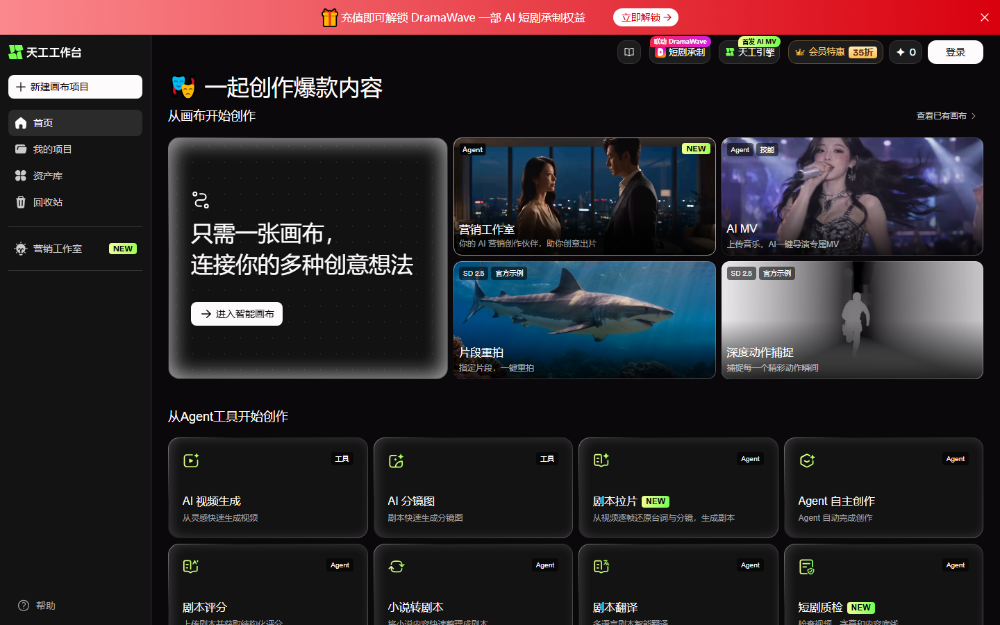
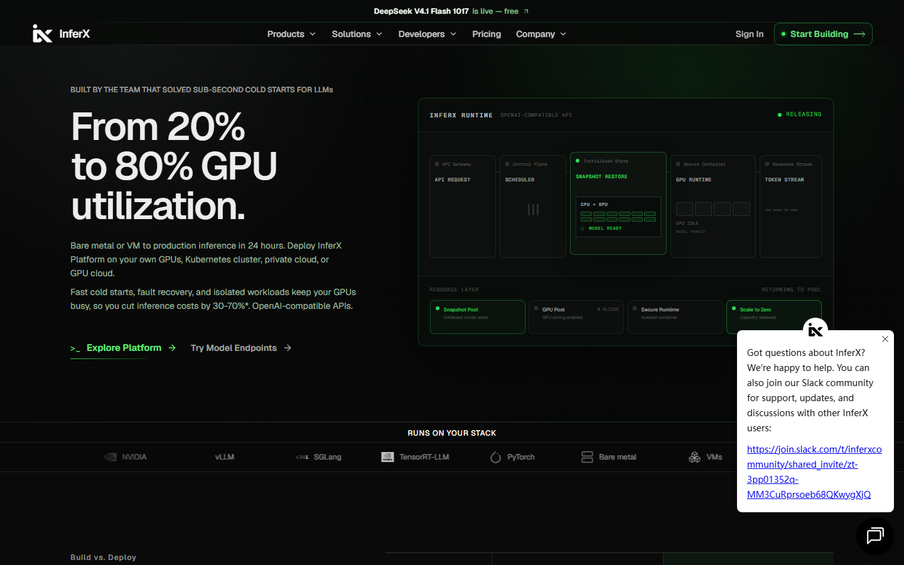

# 视频生成先别充钱，天工 0 积分免到 11 月 11 日

本期最大的羊毛在昆仑万维的天工工作台：Seedance 2.5、可灵 4.0 这些平时按秒计费的视频模型，双十一档 0 积分用，11 月 11 日 24 点收。加上千问办公 1 分钱月卡和 InferX 的免费 DeepSeek API，本期 3 条全是这几天新冒出来的，老面孔没新变化就不占篇幅。顺带一句，OiiOii 新客 7 天畅用的保守截止就是今天 11 月 7 日，还没开的现在去办。

## 头条：天工双 11，视频模型 0 积分

**给什么。** 天工工作台（skyproduction.cn）的双十一活动从 11 月 3 日 0 点跑到 11 月 11 日 24 点。官方公众号原文写的是：Seedance 2.5、Wan 3.0、可灵 4.0、MiniMax H3 等热门 AI 视频模型推出 0 积分免费使用权益，符合条件的用户按活动规则解锁；年包会员最高可解锁 MiniMax H3 免费 60 天；活动期 Seedance 2.5 生成价低至 0.16 元/秒。

**值多少。** 视频生成平时按秒计费，Seedance 2.5 这次的活动价低到 0.16 元/秒，一条 10 秒的片子也要 1.6 元；0 积分档把这钱直接抹掉。对一天出几条投放素材的电商商家，活动窗口里省下的是真账；对想试 AI 视频的新手，这是免费练手期，一个镜头改十几次也不心疼。我算的是到 11 号这几天的窗口，60 天那档另说。

**怎么领。** 打开 skyproduction.cn 注册登录，进工作台，在这些模型的生成入口按活动规则解锁 0 积分权益，不用兑换码。

**坑在哪。** 三个。一，0 积分不是无限量，活动页按模型与会员档挂了「免费 30 条 / 20 条 / 10 条」的分档额度，你的账号能解锁哪档以站内显示为准；二，「最高免费畅用 60 天」只给开通年包会员的人，纯白嫖的窗口就是到 11 月 11 日 24 点；三，官方写明具体优惠以活动页实时公布为准，规则可能调。

**适合谁。** 做电商素材、短剧、广告投放的人最该上，这几家模型平时都是按秒扣费的硬成本；路人想试 AI 视频也值。最大化用法是把要反复改的镜头全塞到 11 号前跑完，别拖。

## 千问办公基础版月卡 0.01 元

- **给什么**：千问办公个人基础版会员月卡，天猫官方旗舰店双 11 价 0.01 元，原价 28 元。月卡含 500 积分，叠加赠送与新用户注册权益合计约 900 积分；按官方直播口径，500 积分约够做 50 份 PPT、写 160 份周报类 Word 或生成 20 张图。
- **怎么领**：天猫搜「千问办公官方旗舰店」，找 0.01 元月卡商品下单（每账号限购 1 件），到店铺旺旺拿兑换码，在千问办公账号里激活。
- **截止到什么时候**：兑换码激活截止 12 月 30 日，售完即止；11 月 2 日李佳琦直播间半小时卖掉近 10 万份，余量自己判断。
- **坑在哪**：这张卡会吃掉你的新用户首购资格，官网标准版首月 29.9 元（含 2000 积分）的新人价就没了。想要大量生图生视频的，900 积分烧得很快，我建议先想清楚要哪档再下单。

## InferX 免费 DeepSeek V4.1 Flash API

- **给什么**：美国推理平台 InferX 把 DeepSeek V4.1 Flash 1017 Basic 端点的输入、输出、缓存单价全部划成 0 美元，上下文约 26 万 Token，OpenAI 兼容接口。官方把价目表单价直接归零，账户余额为零也能调。
- **怎么领**：打开 inferx.net，Google 账号登录，控制台创建 API Key，工具里填 Base URL（model.inferx.net/endpoints/v1）和模型名 deepseek-v4.1-flash-1017-basic，Cline、Cherry Studio 这类支持自定义接口的客户端直接能接。
- **截止到什么时候**：官方没公布截止日，创始人 10 月 31 日公开回复「暂无到期日期」，但促销价随时可能回调原价，用之前再看一眼价目表。
- **坑在哪**：免费只认带 1017-basic 后缀的端点，不带后缀的同名模型照常收费，模型名填错是真扣钱；请求走第三方服务器，公司代码、密钥、客户数据别往里贴。

## 这些已经没了，别白跑

- LibTV 万相 3.0、可灵 4.0 的 0 积分畅用包：领取档约 11 月 5 日截止，没核到延期公告，按已收尾处理。
- 智谱 ZCode 周末包（5 亿 GLM-5.3-Flash）：11 月 2 日 09:00 已收口，本周没再发新一轮。

---

额度都是有时效的，看到就先去点一下。
发现哪条已经结束了，欢迎在评论区指正。
