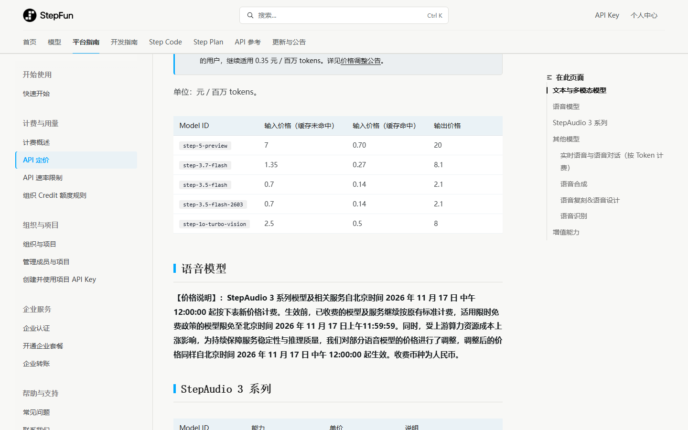
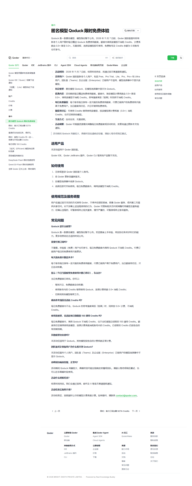
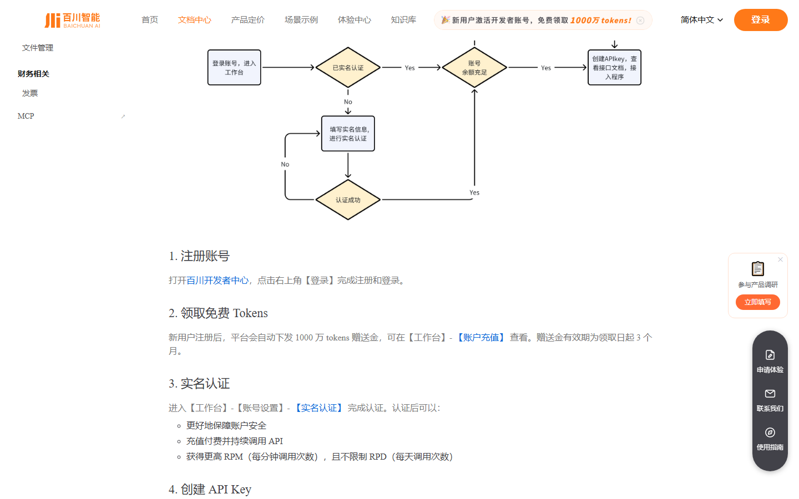
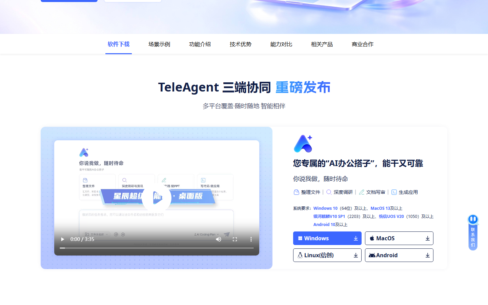

# 阶跃语音免费延到 11 月 17 日，ZCode 5 亿明早清零

先说实在的：阶跃把 StepAudio 3 整条语音线的免费期，从 11 月 8 日延到了 11 月 17 日，我今早在官方定价页核到了原文。今天（11 月 8 日）还是智谱 AutoClaw 5000 万、火山方舟 Auto 0.5 系数、TRAE 宝三档老福利关窗当天，它们前几期收过、本期没新变化，只在开头提醒，别拖过 23:59。正文只写 4 条新出现或有变的，老面孔没变化就不占篇幅。

## 本期头号羊毛：阶跃 StepAudio 3，整条语音线免到 11 月 17 日

免费的是 StepAudio 3 一整条语音线，带 `-preview` 后缀的四个模型都免：做歌的 `stepaudio-3-music-preview`、对白音效的 `stepaudio-3-gen-preview`、实时语音的 `stepaudio-3-realtime-preview`、语音理解的 `stepaudio-3-chat-preview`。官方定价页原文写的是「限免至北京时间 2026 年 11 月 17 日上午 11:59:59」，11 月 17 日中午 12:00 起按新价计费。这比上一版公告的 11 月 8 日多了一周多，是我这期优先想告诉你的。

真实价值我按正式价折算了。11 月 17 日后，音乐生成 16 元/音频小时，语音合成 95 元/百万字符（1 汉字算 3 字符，约 2.85 元/万汉字），实时语音 0.65 元/会话分钟。给短视频批量配 5 万字口播，正式价约 14 元；再跑两小时实时语音测延迟，78 元。认真用一周能省几十到上百元。

领取分四步。一，打开 platform.stepfun.com 注册登录。二，右上角「用户中心 → 账户管理 → 账户信息」做实名，填姓名身份证号并支付宝刷脸。三，控制台左侧「账户管理 → 接口密钥」建一个 API Key。四，照各模型文档调用，模型名填带 `-preview` 的那几个，接口地址 `api.stepfun.com/v1`，OpenAI 兼容，改个 key 就能跑。不想写代码，阶跃语音体验中心的网页端直接试。

隐藏门槛有几处。要实名（身份证加支付宝刷脸），但不绑卡、不充值。不是全部语音模型都免费，`stepaudio-3-tts`、`stepaudio-3-asr-max` 现在就在计费，模型名填错照样扣钱。实时语音是「你和 AI 说话的时间都算」，挂着会话不说话也在走表，别开着不关。用别人的声音或翻唱，官方要求先拿授权。

谁该优先领。做短视频、播客要批量出配音的，趁这十天把下周的配音和背景音乐一次生成、存成素材，11 月 17 日后就不用掏钱。想做语音客服、语音助手的，用 `realtime` 测延迟和打断，再决定要不要付费。我建议把它当批量生产工具，一次把活儿跑完更划算，别当日常聊天用。

风险得提一句：这四个都是 `preview` 预览版，11 月 17 日后会下线，换成正式付费版，长期要用记得提前算账。

## 其余新/变快讯

### 智谱 ZCode 周末包第八轮：5 亿 GLM-5.3-Flash

- **给什么**：每个账号 5 亿 GLM-5.3-Flash Token，1M 上下文、支持图片输入。
- **怎么领**：ZCode 客户端（zcode.z.ai/cn 下载）更新到新版 → 登录 → 左下角或弹窗点活动卡片领取，没弹窗就完全退出重开。
- **截止**：11 月 6 日 23:00 生效，11 月 9 日（周一）09:00 清零，不结转。
- **坑在哪**：只能在 ZCode 客户端里用，不能导 API、接不进 Cursor 或 Claude Code；通道切到 Global、模型选 GLM-5.3-Flash，否则可能扣的是自己的套餐额度；社区截图有 3 亿、5 亿两种口径，以你客户端卡片显示为准；显示「待生效」正常，到点自动进账。

### Qoder Qoduck：匿名模型每日免费

- **给什么**：Qoder 国际版个人用户，每日免费额度内调用匿名模型 Qoduck，计费系数从 0.5× 降到 0.0×，思考强度拉到「极高」也不扣 Credits；付费用户每日免费次数高于免费用户。
- **怎么领**：登录 Qoder 国际版个人账号 → 更新到新版 → 模型选择器里选 Qoduck，自动生效，不用领券；免费账号、Credits 为零也能用。
- **截止**：2026 年 11 月 7 日起，结束时间待定，官方会提前通知。
- **坑在哪**：只在 Qoder 国际版客户端有，IDE、JetBrains 插件、CLI 暂不支持；团队版、企业版看不到这个模型；高峰要排队；额度用完按 0.5× 扣 Credits；官方没公布它到底是谁，别当成 Qwen4 实锤。

### 百川智能：新人 1000 万 tokens 赠金

- **给什么**：新用户注册后自动下发 1000 万 tokens 赠送金，官方按 Baichuan2-Turbo 折算约 80 元。
- **怎么领**：platform.baichuan-ai.com 注册登录 → 自动到账（工作台 → 账户充值 查看）→ 做完实名创建 API Key 即可调用。
- **截止**：赠送金自领取起 3 个月有效。
- **坑在哪**：到期作废；Baichuan4 单价高（100 元/百万 token），拿这 1000 万去跑 Baichuan4 很快见底，跑 Baichuan2-Turbo 才对得上那 80 元。

### 中国电信 TeleAgent：个人版每日免费 Token

- **给什么**：个人版永久免费，推广期每天给大量免费 Token，媒体口径是工作日白天 8000 万、夜间凌晨 1 亿、周末 2 亿，工作日上限约 1.8 亿/天；默认星辰大模型，预置 14 个可切换模型。
- **怎么领**：天翼 AI 开放平台（teleai.com.cn）下载 TeleAgent 桌面客户端 → 安装 → 注册登录即用，额度每天 0 点重置。
- **截止**：个人版长期免费，属推广期政策，官方保留调整。
- **坑在哪**：额度每天 0 点清零、不结转；接第三方兼容模型不享免费额度；纯客户端 Agent，不提供 API，只能在电脑上用；具体每日额度以平台实际显示为准。

## 这些已经没了，别白跑

- **OiiOii 首开会员 20 款模型 7 天畅用**：保守截止 11 月 7 日，已失效。
- **LibTV 万相 3.0 / 可灵 4.0 0 积分畅用包**：约 11 月 5 日截止，没查到延期。
- **智谱 ZCode 周末包上一轮**：11 月 2 日 09:00 已清零，别和这轮的第八轮搞混。
- 再提醒一句，智谱 AutoClaw 5000 万、火山方舟 Auto 0.5、TRAE 宝今天（11 月 8 日）23:59 就是截止时刻，这期不重复列，没领的现在去客户端还来得及。

## 长期可领（本期无变化）

ZCode 每日 3 亿、阿里百炼新人 7000 万、百度千帆每模型 100 万、智谱 GLM-4.7-Flash 全免费这几档，规则没变，按去重规则本期不重复列，需要的翻历史推文。

---
额度都是有时效的，看到就先去点一下。
发现哪条已经结束了，欢迎在评论区指正。
