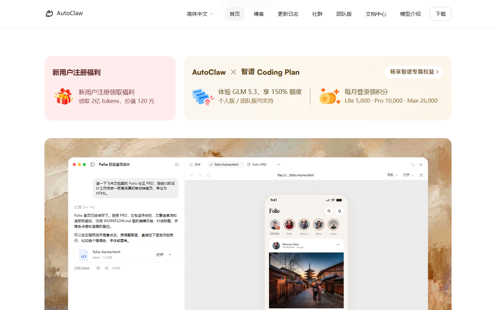
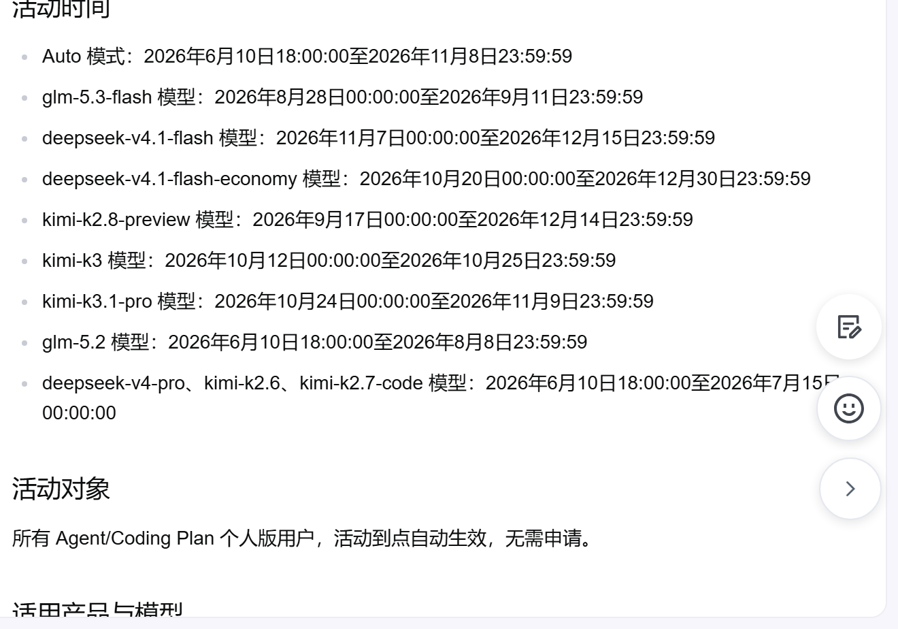
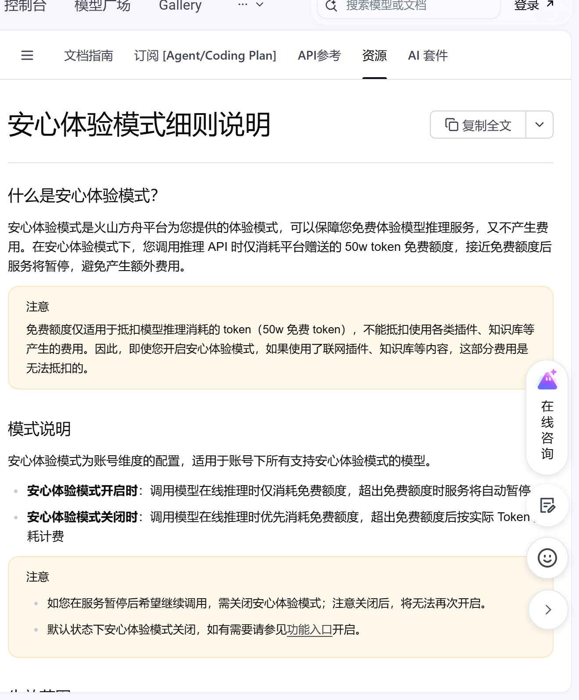
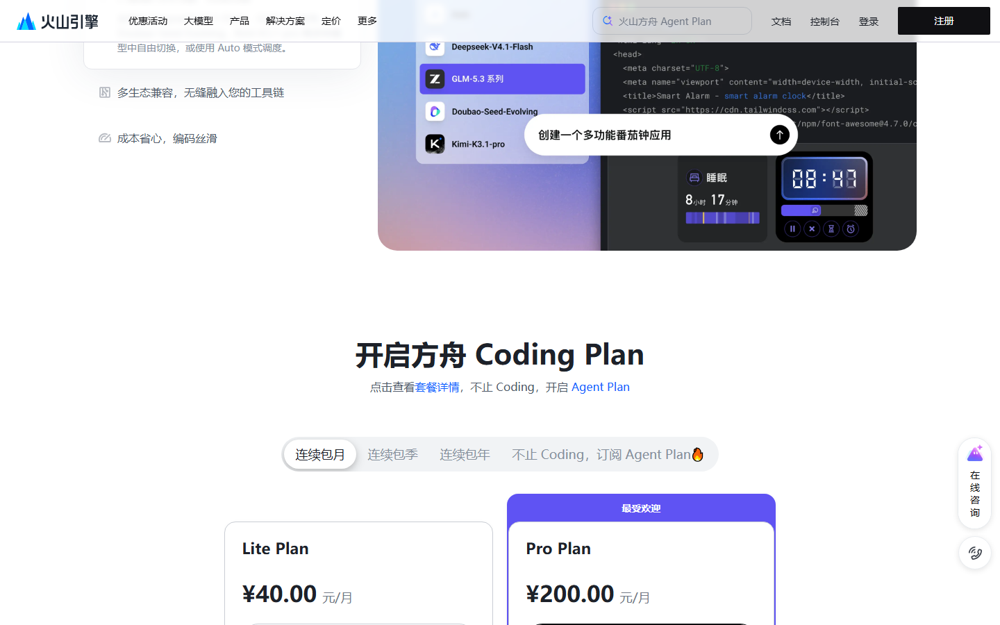

# AutoClaw 双十一 5000 万开领，11月15日关窗

今天能白拿的，主要是智谱 AutoClaw 这一轮 5000 万 Tokens：双十一的每周福利又开了一期，11 月 9 日到 15 日登录就领，国内版 5000 万、国际版 1 亿。本期只收新发和有变化的几条，老面孔没变动就不占篇幅。

## AutoClaw 这 5000 万，到底值多少

先说清楚给的是什么。AutoClaw 是智谱的桌面 Agent，中文名澳龙。这轮叫双十一每周福利：国内版登录领 5000 万 Tokens（折 5000 积分），国际版同周领 1 亿。每账号限领一次，不用订 Coding Plan，老用户也能领。

官网首页另挂着一档「新用户注册福利：2 亿 tokens，价值 120 元」。这是新人一次性礼，和刚才的每周 5000 万是两份，同一个首页就能看到，注册时顺手一起领了。

真实价值我按 GLM-5.3-Flash 的价算。这个模型输入 0.8 元/百万、输出 2.8 元/百万，五折活动期还能再低。5000 万 Tokens 按一半输入一半输出粗算，大约值 40 元上下；国际版 1 亿翻倍。它不能提现，也不是通用额度，只在客户端里跑 GLM-5.3-Flash 时抵扣。

领取路径很短：

1. 到 autoclaw.zhipuai.cn 下载桌面端，电脑和手机端都能装。
2. 用智谱账号登录，活动期内登录即领，或点主界面的礼物图标。
3. 领完去「积分加油站」核余额，别只看弹窗。

隐藏门槛有三条。第一，额度 11 月 15 日 23:59 统一作废，不是领取后满 7 天，别拖到最后一天才领。第二，只能在 AutoClaw 客户端内用，导不出 API Key，接不了别的工具。第三，只认 GLM-5.3-Flash 这个模型，换成旗舰 GLM-5.3 会扣你自己的付费余额。

适合谁：拿 AutoClaw 跑代码、写报告、批量出内容的人。我的用法是把大型任务（重构一整个模块、啃几十页文档）集中到这几天跑完，反正 15 号清零。它和 ZCode 每日 3 亿是两笔账，ZCode 额度更大，但同样是客户端内、同样限 GLM-5.3-Flash；AutoClaw 胜在能跨文件、开浏览器干活。

风险就一句：这是双十一的周更福利，下一轮发不发、发多少，官方没说，别当成长期饭票。

## 其余新/变，按到期排

### 火山方舟 kimi-k3.1-pro 五折，今晚就收

- 给什么：kimi-k3.1-pro 抵扣系数五折（约 0.7 元/百万），套餐可用配额翻到 200%。
- 怎么领：Agent / Coding Plan 个人版用户，活动到点自动生效，不用申请。
- 截止：2026 年 11 月 9 日 23:59:59，就是今晚。
- 坑：只对个人版订阅用户生效，先得订 Plan；过了今晚恢复原系数。

### 火山方舟「安心体验模式」，50 万额度花完即停

- 给什么：每个模型送 50 万 token 免费推理额度，开启安心体验模式后，额度快用完服务自动暂停，绝不自动扣费。
- 怎么领：火山方舟控制台 → 用量管理 → 打开「安心体验模式」开关。仅限没开通过模型服务的新账号。
- 截止：长期，文档 11 月 2 日更新，没写到期日。
- 坑：只抵模型推理的 token，插件、知识库照扣费；关了就不能再开；开过模型服务的账号用不了。

## 这些已经没了，别白跑

- 智谱 ZCode 周末包第八轮 5 亿：11 月 9 日上午 09:00 清零，没用完不结转，池子全平台共享。
- 智谱 AutoClaw 上一期 5000 万：11 月 8 日 23:59 失效，新一轮 11-09 已开，见上。
- 火山方舟 Auto 模式 0.5 系数、Coding Plan 2.5 折普惠：均已在 11 月 8 日 23:59 结束，恢复原系数。

---
额度都是有时效的，看到就先去点一下。
发现哪条已经结束了，欢迎在评论区指正。
