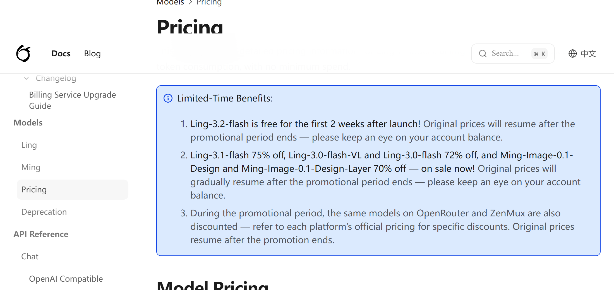
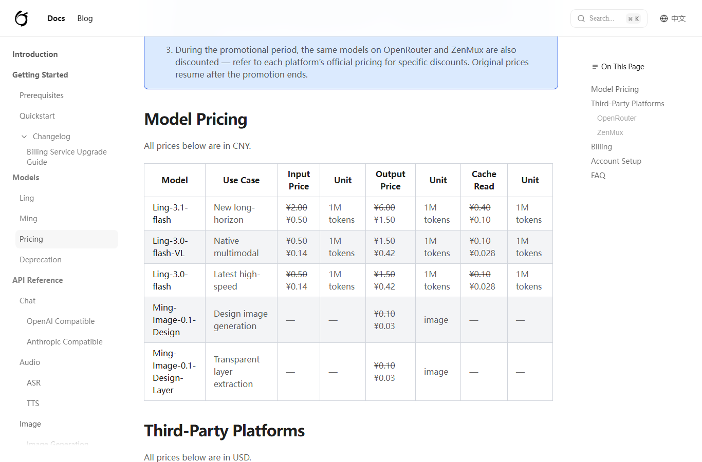
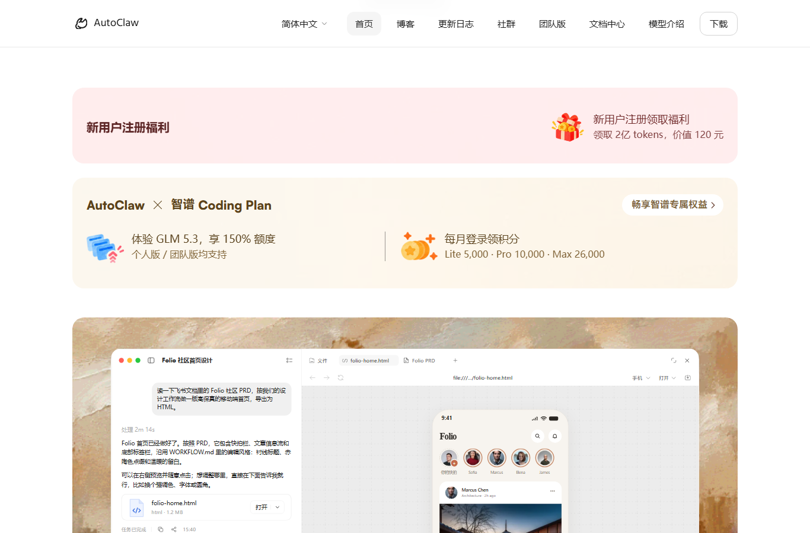
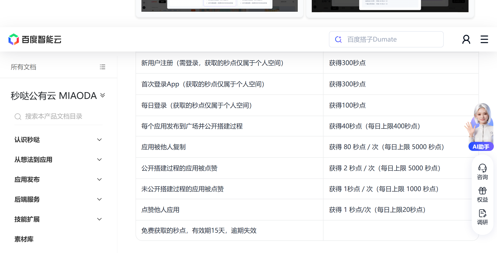

# 蚂蚁百灵新多模态免费两周，先别急着充钱

本期最大的羊毛是蚂蚁百灵 11 月 5 日上线的新多模态模型 Ling-3.2-flash，官方定价页写明上线前两周 API 免费，窗口 11 月 19 日前后收。正文只收新发和有变化的 3 条，天工、魔芋这些近几天列过的老面孔没有新变动，这期不占篇幅。

## 头条：蚂蚁百灵 Ling-3.2，免费两周

官方定价页的原文是「Ling-3.2-flash is free for the first 2 weeks after launch」。上线日 11 月 5 日，两周到 11 月 19 日前后，官方没给精确时刻，以平台页面为准。模型 560B 总参、25B 激活、1M 上下文，图像、文本、视频三种输入直接进主干，官方文档的原话是「不依赖外挂视觉模块」。

值多少，我按官方定价页对上一代 Ling-3.1-flash 的标价算：输入 2 元、输出 6 元每百万 tokens。假设两周里跑 1000 万 tokens 的评测，八成输入两成输出，输入 800 万花 16 元、输出 200 万花 12 元，合计约 28 元。这个数不大，但窗口期内免充值压测一个 1M 上下文的原生多模态旗舰，这个入口平时没有。

领取四步。打开 developer.ant-ling.com 注册登录；在 API 控制台绑定个人支付宝并开通 Ling 服务；对话页可直接体验，API 兼容 OpenAI 和 Anthropic 协议；账单按日结算，窗口期内不用充值。

隐藏门槛有三处。第一，免费额度有上限，官方 FAQ 只说额度用完后「绑了免密支付的自动转后付费，否则 API 暂停到次日刷新」，具体额度数没单列，动手前先看规则页。第二，只收个人支付宝，企业支付宝暂不支持。第三，官方三项跑分全是厂商自测，没有第三方复现，DesignArena 的 1238 Elo 在公开榜上还查不到条目。

谁该领：做文档解析、图生前端的团队，两周够跑通流程、不够下结论，我自己的用法是把真实文件丢进去跑一轮，比看跑分有用。谁别碰：当通用对话或代码主力（官方自己没往这比）、医疗诊断、要稳定输出的线上服务。风险就一句，上一代实际卖过标价四分之一的折扣价，两周后恢复的「原价」相对实付是涨回去的；绑了免密支付的人记得在窗口结束前关掉，不然账单会自己跑。

## 其余新/变，按到期排

### 智谱 AutoClaw：新人礼 2 亿，叠加本周 5000 万

- **给什么**：官网首页明码「新用户注册领 2 亿 tokens（价值 120 元）」；本周双十一登录再送 5000 万 tokens（5000 积分），每账号一次。
- **怎么领**：autoclaw.zhipuai.cn 下载桌面端（Windows、Mac 按芯片选包）→ 注册登录 → 「设置-积分详情」查到账；本周 5000 万活动期内登录即到。
- **截止到什么时候**：本周 5000 万 11 月 15 日 23:59 统一失效，不结转；新人积分按每笔记录的到期时间。
- **坑在哪**：官网 2 亿与用户实测「第 X/7 天 +10000 积分」两套口径对不齐，以客户端积分详情为准；积分只能在 AutoClaw 客户端里跑 GLM-5.3-Flash，导不出 API Key。相比上次：11 月 4 日只提过注册 2 亿新人礼一句，这次补上逐日到账的实测和口径出入。

### 百度秒哒：每日登录送 100 秒点

- **给什么**：每日登录送 100 秒点；新用户注册 300、首次登录 App 再 300；发布一个应用 20 秒点，启用后端每天 15 秒点。
- **怎么领**：miaoda.cn 或秒哒 App 手机号注册，每日登录自动到账，秒点余额在左侧导航查。
- **截止到什么时候**：长期，官方文档常驻规则；免费秒点 15 天有效。
- **坑在哪**：15 天逾期清零不结转；新用户要完成实名认证后端服务才激活；秒点只限个人空间。

## 这些已经没了，别白跑

火山方舟 kimi-k3.1-pro 抵扣五折，11 月 9 日 23:59 已结束，恢复原系数。它本来就只对个人版订阅用户生效，不是普适免费，别被「五折」带偏。

---

额度都是有时效的，看到就先去点一下。
发现哪条已经结束了，欢迎在评论区指正。
