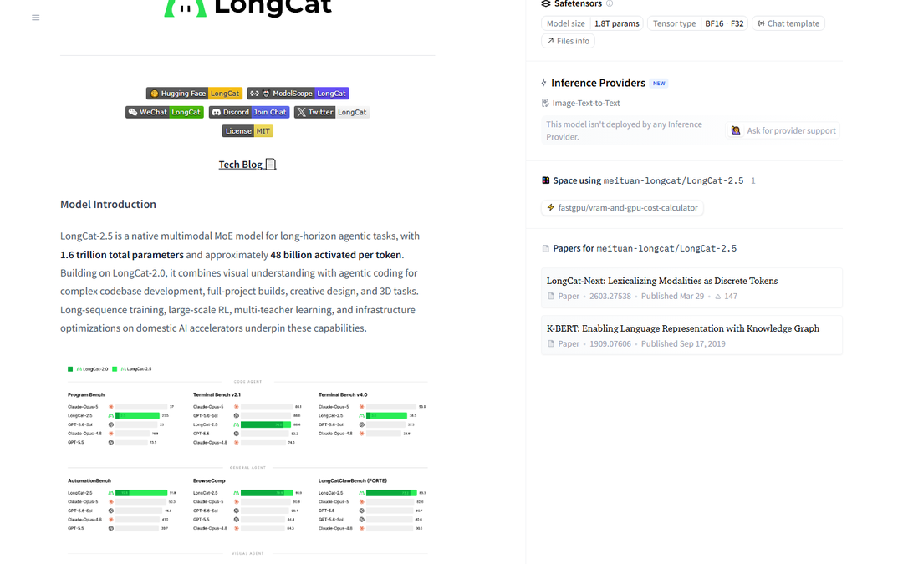
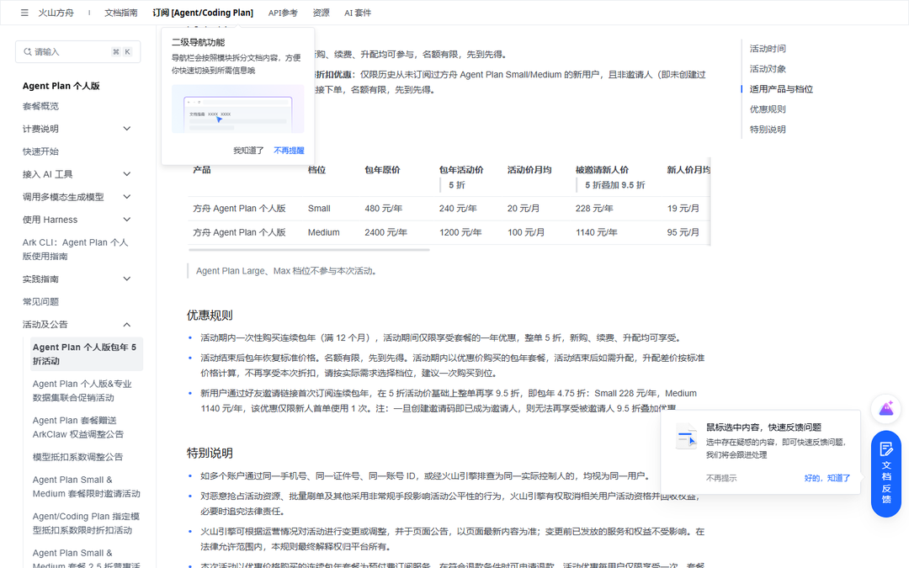
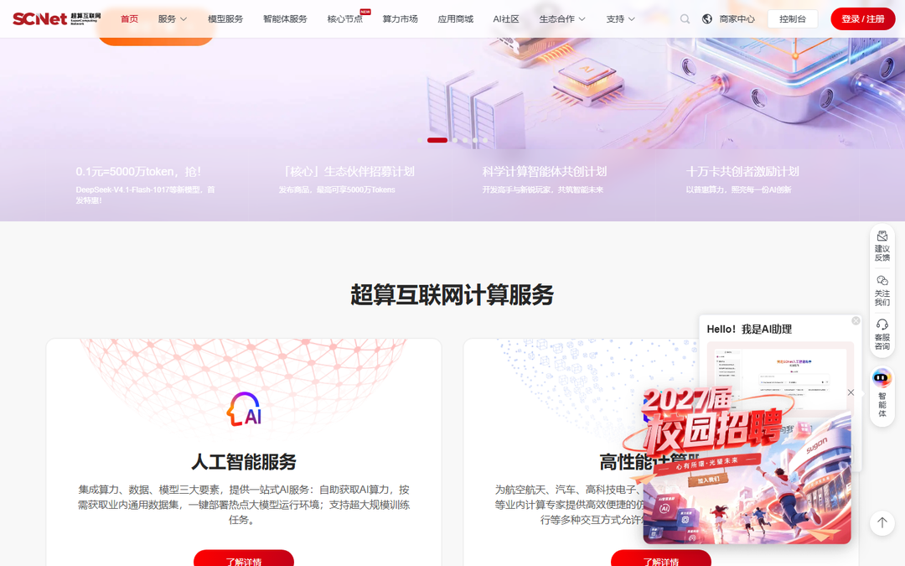
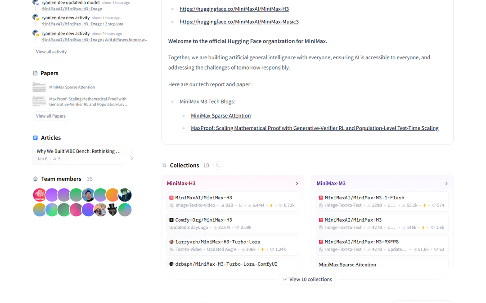

# 美团 LongCat-2.5 开源，OpenCode 限时免费两周

双 11 收官这天，国产大模型连着开源了两个重量级模型：美团昨夜放出 1.6 万亿参数的 LongCat-2.5，MiniMax 也把图像模型 H3-Image 的权重敞开了。本期只收新发和有变化的几条，老面孔这期没新动静就不占篇幅。有个提醒先放前面：魔芋、天工、LibTV 的双 11 档今天 24 点关窗，是最后一天，上期写过四字段，今天不重复列，赶时间的现在去领。

## 头条 · LongCat-2.5 开源，白拿一个旗舰模型

① 给什么，官方原文怎么写
美团 11 月 10 日开源 LongCat-2.5，在 Hugging Face 放出模型权重和 W4A4 量化版本，协议 MIT，可商用、可二次训练、不用授权。模型总参 1.6 万亿、每 token 激活约 480 亿，原生 100 万 token 上下文，主打视觉编程、长程智能体和专业办公。开源当天，开源编程工具 OpenCode 就把它接进了平台，限时免费两周（按发布日算约到 11 月 24 日），支持多模态和百万上下文，免费入口每天限 100 次请求。API 限时优惠价是输入 2 元、输出 8 元每百万 token，缓存命中输入 0.04 元。

② 真实价值测算
这笔羊毛值多少，我拆两笔账。第一笔是权重：1.6 万亿参数的旗舰多模态模型，MIT 协议让你自己部署、随便改。平时这种体量的模型要么不开源，要么不放开商用权。等于白送一个能跑生产的模型底座，前提是你有显卡或国产算力去扛。第二笔是 OpenCode 两周免费 API：按每天 100 次、每次几十万 token 算，正常要付的 API 费在几十到上百元，现在免了。我自己判断，对个人开发者，这比任何送几千万 token 都实在。

③ 领取全流程
两条路。自己部署：去 Hugging Face 下 meituan-longcat/LongCat-2.5 的权重和量化版，按美团给的 SGLang-FluentLLM 说明跑，国产 NPU 也有教程，要一台装得动万亿模型的机器。用现成免费 API：装 OpenCode 客户端，在 /models 里选 LongCat-2.5，免费档每天 100 次、不用绑卡。美团官方还给了 Claude Code、Codex、Hermes 的接入说明。

④ 隐藏门槛
两个坑。自己部署要真有算力，不是网页点一下就能用。云端免费档每天 100 次，官方只说限时两周、按起算约 11 月 24 日前后，没给精确时刻，以 OpenCode 页面为准。实测有人反馈正式版会循环推理，长回复有时反复绕圈、出冗余，跑长任务要留神。API 的 2 元、8 元是限时优惠价，不是长期价。

⑤ 适用人群与最大化利用
最适合两类人：手里有显卡、能跑国产算力的开发者；要做视觉编程、长程 Agent、经营分析网站的小团队。最大化就一条，先下权重自己部署，把免费 API 留着做快速验证和轻量调用，别一上来把每天 100 次的额度花在重试上。

⑥ 对比与风险提示
和同为 1.6 万亿总参的 DeepSeek V4-Pro-0813 比，LongCat-2.5 三项单价都更低。国产模型里 DeepSeek V4.1-Flash 在 26 项可比测试有 14 项高于它，所以别神化。风险就一句：循环推理和部署门槛是实打实的，没显卡就别当免费主力，当成一个能自托管的新选项更稳。

## 快讯 · 新发与有变化

### 火山方舟 Agent Plan 个人版包年 5 折（明晚 24 点截止）
给什么：方舟 Agent Plan 个人版 Small 包年 480 元直降到 240 元/年，月均 20 元；Medium 2400 降到 1200 元/年。被好友邀请首次订阅的新人，还能在 5 折基础上再 9.5 折，Small 实付 228 元/年。
怎么领：火山引擎文档活动页（docs.volcengine.com/docs/ark/agent-plan-personal-annual-discount），新购、续费、升配都能参与，活动 11 月 12 日 24:00 截止，共 4 天。
截止到什么时候：2026 年 11 月 12 日 24:00，就剩 1 天。
坑在哪：这是付费会员的折扣，不是免费额度；名额有限先到先得，活动结束后恢复原价，升配差价按标准价算，建议一次买到位。

### 国家超算新客 1000 万延期到 12 月 31 日（有变化）
给什么：国家超算互联网 MaaS 特惠专场，新客注册即领 1000 万 Token 量包，模型 GLM-5.3-Flash、1024K 上下文，到账 30 天有效。
怎么领：scnet.cn 进 MaaS 特惠专场，仅新用户，注册即领。
截止到什么时候：活动期延到 2026 年 12 月 31 日。上期为 11 月 10 日截止，本期已确认延期，量包到账仍 30 天有效。
坑在哪：量包指定模型、不能换；到账 30 天清零不补；同平台另有 0.1 元秒杀等付费档，别和免费档混为一谈。

### MiniMax H3-Image 开源 + 首周 5 折（新发）
给什么：MiniMax 11 月 10 日深夜发布并开源图像模型 H3-Image，10 秒生成 4096×4096（约 1600 万像素）4K 图，支持提示词理解、图像编辑、最多 16 张参考图；权重已开放，上线 MiniMax API、MiniMax Code、Hailuo AI。发布周内 16MP 以上生成享 5 折。
怎么领：Hugging Face 下权重自部署，或走 MiniMax API、Hailuo AI 调用；首周 5 折在官方渠道自动生效。
截止到什么时候：权重长期开源；5 折仅限发布周内，约 11 月 17 日前。
坑在哪：5 折是限时折扣，过周恢复；自部署要算力；API 按张计费，生 4K 图比普通图贵。

## 这些已经没了，别白跑

火山方舟 Kimi K3.1-Pro 抵扣五折：11 月 9 日 23:59 已结束，目前没有续期公告，别再去领。
魔芋 AI、天工 SkyProduction、LibTV 的双 11 档：今天（11 月 11 日）24 点收口，是最后一天。本期因无变化未回炉正文，但赶时间的读者今天去领还来得及。

---

额度都是有时效的，看到就先去点一下。
发现哪条已经结束了，欢迎在评论区指正。
