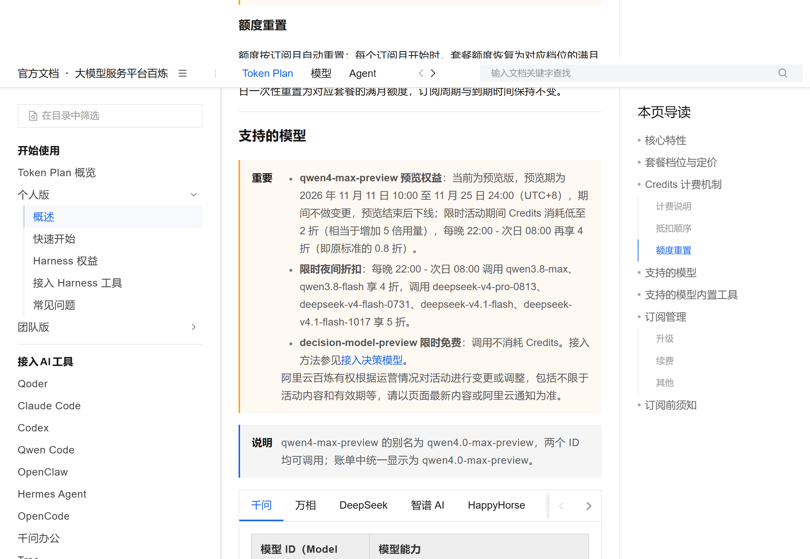
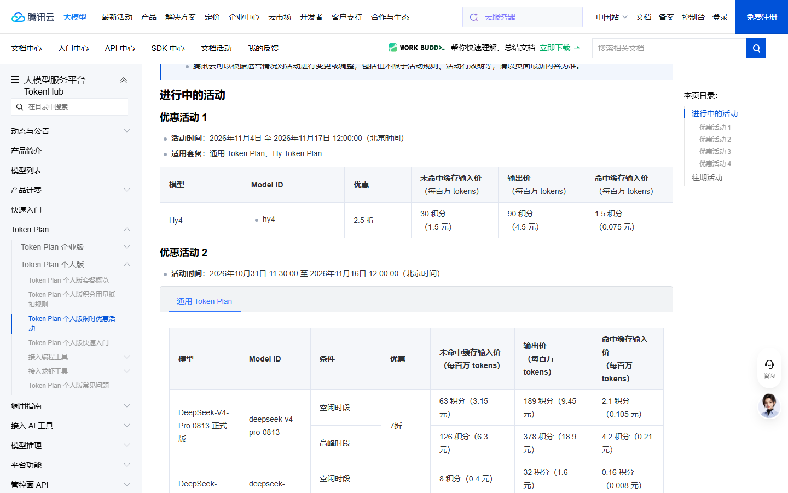
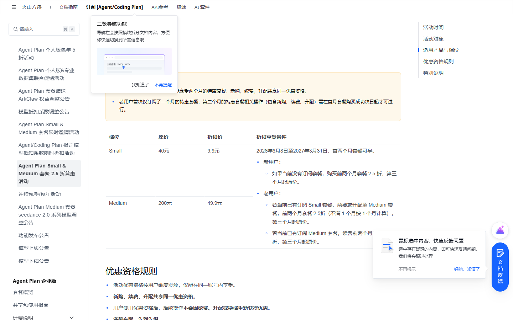
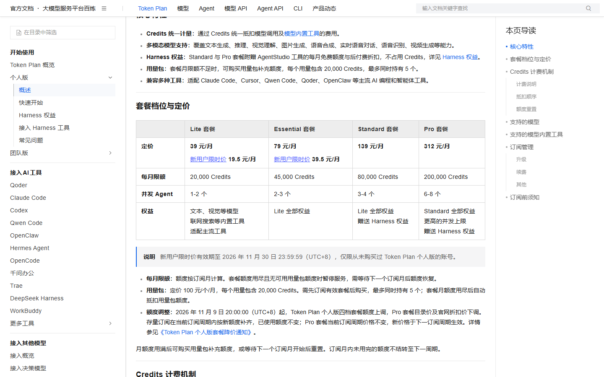

# 阿里 Qwen4-Max 2折，两周预览先试旗舰

双 11 收官后第一天，阿里把下一代旗舰 Qwen4-Max 放出了两周预览，Token Plan 调用低至 2 折、夜间 0.8 折。本期只收新发和有变化的几条，老面孔这期没新动静就不占篇幅。先插一句紧急的：火山方舟 Agent Plan 包年 5 折今晚 24 点关窗，上期写过、本期不重复列，赶时间的现在去领。

## 头条 · Qwen4-Max 预览两周，旗舰按 0.8 折薅

① 给什么，官方原文怎么写
阿里 11 月 11 日 10 点开放 Qwen4-Max 预览版，是千问新一代旗舰多模态模型，100 万上下文，支持图文视频输入、函数调用和联网。官方帮助中心写明：预览期 2026-11-11 10:00 至 11-25 24:00（北京时间），期间不做变更，结束后直接下线；调用仅走 Token Plan 套餐，不支持按量计费。

② 真实价值测算
我按 Lite 套餐算一笔账：39 元/月含 2 万 Credits，折合 1 Credit 约 0.002 元。一项原本消耗 1000 Credits 的调用，平时约 1.95 元；活动期 2 折后约 0.39 元，夜间 22 点后再享 4 折、降到 0.8 折——80 Credits、约 0.16 元。更值钱的是旗舰多模态白嫖两周本身：平时这种体量的新模型要么不开预览，要么不放开低价，等于用极低成本试完正代旗舰。

③ 领取全流程
已订阅 Token Plan 的，直接在 Claude Code、Cursor、Qoder 这类工具里把模型切到 `qwen4-max-preview`（别名 `qwen4.0-max-preview`，账单统一显示后者）即可，不用领券。没订过的，先在 Token Plan 价格页开通个人版——新客首月 19.5 元（优惠到 11-30），控制台生成 `sk-sp-` 开头的专属 Key，填进工具的自定义模型配置。

④ 隐藏门槛
五个坑。其一，只能套餐内用，按月付费，没有按量入口。其二，个人版条款禁止接自动化脚本、应用后端和非交互批量调用，只能当编程/Agent 工具的交互模型。其三，你输入和生成的内容会被用于模型优化，敏感代码别传。其四，模型默认开思考，max_tokens 要预留思考预算，否则长回答会被截断。其五，预览 11-25 下线后没有平替，正式版价格还没公布。

⑤ 适用人群与最大化利用
已经在用 Token Plan 或编程 Agent 工具的人最该试，挑三五个你有标准答案的真实任务，和现用模型各跑一遍比效果。不急的长任务放到 22 点后跑，吃满 0.8 折。没订阅的先开最低档或新客档试完再说，别为尝鲜冲高档位。

⑥ 对比与风险提示
对比千问自家 qwen3.8-max 夜间 4 折、DeepSeek V4 系列夜间 5 折，Qwen4-Max 这波 0.8 折最狠，但只此两周。风险我也直说：官方没给跑分，早期用户反馈两极，有人一个任务扣掉 100 Credits；11-25 预览一停就没有平替，别把它当长期后端。

## 快讯 · 新发与有变化

### 腾讯云 Hy4 Token Plan 2.5 折（11-17 12:00 截止）
给什么：混元 Hy4 在 Token Plan 个人版套餐内调用享积分 2.5 折，未命中缓存输入 30 积分（1.5 元）、输出 90 积分（4.5 元）、缓存命中 1.5 积分（0.075 元）/ 每百万 tokens。
怎么领：腾讯云 TokenHub 或 Token Plan 控制台开通个人版套餐，活动自动生效，无需领券。
截止到什么时候：2026-11-04 至 11-17 12:00（北京时间），剩 5 天。
坑在哪：仅套餐内抵扣，按量通道是 5 折另算；11-17 12:00 一过恢复刊例价（输入 6 / 输出 18 / 缓存 0.3 元）。

### 火山方舟 Agent Plan 2.5 折普惠（延到 2027-03-31）
给什么：Agent Plan 个人版 Small 原价 40 元/月降至 9.9 元、Medium 200 元降至 49.9 元，首两个月按 2.5 折计，第三个月起恢复原价。
怎么领：火山方舟 Agent Plan 活动页选 Small/Medium 订阅，结算页自动显示特惠价，新购、续费、升配都行。
截止到什么时候：活动 2026-06-08 至 2027-03-31，等于长期低价档，但每账号最多享两个月特惠。
坑在哪：只覆盖 Small/Medium 两档，Large/Max 不参与；名额有限先到先得；优惠资格用后不重置，第二个月记得及时续上。

## 长期可领（不用赶）

### 阿里百炼 decision-model-preview 限时免费
给什么：决策模型预览版，调用不消耗 Credits，面向工单分流、内容审核、智能体路由这类结构化判断（分类、是非、评分、概率分布）。
怎么领：Token Plan 个人版里直接选 `decision-model-preview`，输入 64K、RPM 1200，活动期内免费。
截止到什么时候：阿里未给明确截止，按「限时免费」长期挂。
坑在哪：只适配 Token Plan，且是特定场景模型，不是通用对话；当路由/审核节点用最划算。

## 这些已经没了，别白跑

魔芋 AI、天工 SkyProduction、LibTV 的双 11 档：11 月 11 日 24:00 已收口，活动页入口多已关闭。
火山方舟 Kimi-K3.1-Pro 抵扣五折：11 月 9 日 23:59 已结束，目前没有续期公告。

---

额度都是有时效的，看到就先去点一下。
发现哪条已经结束了，欢迎在评论区指正。
