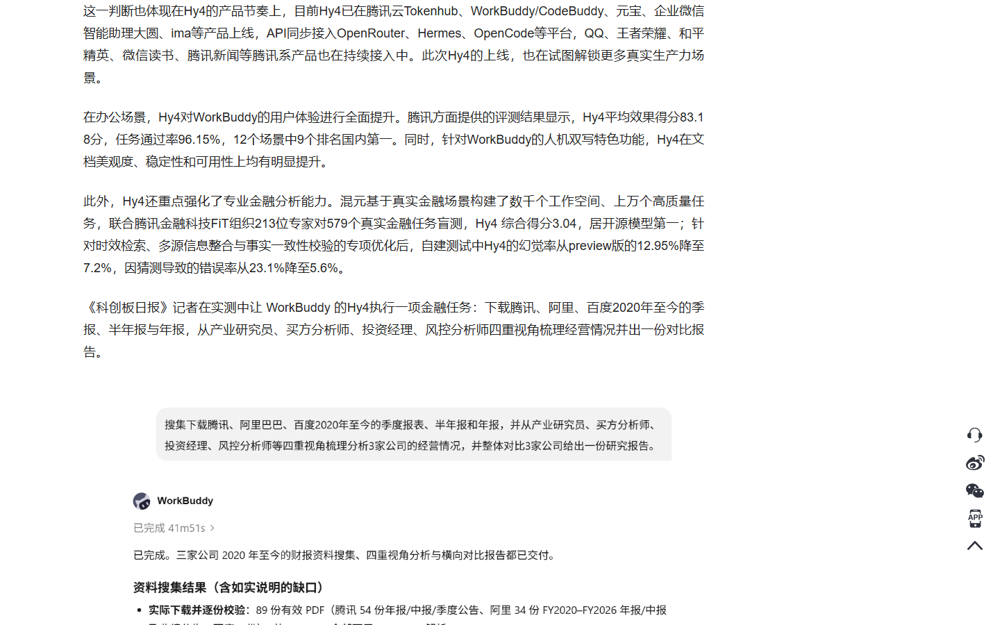
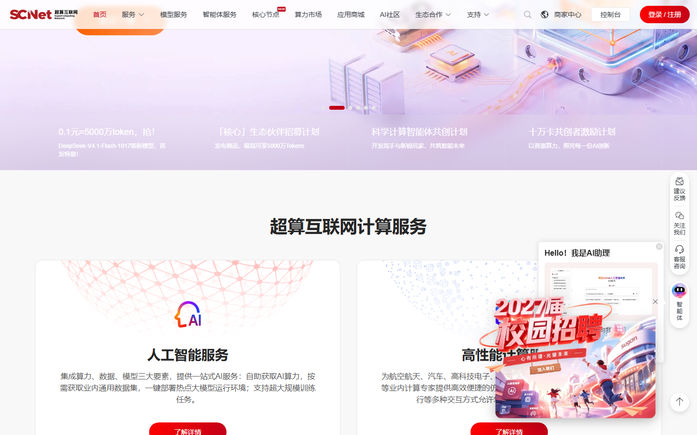
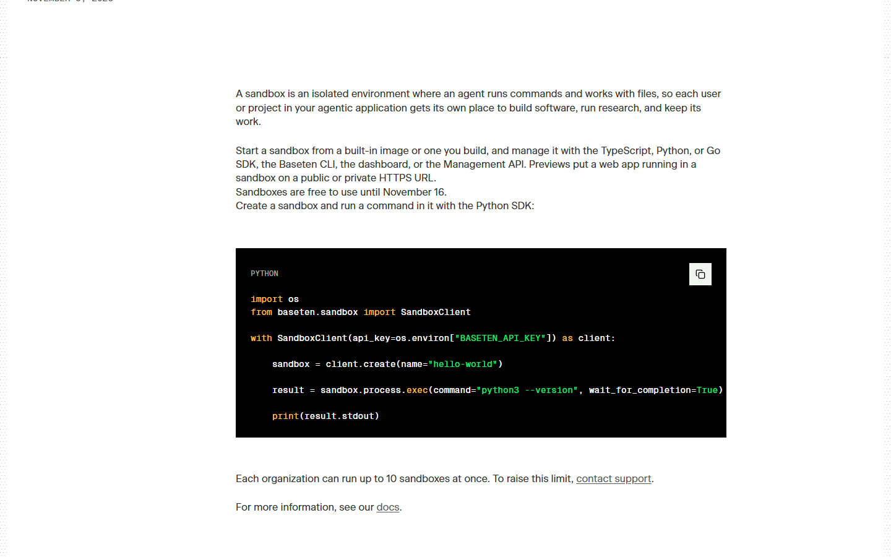
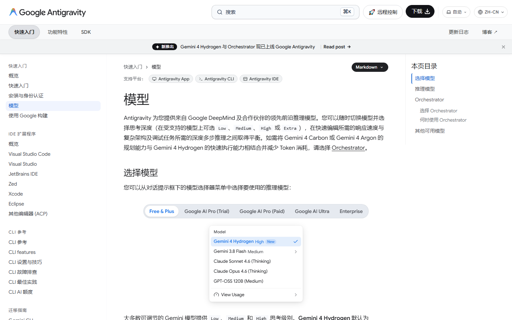
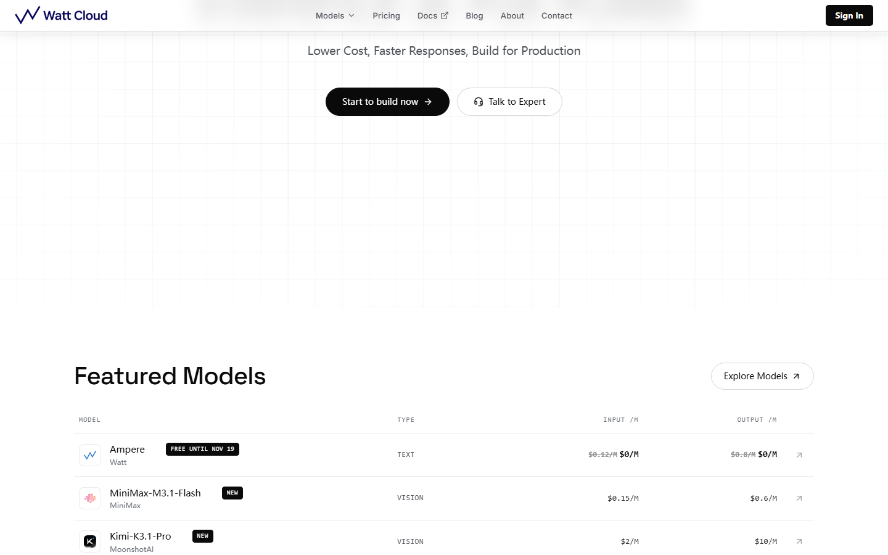
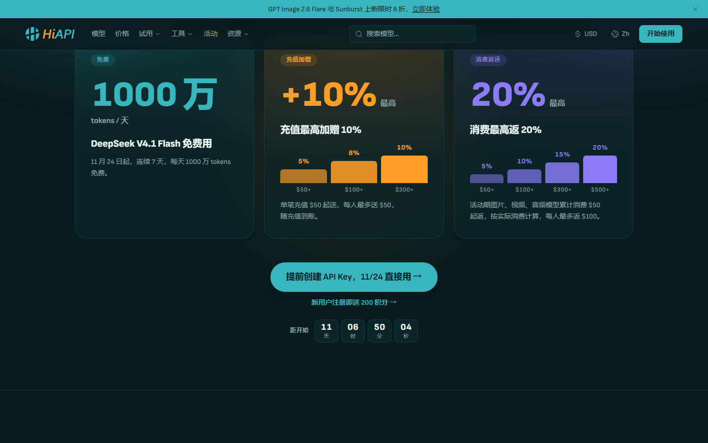

# 混元 Hy4 免费额度剩 3 天，11-15 关窗

本期最大羊毛是腾讯混元 Hy4 在 WorkBuddy / CodeBuddy 的 0 元限免，11-15 23:59 收口。下面 6 条全是近两天新发或有变动的。

## 本期最大羊毛：混元 Hy4 在 WorkBuddy / CodeBuddy 0 元限免

腾讯混元官方发布稿的原话：「WorkBuddy / CodeBuddy 将在 11 月 4 日至 11 月 15 日期间，为用户提供一定额度的免费使用。」

这是 Hy4 上线后的首波免费窗口。Hy4 有 770B 参数，是最强开源模型之一，支持视觉理解和电脑操作。

**真实价值测算。** Hy4 平时刊例价是输入 6 元 / 百万 tokens、输出 18 元 / 百万 tokens、缓存命中 0.3 元 / 百万 tokens，免费期全白用。一次 10 万 token 的对话平时约 0.6 到 1.8 元；一个中型项目评审、财报分析或代码重构跑掉几十万 token，就省下十几元。把 11 月 4 日到 15 日算上，重度用户能省出一张月卡钱。

**领取全流程。** 不用新买、不用绑卡。装好 WorkBuddy 或 CodeBuddy 客户端（Windows / Mac），用微信或账号登录，免费额度自动到账，触顶转积分继续用。生图和生视频不在这波免费范围内。

**隐藏门槛。** 窗口只到 11 月 15 日 23:59，过后恢复按量计费，不会自动续。腾讯云 TokenHub 上 Hy4 是 5 折到 12 月 31 日，和客户端这波免费不是一回事。额度是产品内赠送，不能导出成 BigModel 的 API 额度。

**谁最该领、怎么用最划算。** 已经在用 WorkBuddy / CodeBuddy 的人直接躺赚；想试 Hy4 视觉理解、电脑操作、金融能力的人是最低成本入口。我建议把积压的文档美化、PPT 生成、代码评审、基金 / 证券类分析任务，这 3 天集中跑掉，别挤最后一晚。

**和平时价比。** 同样用 Hy4，今天 0 元，11 月 16 日起按 6 / 18 元每百万 tokens 起算。风险：免费额度不参与生图生视频，那部分依旧计费，用完记得看一眼用量面板。

## 其余新发与变动（按截止日排）

### 国家超算互联网：0.1 元秒 5000 万，明天最后一天

**给什么。** 新客首单特惠：0.1 元买 5000 万 DeepSeek-V4.1-Flash-1017 或 GLM-5.3-Flash 的 Token 量包；同页面「新客尝鲜」另送 1000 万 GLM-5.3-Flash。

**怎么领。** 国家超算互联网官网或客户端，新注册用户（2026 年 8 月 13 日到 12 月 31 日首次注册）登录后，在「新客首单特惠」点「马上秒」，每天 10 点开抢，每账号限一次。

**截止到。** 0.1 元秒杀档 11 月 14 日 23:59，明天最后一天；免费 1000 万的新客礼活动期到 12 月 31 日。量包到账后 30 天有效。

**坑在哪。** 我更建议先领那 1000 万免费档，秒杀档每天 10 点要实名加人脸认证。六款首单特惠按同一自然人合计只能买一次；赠送额度用完会自动扣现金余额，不想被扣费就在用完前停用。

### 智谱 AutoClaw 双十一：登录领 5000 万，11-15 同天关窗

**给什么。** 登录 AutoClaw（澳龙）客户端领 50M Tokens（约 5000 积分），国内版一次到账；海外版是 100M。

**怎么领。** 下载 AutoClaw 客户端，登录一次积分自动到「设置 → 积分详情」，不绑卡、不订阅、每账号限一次。

**截止到。** 11 月 15 日 23:59 一并到期，领到的额度活动结束作废、不结转。

**坑在哪。** 这是客户端内积分，不是 BigModel 的 API 额度，只能在澳龙里花；领取弹窗只在装好客户端、登录后才蹦。

### Baseten Agent Sandboxes：隔离沙箱免费，11-16 收费

**给什么。** 给 AI Agent 跑命令、存文件、做长任务的隔离 microVM 沙箱，每个组织最多 10 个并发，25 毫秒挂起恢复。

**怎么领。** baseten.co 注册拿 API Key，用 Python / TypeScript SDK 或 CLI 建沙箱即可，免费期无需付费。

**截止到。** 11 月 16 日后按用量计费。

**坑在哪。** 沙箱删除会永久清掉本地文件，要持久化得挂 volume；适合跑长程 Agent 和代码执行，不是给普通聊天用的。

### Google Antigravity：Claude 4.6 免费档，11-18 移除

**给什么。** Free 和 Google AI Plus 账号能选 Claude Sonnet 4.6 / Opus 4.6（thinking），带每周限额。

**怎么领。** 下载 Google 的 Agentic IDE Antigravity，免费档或 Google AI Plus 直接在模型选择器里挑 Claude 4.6。

**截止到。** 11 月 18 日 Claude 4.6 从免费档移除，之后要 Google AI Pro 付费计划才有。

**坑在哪。** 仅 Free / Plus，且每周限额；11 月 18 日后 Claude 从免费档消失，只剩 Gemini 3.8 Flash。

### Watt Cloud：自研多模态 Ampere 0 元，11-19 结束

**给什么。** Watt Cloud 自研多模态模型 Ampere，输入输出全 0 元 / 百万 tokens，OpenAI 兼容 API。

**怎么领。** watt-cloud.com 注册建 API Key，调用时 model 填 ampere，Base URL 走 api.watt-cloud.com。

**截止到。** 11 月 19 日后按标价计费。

**坑在哪。** 0 元只限 Ampere 这一个模型，其他模型按价走；需要账号加 API Key，节点和国内直连情况以官方页面为准。

### HiAPI 黑五：DeepSeek V4.1 Flash 连续 7 天每天 1000 万免费

**给什么。** 我算了下，11 月 24 日起连续 7 天，DeepSeek V4.1 Flash 每天前 1000 万 tokens 免费；同期充值加赠最高 10%，图片 / 视频 / 音频消费返最高 20%。新用户注册就送 200 积分。

**怎么领。** hiapi.ai 注册建 API Key，11 月 24 日按活动页公布的方式开通免费额度；想先试水，现在就能领那 200 积分。

**截止到。** 免费档 11 月 24 日到 11 月 30 日；加赠和返还按活动期结算。

**坑在哪。** 免费额度北京时间每天 16:00 重置、不累计，每人每天上限 1000 万、每分钟 10 次、并发 2 个；前提是账号先成功充值过一次（金额不限）；企业账户不参与。

## 这些已经没了，别白跑

- 火山方舟 Agent Plan 5 折：11 月 12 日 24:00 关窗。
- 魔芋 AI、天工 SkyProduction、LibTV 的双 11 档：11 月 11 日收口。
- 火山方舟 Kimi-K3.1-Pro 抵扣五折：11 月 9 日 23:59 结束。
- 今天已过期、睡过头就错过的也有几笔。LLMTR 的 Qwen3.8-Max 免费档 11-13 08:00 就没了，Twigpine 的 Qwen 限免同一时刻关。Traycer 的 100 美元 Gemini 额度 03:29 截止，MLH Builders Week 的 Cursor Pro / X Premium 02:00 截止。
- ZCode 邀请好友活动：11 月 13 日结束，要拉好友才给卡，今天基本来不及。

---

额度都是有时效的，看到就先去点一下。
发现哪条已经结束了，欢迎在评论区指正。
