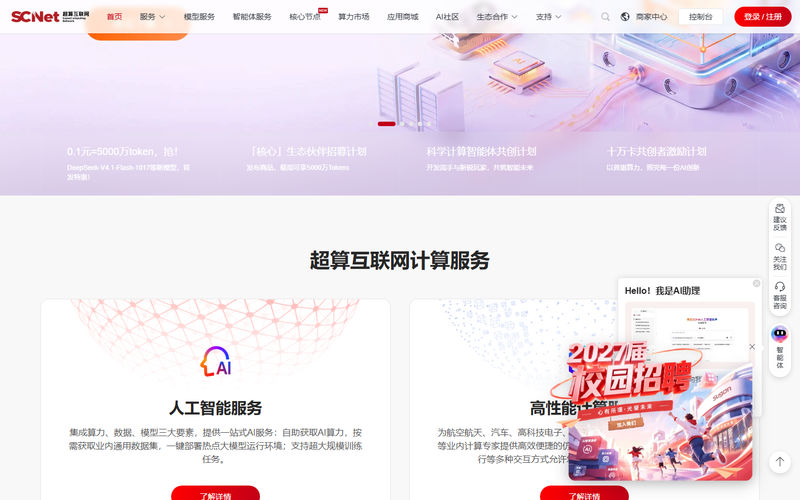
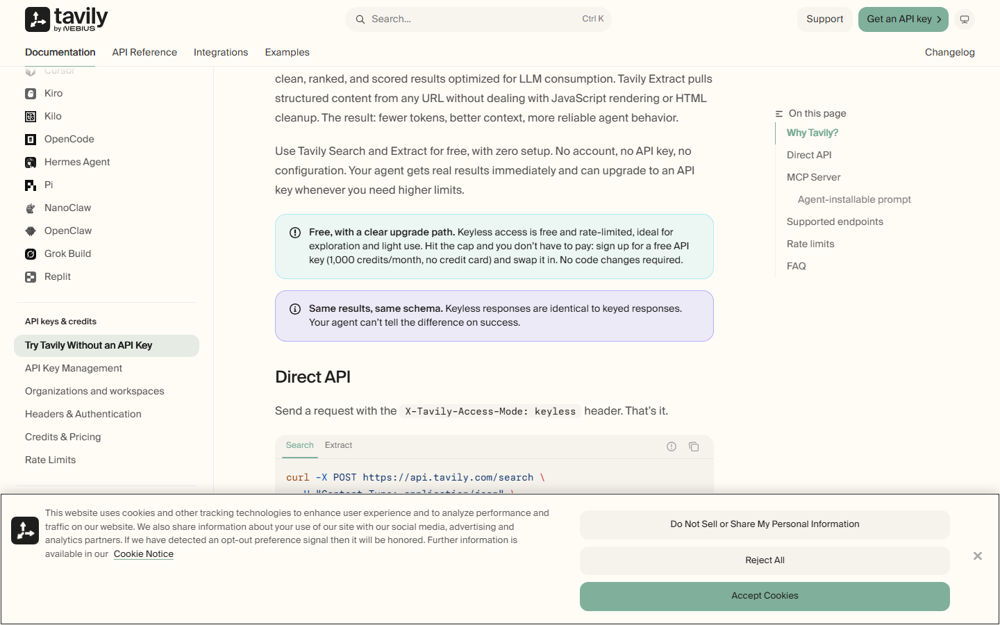
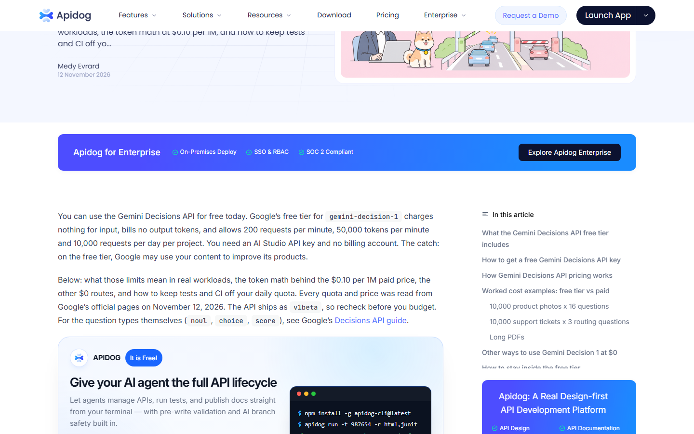
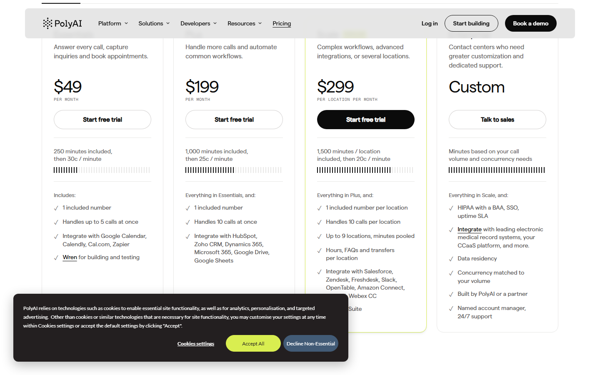

# 国家超算客户端词元不限量，这批 AI 福利领到月底

我翻了今天各家官方页，本期全是新冒出来或刚有变动的福利。最大的一笔是国家超算互联网客户端「双 11 年终巨惠」：旗舰模型词元不限量、AI 调用不受限，一直给到 11 月 30 日。

## 头条：国家超算客户端旗舰模型词元不限量

**给什么（官方活动原文）**
即日起至 11 月 30 日，下载最新版「超算互联网」客户端，即可享旗舰级大模型词元不限量、AI 调用不受限。客户端内置科学计算智能体，覆盖材料研发、生物医药、工业仿真、气象模拟等场景。同期还有三笔可叠加的福利：11 月 9 日起新用户注册再领 1 亿词元科学计算智能体额度；0.1 元限时秒杀 5000 万词元包；AIGC 短视频生成限时免费。

**真实价值测算**
「不限量」比普通送额度狠就狠在这。平时 SCNet 的 Token Plan 按量计费，旗舰模型每百万词元要几元到十几元。做 AI for Science 的课题组反复调参、多次试算，Token 消耗极快。这一档等于把首轮验证的成本压到接近 0。我更看重它打掉了课题组先试一轮的心理门槛。单看那 1 亿词元智能体额度，也够做大量文献梳理、参数试算和结果解释了。

**领取全流程**
1. 到 SCNet 官网或应用商店下载最新版「超算互联网」客户端。
2. 登录或注册；新用户在 11 月 9 日之后注册，额外领 1 亿词元额度。
3. 客户端内旗舰模型和智能体直接可用，词元不限量自动生效。
4. 0.1 元秒杀：每天 10 点在活动页开抢，实名加人脸，每自然人限一次，量包 30 天有效。

**隐藏门槛**
客户端内使用，不能导出成 API Key 给外部代码调。0.1 元秒杀那笔要抢、要人脸、每账号仅一次，别把它当成常驻福利。最关键的一点：词元不限量是「双 11 年终巨惠」的活动档，不是长期政策，11 月 30 日截止，到期后是否延续官方没明说。

**谁最该领、怎么用最划算**
做 AI4S 的科研、工程人员和学生最该上。反复试算最费 Token，先用客户端不限量把一轮完整验证跑通，看到效果再决定买算力或订阅 Token Plan。别拖到 11 月 30 日最后一天才动手，活动一停可能就恢复计费。

**对比与风险**
不限量档相当于把试错成本前置归零，但它是限时活动，不是永久免费。我的判断是，规划上别把它当长期底座。

## 按截止日排的新福利

### Tavily 搜索 / 提取免 Key 直接调
- **给什么**：Tavily Search 和 Extract 两个接口免注册、免 API Key、免配置直接调，返回结果和带 Key 完全一致，只是有限速。免费 Key 每月 1000 credits，也不需要绑卡。
- **怎么领**：请求头带上 `X-Tavily-Access-Mode: keyless` 往 `api.tavily.com/search` 和 `/extract` 发就行，SDK、MCP、curl 都行，接口一字不改。
- **截止到什么时候**：官方没写截止，属长期开放通道。
- **坑在哪**：keyless 有速率上限，超了会提示换免费 API Key，同一份 schema 不用改代码。做联网搜索/RAG 的 agent 调试期最省事。

### Gemini Decision 1 判定模型零输出费
- **给什么**：谷歌 11 月 11 日上线的 Decisions API，由 Gemini Decision 1 驱动，专门做是非、多选、打分三类判定。每百万输入 Token 收 0.10 美元（约 0.67 元），**输出 Token 免费**，同一份输入挂多少问题只计一次费。
- **怎么领**：Google AI Studio 建 API Key 即可用，免费档无需绑卡，给到每分钟 200 次、每天 1 万次请求。
- **截止到什么时候**：价目页没给该模型写截止日，目前长期可用。
- **坑在哪**：免费档内容会被用于改进产品，合同、医疗影像这类敏感数据走付费档。接口还是 v1beta，预算前再核一次官方页。做路由、分类、过审这类短活，比通用大模型硬生成便宜得多。

### PolyAI 语音对话 API 新账号送 100 美元
- **给什么**：PolyAI 的 Dialog-RSN-1 语音对话 API 给新账号 100 美元免费额度（约 667 元），按连接分钟计费，每分钟 2 美分，文本 Token 另计。
- **怎么领**：在 poly.ai 注册新账号、定价页生成 API Key 就能用，接口兼容 OpenAI Realtime 协议。
- **截止到什么时候**：**2026 年 11 月 19 日**前注册的新账号才有这 100 美元，过后变回原额度。
- **坑在哪**：只覆盖语音对话和文本 Token，语音输出 11 月 19 日后计费；并发默认 2 路，绑卡后 10 路。做客服、外呼的开发者先拿这 100 美元跑一轮验证最值。

### OpenCode Zen 新一批模型免费版
- **给什么**：OpenCode Zen 内 MiniMax M3.1 Flash、LongCat 2.5、MiMo-V2.6-Flash 等多款模型输入、输出、缓存读取全免，仅限 OpenCode 客户端内使用。
- **怎么领**：装好 OpenCode，在模型列表选对应「免费版」即可，零保留、不用于训练。
- **截止到什么时候**：官方标「限时免费」，没公布结束日。
- **坑在哪**：只在 OpenCode 内有效，站外 API 直调会被拒；Beam 免费版不含中国（含港澳）等地区，地区限制以官方文档为准。

## 这些已经没了，别白跑

- 火山方舟 Agent Plan 个人版包年 5 折 —— 11 月 12 日 24:00 关窗。
- 魔芋 AI、天工 SkyProduction、LibTV 双 11 视频模型 0 积分档 —— 11 月 11 日收口。
- 智谱 ZCode 邀请好友得 Token Boost —— 活动期 10 月 12 日至 11 月 13 日，已结束。
- WorkBuddy Hy4 Challenge Round 1 报名即得 200 credits —— 11 月 12 日截止。
- 阿里云千问办公每日登录积分 —— 已从活动清单撤下。
- Baseten 两款决策模型一周试用 —— 已撤下。

---

额度都是有时效的，看到就先去点一下。
发现哪条已经结束了，欢迎在评论区指正。
