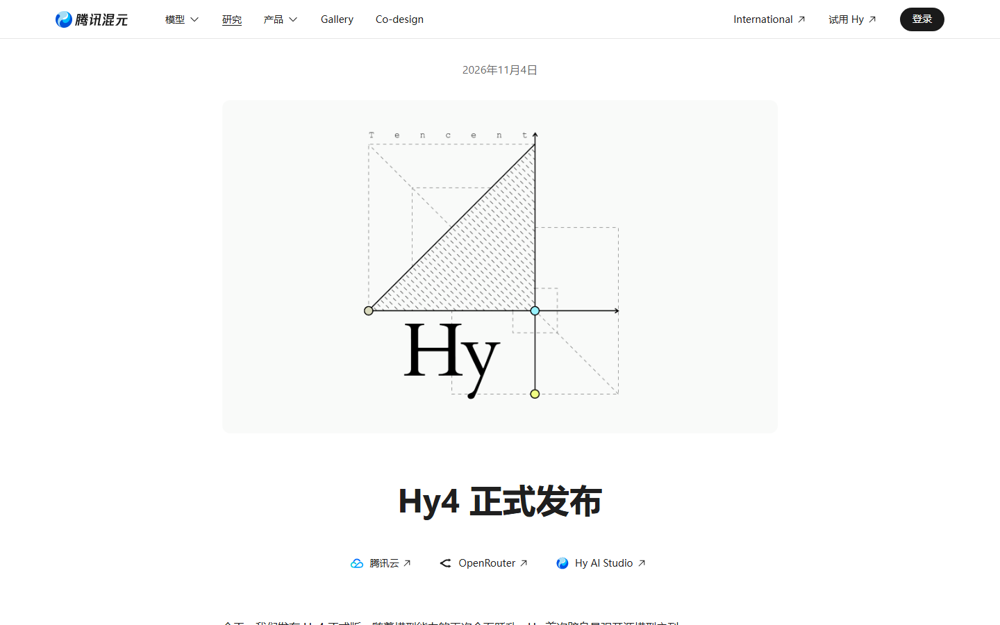
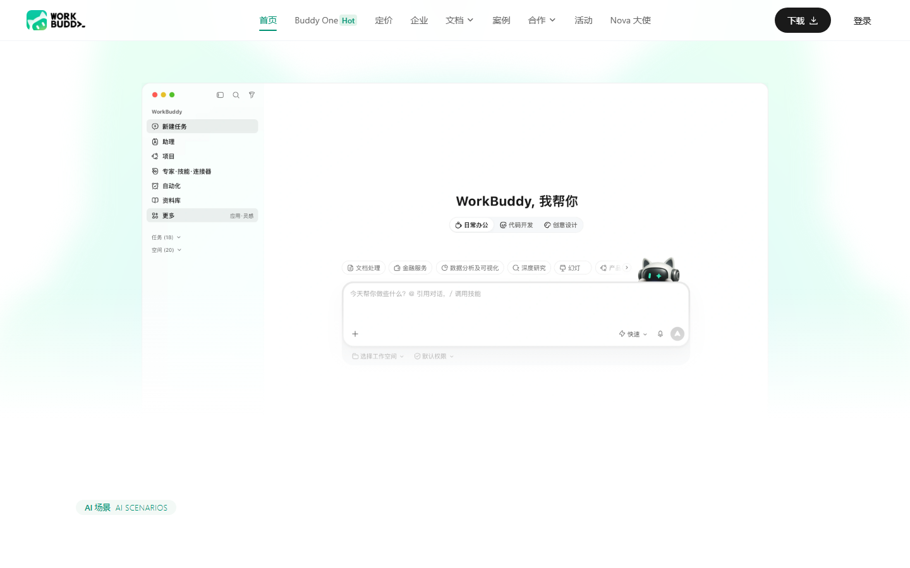
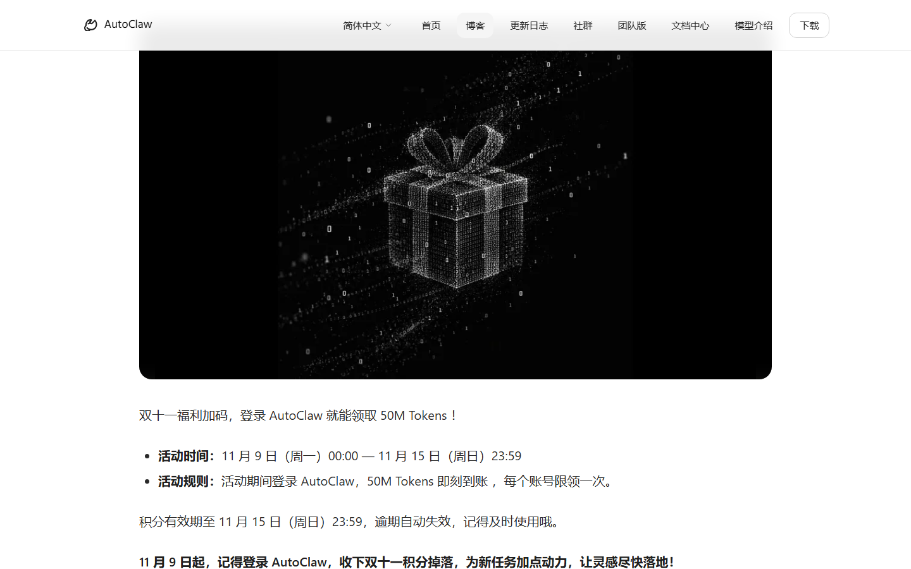
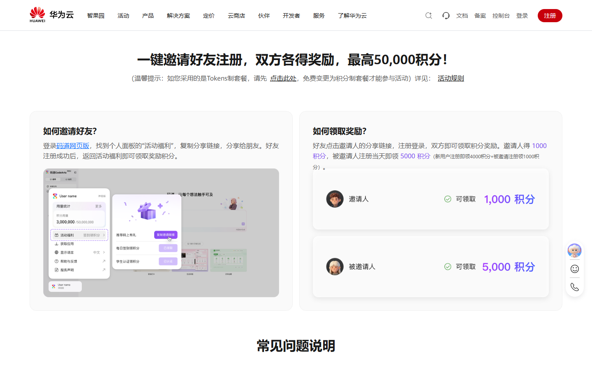
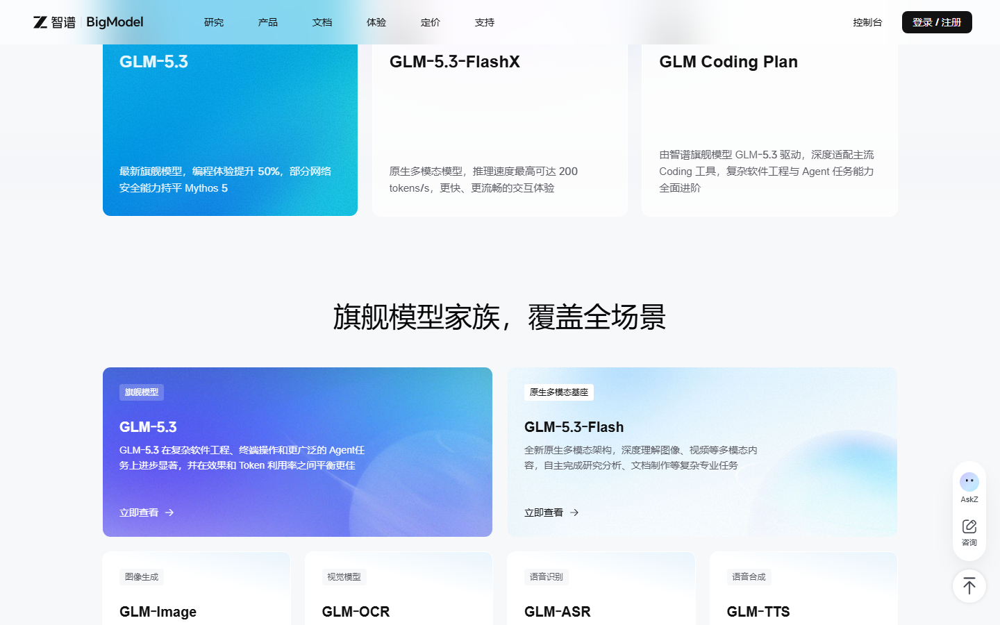

# 混元 Hy4 限免今晚关窗，AutoClaw 码道同步清零

我翻了今天各家官方页，本期只收新发或刚到关窗节点的几条，老面孔没变动的不占篇幅。最大的那笔是腾讯混元 Hy4 限免——今晚 23:59 收口，WorkBuddy / CodeBuddy 里一个 770B 旗舰模型白用一天。

## 头条：腾讯混元 Hy4 限免

**给什么（官方活动原文）**
腾讯混元 Hy4 正式版 11 月 4 日发布，WorkBuddy / CodeBuddy 客户端内限时免费，模型列表标注「限时免费 · 消耗速度 0.00x」，即调用不扣积分。窗口为 11 月 4 日至 11 月 15 日 23:59，每日赠送免费额度（订阅用户更高配额）；Hy3 限时免费一并延长至同一时点。上下文窗口 300K，可扩至 600K / 960K，思考强度高。来源：腾讯官方发布稿（hy.tencent.com/research/hy4）、央广网、北京商报、腾讯云开发者社区、WorkBuddy 官方公众号 11/4 发布稿交叉核实。

**真实价值测算**
Hy4 正式版总参 770B（MoE，激活 49B），官方称进入开源模型的头部梯队。办公评测平均 83.18 分、任务通过率 96.15%，12 个场景里 9 个排国内前列；金融盲测（213 位专家、579 个真实任务）综合表现在开源模型里名列前茅。平时定价：输入 6 元、输出 18 元、缓存命中 0.3 元每百万 tokens。一份 5 万字年报精读加一份 2 万字研报分析，约耗 30 万到 40 万 tokens，平时要花 4 元到 7 元。趁窗口把这类重活跑通，等于白用一天旗舰模型，我更看重它打掉「先买订阅再试」的门槛。

**领取全流程**
1. 打开 workbuddy.cn 下载安装 WorkBuddy，国内版与国际版同步首发，已装好的直接升级。
2. 右下角模型列表选 Hy4，看倍率显示 0.00x（等于不扣积分）即可，不用填 Key、不用改 Base URL。
3. 免费额度每日分配，触顶后页面提示重置时间；当日资源繁忙时需要排队。

**隐藏门槛**
Hy4 是带视觉理解的大语言模型，不生成图片和视频；让它生图生视频会切到专用多模态模型，按正常规则扣积分。免费额度是每天一小桶，不是一次性大桶，桶空了要么等明天要么花积分。限免是体验期不是长期福利，今晚 23:59 后大概率恢复收费。产品内使用，非 API Token，不能导出 Key 接自己的代码。

**谁最该领、怎么用最划算**
拿 WorkBuddy 跑长文档精读、整份年报分析、图表解读、生成完整网页的人最该上。我的建议：把平时要花积分的重活集中到今晚前跑完，别拿它闲聊测试。

**对比与风险**
别把「TokenHub Hy4 5 折」当免费——那是腾讯云 TokenHub 到 12 月 31 日的打折，不是 0 元，API 价格没变。WorkBuddy 里 Hy4 限免是 0 倍率、客户端内、今晚收口。我的判断：这是试用窗口不是长期底座，规划上别依赖它。

## 按截止日排，今晚到明早关窗

### 智谱 AutoClaw 双十一 5000 万
- **给什么**：智谱桌面 Agent 澳龙，双十一每周福利。国内版 11 月 9 日至 15 日登录即领 5000 万 Tokens（约 5000 积分），海外版同期 1 亿；每账号限领一次，不绑卡不订阅，老用户也能领。
- **怎么领**：到 autoclaw.zhipuai.cn 下载桌面端，登录即「即刻到账」，或点主界面礼物图标；领完去「积分加油站」核余额。
- **截止到什么时候**：2026 年 11 月 15 日 23:59 一并作废，不结转不累积。
- **坑在哪**：额度只在 AutoClaw 客户端内用，导不出 API Key；只认 GLM-5.3-Flash，换旗舰 GLM-5.3 会扣付费余额；约值 29 元（入门月卡价）。

### 华为云码道 CodeArts 金秋邀请
- **给什么**：华为云码道 CodeArts「金秋码道有礼」。新用户注册领 4000 积分，每日登录再领 100 到 200，邀友双方各得 1000，单人上限 5 万；学生认证再领 4000（到 12 月 31 日）。通用积分，码道 IDE、插件等多形态可用。
- **怎么领**：登录华为云码道，点头像「活动福利」→「推荐码上有礼」复制邀请链接，好友通过链接注册即双方到账；新用户注册也自动领 4000。
- **截止到什么时候**：邀请活动 2026 年 11 月 15 日 23:59 收口（学生认证那条到 12 月 31 日，不受影响）。
- **坑在哪**：采用 Tokens 制套餐的账号需先免费变更为积分制套餐才能参与；积分自到账起 30 天有效，逾期清零；需实名。

### 智谱 ZCode 周末 5 亿
- **给什么**：智谱 ZCode WEEKEND BUILD 周末包 5 亿 GLM-5.3-Flash，与每日 3 亿那档独立计算，仅客户端内。
- **怎么领**：连接 BigModel 账号后在 ZCode 客户端内自动到账，今天最后一天可领可用。
- **截止到什么时候**：2026 年 11 月 16 日 09:00 清零，没用完不结转。
- **坑在哪**：池子全平台共享，额度有限需抢；仅限 GLM-5.3-Flash，不能导出 API。

## 这些已经没了，别白跑

- 火山方舟 Agent Plan 个人版包年 5 折 —— 11 月 12 日 24:00 关窗。
- 魔芋 AI、天工 SkyProduction、LibTV 双 11 视频模型 0 积分档 —— 11 月 11 日收口。
- WorkBuddy Hy4 Challenge Round 1 报名即得 200 credits —— 11 月 12 日截止。
- 智谱 ZCode 邀请好友得 Token Boost —— 10 月 12 日至 11 月 13 日，已结束。
- 今晚 24:00 后，混元 Hy4 / Hy3 限免、AutoClaw 双十一 5000 万、华为云码道邀请积分也将正式进入这一列——没领的今天是最后机会。

---

额度都是有时效的，看到就先去点一下。
发现哪条已经结束了，欢迎在评论区指正。
