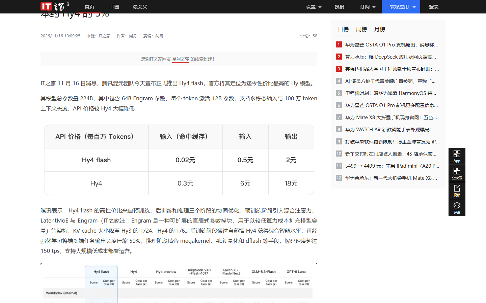
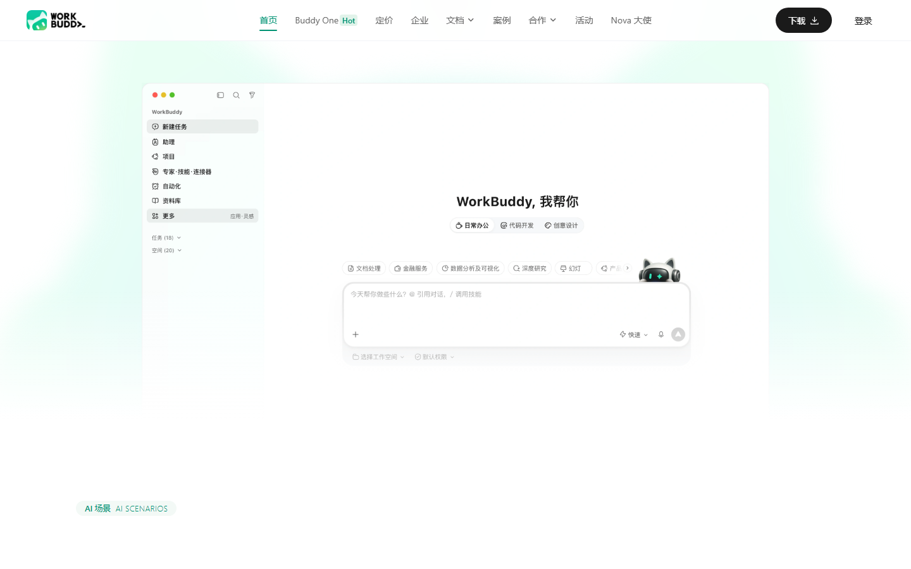
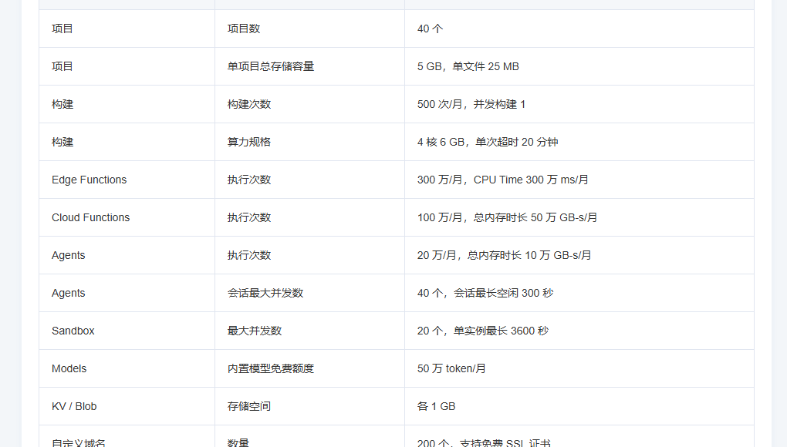
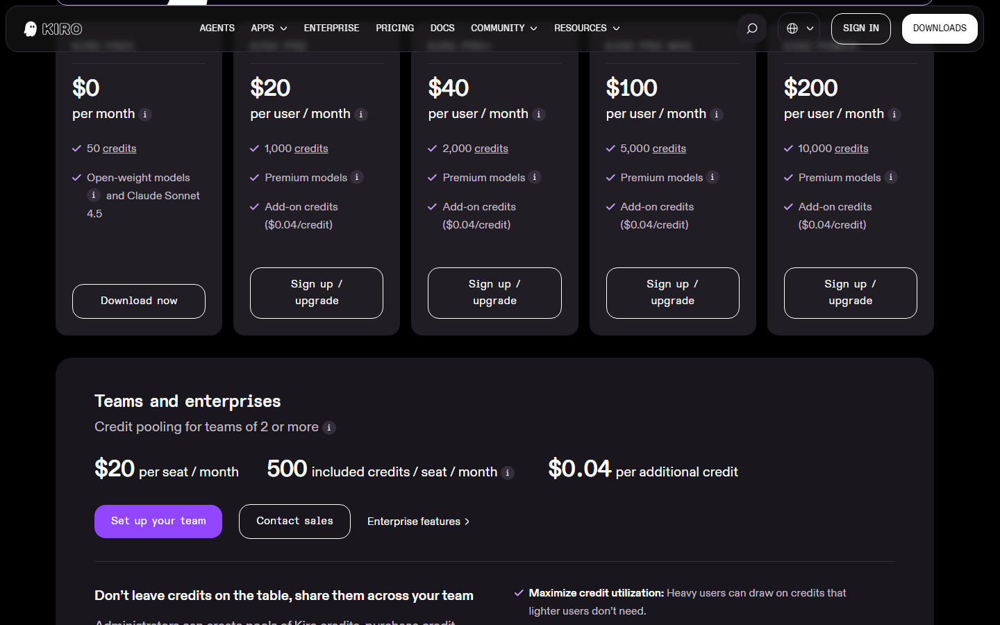

# Hy4 flash 免费到 30 日，套餐折扣中午到期

混元昨天放出 Hy4 flash，WorkBuddy 里跑文档、搜索、幻灯片这类文本活，到 11 月 30 日不扣积分。本期 4 条，全是新发或有变的。老面孔没新动作，不占篇幅。Hy4 套餐 2.5 折今天中午 12 点收档，要用趁早。

## 头条：Hy4 flash 新窗口

**它到底给什么。** IT之家 11 月 16 日原文：2026 年 11 月 30 日前，WorkBuddy 限时免费开放 Hy4 flash，TokenHub 的 API 走 5 折。参数摆在这——224B 总参（含 64B Engram）、每 token 激活 12B，多模态输入、100 万 token 上下文。新模型，新窗口。上一轮 Hy4/Hy3 限免 11 月 15 日 24:00 就收了，不叫延期。别再按老习惯翻 Hy3。

**真实价值测算。** TokenHub 价格页的刊例：输入 0.5 元、输出 2 元、缓存命中 0.02 元（每百万 token）。官方在 WorkBuddy 任务集上给的数——flash 单任务成本约 Hy4 的 1/20、preview 的 1/13。我按每天 50 万 token 的文本量估，两周刊例口径省下十几元，跑得多省得更多。倒推的数，实际账单看你账号。

**领取全流程。** WorkBuddy 客户端 → 模型列表切 Hy4 flash → 直接派文档、搜索、幻灯片任务。不绑卡、不填邀请码。要接 API 就走 TokenHub，建 Key 后按 5 折计费。

**隐藏门槛。** 免费的只是 flash 这档语言调用。生图、生视频会切多模态模型，照常扣积分。每日免费额度有分配，触顶花积分续，忙时排队。三条截止日，容易记混——WorkBuddy 免费到 11 月 30 日 23:59；TokenHub 上 flash 五折到 11 月 30 日 12:00；Hy4 本身五折到 12 月 31 日。

**适用人群 + 怎么最大化。** 深度搜索、文档处理、PPT 生成、简单前端这类日常活，flash 够用。长程软件工程，还是交给 Hy4。批量文档整理我都排在 flash 上跑，省下的积分留给多模态——我觉得这样最划算。

**对比与风险。** 官方拉 85 位内部用户、259 个任务做盲测，满意度接近 Claude Haiku 5.5。官方口径，听听就好。免费窗口只到月底，长期流程别往上挂。

## 今天到期的

### 腾讯云 · 混元 Hy4 套餐 2.5 折

- **给什么**：Token Plan 套餐档 2.5 折，输出按 4.5 元档计。
- **怎么领**：腾讯云 TokenHub 套餐页下单。跟「按量 5 折」是两套，别混算。
- **截止**：2026 年 11 月 17 日 12:00，今天中午。
- **坑在哪**：套餐折扣只在订阅体系内生效，原生按量不享受。

## 长期可领（不用赶）

### 腾讯 EdgeOne Makers

- **给什么**：内置模型免费额度 50 万 token/月，按月重置，同账号所有项目共用；9 款模型含 @makers/hy3、deepseek-v4-pro、minimax-m3、kimi-k2.6 等。
- **怎么领**：控制台 → Models 页建 API Key → 网关填 ai-gateway.edgeone.link/v1（OpenAI 兼容）。
- **截止**：长期，官方说明商业化后配额可能调整。
- **坑在哪**：50 万 token 很少，Agent 多轮加长文件一两天见底。免费版无 SLA。

### Kiro Free

- **给什么**：每月 50 credits，$0/月，可用开源权重模型和 Claude Sonnet 4.5。
- **怎么领**：kiro.dev 下载安装，登录后选免费档。不绑卡。
- **截止**：长期，官方定价页未写截止。
- **坑在哪**：50 credits 不多，重度用户几天见底。Pro 档加购 0.04 美元一个 credit。

## 这些已经没了，别白跑

- 智谱 ZCode 周末 5 亿包：11 月 16 日 09:00 已清零。
- 混元 Hy4/Hy3 旧窗口（WorkBuddy、CodeBuddy）：11 月 15 日 24:00 已收官，别和 flash 新窗口混了。
- 智谱 AutoClaw 双十一 5000 万：11 月 15 日 23:59 结束。
- Google Cloud 300 美元赠金：11 月 16 日起不再覆盖 Gemini 与 Vertex。

---

额度都是有时效的，看到就先去点一下。
发现哪条已经结束了，欢迎在评论区指正。
