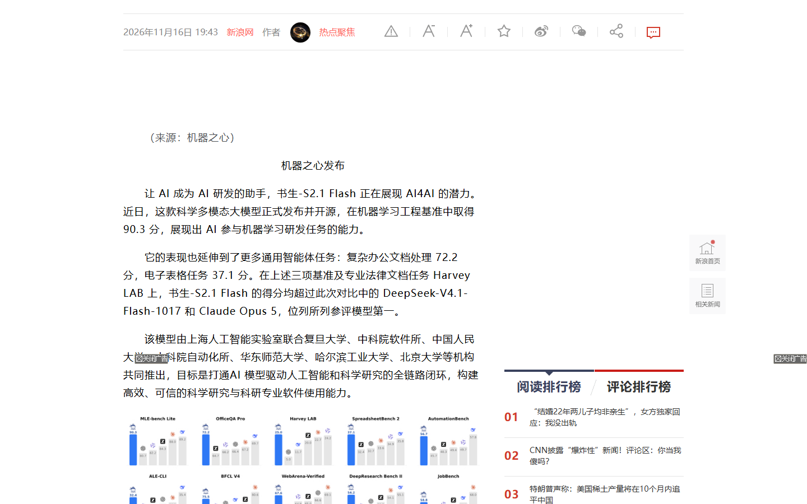
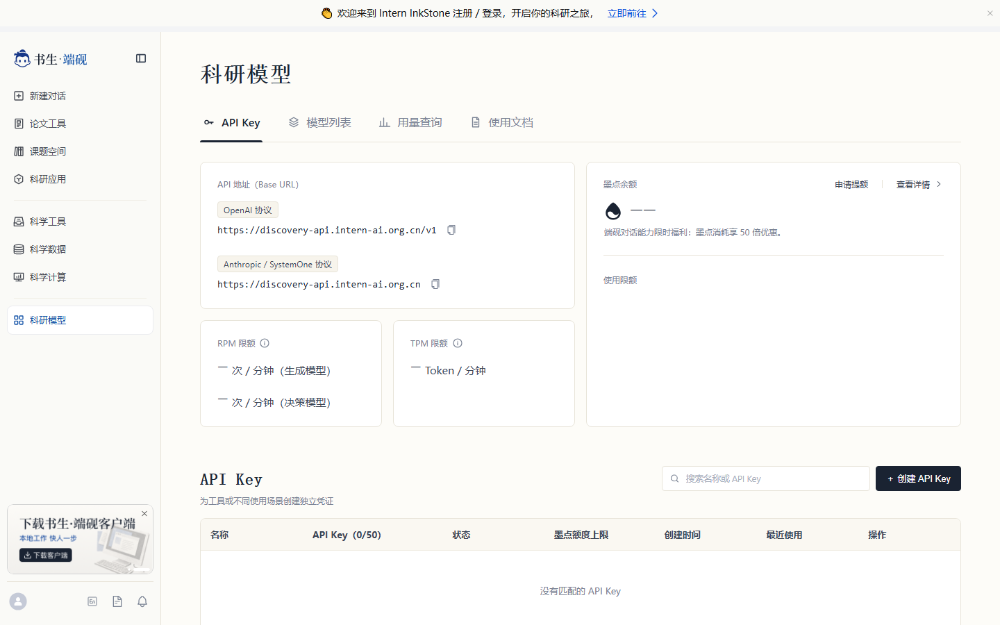
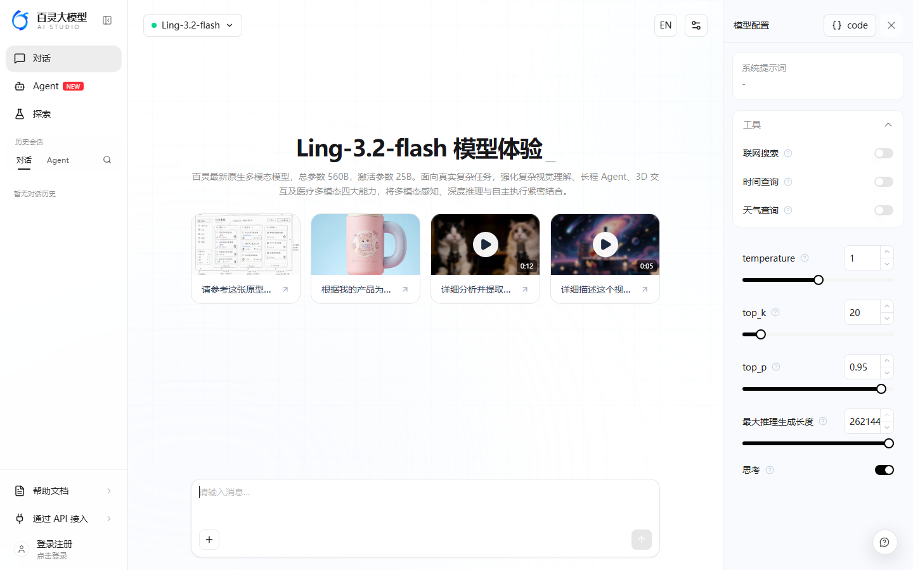
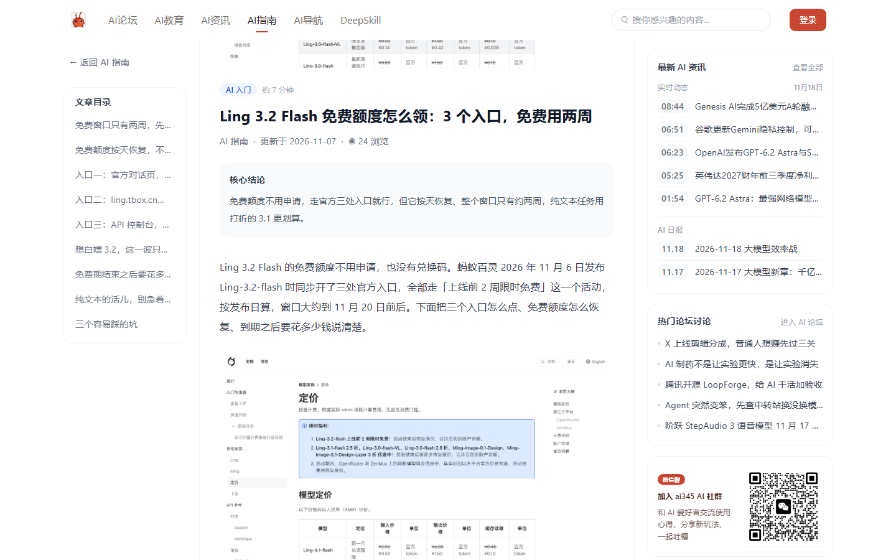
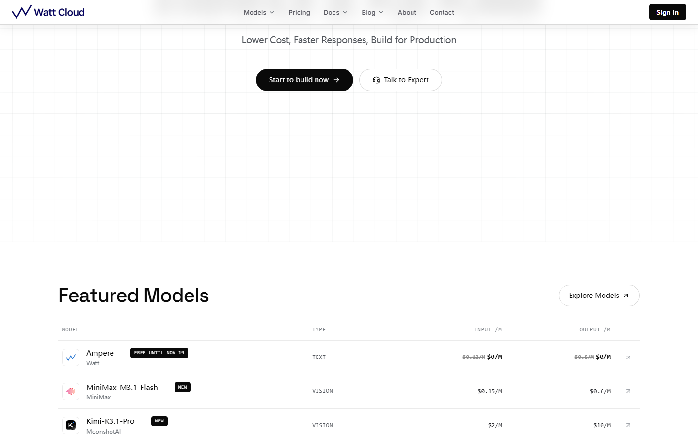

# 书生新模型按 1% 收费，别急着给 API 充值

今天最值得动手的是书生·端砚刚放出来的 S2.1 Flash：新模型上线，价格按对标模型的 1% 收，这个窗口开到 12 月 9 日。本期只收这类新发、或状态刚变的三条，老面孔这周没有新动作的，就不占篇幅了。

## 头条：书生 S2.1 Flash

**它到底给什么。** 机器之心 11 月 16 日的发布稿原文：这款科学多模态大模型正式发布并开源，对标 GLM 5.3 Flash，限时优惠是"即日起至 12 月 9 日，价格仅为对标模型的 1%；12 月 10 日至 12 月 31 日，价格仅为对标模型的 10%"，同时新用户注册送免费额度。开源权重在 Hugging Face 和 ModelScope 都能取。API 走 OpenAI 协议，Base URL 是 discovery-api.intern-ai.org.cn/v1。

**真实价值测算。** "1%"就是一百分之一，同样的调用量，账单约为对标模型的百分之一，相当于一折再打一折。12 月 10 日起涨到 10%，一夜贵十倍。新用户那份免费额度，官方没写具体数字，页面只说"大量"，我建议以注册后控制台显示为准，别按别人的数做预算。

**领取全流程。** 打开 discovery.intern-ai.org.cn/token-plan/home，注册登录，进"API Key"页创建密钥。想先看效果，直接在网页对话里问就行，不用配 key。要接到自己的程序里，把 Base URL 换成上面那条，模型选 S2.1 Flash。新用户额度注册后自动到账，不用手动领。

**隐藏门槛。** 免费额度具体多少，官方没公布——这是我最想盯的一点。1% 是"对标模型价格"的 1%，别当成绝对价，对标模型调价，它跟着动。控制台里 RPM、TPM 限额摆着，重点额度显示为需单独申请。注册页要不要实名，我没跑到那一步，以页面实际要求为准。

**适用人群 + 怎么最大化。** 做科研、啃长文档、要模型看图看视频的人最对路。我的排法是赶在 12 月 9 日前把重活压到这个 1% 窗口里跑完，12 月 10 日之后这批任务成本翻十倍，不划算。

**对比与风险。** MLE-bench 90.3 分这类成绩是厂商自测，没有第三方复现，看看就好。真正要盯的是价格条款：1% 只给到 12 月 9 日，之后翻成 10%。要长期挂工作流的，先把 1% 这段用够再决定。

## 快讯：两条 0 元窗口明后天关

### 蚂蚁百灵 Ling-3.2-flash

**给什么。** 560B 总参、25B 激活、100 万上下文的原生多模态模型，图文视频都能直接喂，上线前两周 API 免费。平台另有每日 50 万 token 的常态免费额度，凌晨发放，当天不用就作废。

**怎么领。** 只想试手感，打开 chat.ant-ling.com 直接聊；要接程序，去 developer.ant-ling.com 控制台建 Key，首次开通得绑个人支付宝，企业支付宝不支持。

**截止到什么时候。** 官方只写"上线前 2 周"，按 11 月 6 日发布倒推，大约 11 月 19 到 20 日。没给精确日，我按 11 月 19 日准备。

**坑在哪。** 免费期结束恢复原价，原价官方还没挂出来；没绑代扣的，免费额度用完接口直接停，不会偷偷扣钱。

### Watt Cloud · Ampere

**给什么。** 自研多模态模型 Ampere，官网模型表标着输入、输出都是 $0/M，划掉的原价是输入 $0.12/M、输出 $0.8/M。

**怎么领。** 到 watt-cloud.com 注册，建 API Key，充一笔 Credits 激活（金额不限，Credits 不过期），model 填 ampere，接口地址 api.watt-cloud.com/v1。

**截止到什么时候。** 官网那一行直接写着 FREE UNTIL NOV 19，也就是 11 月 19 日。

**坑在哪。** 得先充 Credits 才能调用，等于要绑支付方式；同一张表里只有 Ampere 免费，旁边 Kimi、MiniMax 那些照常收费，别选错模型。

## 这些已经没了，别白跑

- MiniMax H3-Image 首周出图五折，11 月 18 日 00:00 已收口。
- 阶跃 StepAudio 3 语音全系限免，11 月 17 日 11:59 结束。
- 腾讯云 Hy4 Token Plan 积分 2.5 折，11 月 17 日 12:00 收口。
- 智谱 ZCode 周末 5 亿，11 月 16 日 09:00 已清零。
- OpenAI 那 5 万份免费 Plus 学术名额，11 月 23 日才开放，而且官方明确把中国和香港排除在外，先别惦记。

---
额度都是有时效的，看到就先去点一下。
发现哪条已经结束了，欢迎在评论区指正。
