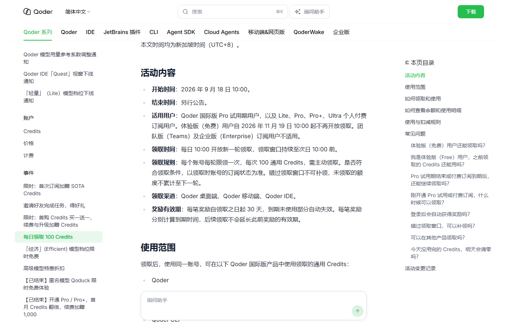
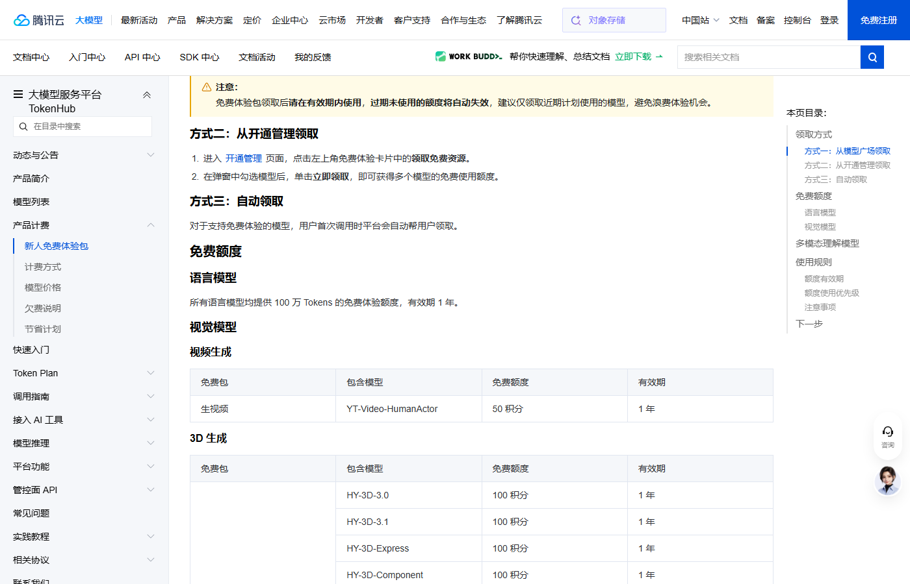
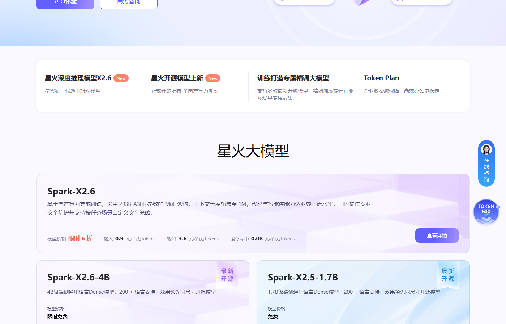
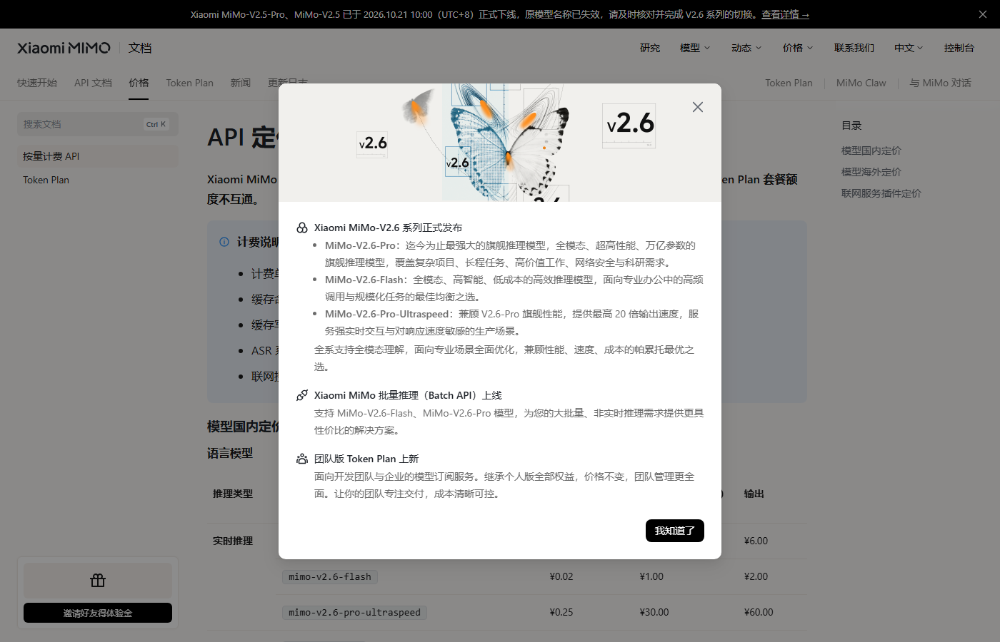

# Qoder 今天起停送免费用户，腾讯云这份还能用一年

Qoder 从今天上午 10 点起，免费体验版用户领不到每天那 100 Credits 了。腾讯云那边，新人免费包刚更新过一轮：语言模型每款 100 万 Tokens，能用一整年。本期只挑这类今天刚变、或刚确认还能领的三条，长期没动的不占篇幅。

## 头条：腾讯云 TokenHub 新人免费体验包

**它到底给什么。** 腾讯云文档写得很直白：语言模型每款给 100 万 Tokens 免费体验额度，有效期 1 年。六个主力文本模型——DeepSeek、Kimi、GLM、MiniMax、小米 MiMo，加上自家的混元 Hy4 preview——每个都能单领一份 100 万。多模态理解模型也是每款 100 万、1 年有效。3D 那一系列给的是积分，混元生 3D 各 100 积分，视频生成的 YT-Video-HumanActor 给 50 积分，都是 1 年。

**真实价值测算。** 六个文本模型各 100 万，加起来 600 万 Tokens，按各家刊例价折算，够把一个中等规模的私人项目从零跑到能演示。关键是有效期 1 年，这一点比大多数羊毛实在——很多免费额度只有 30 天或 90 天，这个能摊到明年。按腾讯云价目页，DeepSeek-V4.1-Flash 这类模型 100 万 Token 也就几块钱的量，六款一起是省下几十元的试用成本。

**领取全流程。** 三种方式挑一个。最省事的是模型广场：登录 TokenHub 控制台，开通服务后进「模型广场」，右上角点「新用户福利免费体验」，弹窗里勾选想要的模型，点立即领取。或者进「开通管理」，左上角免费体验卡片里点「领取免费资源」。还有一种是懒人法——对支持免费体验的模型，第一次调用时平台会自动帮你领。前提都是三样：腾讯云账号、实名认证、开通 TokenHub。

**隐藏门槛。** 每个主账号、每个模型只能领一次，领了不能重来。官方特意提醒只领近期真打算用的——额度从领取那天起算，到期没用完自动作废。早领早过期，这点最容易栽。3D 的「100 积分」和语言的「100 万 Token」是两套计价单位，别混着比大小。活动截至 2026 年 12 月 31 日，官方留了话，后续可能延续或调整，看运营安排。

**适用人群 + 怎么最大化。** 写代码、跑 Agent、想横向对比几家国产模型手感的，最该领。我的排法是先把 DeepSeek、Kimi、GLM 这几个常用的领了，其余等真要用再动手——反正首次调用自动领，不必一次囤齐。

## 快讯：两条新确认的免费口子

### 讯飞星火 Spark-X2.6-4B

**给什么。** 4B 级端侧通用 Dense 模型，200 多种语言、1M 上下文，代码和智能体能力都升了级，还加了对三档推理模式的支持。模型广场标着「限时免费」，免费领取、在线体验都行。

**怎么领。** 打开 xinghuo.xfyun.cn 的模型广场，找到 Spark-X2.6-4B，点「免费领取」；同一页的「模型精调」区还有「限时免费精调」，做行业微调也能白用。

**截止到什么时候。** 官方价格页只写「限时免费」，没给具体日期，以页面当日显示为准。

**坑在哪。** 旁边的 X2.5-1.7B 才是永久「免费」，两款别搞混；旗舰 X2.6 是限时 6 折，不是免费。要接 API 得建 Key，我这次只核到页面标价，没代跑领取。

### 小米 MiMo V2.6 系列

**给什么。** 11 月 18 日，小米 MiMo-V2.6 系列正式发布——V2.6-Pro 旗舰推理、V2.6-Flash 全模态、V2.6-Pro-Ultraspeed 三款。定价页的计费说明里，「缓存命中」一档写着「限时免费」，也就是请求命中 Prompt Cache 的那部分不计费。

**怎么领。** 到 platform.xiaomimimo.com 建 API Key 直接调用，缓存命中的 Token 自动按免费档结算，不用手动领。

**截止到什么时候。** 官方定价页写「限时免费」，未标注具体日期，以页面当日显示为准。

**坑在哪。** 免费的是缓存命中部分，未命中的输入和输出照常按量收费；V2.5-Pro、V2.5 已于 10 月 21 日下线，老模型名别再接。

## 这些已经没了，别白跑

- **Qoder 每日 100 Credits（免费用户）**：今天 10:00 起体验版不再开放，只剩 Pro 试用期和 Lite / Pro / Pro+ / Ultra 付费订阅用户能领。
- **蚂蚁百灵 Ling-3.2-flash 上线两周全免**：官方口径到 11 月 19 日前后，今天按结束处理。
- **阶跃 StepAudio 3 语音限免**：11 月 17 日 12:00 已转全价，实时语音 0.65 元/会话分钟。

---

额度都是有时效的，看到就先去点一下。
发现哪条已经结束了，欢迎在评论区指正。
