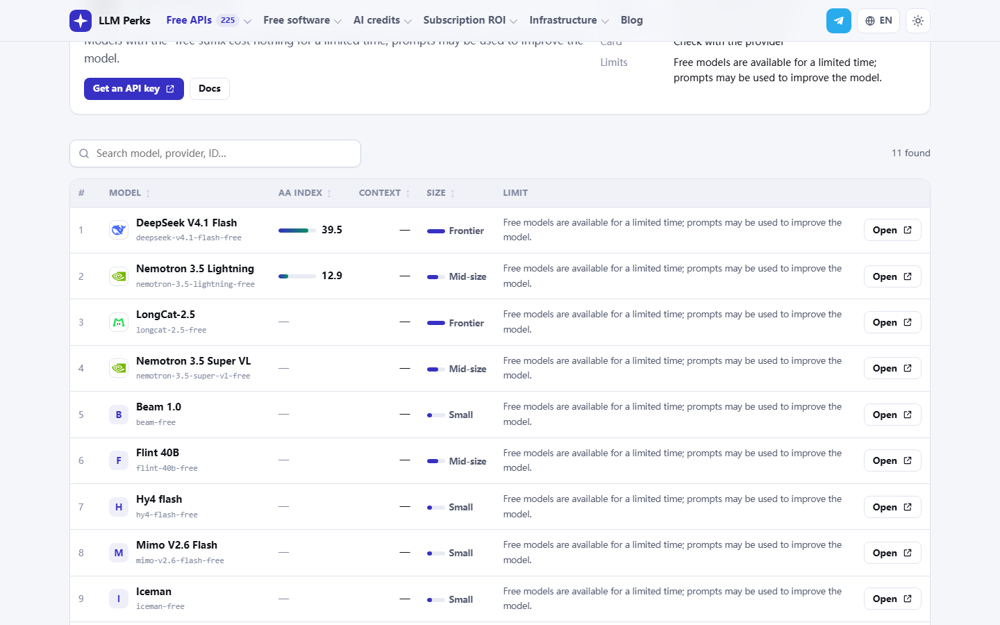
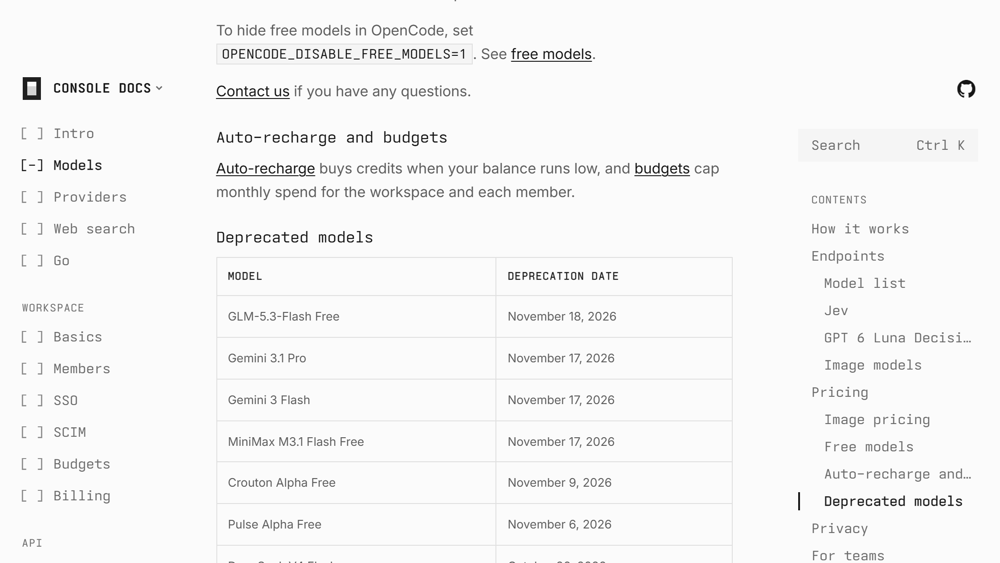
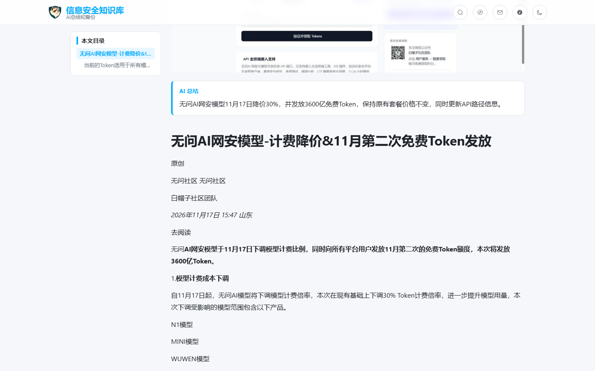
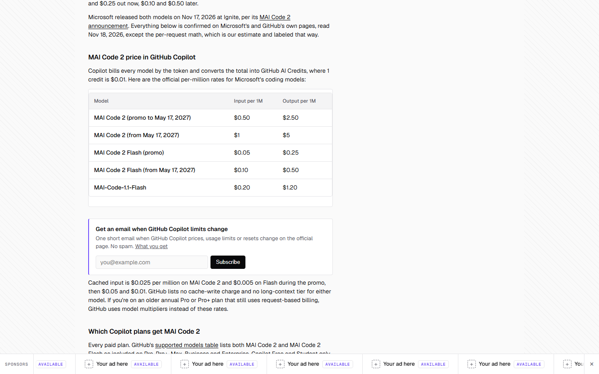

# OpenCode 不只 Hy4，12 款模型还能免费用

这两天 AI 免费圈一边上新、一边关窗。最该动手的是 OpenCode：免费池刚砍掉两款，剩下 12 款还能白用到 11 月 23 日。本期只收这类刚变、或刚确认还能领的四条。长期没动的老面孔，不占篇幅。

## 头条：OpenCode 免费池减员，12 款还能用三天

**它到底给什么。** OpenCode 官方文档的 Free models 一节写着，带 `-free` 后缀的模型限时免费，基础地址 `https://opencode.ai/zen/v1`，兼容 OpenAI 格式。我把文档模型和第三方实时清单对了一遍：DeepSeek V4.1 Flash、腾讯 Hy4 flash、美团 LongCat 2.5、小米 MiMo-V2.6-Flash、英伟达 Nemotron 3.5 两款，还有 Beam、Flint 40B 等，合起来 12 款，上下文最高 100 万。第三方清单 11 月 19 日更新那次数到 11 款，跟官方口径差一两款——以你打开客户端时看到的为准。

**真实价值测算。** 这些模型单独走 API 都要钱。光看 Hy4 flash，官方刊例输入 0.5 元、输出 2 元每百万 Token；DeepSeek V4.1 Flash 也是同级别价位。一天里把文档整理、代码补完、长文摘要分给这几款跑，按刊例折算就是几十元的量。现在零成本。LongCat 2.5 是 1.6 万亿参数的大模型，每天还能免费用 100 次，单这一项够把一批批处理任务跑完。我天天调模型比手感，省下的不只是钱。

**领取全流程。** 去 opencode.ai 下载客户端，或者用官方安装脚本。装好后终端敲 `opencode models` 看当天在架的免费模型，再用 `/models` 选中带 `-free` 后缀的那个，直接对话就行。不用注册账号，不用 API Key，也不用绑卡。这是它比别家省事的地方。

**隐藏门槛。** 免费池在缩水。官方 Deprecated 表白纸黑字：GLM-5.3-Flash Free 11 月 18 日、MiniMax M3.1 Flash Free 11 月 17 日下线，加上更早下架的几款，池子从十几款减到 12 款。关窗时间是多个权益清单记的 11 月 23 日，官方文档只写"限时"没给硬日期——我按保守的算，当 11 月 23 日准备。还有个坑：部分模型的提示词会被拿去训练，Inkling 2 Small、Big Pickle、Iceman 这几款官方明说保留数据；Beam Free 干脆不对中国内地和港澳开放。跑公司代码、证件信息，得避开这几款。

**适用人群 + 怎么最大化。** 写代码、做 Agent、想横向比模型手感的，最该趁这几天白用。我的排法：长文档和批量任务丢给 LongCat、DeepSeek V4.1 Flash，日常补完用 Hy4 flash，涉密的活一律不走免费池。这口子随时可能收，别等。

## 快讯：三条刚变或刚确认的口子

### 无问 AI：11 月第二轮 3600 亿 Token

**给什么。** 无问社区 11 月 17 日的官方原文写得很直白：11 月第二次免费 Token 发放，所有平台用户都能领 3600 亿 Token，兑换码 `WUWEN_DEC_2_TOKEN_TICKET`。同一纸公告还把 Token 计费倍率全线下调 30%，套餐价不动。再往前，11 月 5 日那轮用的是 `WUWEN_DEC_TOKEN_TICKET`。

**怎么领。** 到 wwlib.cn 的福利兑换页，切到"领取 Token"选项卡，填兑换码。领完去 API 控制台拿 Key 和接口地址。

**截止到什么时候。** 第一轮限期包官方标 12 月 9 日 11:51 清零，注册后每天另到账 3500 万；第二轮以兑换页当日显示为准，我没查到硬日期。

**坑在哪。** 这是无问芯穹面向网安场景的模型社区，不是通用大模型平台。模型倍率各不同，Token 数不等于能干多少事。兑换页要登录才看得到，我没代跑领取。

### 火山方舟 Managed Agents：web_fetch 限免

**给什么。** 11 月 18 日，火山把 Managed Agents 的计费挂上价格页：网页抓取 web_fetch 限时免费，首次开通另送 500 次。对照着看，web_search 是 0.02 元一次，Agent 运行时 0.5 元一小时。

**怎么领。** 火山方舟控制台进 Managed Agents，开通就能用 web_fetch 的免费额度，不用单独申请。

**截止到什么时候。** 价格页只写"限时免费"，官方没给硬日期，以页面当日显示为准。

**坑在哪。** 只免 web_fetch 这一项，搜索和 Agent 运行照常计费。这条我核到的是权益清单和速报交叉引述的官方价格页，没抓到官方页原始日期，按保守口径收。

### 微软 MAI Code 2 Flash：Copilot 免费档能用

**给什么。** 11 月 17 日微软 Ignite 发布两款编程模型，当天进 GitHub Copilot。MAI Code 2 Flash 促销价输入 0.05 美元、输出 0.25 美元每百万 Token（2027 年 5 月 17 日后翻倍）。

**怎么领。** Copilot Free 和 Student 档没有手动选模型的权限，只能走 Auto 路由——Flash 在 Auto 的候选里，选 Auto 就可能分到它。Pro 及以上档可以在模型选择器里直接点 Flash。

**截止到什么时候。** 促销价到 2027 年 5 月 17 日；免费档经 Auto 用 Flash 是长期口径。

**坑在哪。** Free 档不能保证一定分到 Flash——Auto 是按任务路由的。Code 2 主干模型只有付费档能选，免费档别惦记。

## 这些已经没了，别白跑

- **云知声 U2-Flash 注册送 1 亿 Token**：多个权益清单记着 11 月 20 日到期，但官网现在主推 U2-Flash-1118 付费六折版，没挂出那波免费活动的原始页，我按查无实据处理，没写进正文。
- **蚂蚁百灵 Ling-3.2-flash 上线两周全免**：官方只说"两周"，按 11 月 19 日前后结束处理。
- **火山 Coding Plan 邀请 9.5 折**：11 月 19 日最后一天，已收。
- **腾讯云 TokenHub 的 DeepSeek 搜索与抓取**：11 月 18 日 00:00 起转收费，每千次约 5 元，免费的口子没了。

---

额度都是有时效的，看到就先去点一下。
发现哪条已经结束了，欢迎在评论区指正。
