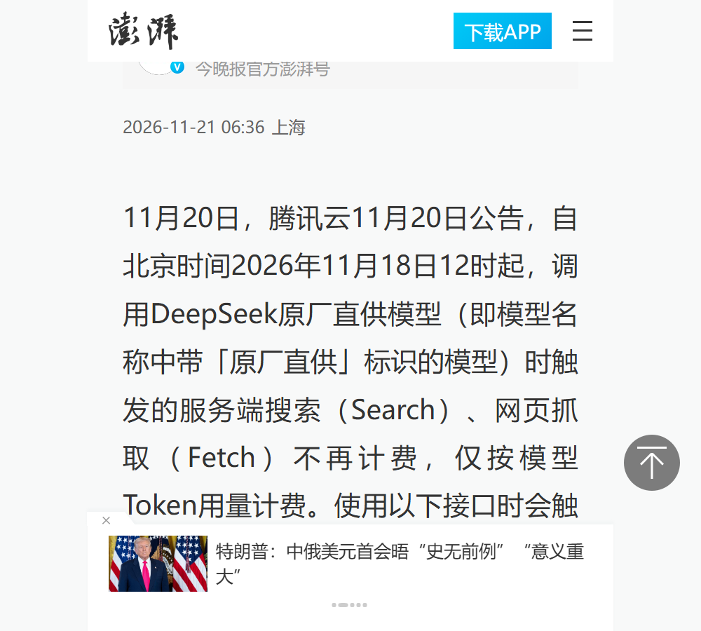
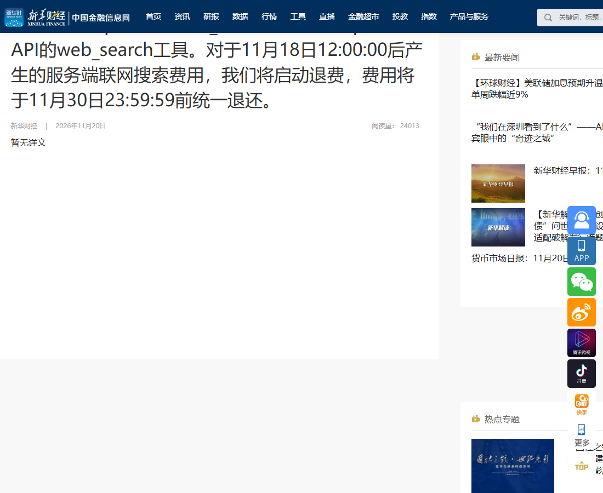
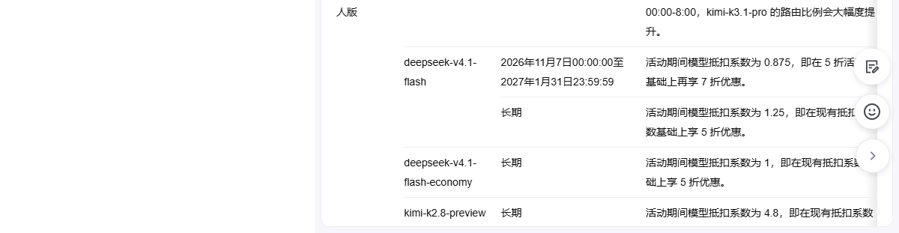
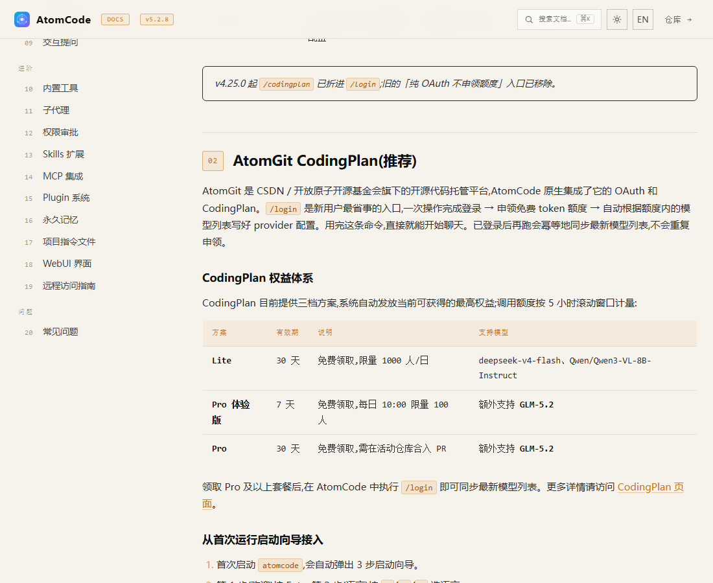

# DeepSeek 联网搜索免费，腾讯云 11 月底退费

昨晚腾讯云挂出公告，DeepSeek 原厂直供模型的联网搜索不计费了，连 11 月 18 日中午以后扣的搜索费也退。这期只收新发和有变的 4 笔，老面孔没动静就不占篇幅。最急的是智谱周末 5 亿，周一 09:00 清零。

## 最大一笔：搜索不收钱了，扣过的也退

**给什么，官方原文怎么写。** 腾讯云 11 月 20 日的公告写得很直白。自北京时间 2026 年 11 月 18 日 12:00 起，调用 DeepSeek 原厂直供模型触发的服务端搜索 Search、网页抓取 Fetch，不再计费，只按模型 Token 用量算。18 日 12:00 之后产生的服务端联网搜索费用会退，11 月 30 日 23:59:59 前统一退还，不用单独申请。原厂直供的定义也写明了，模型名带「原厂直供」标识的才算。

**真实价值。** 独立的 Search/Fetch 接口此前按 5 元/千次收费。做 Agent 的团队一天调几千次联网搜索不稀奇，一个月几百到上千元。这块现在归零，扣过的还能退回。按官方口径，退费覆盖 18 日中午之后所有服务端联网搜索费用，不用提交工单，钱退回原账户。

**领取全流程。** 不用领，不用申请。选带「原厂直供」标识的 DeepSeek 模型，用 Anthropic API 或 Responses API 里的 web_search 工具触发搜索，系统就按免费算。退费也是自动的，11 月 30 日 23:59:59 前到账。我建议去账单里翻一下 18 日中午以后的搜索费，记个数，月底对着看有没有退。

**隐藏门槛。** 三条得盯紧。只有带「原厂直供」标识的模型算，其他渠道的 DeepSeek 不适用。独立的 /v1/tools 接口不在这次范围，仍按 5 元/千次收，两者很容易搞混。退费只到 11 月 30 日，过了这个点再发现没到账，就得找客服。免费政策没写终止日，腾讯云保留调整权。

**谁最该用。** 做联网问答、网页抓取 Agent 的开发者受益最大，把搜索任务切到原厂直供模型，成本直接砍掉一块。重度用户先查退费，轻度用户把接口切过去就够了。要最大化利用，批量抓取放到这类模型上跑，别再走 /v1/tools 那个收费口子。

**对比和风险。** 独立 /v1/tools 接口仍是 5 元/千次。官方等于把「模型自己搜」和「你主动调搜索」拆成两档。政策口径此前反复过，11 月 1 日 Search/Fetch 才开始收费，半个月不到又改回免费并退费，定价还在摇摆。真要长期依赖，这块成本按最坏情况留个预算。

## 其余新变

### 智谱 ZCode 周末包 5 亿，周一清零

**给什么。** WEEKEND BUILD 周末包，5 亿 GLM-5.3-Flash Token，覆盖整个周末约 58 小时。相比上一期 11 月 16 日清零的周末包，这是新开的一期，机制没变。

**怎么领。** 周五 19:00 在 ZCode 客户端左下角卡片点领，23:00 生效。领完去模型设置把通道切到 Start Plan、模型停在 GLM-5.3-Flash，否则还走原来的付费通道。

**截止。** 2026 年 11 月 23 日 09:00 清零，不结转。

**坑在哪。** 仅客户端内可用，不能导出 API Key；19:00 领、23:00 才生效，池子共享，晚领可能抢不到。细则官方页面没公布，以客户端内公告为准，这条我只追到二级源。

### 火山方舟多款模型折扣改长期

**给什么。** 官方折扣文档 11 月 19 日更新。kimi-k3.1-pro 限时五折、配额 200%，到 2027 年 1 月 31 日。kimi-k2.8-preview 的六折从固定截止改成「长期、进行中」，deepseek-v4.1-flash-economy 的五折同样转长期。

**怎么领。** Agent/Coding Plan 个人版用户，到点就生效，无需申请。

**截止。** k3.1-pro 到 2027 年 1 月 31 日 23:59:59，另两款标长期，官方保留调整权。

**坑在哪。** 这是订阅套餐内的抵扣系数折扣，不是免费额度，得先订阅个人版。此前有转述说 k3.1-pro 折扣 11 月 10 日恢复标准系数，文档现在写的是到明年 1 月底，以官方文档为准。

### AtomCode 每天放免费编程额度

**给什么。** CodingPlan 三档。Lite 免费 30 天、每日 1000 人。Pro 体验版免费 7 天、每日 10:00 放 100 人。Pro 免费 30 天，要在活动仓库合入 PR。

**怎么领。** 装 AtomCode 客户端，执行 /login 用 AtomGit 授权，系统按能拿到的最高档发放。用 /status 查用量和重置时间。

**截止。** 长期滚动，每档按各自有效期算，名额每日重置。

**坑在哪。** v4.25.0 起 /codingPlan 折进了 /login，旧的纯 OAuth 入口不再申领额度。Pro 体验版每天只有 100 个名额，10:00 准点抢。额度按 5 小时滚动窗口计量，不是无限用。

## 这些已经没了，别白跑

阶跃 StepAudio 3 语音线 11 月 17 日 11:59 起按会话分钟计费。蚂蚁百灵 Ling-3.2-flash 上线前两周免费约到 11 月 19 日。Watt Cloud 自研 Ampere 官网标 FREE UNTIL NOV 19。Google Antigravity 免费档的 Claude 模型 11 月 18 日已移除。OpenAI 学术 5 万 Plus 席位 11 月 23 日才开放申请，且明确不含中国大陆。

---
额度都是有时效的，看到就先去点一下。
发现哪条已经结束了，欢迎在评论区指正。
