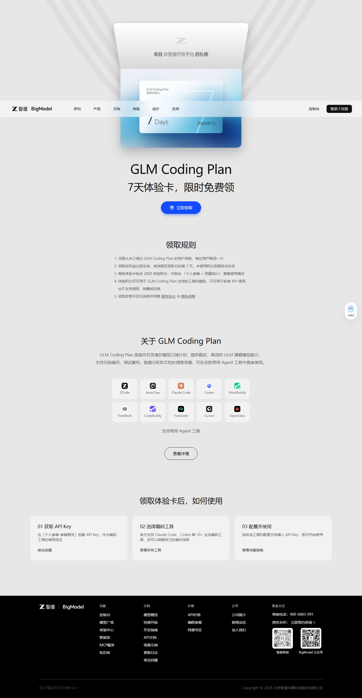
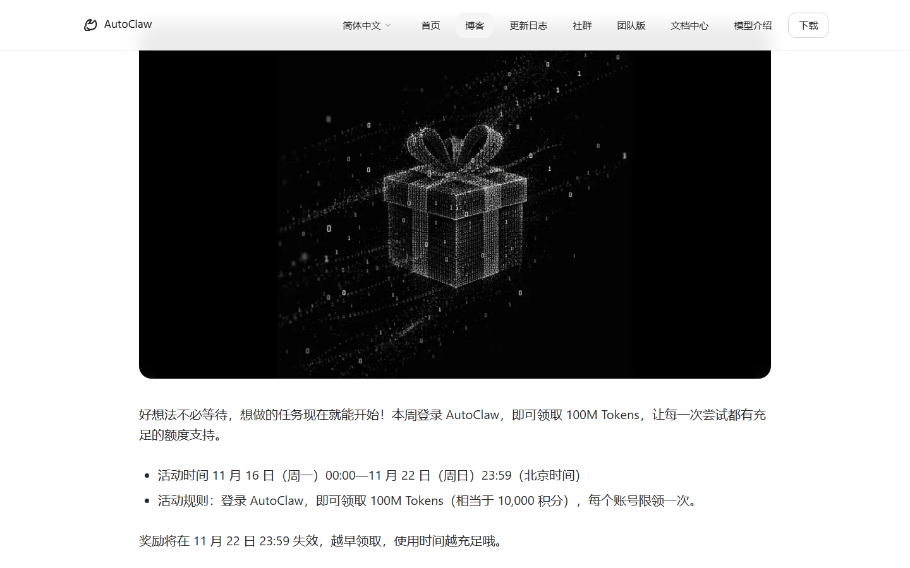
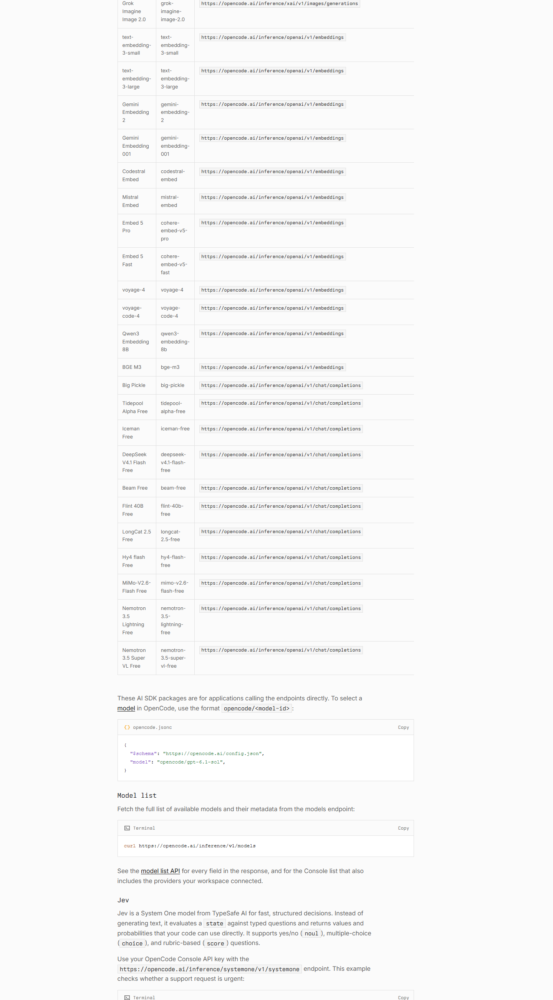
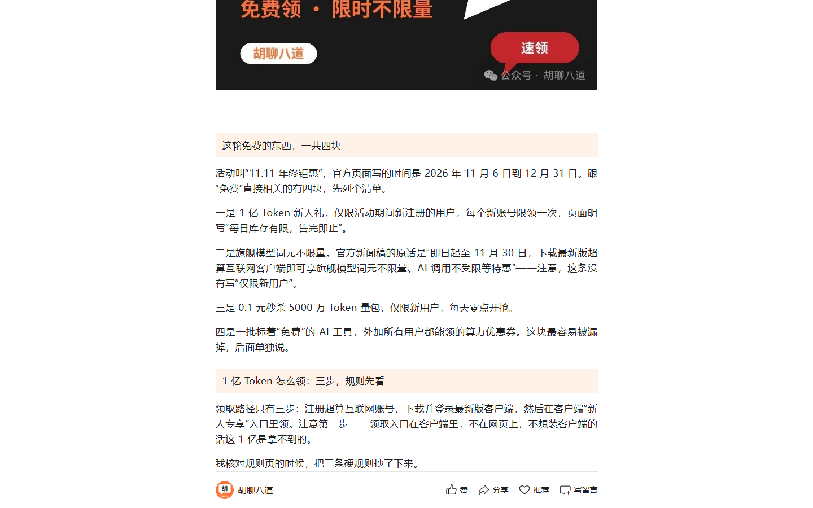
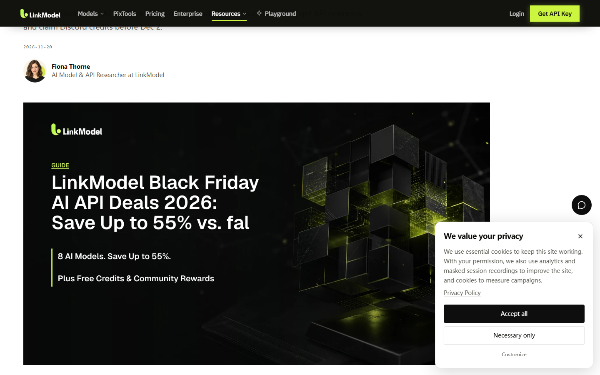

# 智谱 7 天卡每天放 1 万张，OpenCode 明天关池

别只盯着新用户专属那一档。智谱把 GLM Coding Plan 的 7 天体验卡重置放量了，每天 1 万张。OpenCode 那 12 款免费模型，明天关池。本期 5 条，新开的、临关的都有。老面孔没变化，我一条没列。

## 本期最大羊毛：智谱 GLM Coding Plan 7 天体验卡

白送是真的，门槛也是真的。这张卡只给"套餐新朋友"——没订阅过 Coding Plan 的账号才能领。订过的这次也重置了数量，等于再给一次机会。

**它到底给什么。** 活动页写着"GLM Coding Plan 7 天体验卡，限时免费领"，领取规则注明到账 2000 积分、有效期 7 天。同一波还有个更值钱的变动，GLM-5.3-Flash（Ox-Alpha）全量开放给 Coding Plan 用户，同档可用额度提升到原来的 3 倍。我数过活动页上的支持列表，ZCode、Claude Code、Codex、Cursor、WorkBuddy、Trae 等 10 款工具都在。

**值多少钱。** 刊例 118 元/月的 Lite 档，折到 7 天约 27 元。2000 积分按 Lite 每周 1 万积分算，够跑约两周日常任务。额度×3 再叠上去，同样积分能干三倍的活。官网注释写 GLM-5.3 在 Terminal-Bench 3.0 拿 28.3 分，位列第一梯队。这个数我没编，页面上有榜单出处和时间。

**领取全流程。** 打开 bigmodel.cn/activity/trial-card/PU9MTWG0PM，登录或注册智谱账号，点"立即领取"，2000 积分即时到账。再进控制台"个人套餐 → 套餐概览"新建 API Key。这里要留意，Coding Plan 的 Key 跟标准 API 的 Key 不通用。接 Claude Code 填 `https://open.bigmodel.cn/api/anthropic`，其他工具填 `https://open.bigmodel.cn/api/coding/paas/v4/`。

**坑在哪。** 每天限量 1 万张，领完等次日，官方没写总截止日。7 天从点击领取那刻起算，不是首次调用，剩余积分到期作废。个别账号要先实名，能否领到以点"立即领取"后的页面提示为准。到期自动结束，不扣费。

**谁该领。** 想试 AI 编程、又不想先掏 118 元的，这 7 天够跑通几个真实项目。我会把耗积分的批量任务塞进去：GLM-5.3-Flash 省积分优先，复杂长任务再切 GLM-5.3。

## 快讯：按关窗时间排

### 智谱 AutoClaw：登录领 1 亿 Tokens

- **给什么**：100M Tokens，折 10000 积分，每账号一次。官方博客的活动时间是 11 月 16 日 00:00 到 11 月 22 日 23:59。
- **怎么领**：打开 autoclaw.zhipuai.cn 下载客户端，手机号登录，额度自动到账。不绑卡，不填邀请码。
- **截止**：2026 年 11 月 22 日 23:59，今晚清零。上周那轮 5000 万，这轮国内翻倍到 1 亿。两轮独立，不叠加。
- **坑在哪**：额度锁在客户端里跑 Agent 任务，转不成 API Key，接不进 Cursor 这类站外工具。我领回来就先排任务，不放着过夜。

### OpenCode Zen：12 款免费模型明天关池

- **给什么**：-free 后缀模型零成本调用，DeepSeek V4.1 Flash、Hy4 flash、LongCat 2.5（每天 100 次）、MiMo V2.6 Flash 等 12 款。
- **怎么领**：装好 OpenCode，终端跑 `opencode models` 看当天在架的免费模型，再 `opencode run --model opencode/<模型名>` 调用。不注册，不要 Key。
- **截止**：2026 年 11 月 23 日。此前 13 款，GLM-5.3-Flash Free 在 11 月 18 日、MiniMax M3.1 Flash 在 11 月 17 日先后下架，剩 12 款。
- **坑在哪**：名单随时变，动手前跑一次 models 确认。部分模型的提示词可能拿去改进模型，公司代码别往里灌。

### 国家超算互联网：新用户 1 亿 Tokens

- **给什么**：100,000,000 Tokens 量包，首期默认 GLM-5.3-Flash，1M 上下文。活动页时间 11 月 6 日到 12 月 31 日。
- **怎么领**：scnet.cn 注册加实名，下载最新版客户端，"新人专享"入口领。入口只在客户端，网页端翻不到。
- **截止**：2026 年 12 月 31 日 23:59，到账后有效期 30 天。
- **坑在哪**：规则原文写着"赠送 Tokens 优先使用，用完后将自动扣减现金余额"。不充值、用完即停，就不会扣钱。同一手机号、身份证、设备号、IP 都算同一自然人，小号领不到。

### LinkModel 黑五：注册送 1 美元，Discord 再送 2 美元

- **给什么**：新用户注册送 1 美元 Credits，约 7 元。按官方博客的说法，够生成 62 张 Seedream 图。11 月 23 日起，Discord 前 30 名验证用户再送 2 美元，约 14 元。
- **怎么领**：linkmodel.ai 注册拿 1 美元。2 美元得进 Discord，填置顶私密表单提交账号邮箱，24–48 小时到账。
- **截止**：2 美元到 2026 年 12 月 2 日 23:59 PST，或前 30 名领完；1 美元注册送长期有效。
- **坑在哪**：2 美元限每人每账号一次，要邮箱验证。黑五那 8 款模型折扣是付费降价，不算免费额度。

## 这些已经没了，别白跑

- 阶跃 StepAudio 3 语音线：11 月 17 日 11:59 起按会话分钟计费。
- 蚂蚁百灵 Ling-3.2-flash 上线前两周免费：约 11 月 19 日结束。
- Watt Cloud Ampere：官网标 FREE UNTIL NOV 19，已过。
- 智谱上一轮周末包 5 亿：11 月 16 日 09:00 已清零，新一轮 11 月 23 日 09:00 清零。

---
额度都是有时效的，看到就先去点一下。
发现哪条已经结束了，欢迎在评论区指正。
