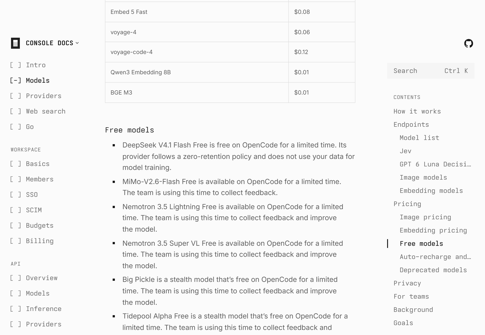
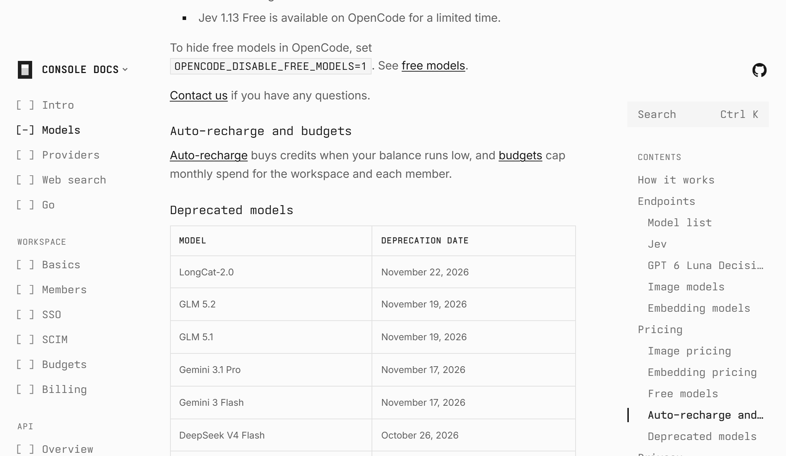
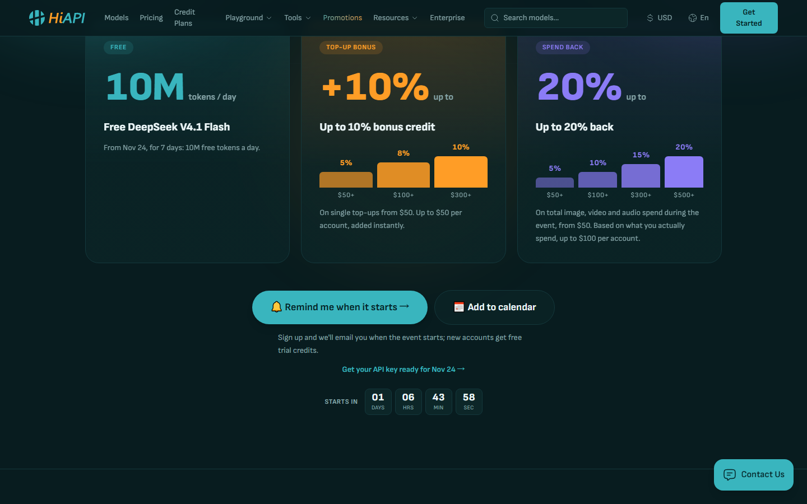
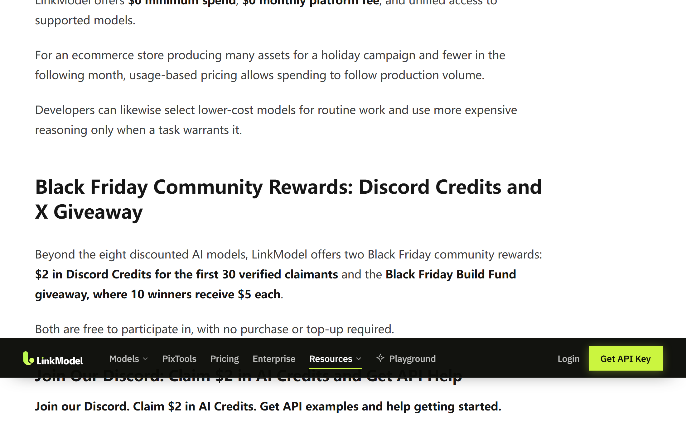

# OpenCode 传今天关池，官网仍列 11 款免费模型

打开 OpenCode 的 Zen 文档，11 款免费模型还挂在那儿。第三方速报却把 11 月 23 日标成关池日，官方只写「限时」，没给日期。两头对不上，我按最保守的口径当最后一天用。本期只收 3 条新发或有变的，近 7 天已收录、没变化的老面孔不占篇幅。

## 头条：OpenCode 免费池减到 11 款，关池日期查不到

**它到底给什么。** 我把官方 Zen 文档的 Free models 一段从头读到尾，逐款核过：DeepSeek V4.1 Flash Free、MiMo-V2.6-Flash Free、Nemotron 3.5 Lightning Free、Nemotron 3.5 Super VL Free、Big Pickle、Tidepool Alpha Free、Iceman Free、Beam Free、Flint 40B Free、Hy4 flash Free、Jev 1.13 Free，一共 11 款。每款下面只有一句「is free on OpenCode for a limited time」，没有结束日期。同一页的 Deprecated models 表倒是有日期，LongCat-2.0 写在 11 月 22 日下架，GLM 5.2 和 5.1 是 11 月 19 日，Gemini 3.1 Pro 与 Gemini 3 Flash 是 11 月 17 日。上期我记的是 12 款，一天之内又少了一款。

**值多少钱。** DeepSeek V4.1 Flash 的官方 API 刊例是输入 0.15 美元、输出 0.6 美元每百万 Token。多数免费模型给每天 50 次请求，一次按 1 万 Token 算，一天 50 万 Token，全按输入价折算约 0.08 美元，按输出价约 0.3 美元，折合几毛到两块多。单次看不多，可这按的是旗舰模型的价，入门档都够不着。连续跑一个月，省下的调用费是几十元量级。相对 OpenRouter 的 :free 通道（每天 50 次，充 10 美元才升到 1000 次），这一池不用先掏钱。

**怎么领。** 装 OpenCode 客户端，终端跑 `/models` 列出当前在架模型，挑带 `-free` 后缀的直接用。API 走 `https://opencode.ai/zen/v1`，模型 ID 同样带 `-free`。文档写明免费档不用充钱，付费模型才按量计费；想隐藏这批免费模型，设环境变量 `OPENCODE_DISABLE_FREE_MODELS=1`。建议今天就把要跑的批量任务塞进去，别等关池那一刻。

**坑在哪。** 日期这笔账，我查不到一手证据坐实任何一边，只能两边都摆出来。数据那头更该留意：部分模型会把输入拿去改进自己，公司代码和客户资料别往里灌；DeepSeek V4.1 Flash 与 Hy4 flash 的服务方写了零留存，Flint 40B 这批没写。地区也卡人，Beam Free 的排除名单里有中国（含港澳），我在这个 IP 下直接调不通。入口还限场景，Slack、CLI、自动化任务里起的对话会失败，只有客户端发起的能跑。

**谁最该领。** 个人开发者、学生、跑 Agent 的重度用户。用法上把整块任务今天拆成多次请求跑完，别把生产流程压在一个随时可能下线的免费池上。我的判断是：能用一天是一天，但它不适合当长期依赖。

## 其余新发 / 有变

### HiAPI

**给什么。** 11 月 24 日起连送 7 天，每天 1000 万 Token 的 DeepSeek V4.1 Flash，7 天合计 7000 万 Token，按官方刊例的输入价折约 10.5 美元，合七十多元人民币。

**怎么领。** 注册拿 API Key，活动自动生效，不用优惠码；新账号另送 200 Credits。相比上期看到的预告页，这期官方页已经挂出倒计时，并写明充值满 50 美元加赠 10%、图像视频音频消费满 50 美元返 20%。

**截止到什么时候。** 2026 年 11 月 24 日开始，连跑 7 天，到 11 月 30 日结束。

**坑在哪。** 每日额度不累计，当天不用就作废。页面按账户发额度，是否要先充值一次以自己账户的实际提示为准，别照我的截图硬套。

### LinkModel

**给什么。** Discord 前 30 名验证用户每人 2 美元 AI Credits，约 14 元；新增的 Build Fund 抽奖再给 10 人每人 5 美元。

**怎么领。** 加入官方 Discord，找到置顶的私密申领表单，提交 LinkModel 账户邮箱，验证通过后 24 到 48 小时到账。抽奖要关注官方 X 账号，并在 Discord 活动频道写下想做的项目，再交表格。相比昨天，2 美元额度今天才正式开放，5 美元抽奖是这期新加的。

**截止到什么时候。** 2026 年 12 月 2 日 23:59（PST），2 美元名额领完即止。

**坑在哪。** 只认前 30 名，一人一账号一次；邮箱必须走私密表单，公开频道留言领不到。两项活动分开审核，别填一次就以为都报上了。

## 这些已经没了，别白跑

- 智谱 ZCode 周末包 5 亿 GLM-5.3-Flash：11 月 23 日 09:00 已清零。
- 智谱 AutoClaw 第三周 1 亿 Token：11 月 22 日 23:59 已失效。
- Capy 的 DeepSeek V4.1 Flash 与 GLM-5.3-Flash 广告免费版：官方文档写明只开放美国、加拿大、英国、澳大利亚、新西兰、爱尔兰的 IP，国内直接调会被拒。
- 阶跃 StepAudio 3 realtime 与 TTS：昨天 12:00 起转计费。
- 百度千帆双 11 全家桶：今天全线收口。
- OpenCode「GLM 行动」第二阶段：第三方口径昨天到期。

---

额度都是有时效的，看到就先去点一下。
发现哪条已经结束了，欢迎在评论区指正。
