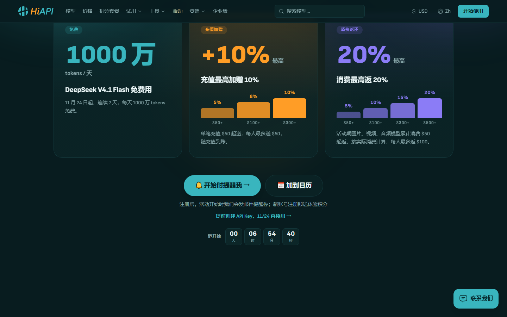
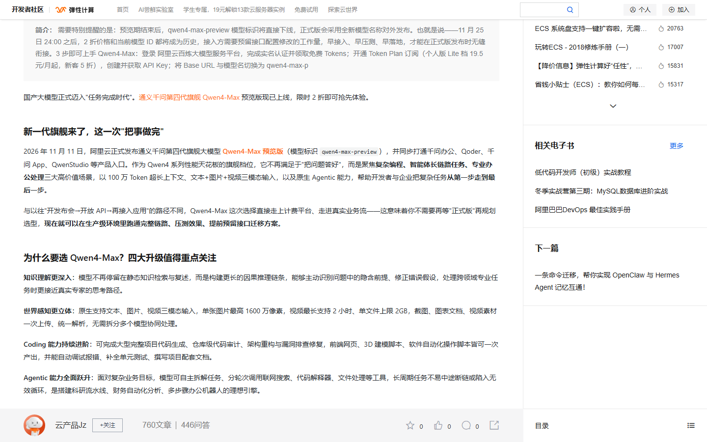
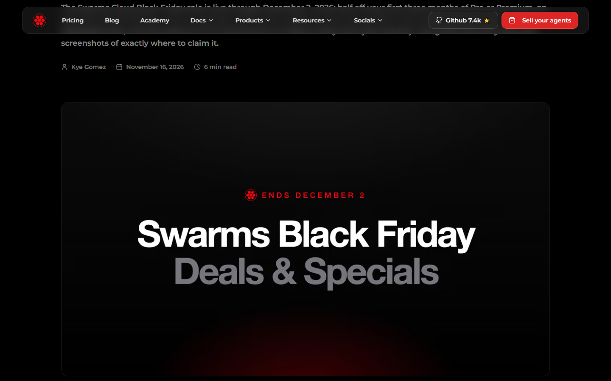
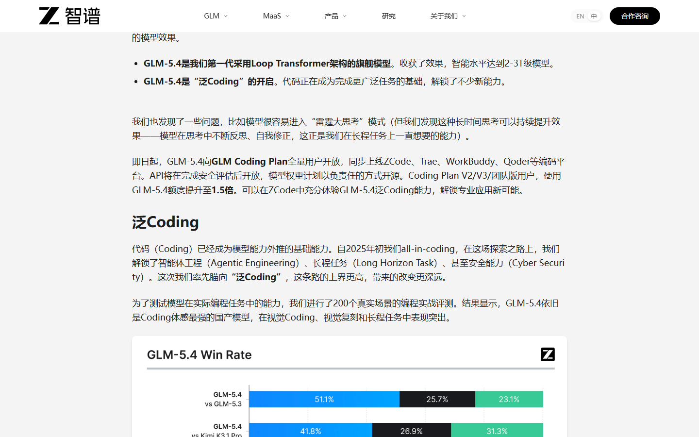

# HiAPI 今天开送每天一千万 Token，连送七天

黑五第一天，HiAPI 把 DeepSeek V4.1 Flash 的每日一千万 Token 正式开放了，连送七天。这期还有三条刚冒出来的变化。智谱 GLM-5.4 给订阅用户加量五成，Swarms 填码领 15 美元，Qwen4-Max 的两折明晚关窗。老面孔这期没有实质变化，就不占篇幅了。

## 头条拆解：HiAPI 每天一千万 Token

**给什么。** 活动页中文原文写着"11 月 24 日起，连续 7 天，每天 1000 万 tokens 免费"。模型是 DeepSeek V4.1 Flash，自动参与，不用优惠码。

**真实价值。** HiAPI 自家价格页上，这个模型输入每百万 Token 收 0.44 美元、输出 1.32 美元。按输入价算，一天一千万 Token 约合 4.4 美元，七天满打满算 30.8 美元，折人民币两百多元。换个实在点的口径：做电商文案，一套标题加卖点加广告语约 2000 Token，一千万够写五千个商品。我算了半天，这个量对个人开发者基本用不完。

**怎么领。** 注册 HiAPI 账号，到控制台创建 API Key，按 OpenAI 格式调用。活动页提示还要加一个请求头，具体名称等活动方在页面公布，免费额度自动到账，不用报名。

**坑在哪。** 官方电商博客写的是"充值过至少一次"的账号才能每天领这一千万，中文活动页却写"自动参与"。两边口径对不上，我按更严的准备，先充个最小额度再说。另外免费 Token 当天有效，不累计到第二天。

**谁最该领。** 批量跑文案、做长文摘要、给小项目当后端的人最划算。想长期用，我会趁这七天把提示词和调用脚本调稳，活动结束再决定要不要付费。HiAPI 平时这个模型不便宜，七天后按量计费，别把免费额度当成长期方案。

## 其余新/变快讯

### Qwen4-Max：明晚 24:00 关窗

**给什么。** 阿里云百炼的 qwen4-max-preview，预览期调用 Credits 按两折算。新客首购 Lite 档 19.5 元/月，含 2 万 Credits。夜间 22:00 到次日 8:00 再叠加折扣。

**怎么领。** 实名认证后开通百炼，打开 Token Plan，新客首购价直接生效，再把 Base URL 和模型名切成 qwen4-max-preview。

**截止到什么时候。** 2026 年 11 月 25 日 24:00，窗口一关，这个模型 ID 直接下线。

**坑在哪。** 两折扣的是 Credits，订阅折扣扣的是月费，两笔账。预览结束正式版会换模型名，接入方要预留改配置的工夫。这是付费折扣，不是免费额度。

### Swarms Cloud：12 月 2 日截止

**给什么。** 黑五活动码 SWARMSFLASH，每个账号一次性领 15 美元 Credits；新账号另有 5 美元注册额度，合计 20 美元，约合 140 元。

**怎么领。** cloud.swarms.world 注册，进 Settings 的 Credits 卡，在 Redeem a code 里输入 SWARMSFLASH。

**截止到什么时候。** 2026 年 12 月 2 日，太平洋时间。

**坑在哪。** 11 月 27 日和 30 日那两天的"token 全免"只给已订阅的 Pro/Premium 用户，是付费权益，不算白送。15 美元 Credits 各模型通用，但要真跑 agent 才用得掉。

### 智谱 GLM-5.4：订阅内加量，长期

**给什么。** 11 月 23 日发布，向 GLM Coding Plan 全量用户开放。V2/V3/团队版周额度提到 GLM-5.3 的 1.5 倍，新增视觉能力和 1M 上下文版本。

**怎么领。** 已有 Coding Plan 订阅的，在 ZCode、Trae、WorkBuddy、Qoder 里直接切到 glm-5.4。

**截止到什么时候。** 官方没写截止，长期。

**坑在哪。** 只给订阅用户，同价加量不等于免费，Lite 档 118 元/月。API 要等安全评估后才开，权重也还没开源，想自己部署的这会儿没戏。

## 这些已经没了，别白跑

- 智谱 ZCode 周末包 5 亿：11 月 23 日 09:00 清零。
- OpenCode 免费模型池：11 月 23 日关窗，官网 11 款已下架。
- 百度千帆双 11 全家桶：11 月 23 日全线收口。
- AutoClaw 每周一亿 Token：11 月 22 日 23:59 失效。
- 讯飞星辰 10 亿 Token：官方没公布统一截止日，第三方推算在这两天，我没查到一手日期，按不可靠处理。
- Caffeine Studio 免费一月会员：只有自媒体在传，官网首页没有活动说明，绑卡与否两种说法打架，先别急着填卡。

---

额度都是有时效的，看到就先去点一下。
发现哪条已经结束了，欢迎在评论区指正。
