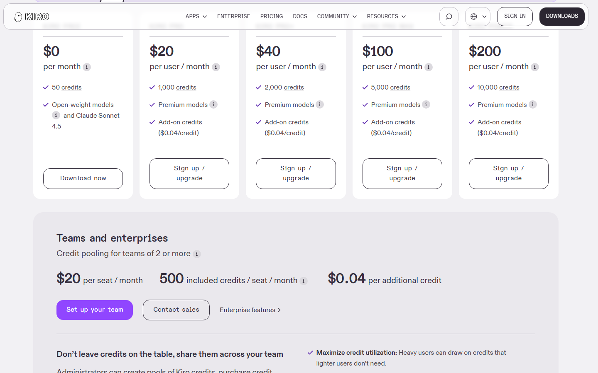
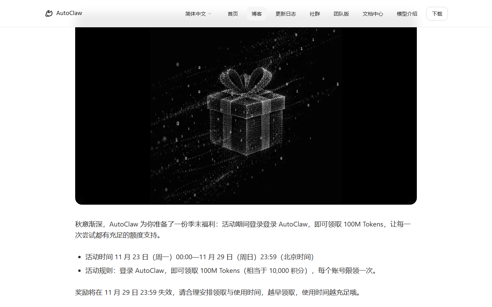
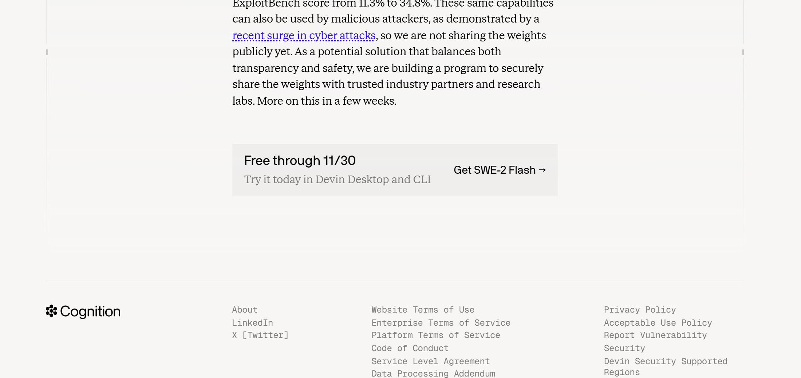
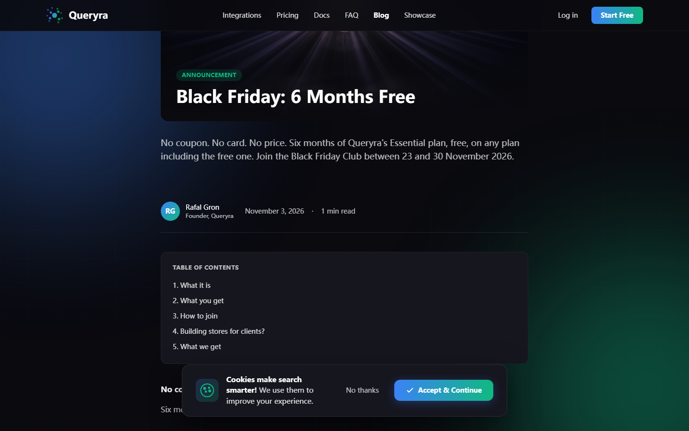
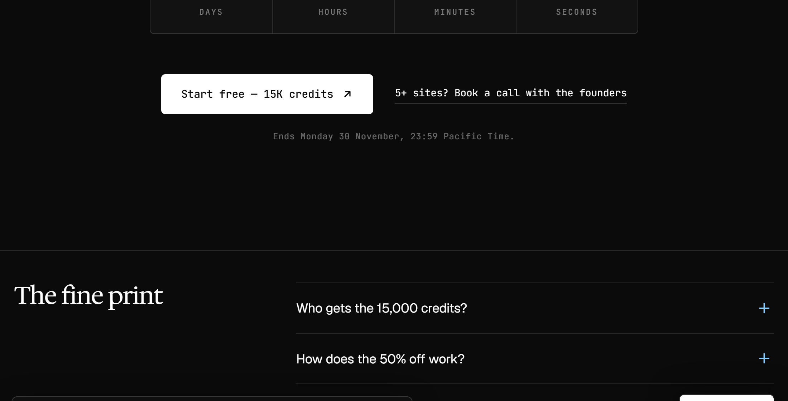

# Kiro 4000 积分 12 月 1 日关申请，先验身份

Kiro 这周放出 4,000 credits。申请窗口到 2026 年 12 月 1 日 12:00（太平洋时间）。

本期 5 条全是新出现或状态有变的，近 7 天写过的老面孔没有新动作，这里不占篇幅。最快清零的是 AutoClaw 一亿词元，2026 年 11 月 29 日 23:59 失效。

## 头条：Kiro 4,000 积分，条款得读全

### 官方怎么写

Devpost 上的 Kiroween 2026，是 Kiro 办的黑客松。官方 Resources 页写得直白：参赛者可申请 4,000 free Kiro credits，用于投稿期。领之前要验身份。规则页用的是「may be provided」，一次性发放，审核后发码，点一下不会立刻到账。

### 这笔积分值多少

我按 Kiro 官网定价页算了一遍。Free 档每月 50 credits。Pro 档每月 20 美元，含 1,000 credits。单独加购 0.04 美元一个。4,000 个按加购价是 160 美元，约合 1,150 元；按 Pro 内含额度算，够 4 个月订阅的量（80 美元）。跟免费档每月 50 个比，这笔相当于 80 个月的月量。

### 领取怎么走

分四步。先在 app.kiro.dev 注册账号，记下 user ID；再去 kiroween.devpost.com 报名。然后填积分申请表，Resources 页，2026 年 12 月 1 日 12:00（太平洋时间）前提交。换算成北京时间是 12 月 2 日 04:00。审核拿到兑换码后，2026 年 12 月 4 日前在账号里兑换。余额出现在 kiro.dev/account/usage，带 kiroween 前缀。

### 门槛藏在哪

一眼看去像白送，细读才知道要先验身份。核验由 Didit 代做，自拍加一张政府证件照片，Devpost 名字得和证件一致。参赛项目限 2026 年 10 月 30 日后新建。仓库要公开，根目录带 /.kiro，还得用 Kiro 做过东西。积分先到先得，官方不保证发放，可疑申请会被拒。兑换码过期不补，已兑换积分 2026 年 12 月 31 日 23:59（太平洋时间）清零。规则按排除法列禁区，没点名中国大陆，但各地可用的 Kiro 功能不一样，得自己确认。

### 谁该领

手里正好有新项目、又愿意公开仓库的开发者，这笔值得走一遍流程。只想试试手感的人，我不建议为了积分去做证件核验，免费档 50 个先跑通就够了。拿到积分后按模型倍率扣，别把 4,000 个当无限量。

### 对比与风险

和每月 50 个的免费档比，差距在量级；和 Pro 每月 1,000 个比，这笔一次性到账。风险有两个：审核和名额不由你决定；证件照片交给第三方处理。项目涉及公司代码就别往上放。

## 其余新/变快讯

### 智谱 AutoClaw

给什么：第四周登录送 100M Tokens，折 10,000 积分。相比上周同款（2026 年 11 月 22 日 23:59 已清零），这是新开的一期。
怎么领：活动期内打开 AutoClaw 客户端登录，每个账号一次。
截止：2026 年 11 月 29 日 23:59（北京时间）。
坑在哪：积分只留在客户端，不能转成开放平台 API；越晚领能用的时间越短。

### Devin SWE-2 Flash

给什么：SWE-2 Flash 在 Devin Desktop 和 CLI 内免费用。官方写它的价格是 SWE-2 的五分之一、速度三倍。
怎么领：下载 Devin Desktop 或 CLI，登录后选 SWE-2 Flash。
截止：2026 年 11 月 30 日，官方没写具体时刻。
坑在哪：权重只对合作伙伴和研究机构分享，个人只能在 Devin 产品里用。

### Queryra

给什么：黑五俱乐部每月加 1,000 次 AI 搜索，连给 6 个月，合计 6,000 次；免费档原本每月 100 次。
怎么领：注册免费账号。2026 年 11 月 23 日至 30 日，在控制台 Club 页加入 Black Friday Club。即时到账。
截止：加入窗口到 2026 年 11 月 30 日，官方没写时区；权益自加入起 6 个月。
坑在哪：本月次数用光的，官方说 6 小时内自动恢复；不绑卡、不用优惠码。

### WPOS

给什么：活动期新账号送 15,000 credits，平时是 5,000。官网换算：够 27 次整页搭建、83 个新区块或 500 次问答。
怎么领：在 wpos.ai/black-friday 点 Start free 注册，不用绑卡。
截止：2026 年 11 月 30 日 23:59（太平洋时间，北京时间 12 月 1 日 15:59）。
坑在哪：只给活动期新账号；页面上的 FRIDAY50 五折和 +25% 加赠属于付费项，不算免费。

## 这些已经没了，别白跑

- 智谱 AutoClaw 第三周 1 亿词元：2026 年 11 月 22 日 23:59 已清零。
- 智谱 ZCode 周末包 5 亿：2026 年 11 月 23 日 09:00 已清零。
- OpenCode Zen 11 款免费模型池：2026 年 11 月 23 日关窗。
- Watt Cloud Ampere 0 元 API：官网标到 2026 年 11 月 19 日，已转计费。
- MOSS Nex-N2.6：公告还写限免，计费栏已挂 0.48 元每百万 Token 起，按计费栏算。

---
额度都是有时效的，看到就先去点一下。
发现哪条已经结束了，欢迎在评论区指正。
