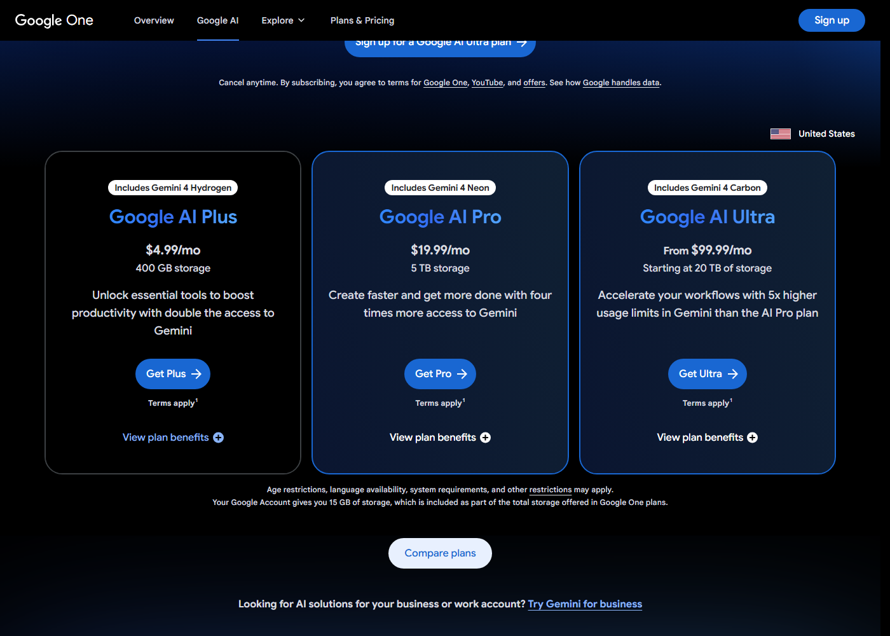
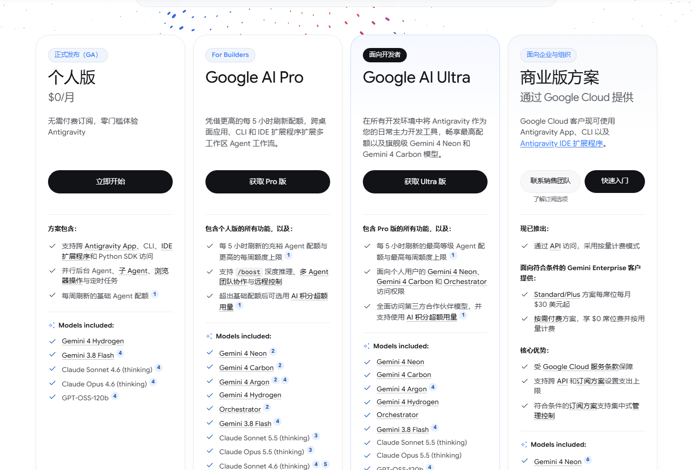
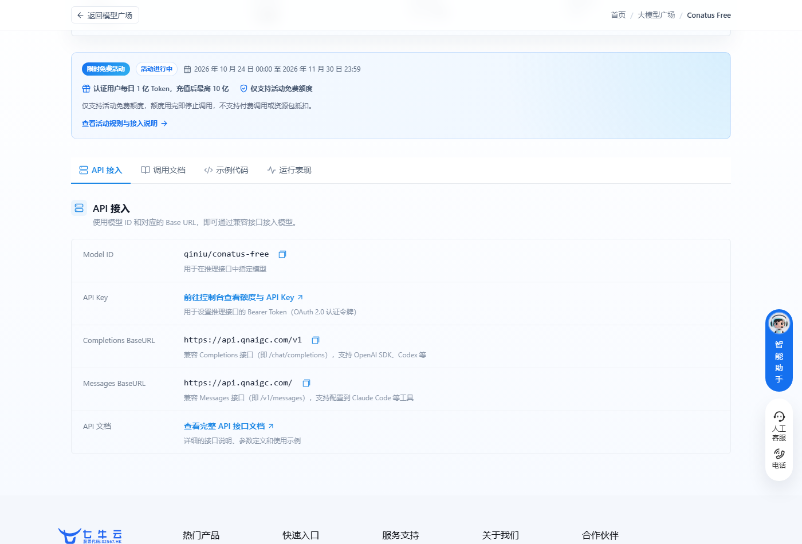
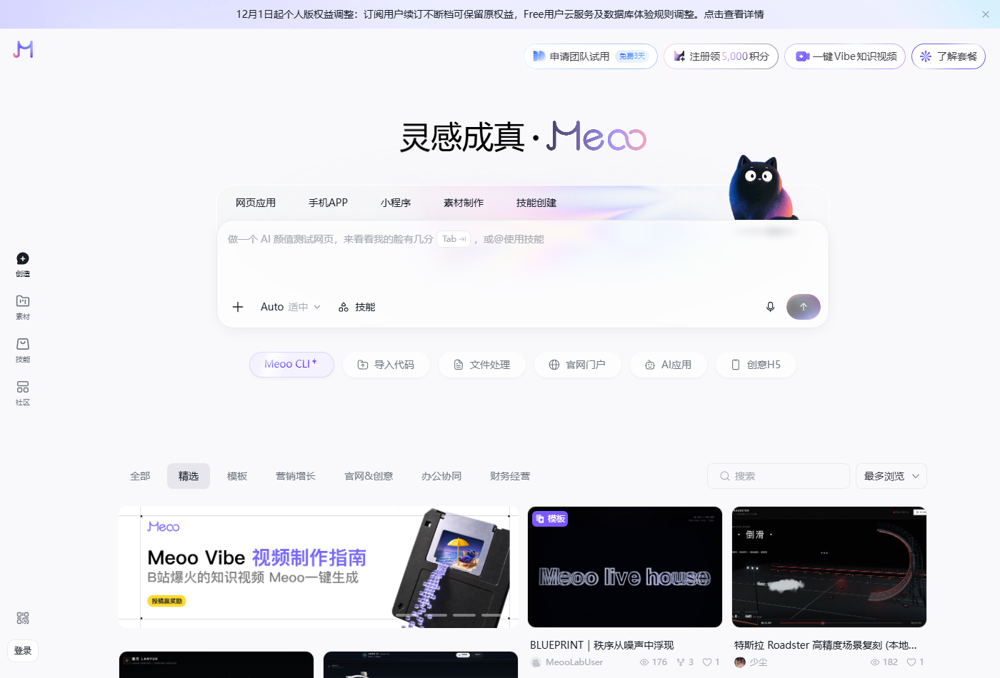
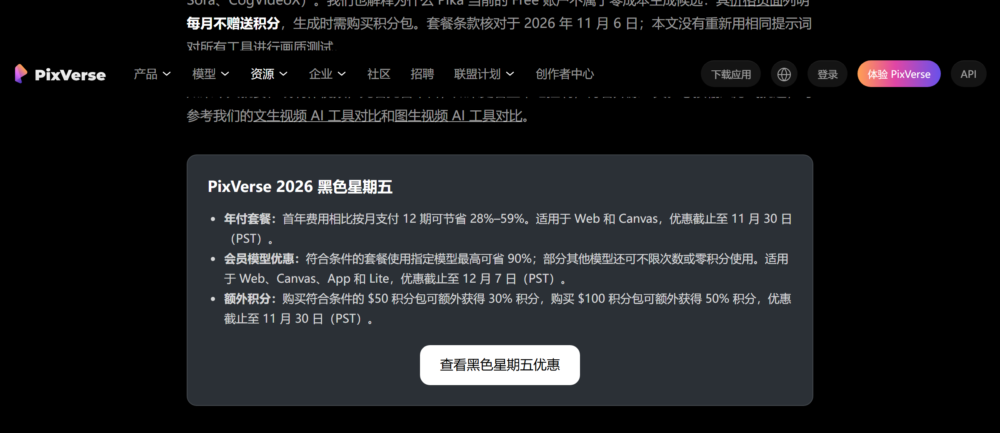

# 别原价续 Google AI，5折今天只对老用户开

黑五前一天，真正要算的一笔不在免费额度里。Google 把 AI Pro 年付从 199.99 砍到 99.99 美元。老用户通道按美国时间 11 月 26 日关闭，新用户要等 11 月 27 日。这期 5 条都是新发或有变的。长期没动静的老面孔，这回不占篇幅。

## 本期头条

### 给了什么

Vikas Kansal 管着 Google 的 Gemini 订阅。他在 X 上写明，黑五抢先场只面向现有 AI 与存储订阅用户。AI Plus 和年度 Pro 最高五折，截止 11 月 26 日（美国时间）。具体折扣，得看你账号当前那档套餐。Google One 方案页还挂着常规价：月付 19.99、年付 199.99 美元。折后 99.99，摊到每月 8.33 美元。

### 值多少

按标价算，头一年省 100 美元，约合 720 元。套餐每月还含 10 美元谷歌云赠金，一年 120 美元约 864 元，光这一项就把年费覆盖了。5TB 存储能拉 5 个人共用，六人分摊后每人每年 16.67 美元，约 110 元。

要按两年看才诚实。头年 99.99 加次年 199.99，合计 299.98 美元；同样两年按月付是 479.76 美元。省是真的省，但幅度从五折缩到三成七。

### 怎么领

手上已经有 Google AI 或 Google One 订阅的，登录方案页，进「全部存储方案」找更改入口。月付用户会看到一个「按年结算」的切换按钮。点进去，下一页才亮出折后价。新用户别急，11 月 27 日黑五当天再看同一页。付款前盯一眼，不含税价是不是 99.99 美元。

### 门槛在哪

只对现有订阅用户开放，第三方渠道买的 Google One 不算，得先把订阅身份换回官方。结算要绑有效的 Google Payments，国内账号直接调不通，这个门槛我没法替你绕开。学生免费领的、印度 Jio 赠送的 Pro，在反重力里用不了 Neon。折扣只限首年，次年按 199.99 美元自动续，要手动去订阅管理里关。

### 谁该领

已经在按月付 AI Pro 的人该切，月费一年 240 美元，折后年付连一半都不到。能用家庭组分摊的人也划算。只想知道 Gemini 4 长什么样、明年还用不用都不好说的人，我的建议是别锁。一年一次付清，模型换代、区域调整、产品改版，哪样都不退款。

### 对比和风险

ChatGPT Plus 每月 20 美元，折后的 AI Pro 月均 8.33 美元不到它一半。但两家模型不在一条线上，别只看价格换船。真正的风险是年付的不可逆：黑五折扣年年有，明年这时大概率还有，等不及的人再上车也不迟。

## 其余新与变化

### Google Antigravity

给什么：免费档个人版 0 美元。11 月 24 日更新后，模型清单里多了 Gemini 4 Hydrogen，全员还拿到一次额度重置。怎么领：antigravity.google 官网邮箱注册个人版，不用绑卡。截止到什么时候：Gemini 4 Argon、3.8 Flash 和 Claude 4.6 系列，官方标 11 月 30 日移除。Hydrogen 留在免费档。坑在哪：上一期我写的是 Claude 4.6 在 11 月 18 日移除。今天再查官方定价页，这几个模型还列着，下线日挪到了 11 月 30 日。以定价页为准，别照旧日期安排活。

### 七牛云 Conatus

给什么：实名后每天 1 亿 Token，充值后最高 10 亿，100 万上下文，文本图像都能进。怎么领：qiniu.com 控制台开通，拿 API Key。模型 ID 填 qiniu/conatus-free，兼容 OpenAI SDK。截止到什么时候：官方页写明 2026 年 10 月 24 日至 11 月 30 日 23:59，只剩 4 天。坑在哪：只走活动免费额度，用完直接拒请求，不扣余额，也不自动切别的模型。没实名领不到。相比上次收录，变的是关口从一个月外挪到了这周。

### 秒悟 Meoo

给什么：所有用户每天首次登录送 2000 积分，新人首月另给 5000。能调 Qwen、DeepSeek、Kimi、GLM、MiniMax 几家。按 GLM-5.3-Flash 的输出价算，2000 积分约合 140 万 Token 输出。怎么领：meoo.com 用手机号或阿里云账号注册，登录即到账，不用找入口。截止到什么时候：每日登录是长期机制，积分每笔 7 天有效。坑在哪：网上「注册送一万」那是早期活动，官网现在写 5000，以注册时的页面为准。积分过期不补。

### PixVerse 黑五

给什么：官网博客写明，符合条件的套餐用指定模型最高省 90%。部分模型不限次数，或者零积分。买 50 美元积分包加送 30%，100 美元包加送 50%。免费档另有初始 60、每日 30 积分。怎么领：pixverse.ai 黑五订阅页，先看账号命中哪档。截止到什么时候：年付和积分加送 11 月 30 日（PST），会员模型优惠 12 月 7 日（PST）。坑在哪：九成折扣、零积分都是付费会员权益，不是白送。PST 比北京时间晚，折过来是 12 月 1 日和 12 月 8 日，别按国内日期误判。

## 这些已经没了，别白跑

- Qwen4-Max 预览版 2 折（11 月 25 日 24:00 关闭，模型 ID 已下线，正式版接替）。
- AutoClaw 第三周 1 亿词元（11 月 22 日 23:59 清零，第四周那笔到 11 月 29 日）。
- 智谱 ZCode 周末包 5 亿（11 月 23 日 09:00 清零，工作日每日 3 亿照发）。
- Watt Cloud Ampere 零元 API（官网标至 11 月 19 日，现已转计费）。
- fal 的 MiniMax H3 免费生成（11 月 23 日结束）。
- NanoGPT Clover 2 首周免费（11 月 24 日结束）。

---

额度都是有时效的，看到就先去点一下。
发现哪条已经结束了，欢迎在评论区指正。
