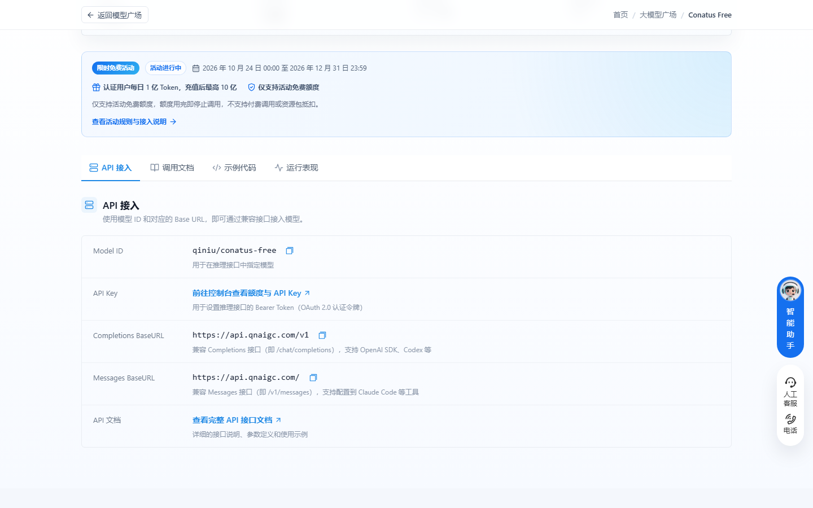
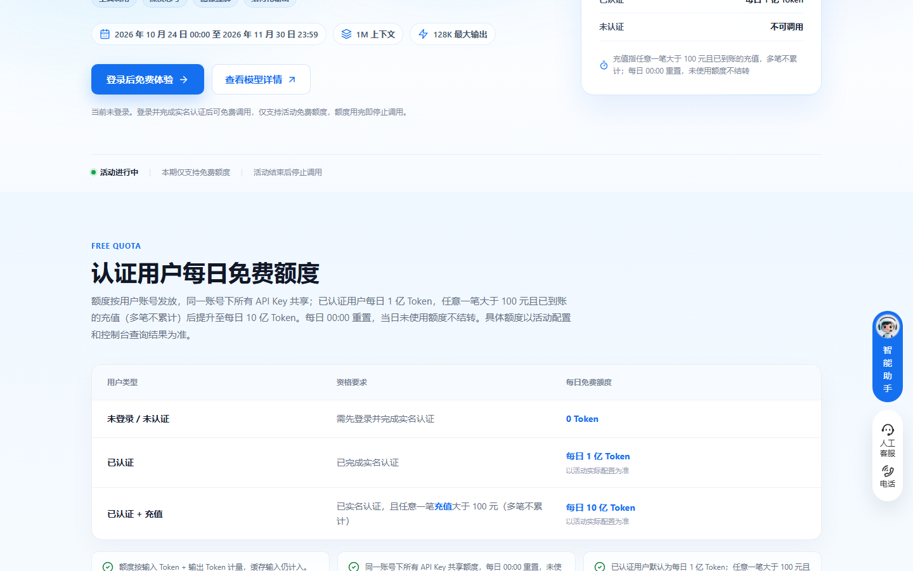
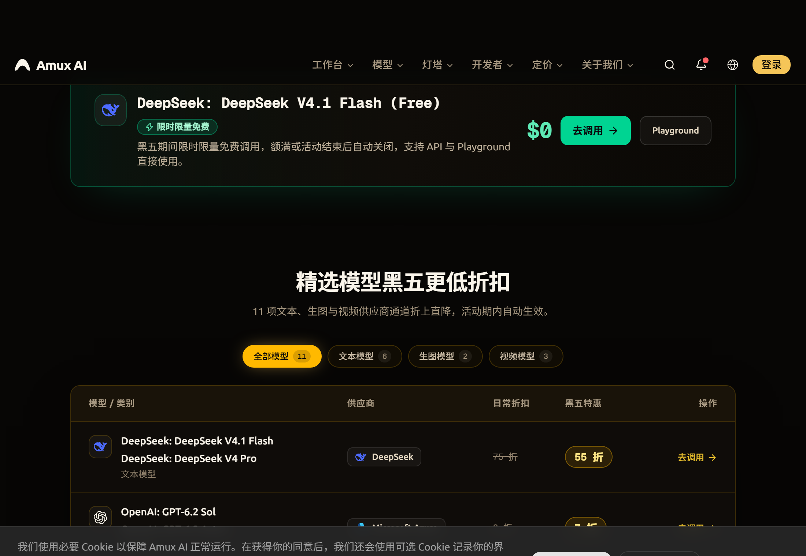
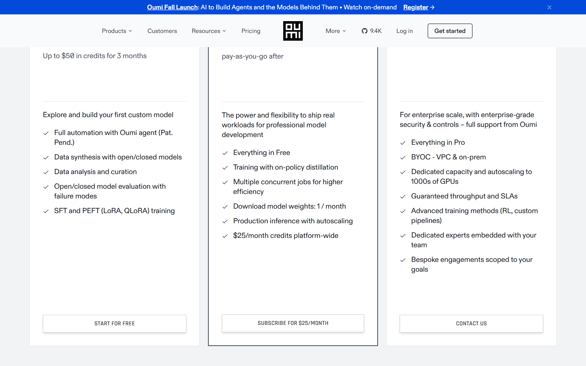

# 七牛云 1 亿免费写到年底，最保守还是 11 月 30 日

七牛云的模型页写着 12 月 31 日 23:59，活动页顶部写着 11 月 30 日 23:59。我今早对着两页看了三遍，确认不是缓存。今天能坐实的新变化只有三笔，没动的老面孔都不占篇幅。

## 本期头条

### 给什么

先看原文。模型详情页写「2026 年 10 月 24 日 00:00 至 2026 年 12 月 31 日 23:59」。实名用户每天 1 亿 Token，单笔充值满 100 元提到 10 亿。我昨天记的是 11 月 30 日。今天再看，模型页和 FAQ 都改成了 12 月 31 日。活动页顶部仍停在 11 月 30 日。看着像延期。细读两页，对不上。

### 值多少

按每天 1 亿 Token 算，多出来的一个月是约 30 亿 Token 的调用空间。七牛云没公布 Conatus 的刊例单价，准确人民币数我给不出。别家新客常见的是几百万到几千万 Token，这个日额度不在同一档。100 元充值换的是上限，不算白送。

### 怎么领

不用找活动码。注册七牛云，控制台完成实名，建 API Key。模型 ID 填 qiniu/conatus-free。Base URL 用 https://api.qnaigc.com/v1/chat/completions。OpenAI SDK 直接兼容，Codex 和 Claude Code 换个地址就能接。没实名不发额度。

### 门槛在哪

每日 00:00 重置，当天剩余不结转。同账号所有 Key 共用一个池子，缓存命中也算进 1 亿。额度用完直接报错，不扣余额，不自动转付费。日期那处最要紧。我按 11 月 30 日排任务，12 月那段等控制台出准信。

### 谁该领

每天要跑 Agent、代码辅助或批量文本的人，今天就把 Key 建好。偶尔问两句的人，注册加实名未必值。这个模型只对外叫 Conatus，背后是哪款官方没写。我的做法是先跑一轮短的，看输出合不合手。

### 对比和风险

别家的大额日额度多绑客户端或订阅，这条直接给 OpenAI 兼容接口，少见。风险也在这。一个页面写 12 月底，另一个写 11 月底，口径还会变。领完把额度页截图留底，省得到时候讲不清。

## 其余新与变化

### Amux AI

给什么：DeepSeek V4.1 Flash (Free) 限时限量免费，标价 0 美元，API 和 Playground 都能调。怎么领：黑五活动页登录后进模型页选它，点去调用，不用优惠码。截止到什么时候：2026 年 12 月 1 日 07:59（UTC+8）；活动 11 月 27 日 08:00 才开始，这是我今天新看到的。坑在哪：官方只写额满即止，并发、RPM 和总配额都有保护，具体免费额度没给。同页的充值加赠与 11 项模型折扣都是付费，不算免费。

### Oumi

给什么：Free 档写「Up to $50 in credits for 3 months」，能做数据合成、评测和 SFT、LoRA 微调。怎么领：定价页点 Start for Free，邮箱注册进控制台。截止到什么时候：自注册起 3 个月，官方没给统一日期。坑在哪：只写 up to，没承诺一定给满 50 美元，额度按账号审批。海外站，网络自己解决。

## 这些已经没了，别白跑

Qwen4-Max 预览版 2 折，11 月 25 日 24:00 关窗，旧模型 ID 已下线。fal 的 MiniMax H3 免费生成 11 月 23 日结束。AutoClaw 第三周 1 亿 Token 11 月 22 日 23:59 清零。Watt Cloud Ampere 零元 API 官网标到 11 月 19 日。昨天我在写 Google AI Pro 黑五 5 折。新用户窗口今天开了。未登录时方案页仍只有 19.99 和 199.99 美元的常规价。登录态那道横幅我没代核，暂不列进可领。

---

额度都是有时效的，看到就先去点一下。

发现哪条已经结束了，欢迎在评论区指正。
