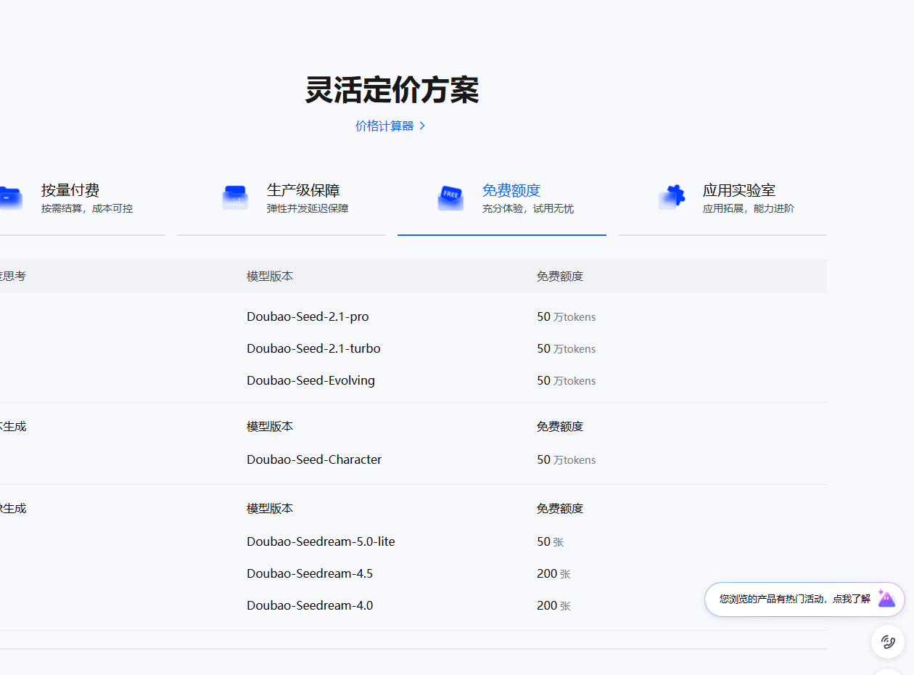
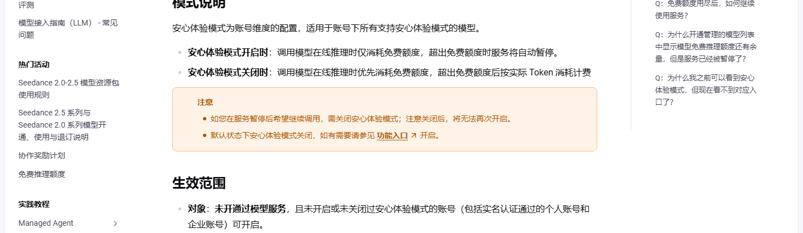
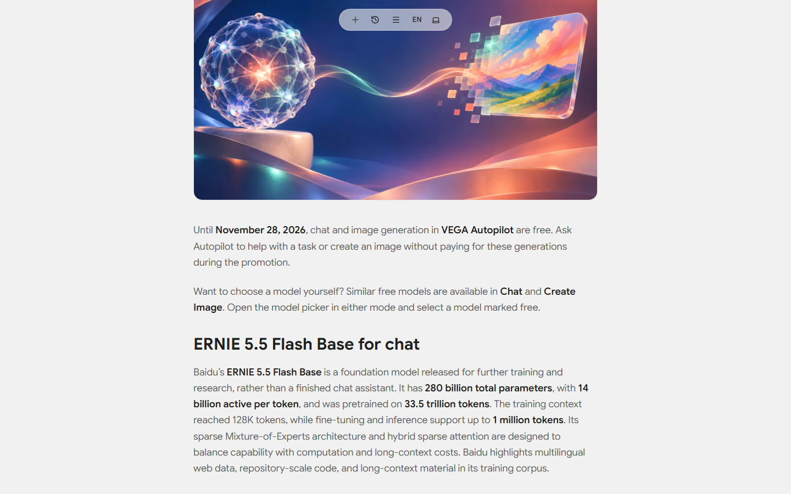
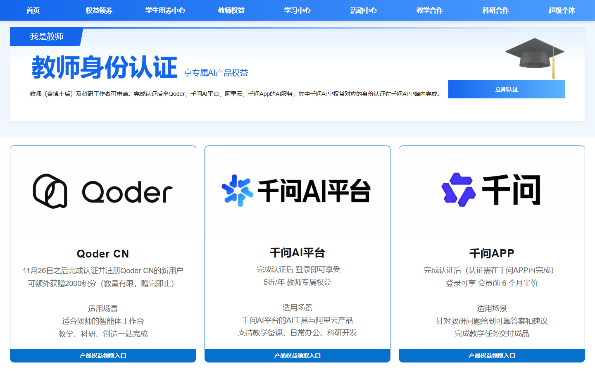
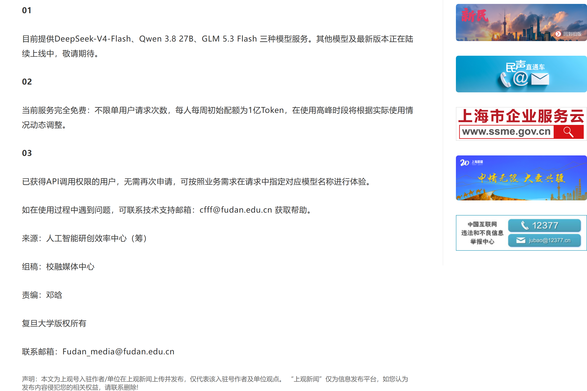

# 火山 450 张图免费，漏勾一个开关就开始扣费

火山方舟把三个生图模型的免费额度摆到了产品页上，加起来 450 张，按官方单价折算值几十到一百多元。先看那个开关：开通模型时漏勾「安心体验模式」，450 张烧完的那一刻，账单就开始走。

本期 4 条，全是 11 月 26 日以后新发或改过口径的。近 7 天收过的老面孔，这期没新变化，我就不摆上来了。

## 头条深度拆解：火山方舟 Seedream 450 张免费生图

**① 官方到底给了什么**

火山方舟产品页「灵活定价方案 → 免费额度」一栏写得清楚：Doubao-Seedream-5.0-lite 50 张、Doubao-Seedream-4.5 200 张、Doubao-Seedream-4.0 200 张。三份额度各管各，不是一个池子，不互转。11.11 智选档期活动页把档期写到 2026 年 11 月 30 日 23:59。

这张表是我打开产品页一行行数下来的，没拿清单里的转述凑数。

**② 真实价值测算**

官方剧创平台套餐文档给了折算价：按张计 0.13 元到 0.30 元。方舟产品页另标 5.0-lite 0.22 元一张、5.0-pro 0.30 元起。按 0.13 到 0.30 元这个区间算，450 张折合 58.5 到 135 元；按 0.22 元的中位价算，大约 100 元。年底做公众号配图、电商详情页、活动海报的，一张省两三毛，这笔量够顶一阵。

**③ 领取全流程**

注册火山引擎账号并实名 → 进方舟控制台「开通管理」→ 三个模型逐个点开通，开一个不带另外两个 → 开通时勾上「安心体验模式」→ 建 API Key 调用。界面显示什么就是什么，不用兑换码。

**④ 隐藏门槛，这条最要紧**

官方《安心体验模式细则说明》原文写的是：开启时「调用模型在线推理时仅消耗免费额度，超出免费额度时服务将自动暂停」；关闭时「优先消耗免费额度，超出免费额度后按实际 Token 消耗计费」。资格也有讲究——只有「未开通过模型服务，且未开启或未关闭过安心体验模式的账号」能开，老账号翻不到入口就是翻不到。另有两处不免：插件、知识库产生的费用不在免费范围内，批量推理也不抵扣。免费额度在 master 账号下共享，子账号用掉同一份。

**⑤ 谁最该领、怎么用划算**

批量出图的人排第一。先开 4.5 和 4.0 各 200 张，别被最新款 5.0-lite 的 50 张晃了眼。领完之后按 11 月 30 日 23:59 倒推排产，别囤到最后一晚。

**⑥ 对比与风险**

网上还有只写 200 张的说法，那是 11 月初的老口径；本次按三个模型加总，控制台显示为准。档期收口日以活动页为准，值不值得开，取决于你月底前有没有真要用掉的图。没批量出图需求，别为凑数去开账号。

## 其余新 / 变快讯

### VEGA Autopilot

- **给什么**：官方博客写明，Autopilot 里聊天与生图在活动期免费。聊天走 ERNIE 5.5 Flash Base（2800 亿总参、140 亿激活、100 万上下文），生图走 Recraft V4.1 Flash V2（1024×1024，官方标 0.007 美元一张）。
- **怎么领**：打开 vega.chat，选 Autopilot 直接提任务；也可以在 Chat 或 Create Image 的模型选择器里挑标了 free 的模型。
- **截止**：2026 年 11 月 28 日，就是今天。
- **坑在哪**：ERNIE 5.5 Flash Base 官方定位是用于继续训练和研究的基座模型，不是成品聊天助手，别拿它当通用对话用。

### 阿里云 × 支付宝教师权益

- **给什么**：Qoder CN 新用户领 2000 积分，官方教师权益页写的是「11 月 26 日之后完成认证并注册 Qoder CN 的新用户可额外获赠 2000 积分」。同批还有千问 AI 平台产品 5 折、千问 App 会员 6 个月 5 折（9.9 元/月，原价 19.9 元）——后两项是付费折扣，不算免费。
- **怎么领**：支付宝搜「尊师惠师」→ 完成「中国教师」小程序注册 → 到 university.aliyun.com/teacher 用支付宝扫码做教师身份认证 → 在 Qoder 卡片点领取。
- **截止**：官方没写统一下线日；领取页标注「数量有限，赠完即止」，以页面实时显示为准。
- **坑在哪**：教职信息得由校方提交到全国教师管理信息系统完成后台审核，核验手机号要与小程序注册手机号一致。不是自己填个教师身份就能过。

### 复旦大学师生

- **给什么**：每人每周初始配额 1 亿 Token，不限单用户请求次数，可调用 DeepSeek-V4-Flash、Qwen 3.8 27B、GLM 5.3 Flash 三款。按从业者估算，1 亿词元账面约 25 元。
- **怎么领**：复旦校内网络访问 cfff.fudan.edu.cn → 右上角「统一控制台」→「模型服务」→「我的模型」，用学工号 UIS 登录申请 API Key；也可从复旦 ehall 搜「人工智能」进入。
- **截止**：长期滚动，每周重置；高峰时段按实际使用情况动态调整。
- **坑在哪**：只面向复旦校内师生，要校内账号和校内网络；非本校读者领不了。

## 这些已经没了，别白跑

- **蚂蚁 ling-3.2-flash**：蚂蚁数科 DTMaaS 平台的免费期已于 2026 年 11 月 28 日 10:00 结束，之后按量计费。输入 2 元、输出 6 元、缓存命中 0.4 元每百万 Token。开发者站是另一套规则，别把两个入口的截止日抄成一张表。
- **火山 kimi-k3**：已于 2026 年 11 月 25 日 14:00 停服，之前领过额度的注意迁移。
- **中国电信直播间 10 亿 Token**：直播安排有新华网原文，但「10 亿」这个数目前只追到直播预告物料，没找到天翼开放平台的活动条款，按查无实据处理。

---

额度都是有时效的，看到就先去点一下。
发现哪条已经结束了，欢迎在评论区指正。
