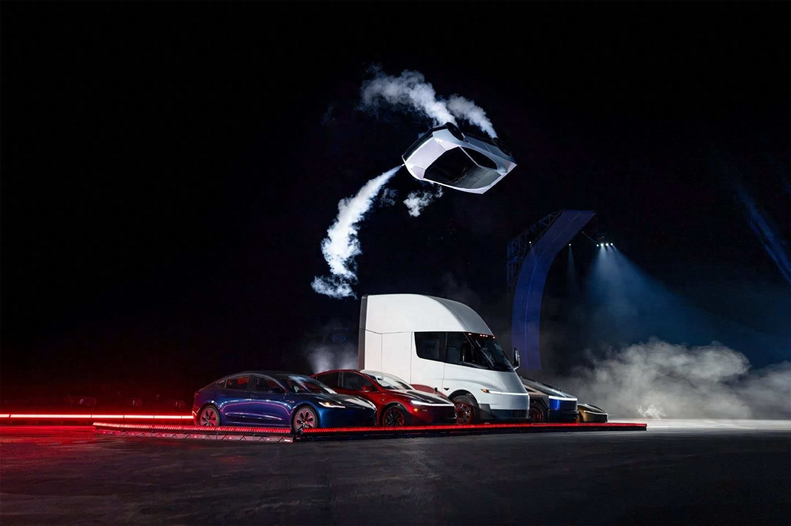
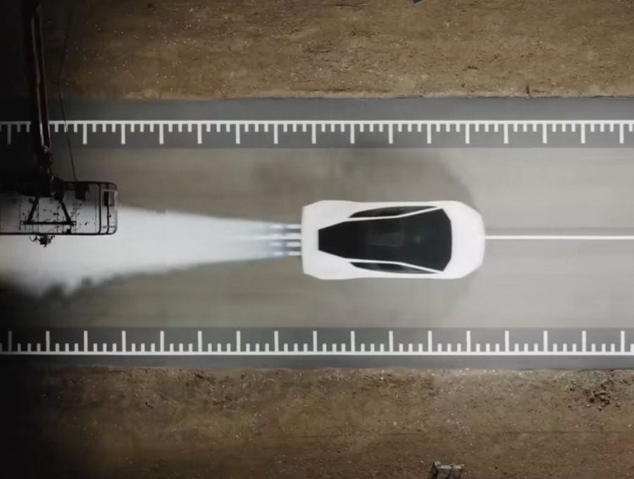
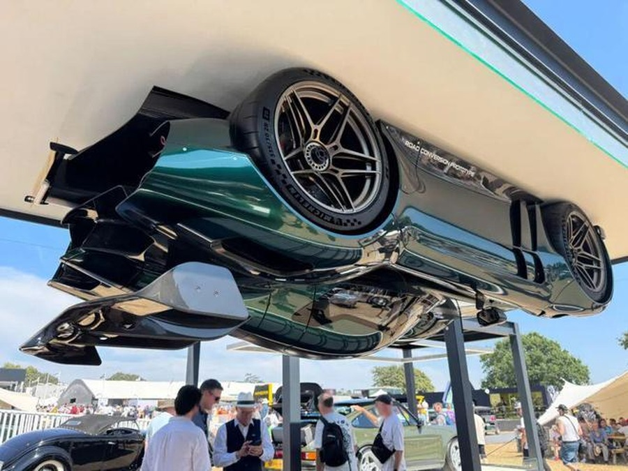
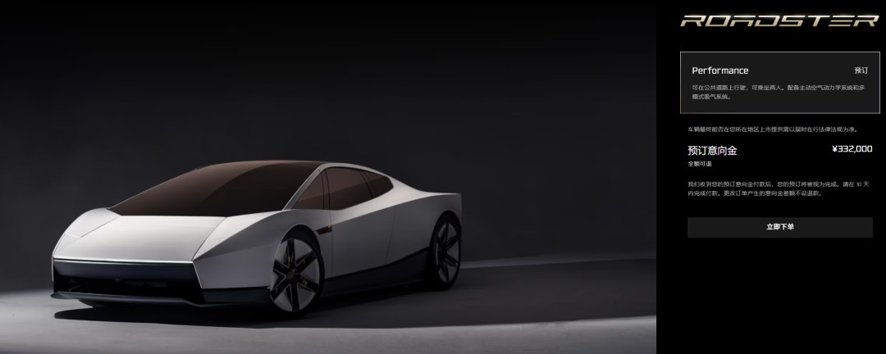
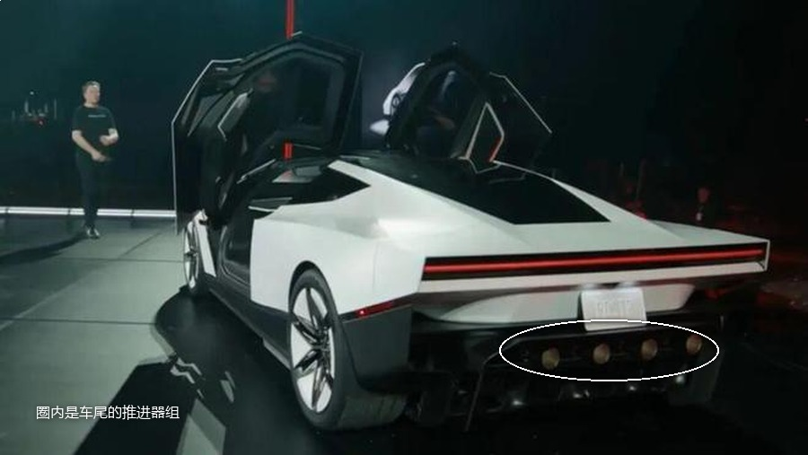
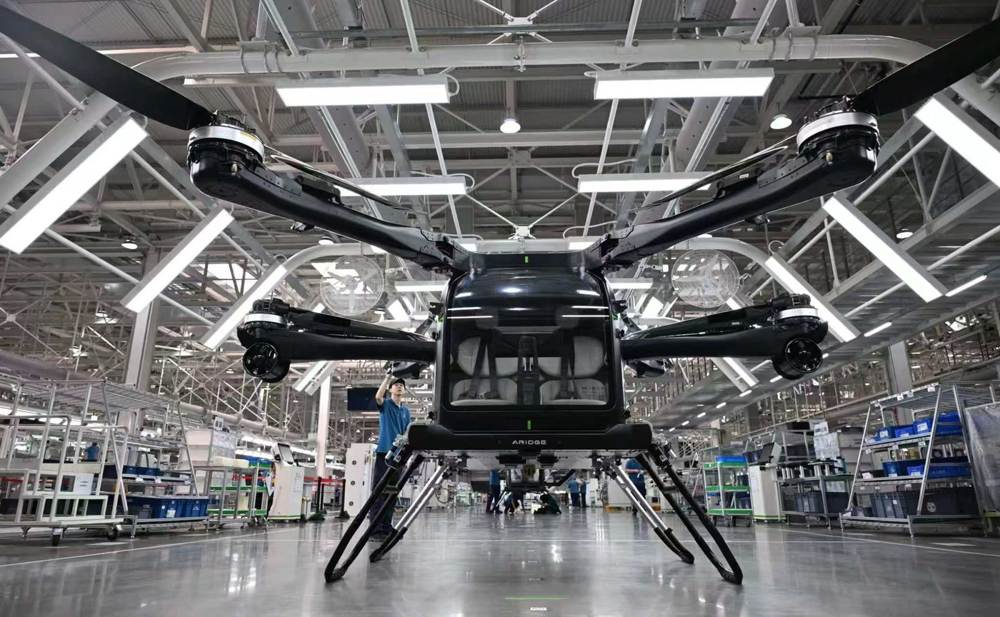
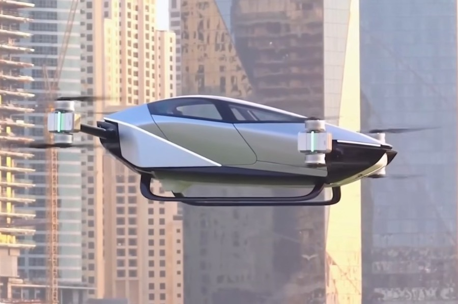

# 别被特斯拉首飞骗了，它只能飞 6 秒

10 月 15 日，得州麦格雷戈，SpaceX 的火箭测试场。

一辆白色跑车开上弧形坡道，到接近垂直的那一段停住。四个轮子贴着墙面，车顶朝下。车里没有人。

几秒后它冲出去，空中翻正，四轮落地。

现场每人发了一副耳塞。马斯克上台说的第一句话不是讲车，是请大家给他作证：接下来的画面不是 AI 生成的。

## 一、先看三个数

车里塞了两个碳纤维缠绕的气瓶，总容积 600 升，装大约 250 公斤压缩空气。技术源头是猎鹰 9 号的姿态控制喷嘴。

悬停一台两吨的车，需要两万牛左右的推力。高压气体喷出的有效速度按每秒 500 米算，每秒要喷掉 40 公斤。

250 除以 40，6.25 秒。

这是满推力悬停的上限。演示里推力拉到 80 千牛峰值，消耗速率翻四倍，撑不到 2 秒。

气喷完就没了。补满要接外部高压设备，6 到 7 个小时。特斯拉说目标压到 30 分钟以内，但没给实测数据。

图灵奖得主 Yann LeCun 在推特上被问到这件事，用比冲自己算了一遍，结论也是 10 秒以内。他管这套系统叫七百巴、六百升的放屁装置。

马斯克回了他一句《巨蟒与圣杯》的台词。

## 二、倒挂靠的不是推进器

坡道上那段倒挂，很多人以为是喷气顶着。不是。

车尾装了风扇，把车底空气抽走，制造负压，外面的大气压把车死死按在路面上。这套系统最多能产生约两倍重力的吸附力。

推进器管的是另一件事：脱坡之后那几秒的姿态。

马斯克当场玩了个双关，说这车真的很 suck。英文里这个词既是吸，也是烂。

风扇吸地不算新点子。1978 年 F1 瑞典站，布拉汉姆 BT46B 在车尾装了一台大风扇，只跑了一场就夺冠，赛季中途退赛。

## 三、真正要紧的是三个版本

发布会摆了三台车，不是一个配置。

Performance 版双座，可合法上路，没有推进器。

Thrust 版双座，车尾加装推进器，赛道专用。

Rocket 版单座，推进器分布在车身四周，邀请制，只允许在封闭场地内使用。

能飞的那台不能上路，能上路的那台不能飞。

同一场发布会之后，美国联邦航空管理局表了个态：这车不符合航空器的定义。

## 四、自己人先拆了台

马斯克在台上说，这车可以靠车载高压泵自己补气。飞 6 秒，等一会儿，再飞 6 秒。

特斯拉车辆工程副总裁 Lars Moravy 在后面的技术讲解里把这句话拆了。他说受限于车载的重量和体积，在车上把气体压到上万 psi，工程上不现实。

台上和台下说的不一样。这种时候我更信台下那个。

台下那个人没必要泼自己冷水。

## 五、它其实不蠢

写到这儿很容易下结论，说不实用。

这个结论太浅。真正该问的是：以特斯拉的工程能力，为什么不直接做旋翼。

因为旋翼要展开。要在车身上开口、布旋翼臂、加展开机构。一台超跑的气动外形是它的命，长出翅膀就毁了。

冷气推进把飞行压到喷嘴这一层。十个喷嘴藏在车身现有的结构里，气瓶塞进座舱后部，外形几乎不用为飞行做妥协。

这是极端的取舍：用能量效率换形态完整。

他们算得出来六个喷嘴只够六秒。要的就是这六秒。

## 六、另一条路上，有人在盖工厂

加州 Alef 走的是八个旋翼加可旋转座舱，飞行航程 177 公里，2023 年拿到 FAA 的特殊适航认证，订单排到三千多台。

国内是另一套语法。小鹏汇天把飞行体和陆行体拆成两个实体，飞行体做六旋翼，陆行体当移动充电站。量产工厂已经在运转。

发布会之后，何小鹏的说法是：非常酷的另外一种形态，但所有人都绕不开飞行认证，这是全球都要花时间的事。

蔚来李斌的话更干脆：这个我们真没有。

两条路线的目标不一样。拿能不能持续飞去评判特斯拉，尺子就用错了。

## 七、下次看这类演示，问三句

它能持续多久。

恢复要多久。

卖给我的那个版本，有没有这个能力。

第三个最关键。前两个是参数，第三个是生意。

---

参数是我按公开资料算的，欢迎在评论区指正。
