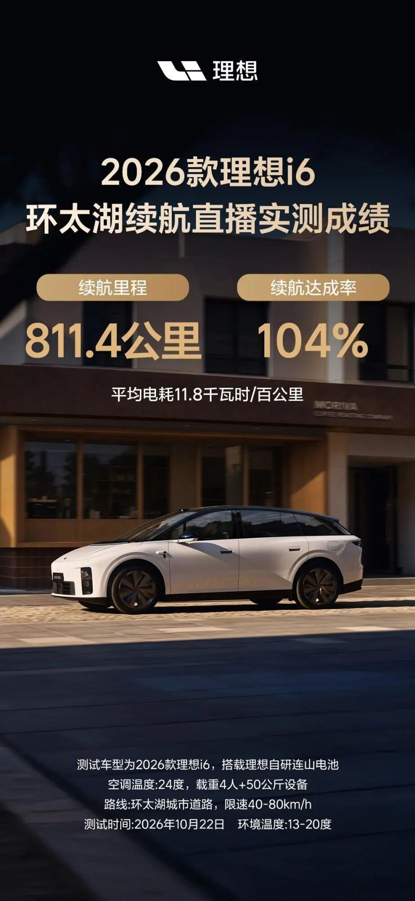
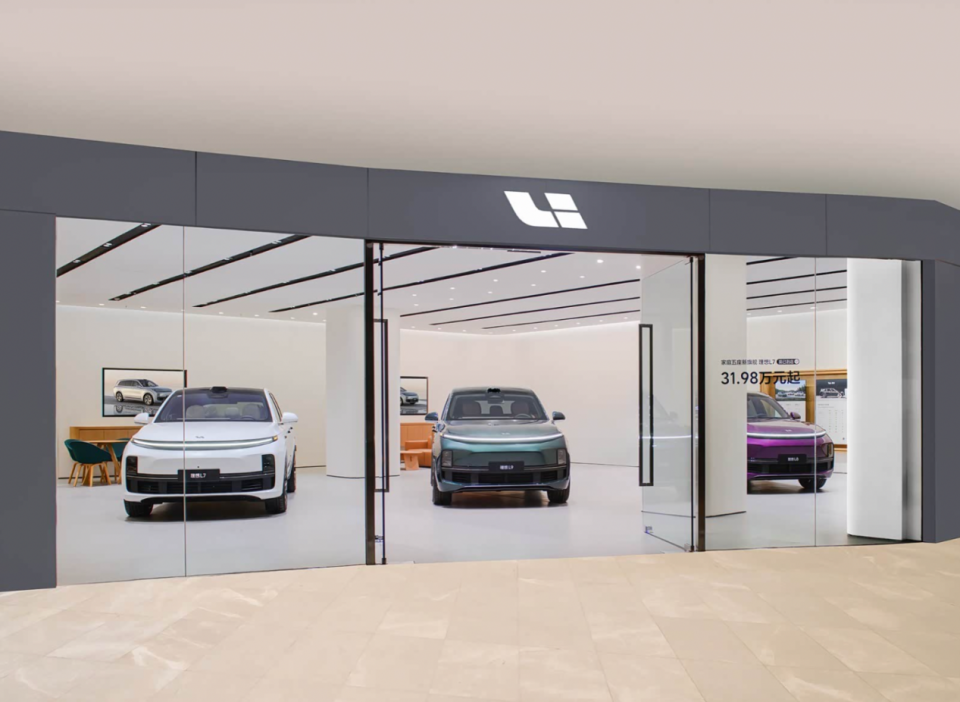
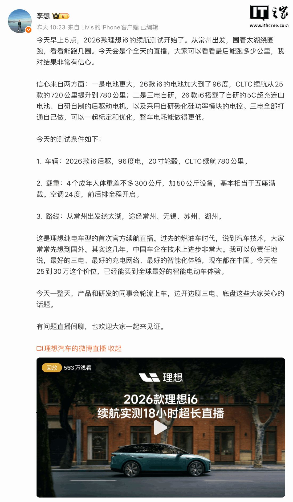
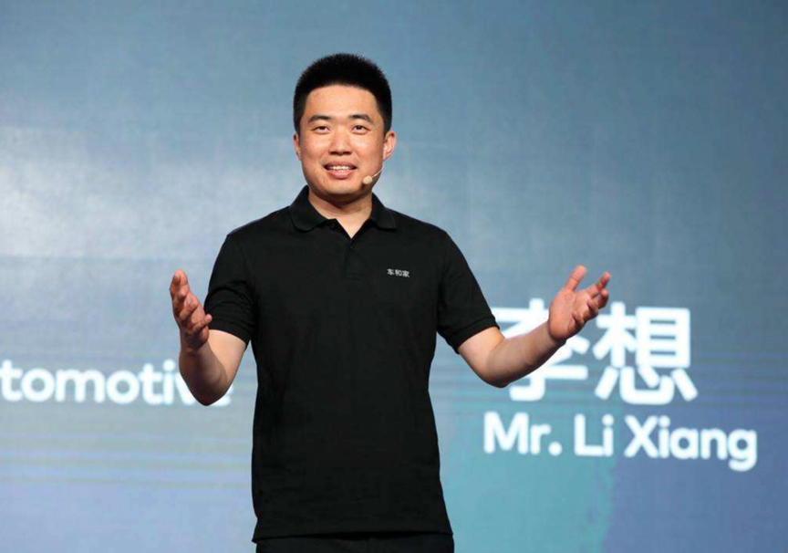
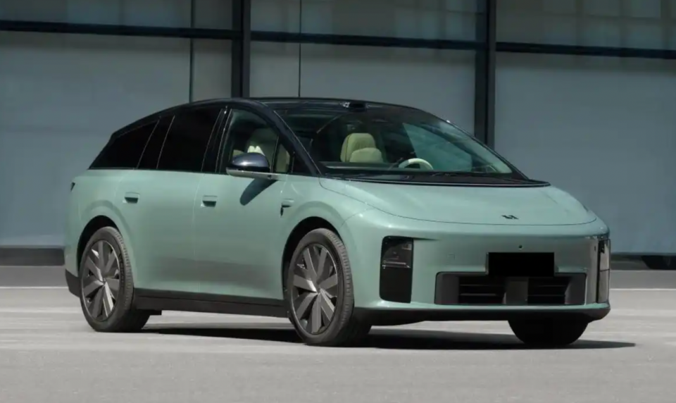
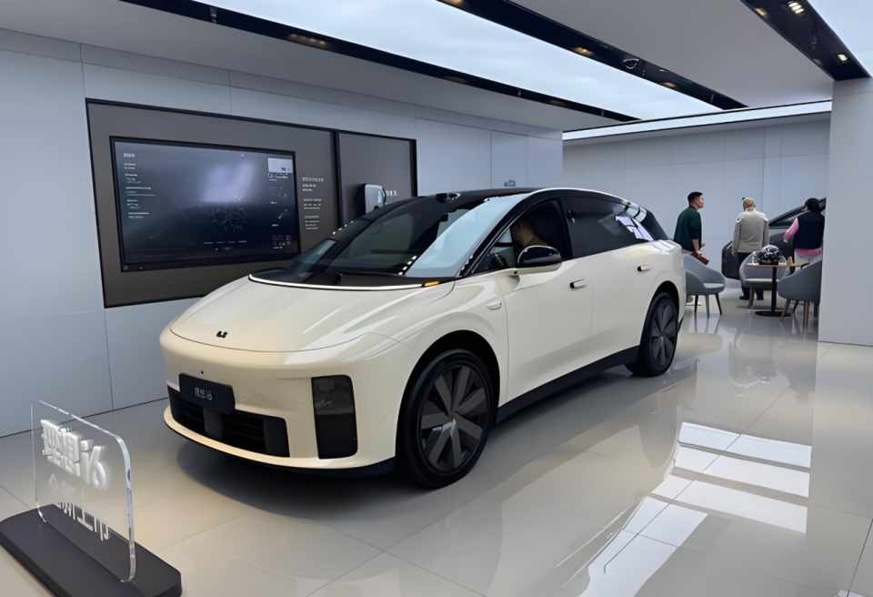

# 理想i6跑出104%续航，平均时速只有45公里

10 月 22 日，苏州。一台还没上市的 2026 款理想 i6 绕着太湖跑了 18 个小时，全程直播，中途不补能。

跑到表显 0% 的时候，里程停在 811.4 公里，平均电耗 11.8 度每百公里。CLTC 标称 780 公里。

811.4 除以 780，104%。

李想第二天在微博上把条件全摆了出来。气温 13 到 20℃，顶着城区限速开，空调 24℃ 自动模式前后排全开，车上四个成年人约 300 公斤，再加 50 公斤设备。

他把这个成绩叫「反向虚标」。

## 一、这个数我信

18 小时不间断直播，电量、里程、电耗每 30 分钟更新一次，比台架测试难做手脚。车机上那行字是「剩余电量 0%，行驶电耗 11.8kWh/100km，已行驶里程 811km」。

先算一笔最实在的账。811.4 乘以 11.8 再除以 100，等于 95.7 度。

电池标称 96 度。

也就是说这台车把标称电量几乎全跑出来了，99.7%。这个比例比 104% 更能说明三电的底子。

再看载重。易车配置页上，2026 款 i6 后驱标准版整备质量 2395 公斤，满载质量 2935 公斤。加上 300 公斤人和 50 公斤设备，测试时是 2745 公斤，相当于满载的 94%。

空调前后排全开，跑了 18 小时。

这一条我认。它比市面上多数续航测试都更接近真实用车。

## 二、104% 反的是谁的标

「反向虚标」这四个字用得漂亮，但它是相对 CLTC 的 780 公里算的。

CLTC 写在国标 GB/T 38146.1—2019 里。一个循环 1800 秒，跑 14.48 公里。平均车速 28.96 km/h，最高 114 km/h。

它被公认偏乐观，原因就在这几个数里。怠速占 22.1%，加速占 36.9%，减速占 32.3%。看着慢，可中间有一段 433 秒、6.12 公里的高速段，占全程时长 24.1%，车速一直拉到 114。

台架还关空调，环境温度控制在 20 到 30℃。

理想的这次反过来：载重更多，空调开着，温度还低一点，最后比台架多跑了 4%。

这一条我也认，是三电效率的实打实收益。

## 三、811 公里里没有一米高速

问题出在另一处。

这次跑的路线是常州出发，绕太湖经无锡、苏州、湖州，全程城区道路，限速 40 到 80 km/h。高速一段没跑。

原因是测试车挂的是测试牌照，上不了高速。这是媒体写明的限制条件。

811.4 除以 18，平均时速 45.1 公里。

这个速度正好落在电车最省电的区间。风阻还没起来，电机效率在高位，刹车回收频繁介入。

拿 CLTC 比一比。那个循环平均车速才 28.96 km/h，看着更慢，可它有 24.1% 的时长跑在 60 到 114 km/h。这一段纯电最费电，理想这次一米没跑。

所以 104% 翻译过来是一句话：城区中低速工况下，这台车的能耗控制跑赢了 CLTC 台架。

它证明不了「这台车不虚标」。

## 四、换个工况，只剩六成

把 96 度电放到 120 km/h 定速上再算一遍。

多家媒体和车主测出来的高速电耗在 19 到 20 度每百公里。96 除以 19.5，约 492 公里。

492 除以 780，63%。

这个数不是我编的。有长测跑过上海到南京往返，120 km/h 定速、两人、空调 24℃，跑 290 公里后表显剩 36%，折算全程高速约 450 公里。

也有实测给到 467.3 公里，达成率 68%。

口径不同，但都落在六成到七成之间。

同一台车，城区 104%，高速六成多。风阻随速度的三次方往上走，这一条谁也绕不开。

## 五、780 这个数字是怎么来的

李想自己把账报了。

一是电池。2025 款后驱版 87.3 度，2026 款 96 度，多了 8.7 度。二是三电自研。

他还给了两笔细账。连山电池包的上盖直接贴合车身地板造型，为整车多装下近 3 度电。自研碳化硅功率模块缩短电流路径，给续航贡献约 30 公里。

按 CLTC 标称电耗 12.31 度每百公里折算，3 度电值 24 公里。加 30 公里，54 公里。而 CLTC 一共涨了 60 公里。

这笔账很干净。780 里没有跳跃，就是多装的电加上少掉的损耗。

这里有个边界得说清楚。

李想说的是「核心三电，电池、电控和电机都我们自己打通设计」。指的是电池包、BMS、电机、电控。易车配置页上，2026 款后驱标准版的电芯品牌写的是中创新航。

自研电池包和自研电芯是两件事。前者值钱，后者是另一个量级的投入。

这不影响 11.8 度这个成绩的可信度。但读者容易把这两件事混成一件。

## 六、下次看到超 100% 的达成率，问三句

这 811 公里里有没有高速。

平均时速是多少。

电池标了多少度，实际跑出来多少度。

第三句最关键。前两句决定这个数字能不能外推到你的用车场景，第三句决定测试有没有把标称电量榨干。

理想这次榨到了 99.7%。这是真功夫，也是我愿意把它写清楚的原因。

---

参数是我按公开资料算的，欢迎在评论区指正。
