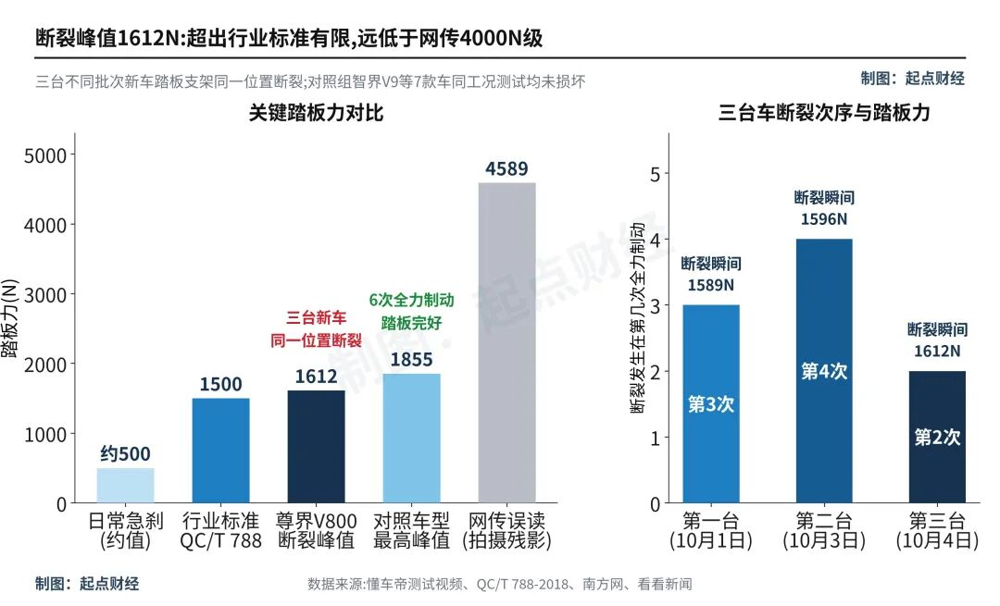
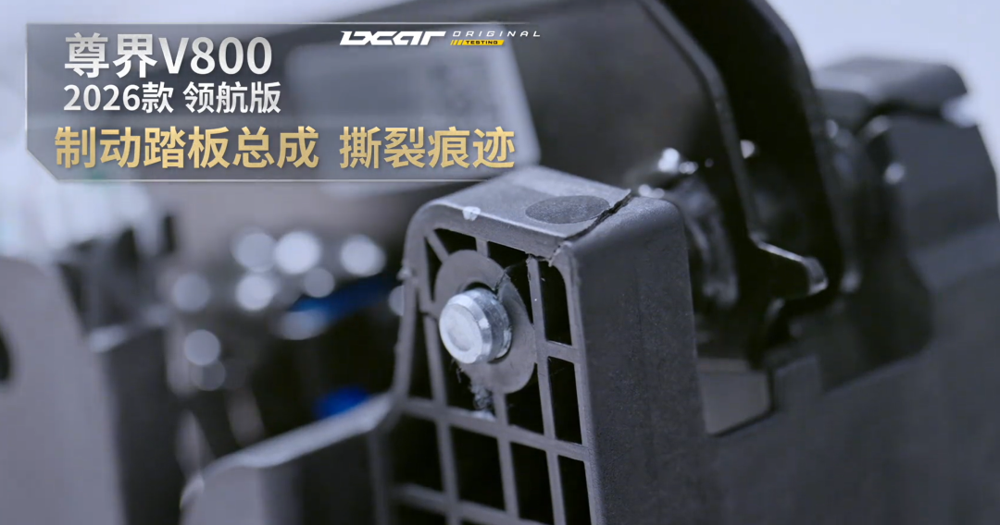
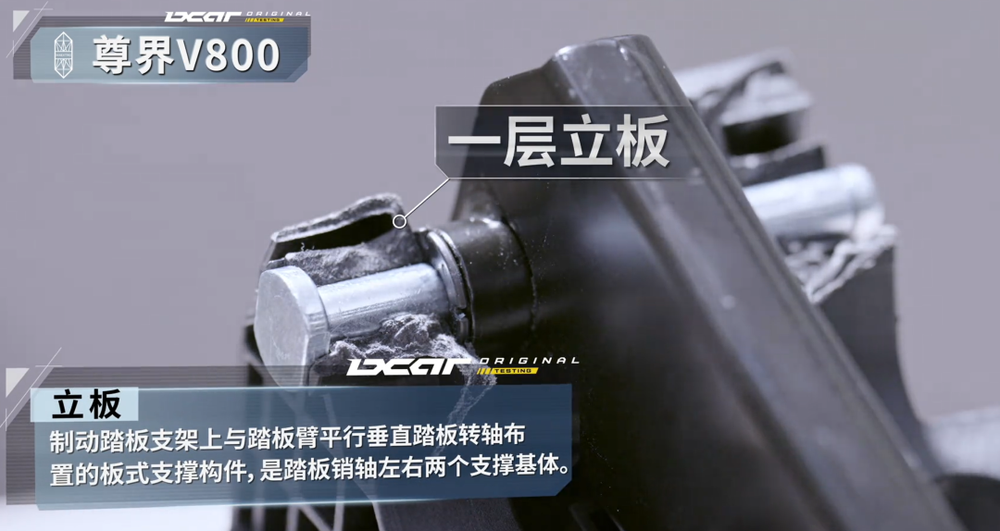
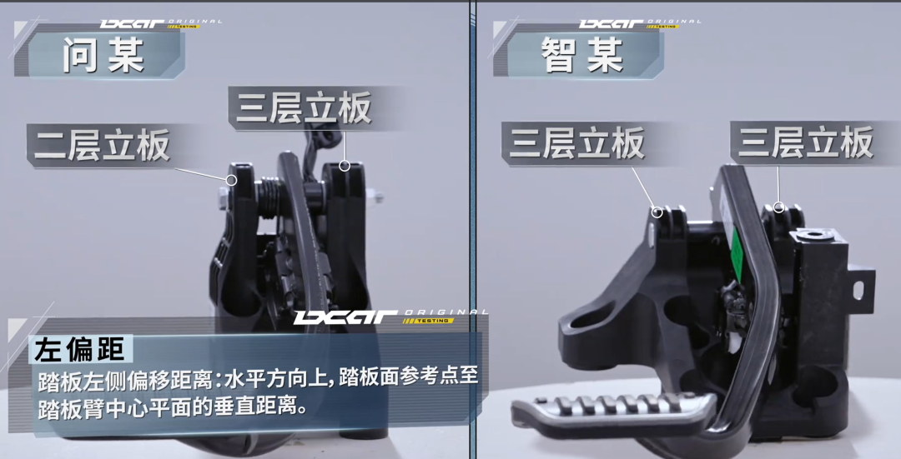
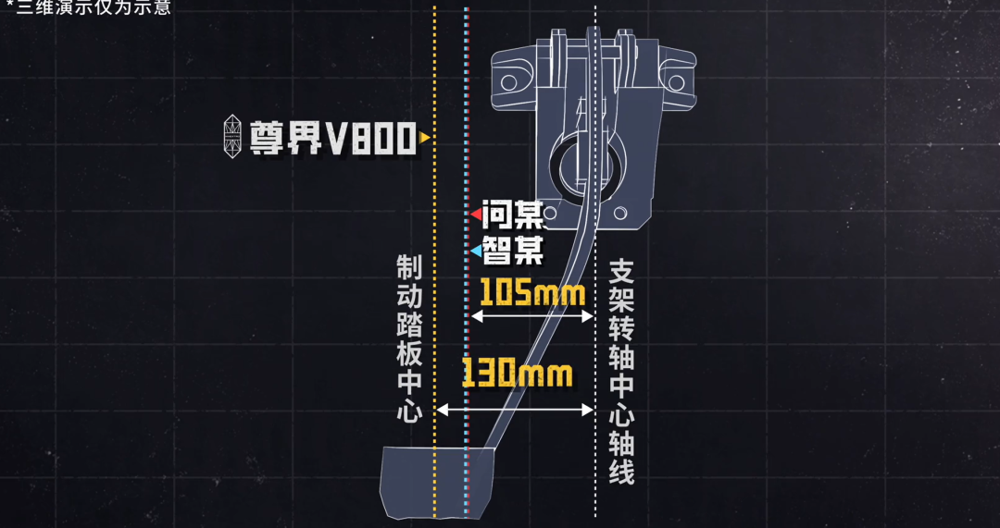
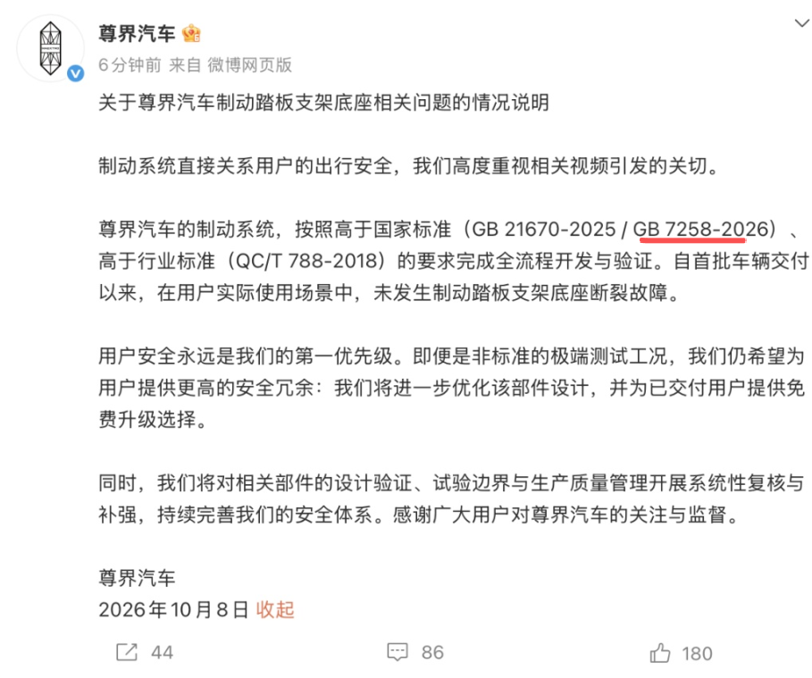
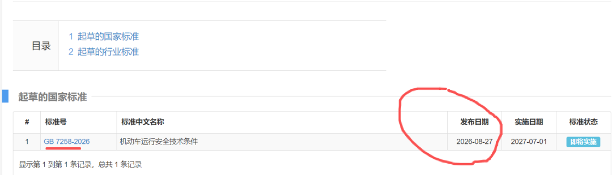

# 三台尊界刹车踏板断裂，4589牛那个数是假的

10月1日到4日，懂车帝把三台全新尊界V800开进封闭场地，做100公里时速到0的全力制动。

这是一台76.6万元起售的MPV，华为和江淮联手做的百万级豪车，9月底才规模交付。三台车分别断在第3次、第4次和第2次全力制动，断裂位置几乎一样。

其中一台车，总里程只有3公里。

## 一、4589牛是残影

事件发酵后，全网都在传一个数：4589牛。换算下来约468公斤，一个成年男性的腿远远踩不出来。质疑者据此认定，这是暴力测试。

10月8日晚懂车帝回应：4589牛是高速摄像机拍摄检测设备液晶屏时，刷新帧率不同产生的数字残影。读数在断裂瞬间从1600牛附近跳了上去。

三台车真实的断裂踏板力是1589、1596、1612牛。4589是1612的2.8倍，一个残影被截图转发，传成了暴力测试。

测试车是懂车帝自费从市场买回的三台不同批次新车。有媒体逐帧核对了画面，读数跳上去的时刻就是支架断裂的瞬间，更像断裂回弹撞了传感器一下的尖峰。

## 二、真实的数只比及格线高6.6%

1612牛是什么概念。现行行业标准QC/T 788-2018要求，制动踏板承受1500牛纵向力，保持5秒，循环5次，不能损坏。这是这条及格线的全部内容。

我用三台车的均值算了一遍，1599除以1500，只多出6.6%。

头部车企的内部标准高得多。通用把踏板极端载荷定在2700牛，保时捷要求3000牛，还要在零下35度到80度之间反复验证。按3000牛算，尊界V800的断裂载荷只有这个数的一半多一点。

台架的做法也写得清楚：纵向力1500正负20牛，以每分钟20毫米的速度缓慢加载，保持5秒后解除，做5次。这是静态考核，考的是材料扛不扛得住一个慢慢加大的力。

断裂的是塑料支架，不是金属件。支架一断，脚踩的力传不到制动系统。

## 三、断了之后，靠P挡滑了140米

踏板支架断裂后，脚刹完全失效，测试员只能按住P挡应急减速。刹车踏板是人和制动系统之间唯一的物理连接，这个连接断了，车就只能靠P挡里的电机慢慢磨。

测试数据显示，停车距离从正常状态的约38米延长到约140米。

这个数我可以算。100公里时速是每秒27.8米，38米刹停，平均减速度约1个g。140米刹停，减速度掉到约0.28个g，只有正常制动的27%。

尊界V800的用户手册写着，P挡应急制动主要用于减速，不能完全替代常规制动。这句话救了测试员，也说明厂家知道P挡兜不住。

## 四、同一场考试，别的车没断

懂车帝同场还测了另外8款车，各自完成6次全力制动，踏板支架都没断。对照车型里同样用塑料支架的，最高踩到1855牛。

拆开看，差别在结构。尊界V800的踏板转轴位置只有一层立板支撑，对比的问界、智界车型是两到三层。

还有一个数，尊界V800的踏板中心到支架转轴约130毫米，对照车型是105毫米。力臂更长，刹车瞬间传到转轴的冲击就更大。

我按力矩算了一下。1612牛乘0.13米，约210牛米；对照车1855牛乘0.105米，约195牛米。踩的力更小，转轴承受的力矩反而更大。

## 五、送检合格和实车断裂，可以同时成立

10月8日尊界声明，制动系统按高于国标、高于行标完成开发验证，交付以来未发生断裂故障，将优化设计并免费升级。

有人核对发现，声明援引的GB 7258-2026是今年8月27日公布的，比V800上市晚了22天。

零部件厂商伯特利的董事长袁永彬公开说，普通驾驶员单纯正向踩踏踩不断踏板，视频里的损坏可能是侧向发力别断的。伯特利同时说明，尊界V800的踏板并非由他们供应。

10月13日，江淮向车主发送检测说明。10月11日，中国汽研对14个踏板总成做台架检验，1500牛下位移均值2.61毫米，加严到3000牛也没有裂纹。

这跟三台车断裂并不矛盾。台架试验垂直于踏板表面、过几何中心、缓慢加载，实车紧急制动是动态冲击，踩踏位置会偏，力值在几十毫秒内剧烈变化。

中国汽车流通协会专家李颜伟的说法是，不能只拿3000牛未断去否定三台实车的断裂，也不能凭三次断裂就认定台架数据造假。两组结果可以同时成立，但公开材料还没解释它们为什么不同。

门店销售人员的说法有两层。一层是该测评也存在暴力驾驶的行为；另一层是升级用的部件已经在开模，10月底启动升级，未交付的车辆升级完再发。

## 六、下次看到这类罗生门，问三句

传言里的数字，源头画面能不能对上。

及格线是多少，实测离它有多远。

出事的车和对照的车，是不是同一张考卷。

前两条是事实核查，第三条才是判断。这次三条都指向同一个方向。

---

参数是我按公开资料算的，欢迎在评论区指正。
