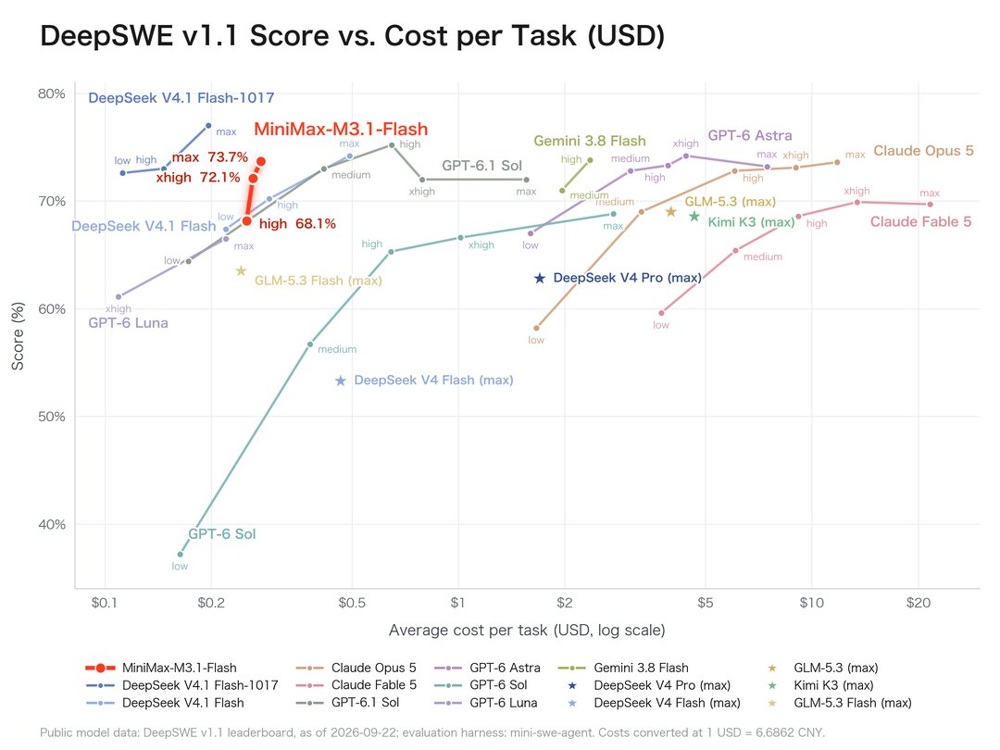
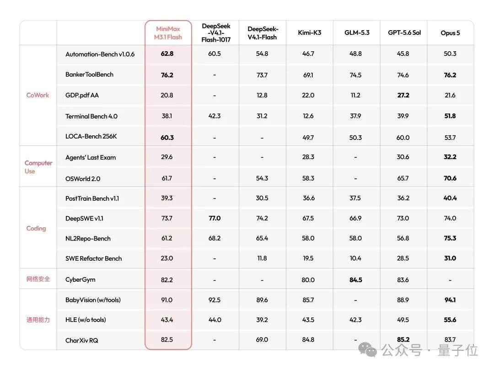
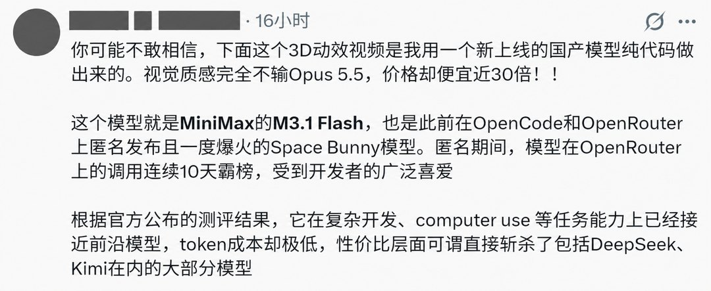
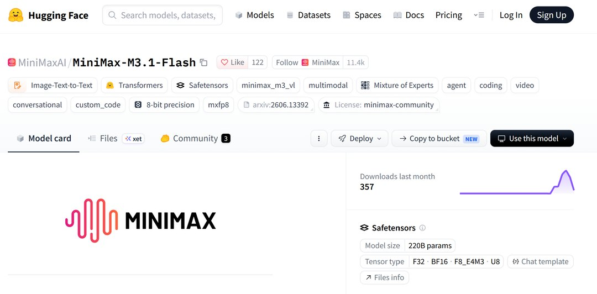
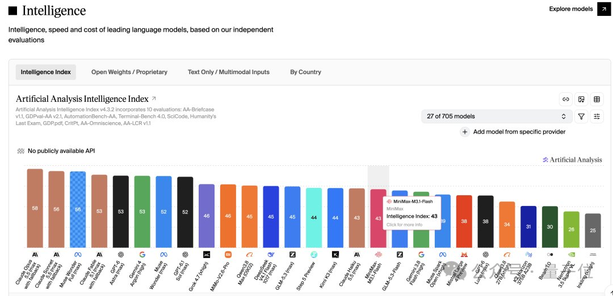

# MiniMax的70%从哪来？单价只降了50%

10 月 19 日晚，MiniMax 上线 M3.1 Flash，官网价目表挂出三个数。每百万 tokens，输入 0.15 美元，输出 0.60 美元，缓存读取 0.015 美元。

同一份公告里还有一句被所有媒体抄了一遍的话，使用成本降低 70%，推理速度提升近 3 倍。

我拿这句话去对价目表。对上的是 50%。

## 先把三个价签摆出来

上一代 M3 现在的价是输入 0.30 美元、输出 1.20 美元、缓存读取 0.06 美元。这个价本身已经打过折，官网把原价 0.60 / 2.40 / 0.12 划掉了，标着永久 5 折。

两代并排，逐项做减法。

输入从 0.30 到 0.15，降 50%。
输出从 1.20 到 0.60，降 50%。
缓存读取从 0.06 到 0.015，降 75%。

换成人民币，新民晚报写的是输入 1 元、输出 4 元、缓存 0.1 元，和官网汇率换算对得上。

同一篇报道的措辞是「输入和输出单价均降低 50% 以上」。我算出来是正好 50%，不多一个点。

这句话不算假，但「以上」两个字撑不住。真降得狠的只有缓存那一项。

这个价也压到了 DeepSeek V4.1 Flash 谷时价的同一水平。两家都是 0.15 美元的输入价，谁也没比谁便宜。所以媒体那句「正面硬刚」没说错，只是硬刚的结果是打平。

## 多出的 20 个点在缓存里

单价降五成，总成本降七成，中间这 20 个百分点得有个出处。

能出钱的只有两个地方。一是缓存计价，二是一个任务用的 token 变少了。

第二个它没给数。公告里只有结论，没有「每个任务平均省多少 token」的拆解。

第一个我能算。缓存读取降 75%，是三项里降幅最大的一项。它在总账里占多重，取决于命中率。

我把命中率从 0 拉到 100%，按输入侧加权算了一遍。

命中率 0，降 50.0%。
命中率 50%，降 54.2%。
命中率 75%，降 59.4%。
命中率 90%，降 66.1%。
命中率 95%，降 69.8%。
命中率 100%，降 75.0%。

要正好凑到 70%，命中率得到 95.2%。

落到账单上更直观。假设你一个月跑 10 亿输入 tokens。

全不命中缓存，旧价 300 美元，新价 150 美元，省一半。
命中 80%，旧价 108 美元，新价 42 美元，省 61%。
命中 95%，旧价 72 美元，新价 21.75 美元，省 69.8%。

三个数摆在一起就清楚了。命中率越高，账单里按缓存价结算的比例越大，总降幅就越接近 75%。

95% 在 Agent 场景里不算离谱。每一步都要把同一段上下文重发一次，前面几轮的内容全躺在缓存里，命中率自然往 90% 以上走。

换个用法就没了。你拿它做单轮问答，每次 prompt 都是新的，命中率接近零，省下来的是 50%。

所以「降 70%」不是假话，它有前提。前提是长会话、高缓存复用。这句话公告里没写。

## 跑分和用量都是自报的

便宜是有技术来路的。前三个全注意力层换成稀疏注意力，路由专家压到 W4A4，KV 缓存从 Q8KV8 降到 Q8KV4，再加一层按功耗分配的调度。同样一张卡，能多干点活。

代价也写在同一份技术说明里。精度从 8 位压到 4 位，省的是显存和带宽。省下来的这部分对输出质量有什么影响，公告没提。

跑分我不逐项抄，表在那儿。

Agent 类：Automation-Bench 62.8 分，BankerToolBench 76.2 分。
上下文：LOCA-Bench 256K 是 60.3 分。
电脑操作：OSWorld 2.0 是 61.7 分，Agents' Last Exam 29.6 分。
编程：DeepSWE v1.1 是 73.7%，SWE Refactor Bench 只有 23.0%。

这些数 MiniMax 自己测、自己挑对手、自己排版。彭博社抄完跑分之后补了一句，两项结果均未经独立核实。

它自己的表里也有输的项目。DeepSWE 输给 DeepSeek V4.1 Flash 的 77.0 分。Terminal Bench 4.0 只有 38.1 分，比 DeepSeek 的 42.3 分低。

独立榜单也有。Artificial Analysis 的智能指数上，它是 43 分。

用量那边更热闹。发布前有个匿名模型叫 Space Bunny，挂在 OpenRouter 上，没人知道是谁家的。

它连续 10 天霸榜，处理掉 200 万亿 tokens。开发者拿它跑 3D 动效、前端页面、材质模拟，一路夸到 Opus 5.5 头上。

10 月 19 日揭晓，就是 M3.1 Flash 的早期版本。

这批数据比任何实验室跑分都值钱，真实请求、真实任务、真实并发，而且不要钱。

开源那天的数字是 72 小时 100 万亿 tokens。两个数都只有 MiniMax 自己的口径，没有第三方审计。

## 两个对不上的小地方

第一个是速度。中文稿统一写「近 3 倍」，英文标题被写成 3x。那个「近」字在转述里掉了。

第二个是参数。Hugging Face 仓库页显示的模型规模是 220B，模型卡写 428B 总参数、23B 激活。

两个数差了一倍。可能是量化后的计数方式不同，也可能就是标错了。官方没解释，我也没查到。

参数这个数会往下游传。写进采购文档，或者写进给老板的那页 PPT，都可能照抄 428B。抄之前最好自己开一次仓库页。

这两处不影响主结论。但它们说明另一件事，公告里的每个数，都得自己去对一遍。

## 下次看降价，先问三句

单价降多少。别看百分比，拿两版价目表自己除一遍。

分母是原价还是折后价。M3 挂着永久 5 折，按原价 0.60 算，这次输入降 75%；按折后 0.30 算，降 50%。两个数都成立，看它挑哪个。

缓存算没算进去，算了多少，公告写了没有。这条最容易被跳过，也最影响你月底那张账单。

MiniMax 这次的价是真低。0.15 美元的输入价，和 DeepSeek 谷时价打平，是它高峰期价格的一半。这个不用怀疑。

要怀疑的是那个 70%。它属于一套特定的用法，不属于所有用法。

---

参数是我按公开资料算的，欢迎在评论区指正。
