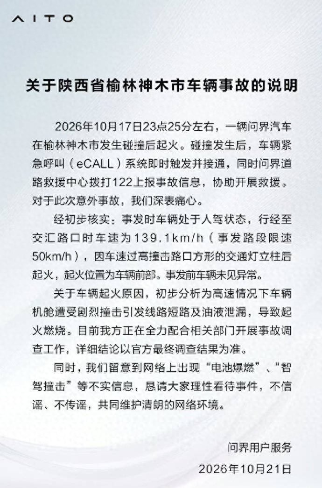
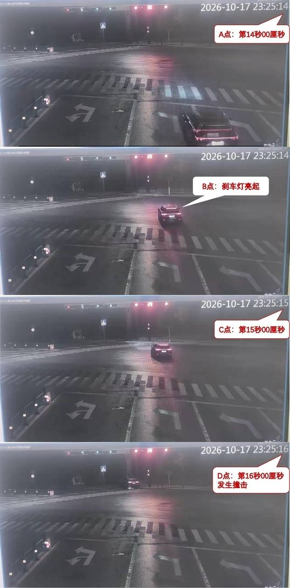
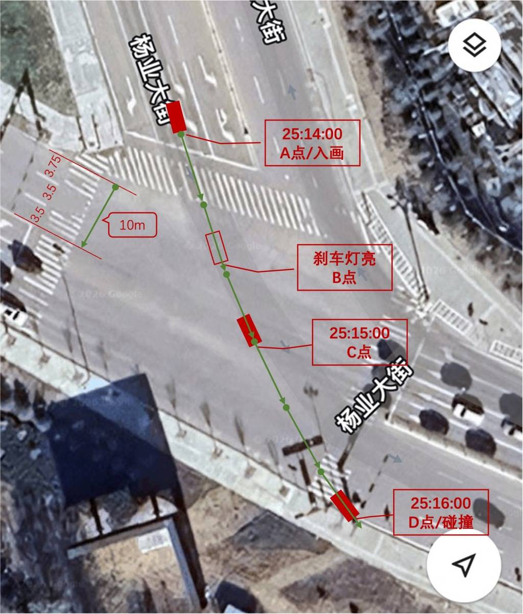
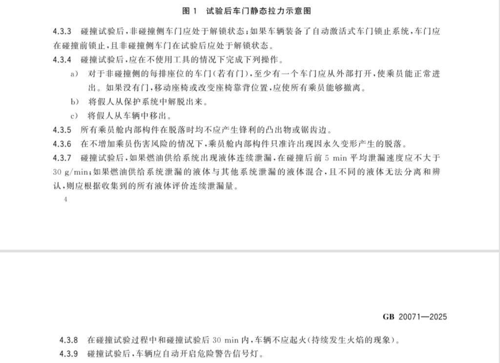
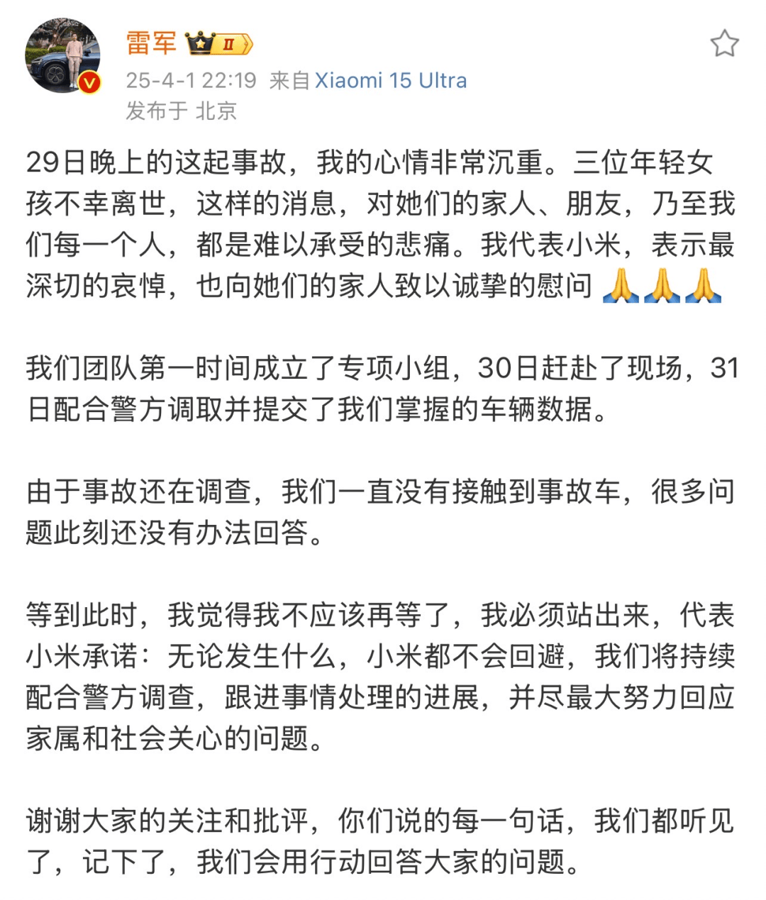

# 问界M9撞柱起火，139.1是真的但没说清哪一刻

10 月 17 日 23 点 25 分，陕西榆林神木，杨业大街和滨河西路的路口。一辆问界 M9 撞上路口方形的交通灯立柱，车头起火。车上只有司机一人，遇难。

4 天后，问界用户服务发出说明。人驾状态，行经交汇路口时车速 139.1km/h，该路段限速 50km/h。起火初步分析为高速撞击致机舱线路短路、油液泄漏。

这个数字，我倾向于是真的。它大概率来自车端记录，不是拿监控估算出来的。

问题在旁边那句定语上。

## 少的是那句定语

声明原文完整的一句写的是，行经至交汇路口时车速为 139.1km/h（事发路段限速 50km/h）。

时刻给了，位置给了，参照系也给了。没给的是撞上灯柱那一瞬的速度，以及从 139.1 到 0 之间发生了什么。

于是大家自己算。

汽车博主封士明拿监控和卫星地图测算，车辆从入画到撞击约 2 秒，移动约 58 米。他算出的平均时速 104.4km/h，碰撞瞬间大概 75.6km/h。

另一位博主用帧数加卫星测距。从停车线到灯柱 62.11 米，用时 1.90 秒，均速 117.68km/h。

最后 9.02 米用了 0.60 秒，均速 54.12km/h，撞击不会超过 70km/h。

也有自媒体逐帧加地图，算过线时速约 142km/h、撞击大于 100km/h，反而和官方数对得上。

同一段视频，60 到 130 都有人算出来。

清华大学汽车系博士张抗抗对澎湃新闻说，这些测算都不能作为确定结论，撞击时速要以警方鉴定为准。这话是对的。

但他在这句之前，先指出了另一个问题。

他说，行经交汇路口时时速 139.1km/h 这个表述非常不严谨。指的是哪一个时刻、哪一个具体地点，无法让人作出合理判断。

## 一个数决定问不问下去

因为它同时锁两件事。

第一件是责任。限速 50 的路口跑到 139.1，接近三倍，这是事故主因，没有争议。

第二件是车。中国新车评价规程 2024 版里，正面 100% 重叠刚性壁障碰撞的试验速度是 55km/h，侧面柱碰撞是 32km/h。

国家标准 GB 20071—2025 对碰撞后的要求写得更直白，试验过程中和试验后 30 分钟内，车辆不应起火。

按 139.1 算，动能是 55km/h 标准测试的 6.4 倍。这个量级撞上刚性立柱还不起火，目前没有哪家做得到。问题到这儿就关掉了。

按 75.6 算，动能是 1.9 倍。按 54 算，是 0.97 倍，几乎就是标准测试的同一量级。这时候车为什么烧，就得另找一个解释。

同一场事故，两个口径，一个让疑问止步，一个让疑问继续。

我理解车企为什么选前者。但我更关心的是，选完之后它没有告诉读者，这是哪一个点。

## 小米给的是时间轴

2025 年 3 月 29 日 22 时 44 分，德上高速池祁段。一辆小米 SU7 标准版撞上隔离带水泥桩后起火，三人遇难。

4 月 1 日下午，小米公司发言人公布了一段精确到秒的时间轴。

22:27:17，NOA 激活，车速 116km/h。22:44:24，NOA 发出风险提示「请注意前方有障碍」，发出减速请求。

22:44:25，NOA 被接管，方向盘左转 22.0625 度，制动踏板开度 31%。22:44:26，方向盘右转 1.0625 度，踏板开度 38%。

22:44:26 到 28 之间，车辆与水泥护栏碰撞。

碰撞前的速度，它写的是「系统最后可以确认的时速约为 97km/h」。116 到 97，中间有提醒、有接管、有踏板开度。读者能自己把这一秒一秒拼出来。

同一天晚上的六问六答里，它也留了空。

车门能不能打开，原文是「我们尚未接触事故车辆，无法分析事故时车门是否可以打开。目前没有准确的结论」。

AEB 有没有触发，它给了工作区间 8-135km/h，并写明这套系统不响应锥桶、水马、石头、动物。

答不上的，它说答不上。

小米那次也有问题。

2025 年 9 月，市场监管总局公告召回 116,887 辆 SU7，占当时销量约 38%。

原因是辅助驾驶系统在特定情境下辨识能力不足，导火索就是这起事故。

数据公布得清楚，跟产品没毛病，是两件事。

## 给的东西能不能被验

两家的反应都不算慢。问界是事发第 4 天，小米是第 3 天。

差别在给出来的东西，能不能被别人验一遍。

小米给的是一串时间戳，每一个都能拿去和监控、和后台日志、和警方调取的记录对照。你可以不信它，但你清楚该去核哪一条。

问界给的是一个点。你不知道这个点落在路口的哪一米，也不知道从它到撞击之间还剩多少距离。想验，只能自己拿监控逐帧算，于是算出了六七个版本。

更麻烦的是那份说明的结构。400 字里，它同时做了三件事，定性（人驾）、归因（线路短路加油液泄漏）、否认（电池爆燃、智驾撞击）。

最后一句写「详细结论以官方最终调查结果为准」。

前面三条已经是结论，最后一句要求等结论。这两句话放在一起，读者很难不觉得，结论给完了，调查只是走个流程。

小米那份也否认了自燃。它的否认带着推断链，推测系猛烈撞击水泥桩后整车系统严重受损导致，并且承认尚未接触事故车。

一个是我推断，一个是初步分析请你等官方，字面接近，感受差很远。

还有一层是历史。2024 年 4 月，山西运城一辆问界 M7 追尾后起火，车上三人遇难。

据新浪汽车报道，广东惠州一起 M9 起火事件里，问界给出的结论同样是三电系统状态正常、未见车辆其它自身异常。

同一套说法用到第三次，读者的第一反应从「它解释了」变成了「它又这么说了」。

往根上说，问题是举证路径不在公众手里。EDR 从 2022 年起强制装车，数据锁在车内，读取要专用设备走 OBD 接口，通常只有交警、法院能依法调取。

车企既是数据持有方，又是第一份结论的发布方。这种结构下，它说得再对，也没人能替它证明。

## 下次先问三句

第一句，这是哪个时刻的速度。路口、刹车前、撞击瞬间，是三个不同的数。

第二句，从这个数到 0，中间有没有过程。有过程，才看得出人的动作和车的动作。

第三句，数据在谁手里，谁能核。车企自己说的数，只能当线索。

回到这次。139.1 大概率是真的，神木警方还在调查，最终以鉴定为准。我不认为问界在编数。

但它把一个极易被误读的数放在了显眼的位置，没有说明它是什么。后面所有的争吵，都是从这里开始的。

---

数据是我按公开报道和国标条文算的，欢迎在评论区指正。

免责声明：本文基于截至发稿前的公开报道与网络信息整理，仅为个人评述，不构成对任何事故原因的认定；事故最终结论以有关部门调查通报为准。文中图片来自公开网络报道，仅用于新闻评论，版权归原作者所有；如有不实或侵权，请联系本号删除。
