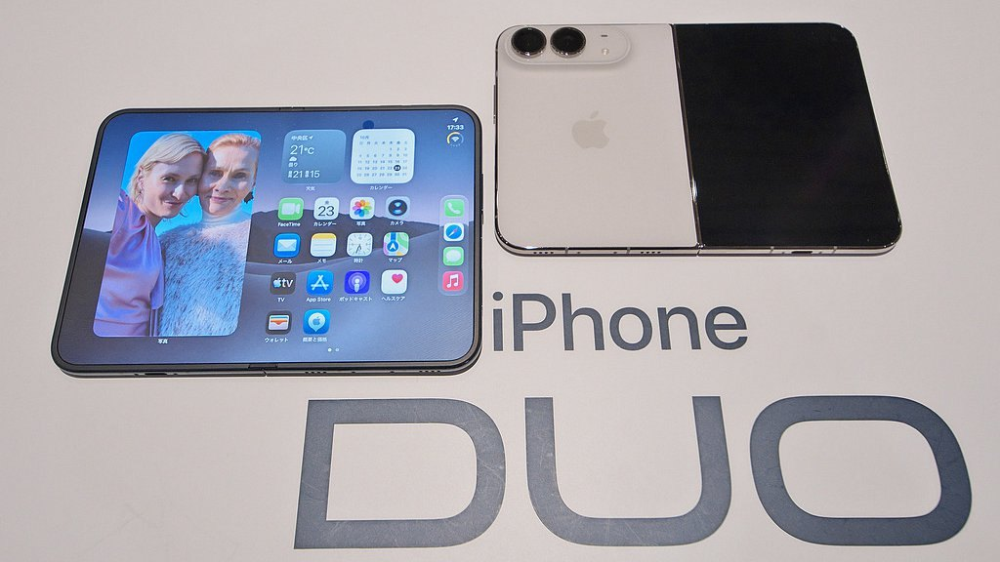
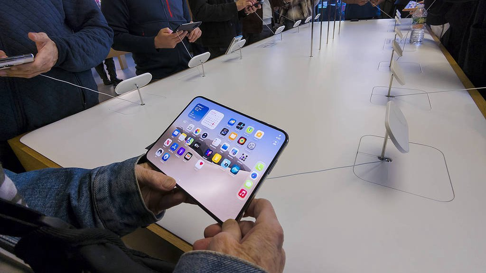
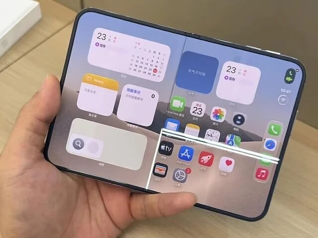
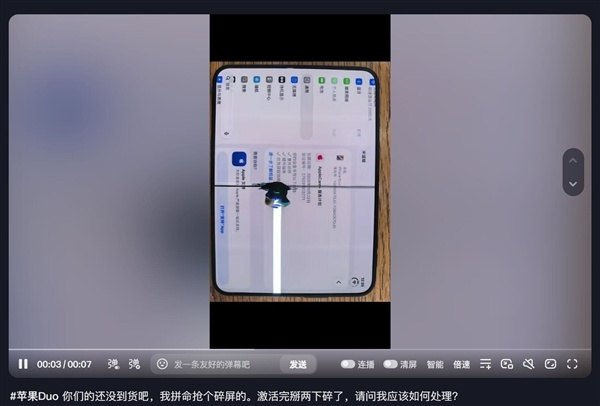
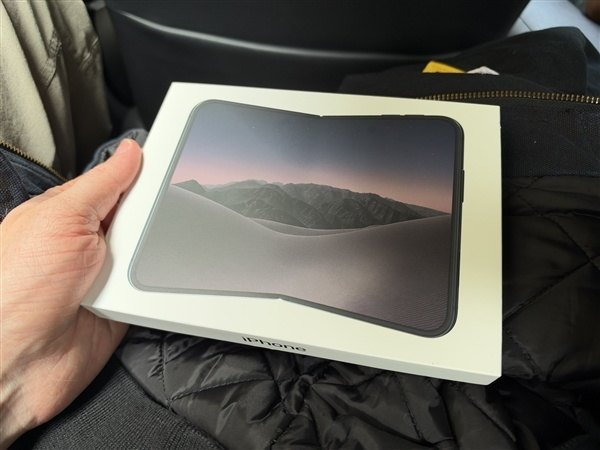

# iPhone Duo开售3天：7998元的屏撑不过20次

10 月 23 日，苹果第一台折叠屏 iPhone Duo 开售。

纽约、东京、上海，门店门口排长队，线上预购几分钟售罄，澎湃新闻记者在门店外碰见加价 2000 元转卖的黄牛。国行 15999 元起，苹果史上最贵的一部 iPhone。发布会讲了十多年研发、超瓷晶面板、纳米纹理内屏。CEO 特努斯此前评价安卓折叠屏的原话是 cheap and crappy。

三天后，苹果发了一份声明。

原话是，已留意到极少数 iPhone Duo 的内屏出现问题，遇到显示问题的用户请联系 AppleCare 换机。从开售到承认，隔了 3 天。

问题不复杂。多位用户展开手机时听到一声脆响，内屏沿铰链中线裂开，有的还带一条横贯屏幕的白线。彭博社向六位以上用户逐个核实，拿到的是照片和客服记录，不是论坛截图。

## 一、裂得太整齐，就不像意外

把晒出的裂痕图摆在一起，位置几乎一样，都沿铰链中线，起裂点附近能摸到一个小凸起。随机的磕碰，不会每次落在同一个点上。

拆解机构 iFixit 拆了一台新机，用拆解影像、专利图和 CT 扫描建了铰链的 3D 模拟。损伤集中在屏幕排线经过、支撑条附近的同一个位置。那根支撑条展开时托住屏幕，合上时应该退让开，iFixit 推测它没有完全让开，压力反复砸在同一处。

iFixit 首席执行官凯尔·维恩斯在社交平台写得直白。铰链由几十个零件组成，精度要求极高。一点制造公差或一粒沙子，就可能毁掉它保护的屏幕。

有件事得先说清。MacRumors 发现，网上流传的部分裂屏图是 AI 生成的。我把引用的案例按来源筛了一遍，留下的是彭博社核实过的，或当事人发出原始视频的。

## 二、三个数摆在一起，才知道坏在哪

第一个数，7998 元。

苹果官网 10 月 14 日挂出 Duo 的维修预估价，内屏损坏 7998 元，外屏 3198 元，电池 1898 元。15999 元的起售价，内屏维修正好是一半。做个对照，iPhone 18 Pro Max 换屏 3198 元，Duo 一块内屏是它的 2.5 倍。

第二个数，5.5 万次。

折叠屏有个行业指标叫开合寿命，实验室里反复开合，看屏幕和铰链撑得住多少次。三星给 Galaxy Z Fold6 标 20 万次，新一代 Fold8 标到 50 万次。Duo 的这个数，苹果至今没公布。外部实测倒有。华尔街日报记者乔安娜·斯特恩用机器把 Duo 开合 3.2 万多次，折算下来是每天 45 次、连用两年，机器没事。另一台持续做铰链测试的机器，开合超过 5.5 万次，也没事。

第三个数，20 次。

出问题的机器里，最短的案例开合不到 20 次。一位用户到手 30 小时，正常展开时屏幕裂了。还有一位激活完掰了两下，内屏中央漏液。

我自己算了一笔账。按每天 45 次的用量，20 次折合不到半天的开合量。别人的机器撑了两年，这一批撑了半天，差别不在用户怎么用。

## 三、郑州的良率，和没挂出来的那张表

Duo 由富士康郑州工厂独家组装，铰链含 100 多个微型零件。界面新闻的独家报道说，上市前一个月整机组装良率六成出头，铰链供应商新日兴同样偏低，只能挑合格的样品交货。良率六成，等于 10 台下线有 4 台过不了关。

10 月 11 日，苹果 COO 萨比·汗专程去郑州看产线。彭博社记者古尔曼报道，今年夏天量产困难一度严重到苹果考虑推迟到 11 月底发布。最后没有推迟。

出事之后，有媒体援引富士康员工的话，说苹果曾下调良率质检标准保供应。接近供应链的人士随即否认。两边对不上，这个我没查到一手结论，先记下。

能查到的是，苹果官网挂出了 7998 元的维修价目表，却始终没挂出 Duo 的开合寿命数。竞品拿实验室数据当承诺，Duo 连承诺的数字都没有。

## 四、话是收不回来的

比裂屏更难收回的，是之前的措辞。

特努斯说安卓折叠屏 cheap and crappy，硬件工程负责人玛丽布让用户对折痕耐用性向苹果追责。七年前，三星第一代 Galaxy Fold 评测机集体翻车，售价 1980 美元，推迟了五个月再上市。苹果这次边换机边接着卖。

销量也确实没受影响。证券时报 10 月 10 日报道，苹果对 Duo 加单 30%，总量控制在 1000 万台以内。此前分析师预估今年出货约 600 万台。官方订单排到明年 1 月，第二批 1 月 22 日出货。

一边修产线，一边冲产量，爬坡越快，没解决的问题越容易被放大。沈阳万象城的售后已经碰到这种情况，用户的内屏漏液，付费也修不了，店员答复没有配件，只帮忙登记。

## 五、下次看到这类首发，问三句

开合寿命数公布了吗。

裂痕是随机的，还是都落在同一个位置。前者怪用户，后者怪产线。

第二批还加不加单。一边修工艺一边提产量，品控的账迟早要还。

1 月 22 日第二批出货之前，这三问都会有答案。

---

参数是我按公开资料算的，欢迎在评论区指正。
