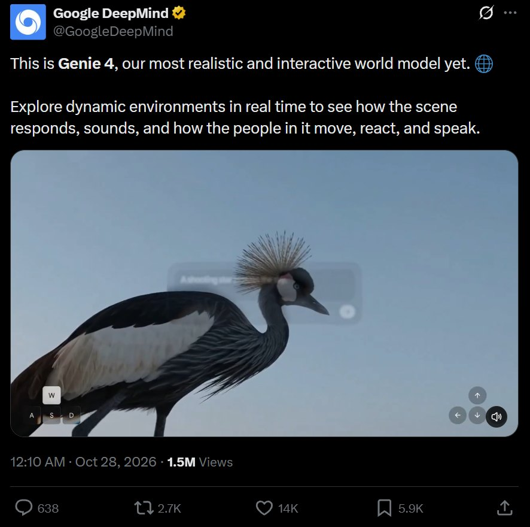
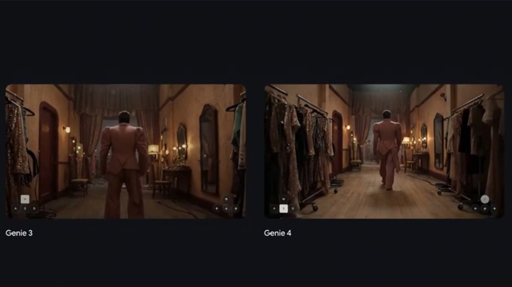
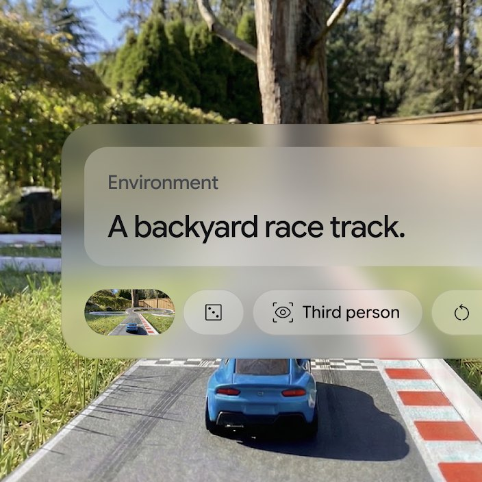
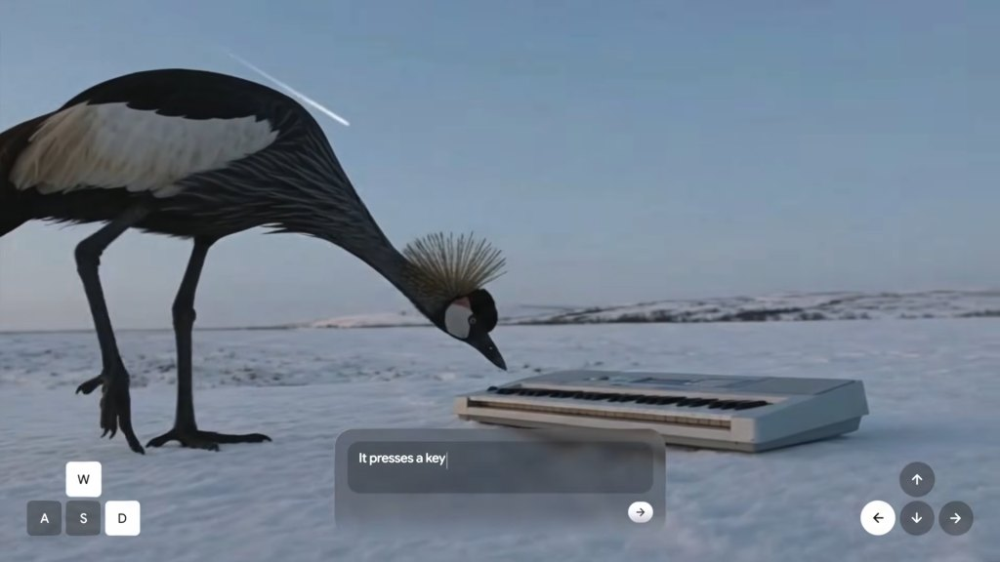
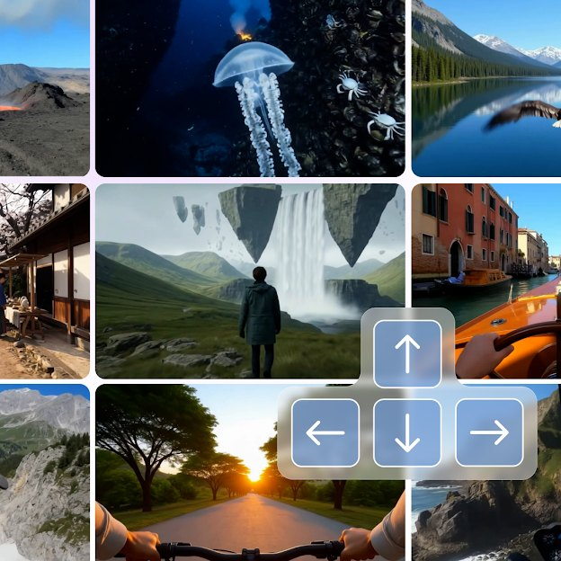
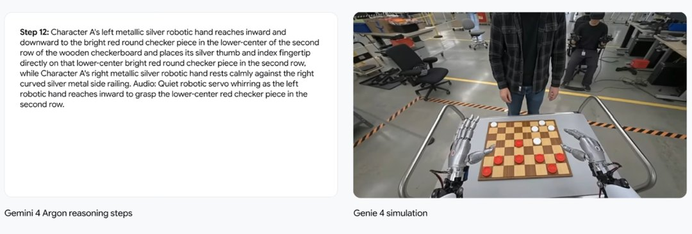

# Genie 4 的两分钟是真的吗？官方博客只写了短会话

10 月 27 日，DeepMind 把 Genie 4 挂上博客，副标题是「新一代世界模拟」。

官方账号当天发的原话是：这是谷歌迄今最逼真、交互性最强的世界模型。演示片段里，一句话换天气，一句话加个角色，镜头能推能拉，声音跟着画面一起出来。

鹤在雪地里啄一下琴键，骑士穿着盔甲坐在草地上刷手机。画面确实好看。我看第一遍的时候也停了一下。

但通稿里那个「两分钟」，我在官方博客正文里没找到。

## 一、两分钟是上限，不是连贯

博客里跟时长有关的只有两句：「能在短会话内维持连贯的环境」，以及「运行时间比上一代更长」。

短会话是多短，更长是长多少，都没写。

模型页的说法是「几分钟的连续交互」。几分钟，还是没给数。

两分钟出自媒体简报会。TechCrunch 记下谷歌的说法是「最长两分钟，是 Genie 3 的两倍」。中文媒体当天写成「最长可以维持两分钟连贯不变的场景」。

前半句和后半句不是一回事。

同一场简报会上，DeepMind 研究工程师 Hang Qi 说，就算跑到两分钟上限，也不代表整个场景期间保持一致。产品经理 Diego Rivas 说得更直：两分钟能做到的事情终究有限，团队还在研究探索阶段，没有真正进入最终产品开发。

所以官方口里有三个时长：短会话、几分钟、最长两分钟。媒体挑走了最好听的那个，顺手把「上限」改写成了「连贯」。

## 二、没有帧率，两分钟不可核

两分钟是 120 秒，这个数没错。Genie 3 一次 60 秒，120 除以 60 等于 2，「翻倍」的算术也成立。

问题在后面。

要知道 120 秒里装了多少画面，得有帧率。按竞品公开的 24 帧算，120 秒是 2880 帧。Genie 4 的帧率谷歌没给，这 2880 我算不出来。

分辨率没给。跑分没给。价格没给。

价格这一项还有个更简单的原因，这东西还没开卖。眼下只放给受信任测试者，几周后才轮到 AI Ultra 订阅用户和 Gemini API 的早期伙伴。没上架，自然没有价。

顺带说一句时间。Genie 3 是 2025 年 8 月发的，到这次隔了 14 个月。两次的发布身份一模一样，都是研究预览。上一代预览了一年多，这一代还是预览。

能拿去跟工程团队对齐的硬指标，我数出来是 0 个。

同一条赛道上，Runway 9 月发的 GWM Worlds 2，官方页写着 720p、24fps、48kHz 音频，三个数。腾讯的 Hy-Nomas 直接开源权重，还配了 280 例测试集。Odyssey-3 也给了自家数字。

不比谁更强。比的是别人愿意把东西拆成可核的参数，谷歌这次一个都没给。

## 三、官方自己点了七项短板

博客里有一段叫「理解当前局限」，我建议转发这条新闻的人都读一遍。

我把里面的短板数了一遍，七项：视觉细节、物体恒存、复杂物理交互、实时音频准确性、可读文字渲染、空间准确性、长期一致性。

前两项是「会随时间漂移」，后五项直接写着「仍在研究中」。

物体恒存值得单独说。东西离开视线再回来，还是不是原来那个。这是世界和视频的分界线。视频里物体出画就没了，世界里它应该还在原地。

博客还列了漂移的三个触发条件：模拟跑得越久、复杂的提示词编辑越多、在场景里走得越远。

三个条件里有两个，正好是 Genie 4 主打的卖点。实时改天气算提示词编辑，实时操控镜头就是在场景里移动。

卖点越用力，漂移越明显。这句官方没写，但它自己列的三个条件推得出来。

博客末尾还有一句关于水印。Genie 4 生成的视频和音频全部带 SynthID 隐形水印。

这句话管的是来源，管不了内容。水印能说明这段画面是 AI 生成的，说明不了画面里的东西对不对。

受信任测试者已经在用的一个场景是新闻摄影，把一张二维的历史照片做成可以走进去的场景。照片本身只有正对镜头的那一层，转过身去看到的一切，都是模型补的。补出来的东西不能当史料。

## 四、这套东西是拼起来的

Genie 4 不是一个模型。

Gemini Omni 负责让场景看起来像真的，其他 Gemini 模型负责让它保持连贯。真正在环路里跑的调度者是 Gemini 3.8 Flash。

它看画面，判断用户想干什么，把目标拆成几步，再回看画面确认每一步成了没有。

团队试过用更大的 Argon，最后的实时体验还是交给 Flash 驱动。Flash 快，这是它能进环路的理由。

所以「最逼真」这个说法底下是一条流水线：一个模型管外观，一个模型管连贯，一个轻模型管调度。

这条路本身没错，混合世界模型是库尔卡尼在简报会上反复讲的方向。但它有个副作用：「世界模型」这个词没法测了。你测的是外观、是连贯性、还是调度，三样东西的分数不能加在一起。

官方把「为机器人和智能体提供训练环境」写在博客开头。这条用途要两样东西，够长的一致性，和能重来。

两分钟不够长，官方承认了。能不能重来，官方没说。同一个提示词跑两次，是不是同一个世界，博客和模型页都没有答案。

训练要能重置、能重放，同一条件反复试。世界模型当训练环境还有另一条路，不要求复现，按需造无限多的新场景做数据增强。哪条路先走通，目前没有公开材料。这个我不知道。

## 五、下次看这类发布，问三句

它说的时长，是会话上限还是会话平均。

分辨率、帧率、跑分，给了几个。

同一个提示词跑两次，是不是同一个世界。

第三句最难答，也最能分出世界模型和一段好看的视频。

---

参数是我按公开资料算的，欢迎在评论区指正。
