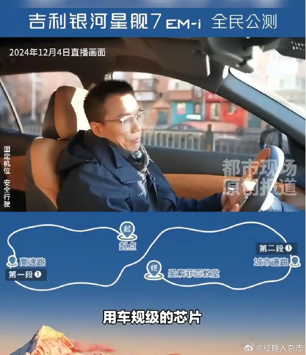
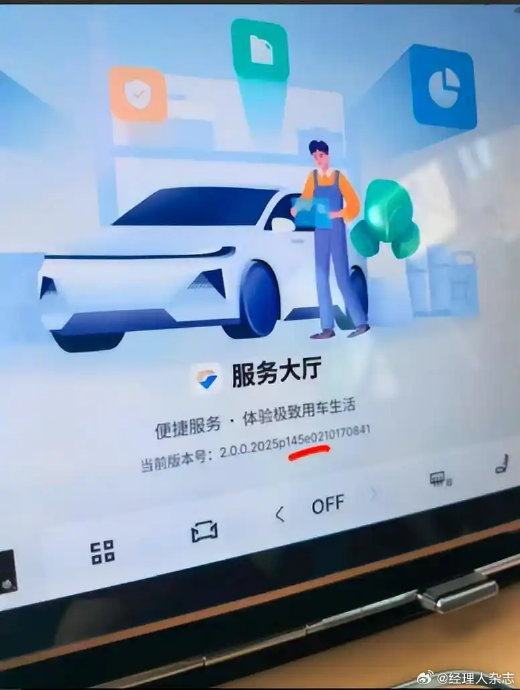
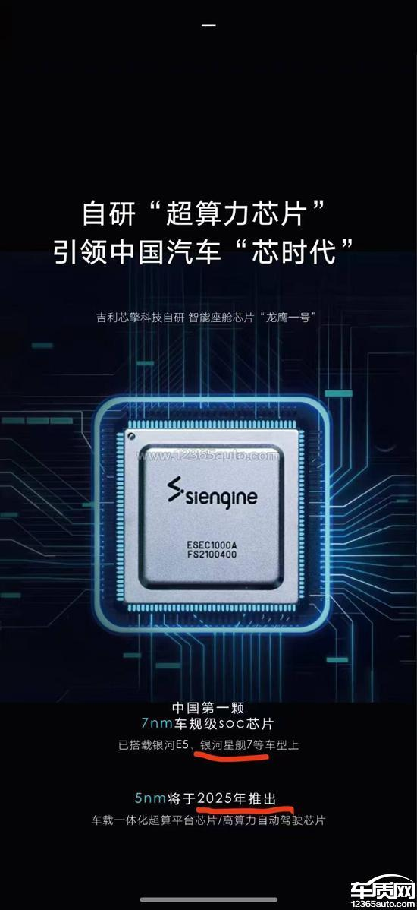
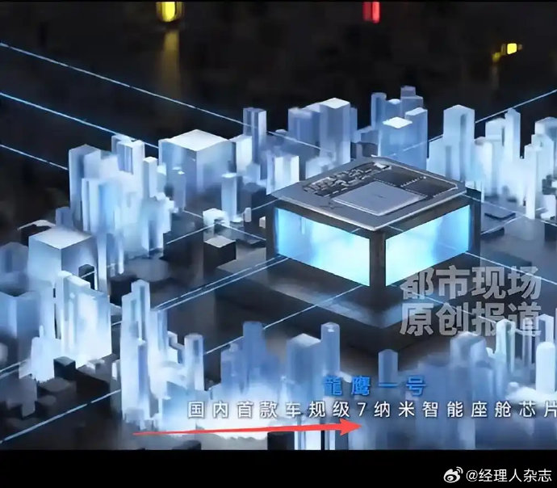
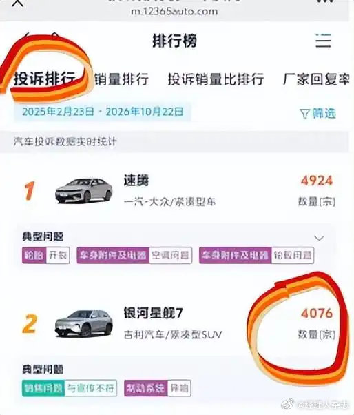

# 星舰7提车必查四项：宣传7nm，实车12nm

2024 年 12 月 4 日，吉利银河给星舰7 做了一场直播。

吉利的一位副总裁坐在驾驶位，车在跑，字幕打出来五个字：用车规级的芯片。

同期海报更直白。芯片的 3D 图下面写着「中国第一颗 7nm 车规级 SoC 芯片」，再下一行是「已搭载银河 E5、银河星舰7 等车型上」。

注意，字幕写的是「车规级」，没写型号。这三个字后面会用上。

10 万级的家用 SUV，装一颗国产 7nm 座舱芯片。这话当时值得说一句。

## 一、那个型号是自己跳出来的

河南洛阳的侯先生，2025 年 3 月 10 日提的 2025 款星舰7 EM-i。

他后来对《都市现场》说，决定下单的关键因素之一，就是官方反复强调的那颗龙鹰一号。

提车不到一年，一次系统升级之后，他点开车机「关于本机」。

型号那一栏写着：亿咖通 E02。

车主在投诉里补了另外两行：宣传里的 16G 运存加 128G 存储，车上是 8G 加 64G。

他把截图发出去，群里陆续有人跟着查，维权群后来凑到一千多人。

同一批截图里还有一行版本号，2.0.0.2025p145e0210170841。系统是同一套 Flyme Auto。

## 二、两个数都是吉利说的

12nm 这个数，不是车主估的。

《都市现场》记者打了吉利银河官方客服，工号 5217 的值班经理项女士给了完整口径。

「星舰7 在规划和研发过程中，基于不同配置和款型，开发了龙鹰一号和 E02 两套芯片方案，以适配不同等级的辅助驾驶功能。25 款星舰7 全系车型搭载的是 E02 芯片，只有 26 款的部分配置才搭载龙鹰一号。」

她后面还补了一句，消费者看到的是发布会上的技术展示，并不涉及虚假宣传。

同一批材料里，吉利管家的回复更短：2025 款星舰7 搭载的是 E02 座舱芯片平台，集成 12nm 车规级芯片。

7nm 写在吉利自己的海报上，12nm 写在吉利自己的对话框里。

海报说「已搭载星舰7」，客服说「25 款全系 E02」。这两句话之间，隔着一整代制程。

7nm 和 12nm 在座舱里不是纸面数字。同一块屏、同一套系统、同样几十个应用，共用一颗 SoC 的算力和内存带宽。

芯片弱一档，系统就只能按弱的那档裁功能。调优能挤出一点，但挤不出一代。

高通 8155 是 7nm，这颗龙鹰一号宣传时对的就是那一档。E02 在 12nm。

龙鹰一号是芯擎科技做的，吉利是它的股东之一，2021 年发布时被叫作国内第一颗 7nm 车规 SoC。

媒体常引的两个数是 87 层电路、88 亿晶体管。这两个数我在芯擎官网没找到原文，先标一下口径。

车主反映的问题很集中：多任务卡顿、触屏延迟、360 影像调出慢半拍。有人提到车道级导航和完整版停车守卫用不了。

这些功能有没有，取决于芯片在不在。OTA 只能推它跑得动的东西。

## 三、投诉量和价格轴

车质网的投诉排行榜上，银河星舰7 排第二，累计 4076 宗，统计区间 2025 年 2 月 23 日到 2026 年 10 月 22 日。

典型问题第一栏是「销售问题 / 与宣传不符」。

这 4076 宗是这台车的全部投诉，不全是芯片，我把范围写清楚。

再看价格。2025 款的限时先享指导价是 9.98 万到 13.28 万，2024 年 12 月 6 日上市。

2026 款 2025 年 11 月上市，限时指导价 9.58 万起。

新款起售便宜 4000 元，而它的配置单里，龙鹰一号回来了。

客服的解释是「两套方案适配不同等级的辅助驾驶功能」。

如果 7nm 是更贵的那一套，更便宜的新款就不该先用上它。

这两颗芯片的采购价吉利没公布，我算不出来。但价格轴上这个顺序是反的。

更省事的解释是，2025 款那批车按 E02 定的料，宣传文案没跟着改。

有车主说，当初那版写着龙鹰一号的宣传页，现在打不开了。他们手里的东西是直播录屏、销售微信记录、官网截图。

## 四、被承诺的是另外一件事

车主真正在意的，可能不是车道级导航少不少。

是买车时那句「可长期 OTA 迭代」。

硬件把算力上限定死了，往后每年能推什么，出厂那天就写完了。

同一台车、同一个名字，新款能推车道级导航和仪表可视化导航，老款只收到 bug 修复。差别不在服务态度。

这一段我没有拿到两款的 OTA 清单，吉利没公开过。车主手里的依据是推送记录。

座舱芯片是这台车上最看不见的零件。试驾二十分钟，你能摸出座椅软不软、音响闷不闷、屏幕滑不滑，摸不出制程是 7 还是 12。

宣传能塞进去的空间，全在这种地方。

《消费者权益保护法》第二十条要求经营者提供真实、全面的商品信息。《广告法》第二十八条把「性能与实际情况不符、对购买行为有实际影响」算作虚假广告。

难的是后半句。车主得证明自己是冲着这颗芯片掏的钱。

## 五、提车看四行

不用背参数表。提车那天打开车机「关于本机」，看四行：

芯片型号，是不是宣传里那个名字。

有没有独立 NPU，算力那一栏有没有具体数字。

运存多少 G。

存储多少 G。

四项有一项对不上，当场拍照，别等系统升级之后再说。

更省事的办法是签字之前让销售把芯片型号写进合同备注。写不进去，这句话就是答案。

「车规级」是形容词，E02 也是车规级。能拿去对账的只有型号和数字。

---

参数是我按公开资料算的，欢迎在评论区指正。
