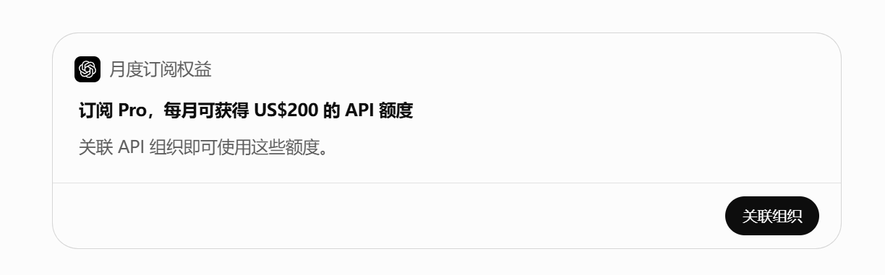
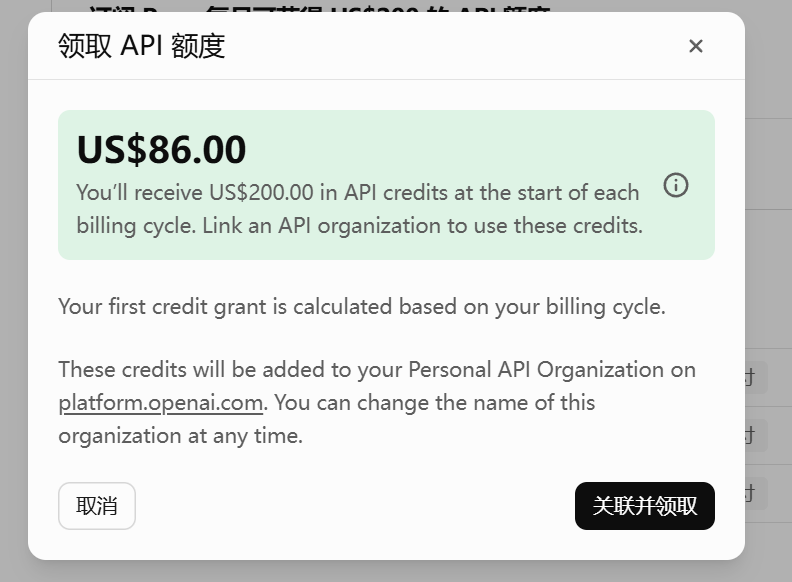
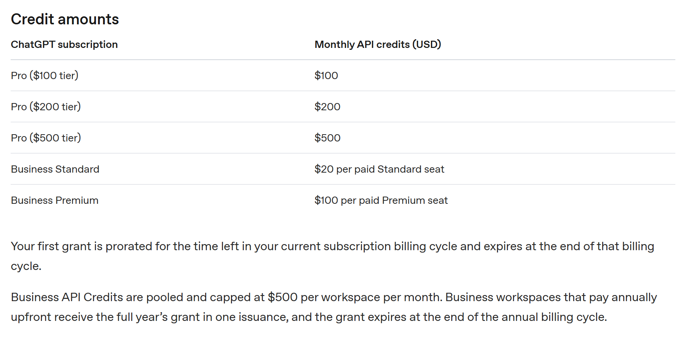
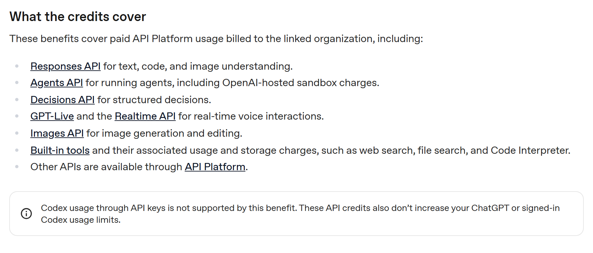
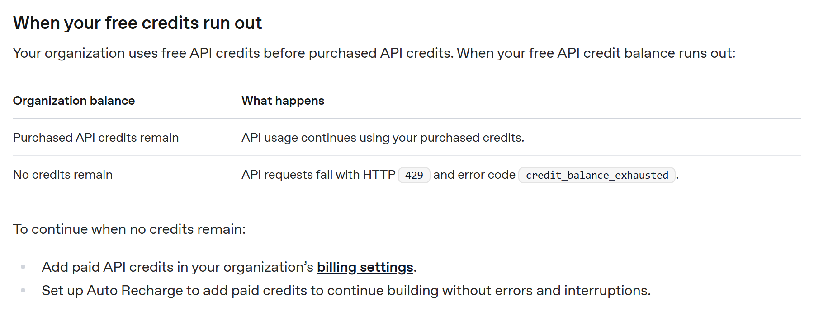

# ChatGPT Pro 说送 200 美元，弹窗只给 86

10 月 28 日，OpenAI 在开发者 changelog 里加了一行：符合条件的 Pro 和 Business 订阅，每月可领最高 500 美元的 API 额度。

按档位等额。Pro 100 给 100，Pro 200 给 200，Pro 500 给 500。订阅多少钱，就还你多少接口预算。

以前 ChatGPT 和 API 是两套账单，想调接口得再充一次钱。这次两边打通了。

还有个细节我挺喜欢。不用先绑 API 支付方式，余额是 0 也能直接发请求。

## 一、86 是按比例算的

转发里最常见的写法是「每月白送 200 美元」。这句话拆开看，三个词都带条件。

每月，指额度按月发。白送，要先关联一个你自己拥有的 API 组织。200，是最高的那一档。

有人把领取弹窗截了出来，金额是 US$86.00。不是 200。

官方文档写了原因。关键就一个词，prorated，首笔额度按当期剩余时间折算。

按剩余时间折算，翻译成大白话就是打个折发给你。后半句还有一层，这笔钱到当期计费周期结束就作废。

折算和到期叠在一起，问题就出来了。你在周期第 25 天才去点领取，拿到的是零头。

零头到周期结束照样清零，不结转。

计费周期也不是自然月。从你上次续费那天算起，到下次扣款那天结束。所以「当期还剩多少」每个人都不一样。

86 除以 200 是 43%，对应周期已经走了 57%。这张截图的账号周期我没法核，但比例和规则对得上。

所以月末顺手领一下这个动作，等于把额度领成零。

想拿满额只有一条路。在续费当天，或者刚过 7 天门槛那几天去点。

刚订阅的人更吃亏。7 天门槛挡在前面，等你能领的时候，一个月的周期已经走掉四分之一。

## 二、Plus 一分没有

官方文档讲降级的那段很直白。降级到「不符合条件的方案，例如 Plus、Go、Free」，OpenAI 会在当期结束时移除你那条 API 组织链接。

Plus 是绝大多数付费用户手里那张卡。这次没它的份。

Enterprise、Edu、免费试用、赠送订阅也不在内。年付的 Business 一次性发全年，上限 6000 美元。

这条福利绕开 Plus，说到底是句明话。想用接口额度，先去升级。

Business 按席位算。Standard 每席位 20 美元，Premium 每席位 100 美元，整个工作区封顶每月 500。

25 个 Standard 席位就顶到天花板，加到 60 个还是 500。大团队人均被稀释得厉害。

这条我算了半天。一个 60 人的团队，每人手里不到 8.3 美元的额度，还得挤在同一个组织里花。

## 三、三道门，缺一不可

想领，要同时满足三条。付费订阅满 7 天、两边用同一个邮箱、并且你同时是订阅 owner 和 API 组织 owner。

「owner」这个词是硬的。同事把你拉进工作区、给你一个管理员角色，都不算。

换接收额度的组织也不能自己改，得联系客服。

我没订阅 Pro，这一步跑不了，三条都是文档原文。

同邮箱这条最容易忽略。很多人 ChatGPT 用公司域名邮箱，API 平台用私人邮箱注册，两个账号不是同一个人，第三条直接过不了。

要动手改，从邮箱入手比从组织入手容易。这是我自己的判断，文档没写这么细。

还有一种情况容易漏。你升级了 Pro 档位，剩下的周期会补发按比例的额度，但仍在 500 的月度上限内。

## 四、Codex 那条最关键

额度能花的地方不少。Responses、Agents、Decisions、GPT-Live 和 Realtime、Images，都在范围内。

Agents 那条值得单独说。OpenAI 托管的 sandbox 费用也算，这块通常是跑 agent 时账单里最贵的一项。

内置工具同样算，包括 web search、file search、Code Interpreter 的用量和存储费。

不能花的地方只有一句。「Codex usage through API keys is not supported by this benefit」。

走 API key 调 Codex，不抵扣。它也不提高你 ChatGPT 或已登录 Codex 的用量上限。

如果你订阅 Pro 只是为了写代码时用 Codex，这笔额度对你基本没用。

额度按组织算。你得选中那个已关联的组织，用它下面的 project API key 发请求，才扣得到。

还有一条容易被忽略。这笔额度不提升你的速率限制，文档写明它照样受 API 条款和 rate limits 约束。

手里有 200 美元余额，不代表能跑更快的并发。你组织的限额还是那个数，去 organization limits 页看。

用完会怎样，顺序也写了。先扣赠送的，再扣你自己买的。

两边都空，请求直接返回 429，错误码 credit_balance_exhausted。想不中断，就去计费设置里加钱，或者开自动充值。

## 五、它发的是额度，不是降价

四条限制摆在一起，方向很清楚。钱只能在 API 侧花、必须当月花完、换不来 Chat 用量、也不给 Codex 用。

订阅价一分没降，账面收入不动。发出去的是额度，只有真被调用才产生成本。

没花掉的部分，等于没发。这和发代金券是一个道理，比直接降价划算得多。

取消订阅也一样。已发的额度不收回，能用到过期，只是不再发新的。

说它一句好话。把订阅余额和接口账单打通，这件事本身是实的。

以前你想试一个 agent，得先充一笔最低额度，再惦记着余额会不会过期。现在手里有 Pro，直接就能跑。

它还有个附带效果。想拿这笔钱，你得先有一个 API 组织，得进 Billing 点一次关联。

关联完你才会去看 Agents、sandbox、Images 这些接口。这一步对 OpenAI 才是真正的收获。

Business 封顶 500 也说明，它盯的不是大企业，是个人开发者和小团队。

额度到账后，去 API Platform 的 Billing 页，credit grants 里能看到发放金额和到期日。

以后看到「送 X 美元额度」，问三句就够。谁没有，什么时候清零，哪些用途不给用。

排除名单比入选名单重要。清零规则决定你什么时候领。用途限制决定它对你有没有用。

这三问答完，返券和降价就分得清了。

---

如果你已经领了，欢迎报一下实际到账数和当时的周期进度。
比我在纸上推的准，也让下一个人少走一步。
