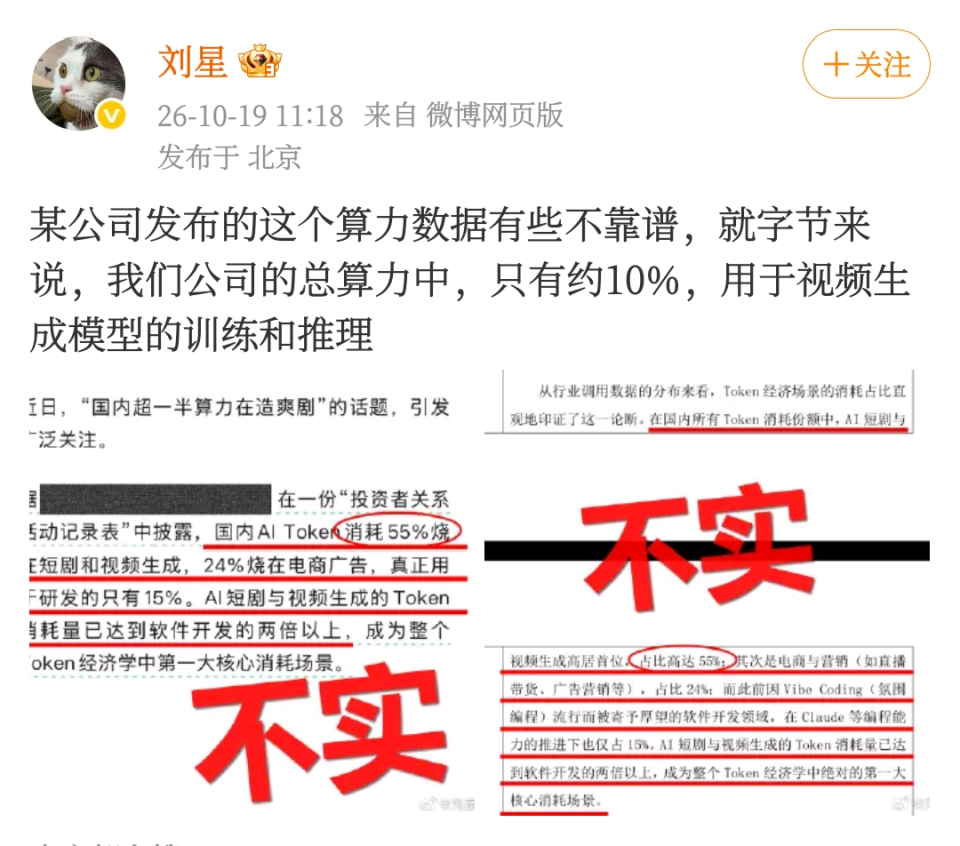
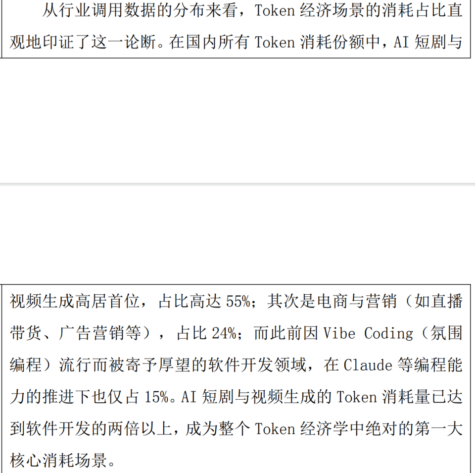
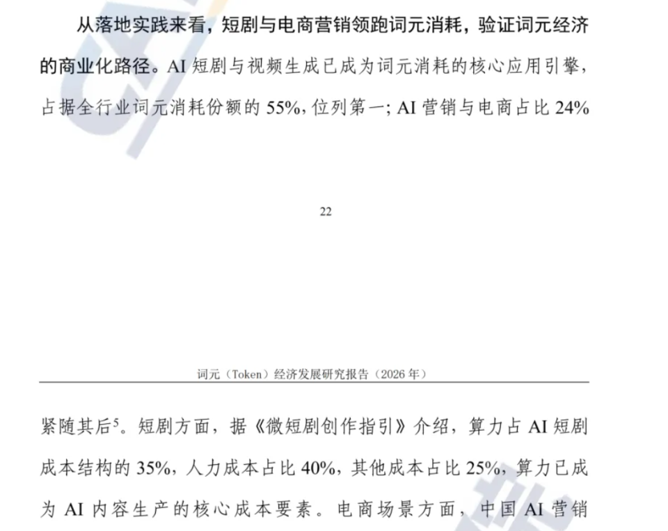
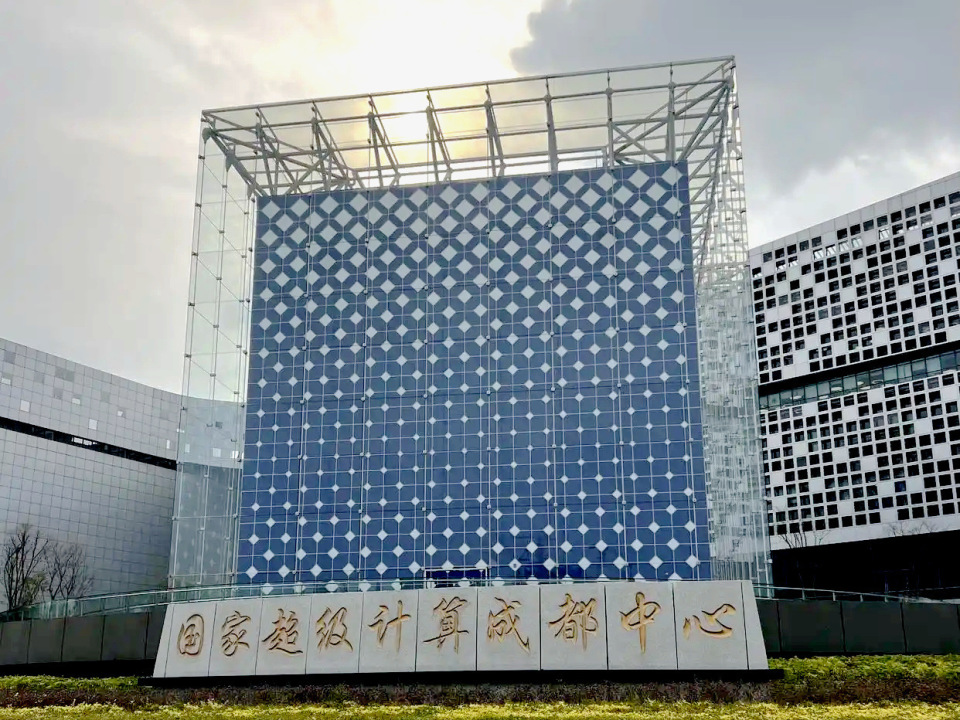
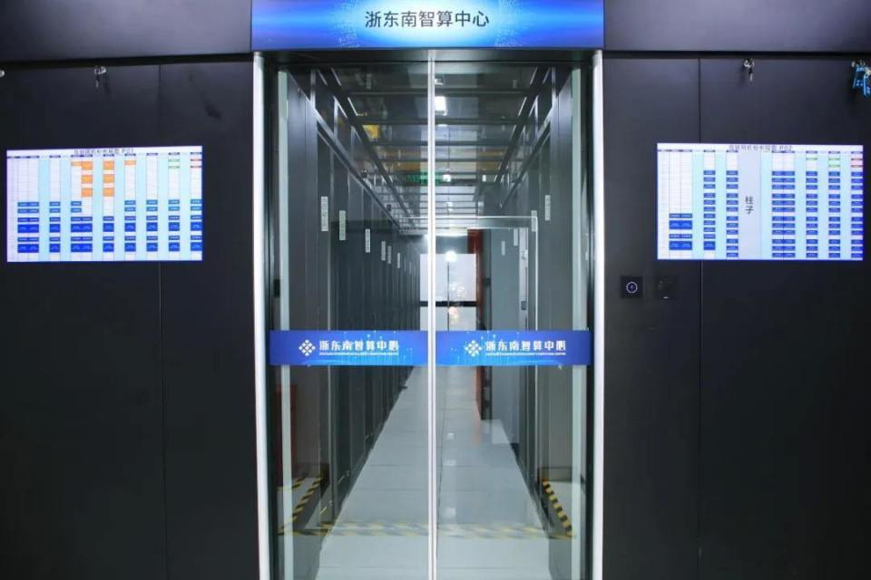

# 字节说视频只占10%算力？55%那个数说的是Token

"国内超一半算力在造爽剧"，这句话10月下旬在社交平台刷了屏。配着的调侃更扎心：美国AI在搞科研，中国AI在喂爽剧。

听着像有数据撑腰。55%，精确到个位的百分比，出自一家A股上市公司。

10月19日，字节跳动旗下豆包的公关负责人刘星在个人微博上回了这句话。

原话是，某公司发布的这个算力数据有些不靠谱，就字节来说，我们公司的总算力中，只有约10%，用于视频生成模型的训练和推理。

中国经营报的记者之后向字节跳动相关人士求证这个数，得到的回复是不方便回复。

一边是55%，一边是10%。两个数各自都对得上出处，接在一起就出了问题。

## 一、55%说的不是算力

先把两个口径分开。中文在线今年6月披露的投资者关系活动记录表里，写的是Token消耗份额。

原话是，在国内所有Token消耗份额中，AI短剧与视频生成占比高达55%，其次是电商与营销，占比24%，软件开发领域仅占15%。

这段话的原语境是Token经济学，讲的是各场景在Token消耗盘子里的占比，通篇没提算力两个字。

Token是大模型处理文本、图像、视频时的最小计量单元，它衡量的是模型吞吐了多少内容。算力是另一回事，指硬件单位时间内能完成的浮点运算量。

一个是调用量，一个是芯片的计算能力。两笔账的计量单位不同，统计主体也不同。中文在线统计的是行业侧的Token分布，字节回应的是自家算力的分配。

## 二、往源头追一层

55%这个数本身也值得追。中文在线披露时，段落开头只写了"从行业调用数据的分布来看"，没提数据从哪个机构来。

潮新闻的记者电话、邮件都联系过这家公司，截至发稿没有收到回应。

今年9月，中国信通院云计算与数字化研究所发布《词元（Token）经济发展研究报告》，沿用了同一组数。

报告里注明，这组数的出处是中泰证券研究所5月的一份深度报告。

我把这条链顺着潮新闻的报道核了一遍。中泰那份5月的报告里没有55%这个全国占比，它对AI剧的说法只有一句，Token消耗占生产成本近半。

也就是说，这组被反复转引的百分比，从上市公司记录到信通院报告，再往前追一层，源头是模糊的。

数字经济智库高级研究员佘宗明的说法更直接。

阿里云、火山引擎、腾讯云手里只有自家MaaS平台的调用数据，私有化和端侧的推理观测不到。靠厂商计费数据，算不出全国Token消耗的总量。

## 三、按中文在线的口径自己算一遍

即便不追出处，这组数也推不出"过半算力造爽剧"。我按它给的比例倒推了一遍。

AI短剧与视频生成占55%，软件开发占15%，前者是后者的两倍以上。听着很大，但Token在不同任务间并不通用。

艾媒咨询首席分析师张毅给过一组数，一秒1080P的视频要消耗4万到5万个Token，一分钟标准剧集要250万到320万个。

代码的Token按字符算，视频的Token按帧算。单位不一样，占比再高也只是说这个场景调用量大，推不出算力被它吃掉了。

短剧这边还有个放大器。中国经营报采访的创作者说，同一个镜头要反复生成几次甚至几十次才能挑出能用的，圈里管这个叫抽卡。

Token就耗在这些重试上。重试多，说明这是推理侧的消耗，跟训练用的那批高端算力没关系。

## 四、算力实际在干什么

国家超级计算成都中心的公开数据是，到今年9月底，累计完成高精度科学计算任务超1.8亿项。综合算力利用率超过78.4%，服务用户超过2100家。

浙东南智算中心2024年对外运营，一期已投用算力400P，相当于20多万台高性能电脑同时运转。

它的租户是本地的模塑产业企业和工业智能体团队，做的是模具设计、生产质检这类活。

这些算力跟短剧不在同一个市场。DataEye研究院负责人刘尊的解释是，AI短剧的Token消耗集中在推理环节，用的是通用模型和中低端显卡。

科研和基础大模型训练吃的是重GPU算力，两套供给体系，采购主体和成本结构都不一样。

短剧消耗Token，挤占的是推理侧的资源，跟科研算力不在一条线上。

## 五、口径换了三次

回看这场争论，一组百分比在传播里换了三次口径。

第一步，把"行业Token消耗"说成"全国算力"。第二步，把"消费占比"说成"硬件负载"。第三步，把"一家公司的局部样本"说成"整个国家的投入结构"。

三步里任何一步有人较真，这句传言都传不起来。

我的判断是，刘星和中文在线说的都是各自看到的那部分事实。一个讲自家算力分配，一个讲行业Token分布，谁也没撒谎。

出问题的是把它们接在一起的那条传播链。

顺带说一句跟风的中美对比。有网友拿"国内55%造短剧、美国58%写代码"做对照，刘尊的回应是，两组数的统计边界、模型类型、样本范围都不一样，不能直接比。

## 六、看这类说法先问三句

第一，它说的是Token还是算力。前者是调用量，后者是芯片负载，两者换算不过来。

第二，统计的是一家公司还是全行业。局部样本推不出全国结构。

第三，原始出处标了吗。没标出处的百分比，先当线索，别当结论。

第三句是我自己先看的。前两句帮你看懂那笔账，第三句帮你决定，这条转发要不要点出去。

---

参数是我按公开资料算的，欢迎在评论区指正。
