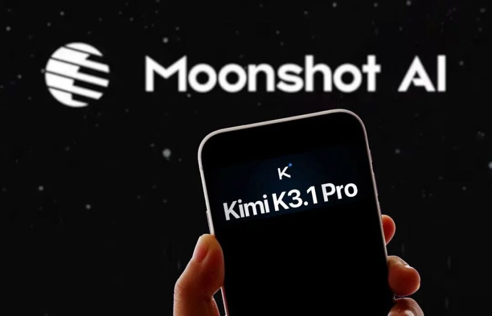
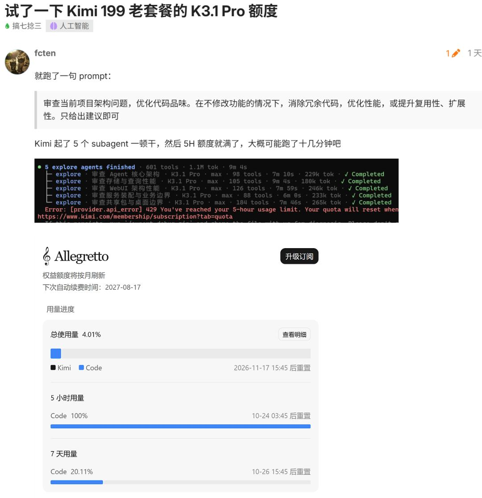
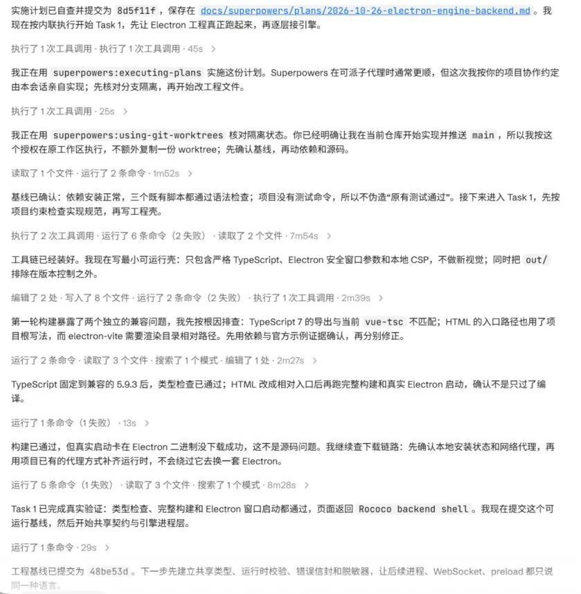
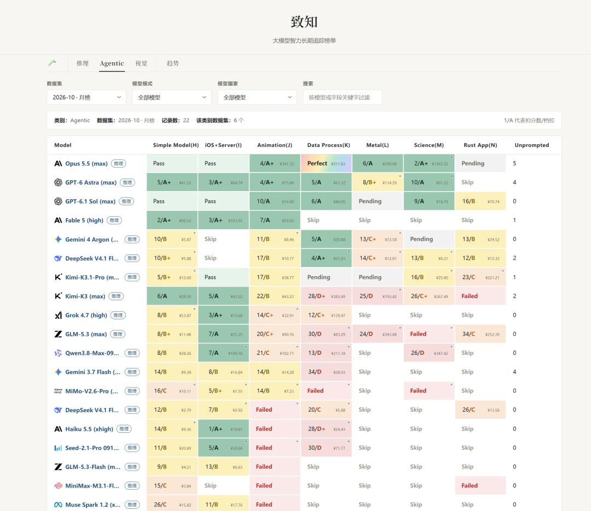
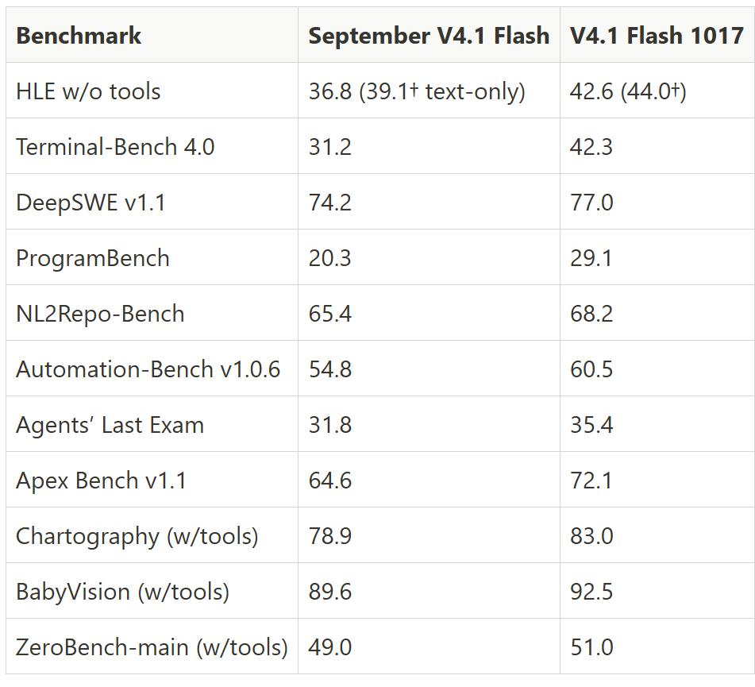

# Kimi K3.1 Pro便宜三成，实测多烧一倍Token

10 月 24 日凌晨，月之暗面发布 Kimi K3.1 Pro。3 万亿参数，100 万 token 上下文，Terminal-Bench 4.0 拿到 65.7%。

这个分数超过 GPT-6 Astra 的 58.2%，离 Claude Opus 5.5 的 66.4% 只差 0.7 个百分点。完整权重定在 11 月 4 日前开源。

Terminal-Bench 测的是真实终端里连续下命令、读报错、改方案的能力，是编码智能体最贴近实战的一项。拿到 65.7%，说明它确实能干活。

对开发者更实际的一点，是完整权重计划在 11 月 4 日前放开，拿到就能自己部署。

图：Kimi K3.1 Pro 发布，月之暗面称其为 3 万亿级参数的开源模型。图片来源：中国企业家（腾讯新闻转载）

## 一、两天，一个月的额度

10 月 26 日，也就是发布不到 48 小时，Kimi 把一封致歉信置顶在发布文章的评论区。

原话是"会员使用 K3.1 Pro 时出现的限流及不必要的额度消耗"。补偿是所有订阅会员返还月度额度的 25%，已用不足 25% 的直接清零。

Kimi 的说法是，已经调整运行参数，减少不必要的子 Agent 调用，压缩冗余输出长度。

一位 199 元档用户，只发了一句"审查项目架构，优化代码品味"。K3.1 Pro 拉起 5 个子 Agent，十几分钟后 5 小时额度窗口就满了。

这不算最惨的。一位 99 美元套餐用户说，只跑一个会话、没开 Agent 群组，47 分钟就触发了 5 小时限制。

有人做过对比。同一个套餐，之前能从周一用到周四，现在两天见底。

补偿也没完全平息。有用户反映这几天额度也用不了，聊天框反复弹出"Kimi 正在高峰期，请稍后再试或升级会员加速"。

这不是 Kimi 第一次为额度道歉。今年 2 月智谱、6 月 MiniMax、10 月 DeepSeek，都因为额度或服务问题公开补偿过。模型越来越强，账单越来越难算，成了这一轮国产大模型的共同难题。

## 二、便宜三成，说的是单价

先认官方这个数。输入每百万 token 从 20 元降到 13 元，输出从 100 元降到 68 元。按旧价算，分别降了 35% 和 32%。

36 氪的措辞是"较上一代下调约三分之一"。官方定价页写得很细，K3.1 Pro 输入 13 元、输出 68 元每百万 token，缓存命中的输入只要 1.3 元。

高速版另算。K3.1 Pro Highspeed 输入 26 元、输出 136 元，是标准版的 2 倍，速度也快 2 到 3 倍。

图：Kimi 是月之暗面的对话产品，K3.1 Pro 已在网页、App 和 API 上线。图片来源：中国企业家

缓存命中价是这套定价里的变量。命中缓存，输入 1.3 元；不命中，13 元。一次请求命中多少，直接决定账单。

问题就藏在"每百万 token"这五个字里。你付的钱是单价乘消耗量。单价降了，消耗量没人提。

## 三、把账算一遍

一位开发者实测：同一个任务，K3.1 Pro 消耗约 144 万 token，K3 只要 61 万。前者是后者的 2.36 倍。

我按输出价粗算一遍。K3 那次，100 元乘 0.61，约 61 元。K3.1 Pro 那次，68 元乘 1.44，约 97.9 元。

单价降了 32%，总价反而高了约六成。这就是"便宜三成"没落到账单上的原因。

图：一位 199 元套餐用户的实测记录：一句指令后 5 个子 Agent 跑完 601 次工具调用、消耗 1.1M token，9 分 45 秒后返回 429，5 小时额度显示 100%。图片来源：36 氪

第三方机构 Artificial Analysis 的测试更直接。跑完整套 Intelligence Index，K3.1 Pro 累计输出约 1.5 亿 token。

同价位模型的中位数是 8700 万，GPT-6 Astra 约 6000 万。K3.1 Pro 的输出量是 Astra 的 2.5 倍，比中位数也高出约 72%，被直接标成"非常冗长"。

结果是单任务成本 2.11 美元，Astra 是 3.26 美元。token 单价约为 Astra 的五分之一，实际只省了约 35%。

还有一个口径是速度。K3.1 Pro 输出约每秒 73.5 个 token，同类中位数是 81.1。慢一点，同样的活要挂更久，计费窗口也更容易撞线。

把输入也算进去，账只会更紧。144 万 token 里若有不少未命中缓存的输入，13 元的单价会继续往上叠。

## 四、贵在哪一步

K3 的官方技术文档写过，模型输出时会"过度谨慎、反复自我审视"。K3.1 Pro 把这种严谨延伸到了执行层。

它多做几步。思考链更长，工具调用更多，还会拉起子 Agent 自查。每一步都在烧 token。

杨植麟的说法是，要让模型输出更长、更稳，就得在整个过程里反复检查、修改、自我修正。这是训练时就定下的取向。

图：K3.1 Pro 的执行记录，单个任务里连续多次工具调用与文件读写。图片来源：中国企业家（腾讯新闻转载）

外部研究不完全认同。Fireworks AI 的一篇博客说，把 K3 反复检查的步骤拿掉，对性能几乎没有影响。

翻译成账单上的话，多出来的每一步检查，用户都要付钱。

而且 K3.1 Pro 只开放思考模式，关掉思考的请求会被直接拒绝。你不能选"快速回答"，每一次问答都带着完整推理。

任务越长，这个特征越放大。长程 Agent 要连续跑几十分钟，多出来的推理按分钟累加，额度就按分钟蒸发。

举一个极端的例子。有用户让 K3.1 Pro 画"鹈鹕骑单车"，它生成了 1 小时 47 分钟，吃掉 87% 的 5 小时额度。

它算得没错，只是太肯干。一个主任务被拆成多个子任务，每个子任务独立推理，token 就乘着倍数往上涨。

## 五、另一条路

同样在 10 月，DeepSeek 迭代了 V4.1 Flash 1017。思路是反的。

它不拼能力上限，而是把性能、速度、输出长度一起优化，价格保持不变。官方管这叫帕累托改进，底层靠架构效率，KV 缓存压到每个 token 890 字节。

致知的第三方成本榜上，同一道 Rust App 任务，K3.1 Pro 花了 221.21 元，DeepSeek V4.1 Flash 只要 12.32 元。

图：致知大模型成本榜（2026-10 月），同一任务下 K3.1 Pro 与 DeepSeek V4.1 Flash 的单次花费对比。图片来源：36 氪

图：DeepSeek V4.1 Flash 1017 的基准对比，官方称性能提升而输出更短、价格不变。图片来源：36 氪

两条路取舍很明白。一条把能力顶到最高，代价落在用户额度上；另一条把单位成本压下去，能力不追第一。

Kimi 把预算花在"多想几步"上，DeepSeek 花在"少想但想对"上。落到用户账单，同一道题的差距是十几倍。

杨植麟也承认，提升智能水平必然需要更多 token，这是取舍。

## 六、下次看报价，问三句

单价降了多少。

同一个任务，token 多烧几倍。

是不是只开思考模式，强制你为推理付费。

三句里第二句最要紧。单价降幅要大于 token 增幅，账面上的便宜才是真的。

还要分清两种问法。订阅制问的是"额度够不够用一周"，API 问的是"单任务多少钱"。同一张价目表，两种答案。

再补一句缓存，命中率高不高。命中缓存，输入省约九成，这一项最容易被忽略。

---

参数是我按公开资料算的，欢迎在评论区指正。
