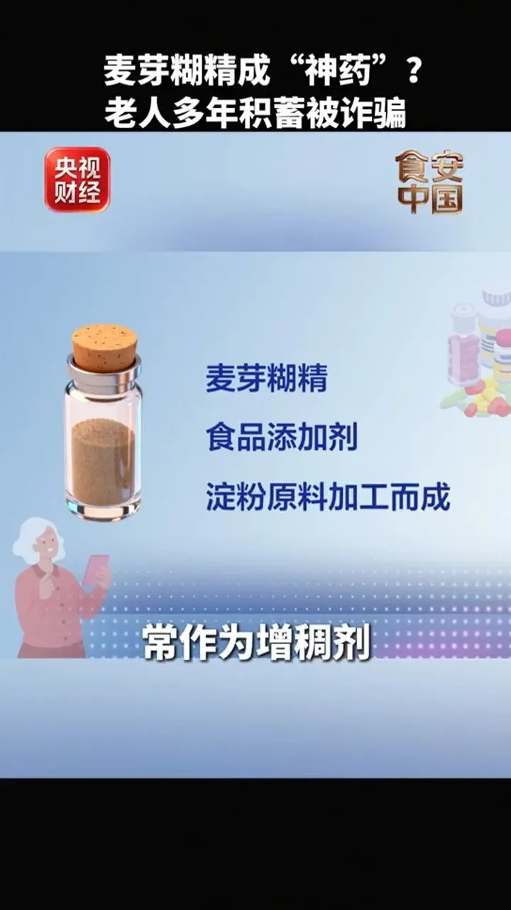
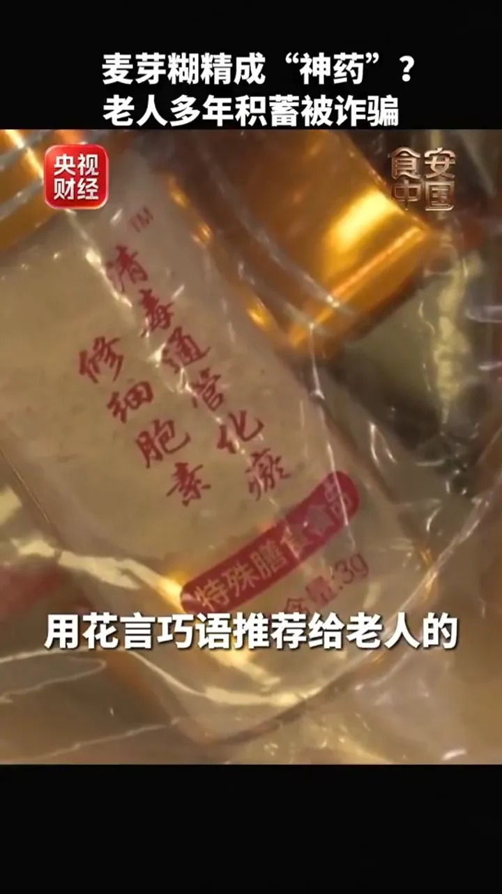
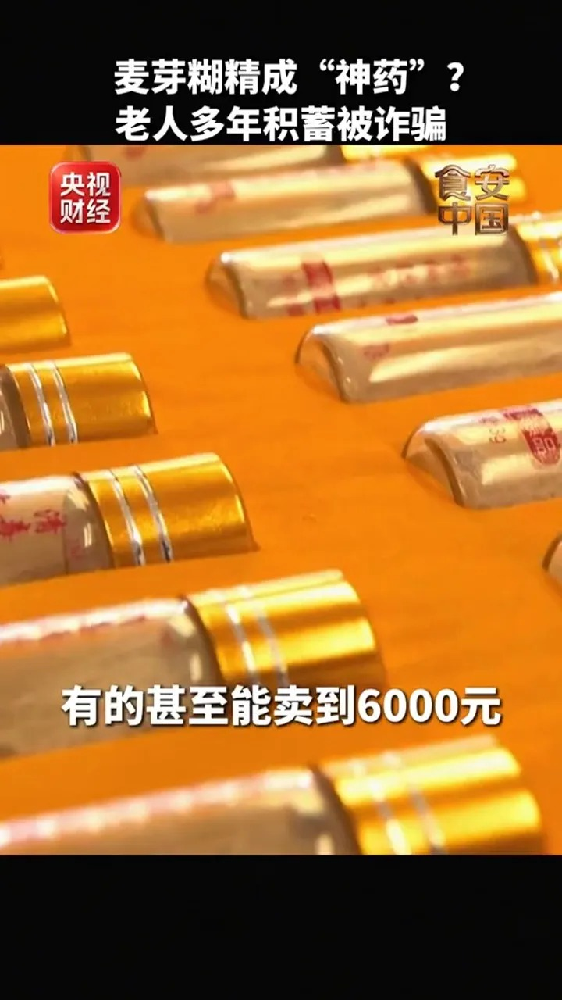
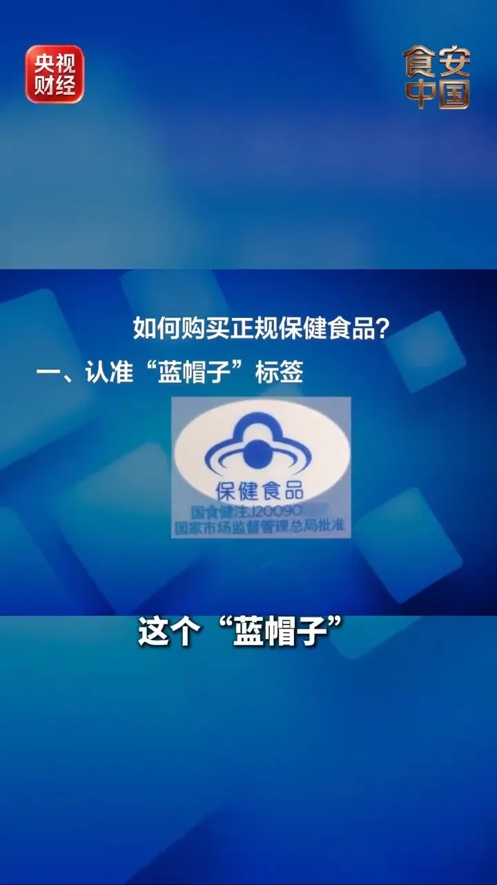
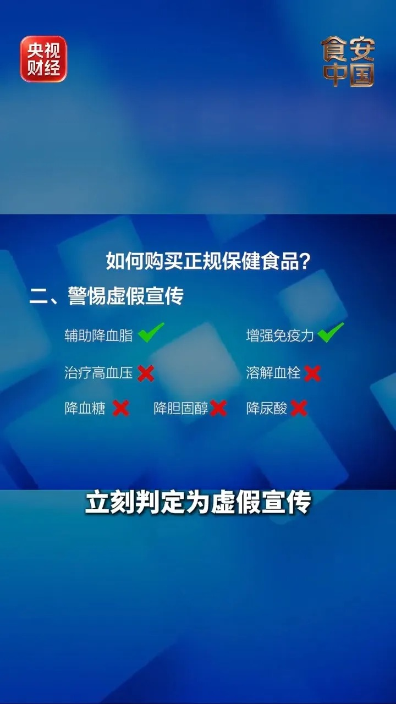

# 成本30元卖6000，麦芽糊精被吹成防癌神药

广州一位老人，不到半年在养生课堂上花掉十多万元。

讲课的"专家"没做检查，张口就说中他身上的老毛病，还说他"已经是老年痴呆二级"。

听着玄，其实一点不神。

## 一、这骗局先哄你开心

骗子不急着卖货。有人帮老人提菜、打扫卫生，送上鸡蛋和米面。

等老人敞开心扉，聊什么都记下来：家庭住址、退休金多少、得的什么病、心里怕什么。

这些内容每天整理成一份报告，交到上线手里。

国医馆里灯光打得暖，专家张口就说出你怕的那个病，老人自然觉得遇着贵人。

这份情报，是前面送鸡蛋、陪聊天的人一点点攒出来的。

这种"先交心、后卖货"的套路，成本几乎为零，全靠时间换信任。

等老人掏钱时，已经把卖货的人当成了比儿女还亲的人。

诈骗团伙还挂着"中华老字号""非遗中医馆""国企优生活"的旗号，看着像正规军。

警方后来查到，这套"情报"机制是团伙统一培训的。谁家老人有什么病，系统里记得清清楚楚。

## 二、拆开就剩一包淀粉

我查了广州警方的通报和央视财经的报道。

课堂上那些名字吓人的"神药"，核心成分都是同一种食品添加剂：麦芽糊精。

"乌梢蛇牛磺酸冻干粉""清毒通管化瘀修细胞素""金龟纯元粉"，名字唬人，底子一样。

麦芽糊精用玉米、大米、马铃薯的淀粉加工，在饮料和食品里常当增稠剂，几块钱一大袋。

它安全到连婴幼儿配方奶粉里都用。它无毒，只是没用。

说它能"防癌延寿"，等于说盐能防癌——成分安全，不等于有药效。

合法添加剂被说成能治病的神药，身价就翻了两百倍。

这笔账我算过。一盒三十瓶，出厂成本只有三十元，摊到每瓶一块钱。

到了课堂上，一盒能卖到六千元，每瓶两百元。

出厂价不到一元的瓶子，被卖到几十到两百元。

同样的瓶子，超市里论斤卖，到了课堂按"疗程"论盒卖。

三十除以一，或者六千除以三十，答案都是两百倍。

老人花十万买回去的，是成本不到一块钱一瓶的增稠剂。

按每瓶成本一块算，十万块能买下十万瓶增稠剂。

课堂上还教老人把空瓶留下，说能"激活能量"，其实是怕他们拿去化验。

## 三、警方和专家都认了

广州警方在2026年初接到报案后立案调查，确认这些产品没有治疗效果。

中国疾控中心营养与健康所研究员、国家市场监管总局保健食品审评专家何丽，说得更直白。

买保健食品，包装上先看"蓝帽子"标志，没有就是违规。

没有蓝帽子的，连保健食品都算不上，更谈不上治病。

她还划了一条红线：听到"治疗高血压""溶解血栓""降血糖""降尿酸"，立刻判定为虚假宣传。

保健食品只能标注国家批准的二十四项功能。"防癌延寿""调理百病"不在其中。

二十四项里有辅助降血脂、增强免疫力，没有"治癌"，也没有"降糖"。

何丽提醒，认准蓝帽子之外，还要看批准的功能有没有真的印在盒子上，口头承诺不算数。

央视财经跟进报道时提到，这些产品没有单价、没有标签，一盒动辄数千元。

价格不透明，正是这类骗局的共同特征。

民警说得直白：老人以为吃了就不用去医院。到头来钱也没了，身体也拖垮了，这才是真坑。

## 四、骗子手里根本没有药

我更信那位把话说死的专家。

骗子真正卖出去的，是"终于有人懂我"的陪伴，加上一份比子女还准的"情报"。

麦芽糊精本身没罪，被不法分子夸大了而已。

对糖尿病患者，长期吃这种富含多糖的东西，病情只会更重。

陪伴能治病，是这整场骗局里关键的一句谎。老人怕的是病，骗子卖的是"有人陪你怕"。

真要防大病，靠的是定期筛查和接种疫苗。一盒来历不明的粉末，管不了这些。

老人怕病，是因为真的怕给子女添麻烦。骗子把这份善良，标成了价签。

## 五、买保健品先认蓝帽子

记住三条。

包装上没有蓝帽子，别买。蓝帽子是保健食品的法定标识，没有它，再大的"国医馆"也是空壳。

保健食品只有二十四项批准功能。"防癌""降糖"这类词，本身就说明在骗人。

只要对方说能"治疗"某种病，直接当骗子处理。

蓝帽子上的批准文号，在国家市场监督管理总局网站能查到，查不到就是假。

老人记不住，子女帮着查一次，比劝十句都管用。

何丽还提醒，降血脂的保健食品常含红曲，和他汀类药物叠加有风险，要先问医生。

顺带一句，打着提神补脑幌子的"聪明药"莫达非尼、阿得拉，是国家严格管制的精神药品。

莫达非尼是治嗜睡症的处方药，健康人吃了头痛、恶心、失眠、焦虑。

它管病人睡眠，管不了学生成绩。

把"聪明药"当补脑神器，那已经涉毒，谈不上保健。给父母打电话，不如从认蓝帽子聊起。

---

参数是我按公开资料算的，欢迎在评论区指正。
