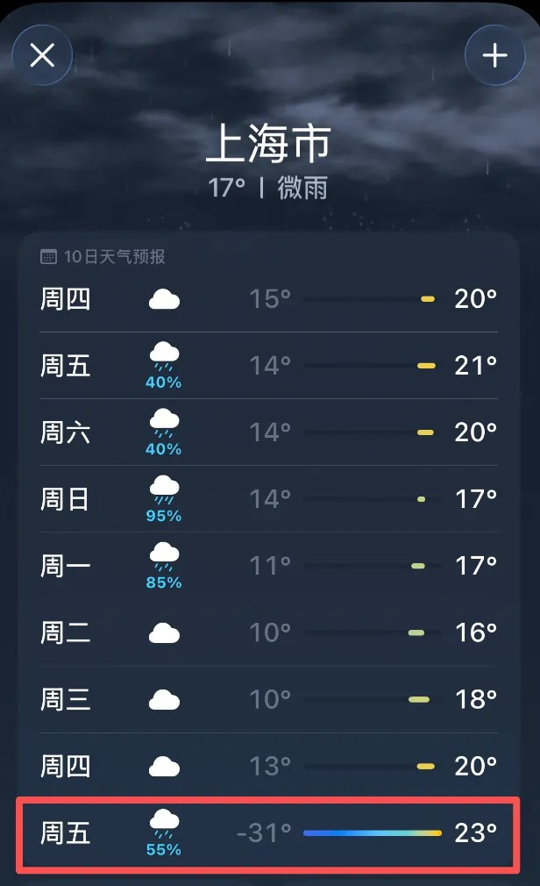
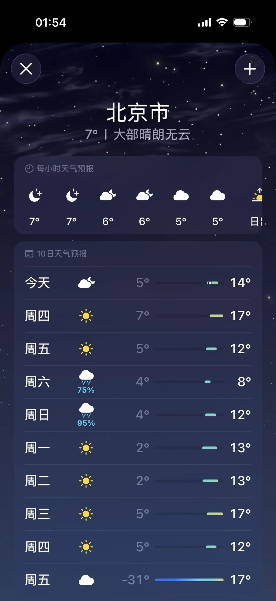
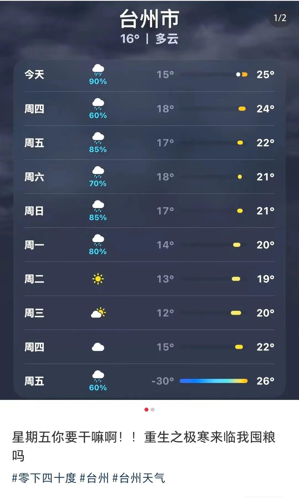
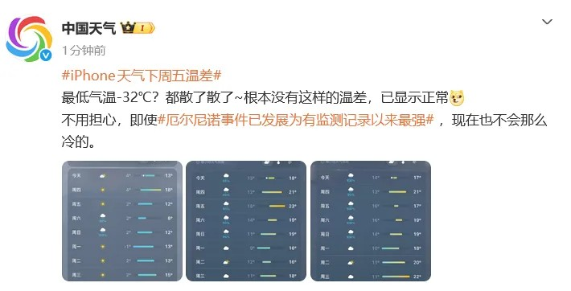
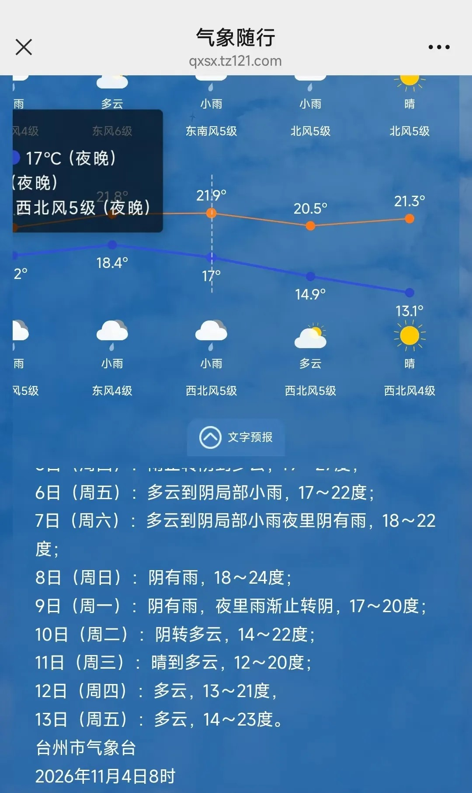

# iPhone天气今晨-32℃，下周五实际只有十几度

11月4日凌晨，一批iPhone用户发现，自带天气App里11月13日（下周五）的最低气温写着-31℃、-32℃。

北京、上海、成都、杭州、青岛，几十座城市同一个周五同一个数。同一天的最高气温还停在17℃到26℃。

对多数人来说，手机自带的天气App就是每天唯一的天气信息来源。它显示什么，大家就照着安排什么。

南方都市报报道，凌晨一点相关话题上了微博热搜第二，早上已经排到第一。

## 一、一个数，几十座城市

截图看着整齐。北京周五-31°对17°，上海-31°对23°，成都-32°对18°，杭州-32°对25°，台州-30°对26°。

我数了下各地截图，最低温全压在-30℃上下，最高温全在二十来度。一天里最低和最高差了近50度，这个落差是它上热搜的原因。

预报页上那条渐变色条，从-30°一路拉到26°，把两头连成一条线。看着就像一次真实的断崖降温。

出错的范围也齐整。南京、武汉、郑州、合肥、西安、福州、石家庄、苏州，数十座城市只错下周五这一个日期，前后几天的预报都正常。

评论区的反应比数字本身热闹。台州的网友配着-30°的截图问「星期五你要干嘛啊，重生之极寒来临我囤粮吗」。

还有人接梗「早晚温差60度我丝毫不怕」，更有人晒出了-43°。

调侃归调侃，照着数字做的人是有的。南都采访的长沙网民说，看到-32℃的第一反应是下周气温跌破冰点，已经在计划取消下周的出行。

## 二、气象台一句话拆了台

中国气象局公共气象服务中心的官方账号@中国天气 当天回应：「最低气温-32℃？都散了散了，根本没有这样的温差，已显示正常。」

后面还跟了一句：「不用担心，即使厄尔尼诺事件已发展为有监测记录以来最强，现在也不会那么冷的。」

地方气象台也跟着表态。成都气象说「成都暂时还没有开启北极副本」。台州市气象台工作人员回了句更实在的，苹果用户的数据不是我们的。

台州市气象台11月4日8时的官方预报写着，13日周五，多云，14到23度。

中央气象台的中期预报给的是另一套数。未来11到14天，也就是11月13日到16日，华北、东北、黄淮、江淮的气温还要比常年偏高2到4℃。

这份数据是11月3日发布的。未来10天我国大部气温接近常年或偏高，只有内蒙古东北部、东北地区北部偏低2到4℃。

苹果客服的口径是「不排除是显示或数据异常导致的该情况，不是硬件方面问题，不用担心，后期可多进行观察」。

专业人士的分析是软件后台出错，把其他地区的数据错配到了国内城市。错到了哪里，官方没有给出答案。

事件发酵数小时后，苹果完成了修复，App里11月13日恢复正常。一场虚惊结束得比它来的时候还快。

## 三、那个数是估出来的

差出40多度，数据错了是一层，还有一层更少人提的事。

上海市气象局科普过这个差别。气象台的气温由标准观测站按统一技术标准测得。一些手机自带天气App没有用实际观测数据，用的是其他数据和手段的估算。

我把两边放在一起核了一遍。同一个11月13日，App把台州最低写成-30°，台州市气象台写14度，差44度。

我按截图算，上海那行-31°对23°，一天的温差是54度。各媒体报道说一天温差近50度，这个口径已经算收着说的。

中央气象台还给过一个界限。3天以内的预报准确率在80%以上，7天的不知道有没有50%。11月13日在9天之外，落在比7天更不准的那一段。

App界面上没有这些标记。10天后的估算值和明天的实况，在屏幕上长得一样，呈现出来的确定程度没有区别。

这些App的数据到底从哪来，各家口径不一样，我没查到苹果官方的说明。能确认的只有上海市气象局那句，用的是其他数据和手段的估算。

评估一条新闻要看出处。评估一个天气数，界面上没有任何提示，这件事普通用户没办法自己发现。

## 四、6月还报过近50度

这个App已经不是头一回给出极端值。今年6月，它把杭州临安的气温预报成逼近50℃。

临安区气象局核查后认定，这是App自身系统数据错误，当地从未发布过极端高温预警，真实的预报最高只有32℃。差了18度。

去年11月还有一次。这款App把上海下周六的最高气温报到33~34℃，上海市气象局的预报是14到19℃。

三次都是极端数，方向有高有低。共同点是都落在最抓眼球的那个位置上，也最容易让人照着做。

## 五、下次看天气，问三句

这个数是实测还是估算。手机自带天气App很多是估算值，App不会主动告诉你这一点。

预报的是几天之后。3天内八成准，7天不到五成，再远的数只能当参考。

气象台的官方渠道怎么说。中国天气网、各地气象台的官微和小程序，数字都比App推送可靠。

台州气象台在公众号里挂了「气象随行」入口，点进去就是官方数据。各地气象台都有类似的官方入口，找一下就能看到。

我自己会先做第三件事。看到-32℃或者50℃这种极端值，先去气象台核对一遍，再决定要不要改行程。

今年冬天确实有天气话题。国家气候中心11月3日介绍，超强厄尔尼诺已经成形，今冬南方降水偏多，阶段性低温雨雪的风险是真的。

该防的要防，按官方预报防。

---

参数是我按公开资料算的，欢迎在评论区指正。
