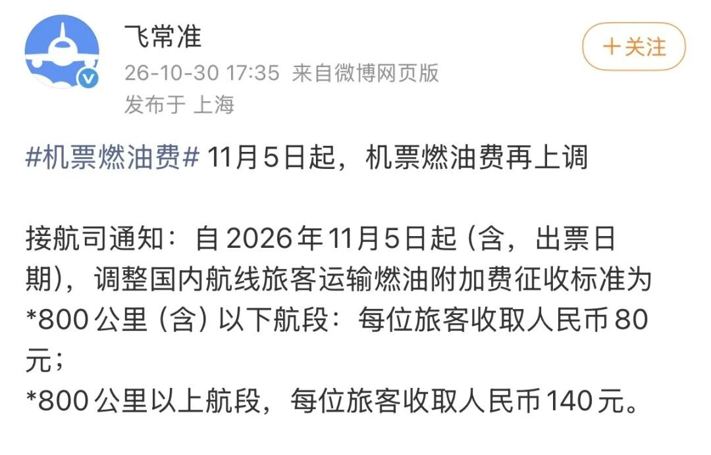
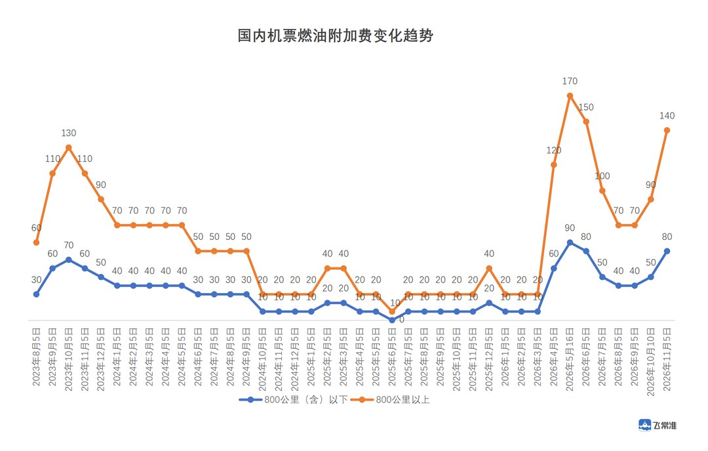
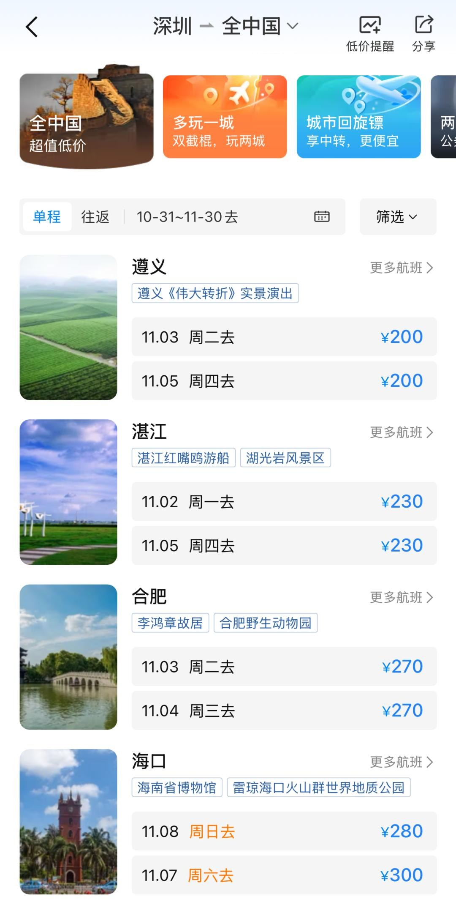
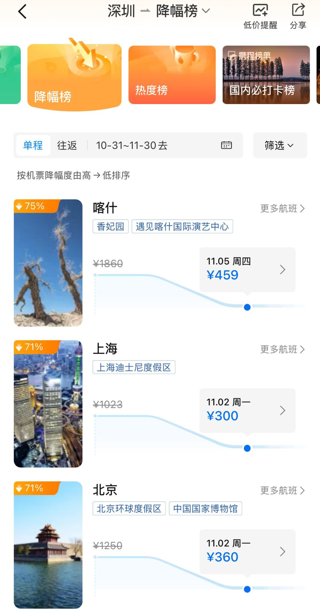
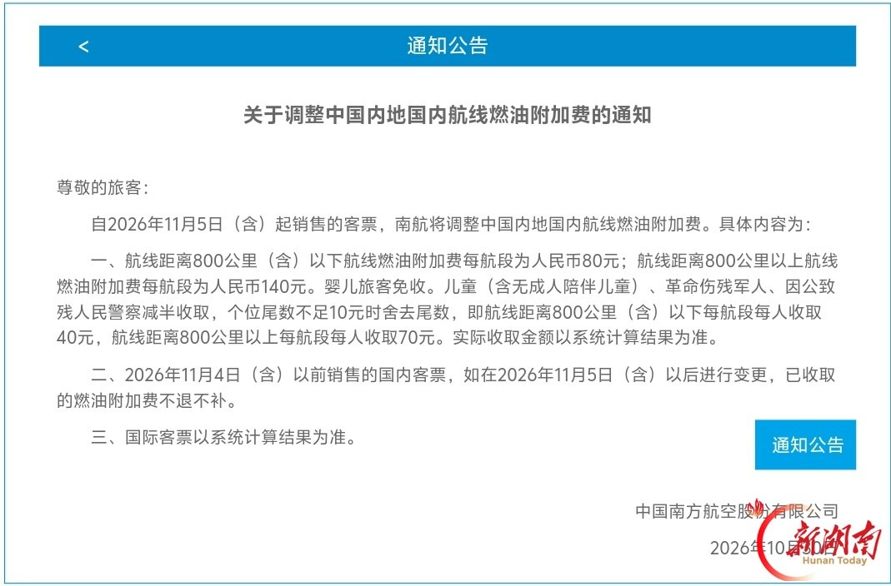
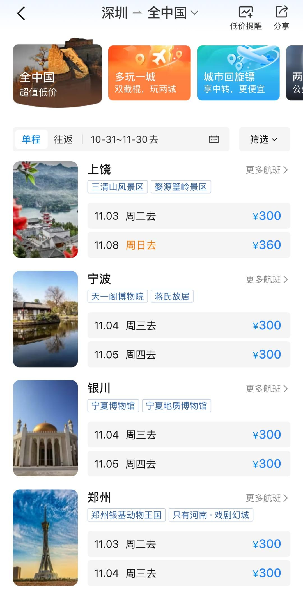

# 11月5日起机票每张多付30元，燃油费从40元到80元

11 月 5 日零时起出票的国内机票，燃油附加费换成 80 元和 140 元两档。

800 公里（含）以下收 80 元，以上收 140 元。央视新闻、中国经济网、澎湃当天都发了这条。

几乎所有报道都跟一句「较此前分别上涨了 30 元和 50 元」。30 块、50 块，听着像小事。

我翻了航司的原始通知，这个「此前」指的是 10 月 10 日的 50 元和 90 元。

再往前退三个月，8 月 5 日那次下调之后，两档是 40 元和 70 元。

从 40 到 80，从 70 到 140，都是翻倍。三个月两连涨，把三连降的幅度吃了回去。

## 一、30元跟哪天比

先把四个日期摆在一起。

8 月 5 日，800 公里以下 40 元、以上 70 元，年内低点。央广网和央视网当天都发了航司公告。

10 月 10 日，调到 50 元和 90 元。

赣县区政府信息公开页转了航司通知全文。依据写的是发改价格〔2009〕2879号、〔2011〕2219号、〔2015〕571号。

11 月 5 日，80 元和 140 元。

所以 30 = 80 − 50，50 = 140 − 90。这组数是跟上个月比出来的。

按 10 月 10 日的标准算涨幅，30 ÷ 50 = 60%，50 ÷ 90 ≈ 55.6%。

按 8 月 5 日算，40 → 80 涨了整整一倍，70 → 140 同样翻倍。

我更愿意用后一组。买票的人记的是今年这张票多少钱，不会去记上个月涨了几块。

得补一句口径。80 和 140 还没回到 5 月 16 日的 90 和 170。

腾讯新闻 11 月 2 日那篇把年内序列列全了。年初 10 元/20 元，4 月 5 日 60/120。

5 月 16 日 90/170 见顶。6、7、8 月三连降，回到 40/70。

翻倍只成立于 8 月低点这个起点。5 月那两个峰值还立在上面。

## 二、票面外还有130元

湖南日报 11 月 5 日给了一个能直接用的算法。

机票票面价之外，还要加 50 元机场建设费。

加完之后，飞广州、重庆这类 800 公里以下航线，机建燃油合计 130 元。飞北京、上海这类长航线，合计 190 元。

130 = 80 + 50，190 = 140 + 50。这两个数我按公告复算过，对得上。

苏南瑞丽航空官网的公告写得更直白。燃油附加费须在购票时与票款一并收取，燃油附加项目和标准在客票上单独标示。

公告还写了退票的处理：燃油附加费按实际收取金额退还旅客。

「单独标示」四个字解释了落差从哪来。平台列表里那个价，是票面价。

深圳幸福福田 10 月 31 日那篇贴了票务平台截图。深圳飞遵义 200 元、湛江 230 元、合肥 270 元、海口 280 元。

文末特意注明，文中价格不包含机建燃油费。

拿 200 元那张算。短途实付 200 + 130 = 330 元，长途 200 + 190 = 390 元。附加费占实付的 39.4% 和 48.7%。

同一篇还有一张降幅榜。深圳飞喀什从 1860 元降到 459 元，标着 -75%。

这个 75% 也是票面降幅。459 + 190 = 649 元，附加费占 29.3%。

再把账放大到一家三口往返。

按 10 月 10 日的标准比，短途每人每程多 30 元，三人两程就是 180 元；长途每人每程多 50 元，合计 300 元。

按 8 月 5 日的低点比，这两组数是 240 元和 420 元。

一家出门，机建燃油这一项就够再买一张短途票。

## 三、跟油价两套机制

8 月 5 日央视网那篇专门解释了定价机制，我把关键参数记下来了。

国内航线燃油附加费以航空煤油出厂价为核心联动依据，联动基准线 5000 元/吨。

参考的是过去一个月的航油平均价格。航煤采购价超过 5000 元时才启动收取机制，超出部分的 80% 由燃油附加费解决。

国内汽油价是另一套。它绑定国际原油均价，每 10 个工作日开一次调价窗口。

一个看航煤月均价，一个看原油十个工作日。

所以「加油站降价了，机票燃油费怎么还涨」这个疑问，问错了对象。

调整窗口通常是每月 5 日。10 月那次推到了 10 日，今年第二次打破惯例，上一次是 5 月推到 16 日。

这次 80 元、140 元对应的具体航煤采购价，我没查到。

航司通知里只写按局方的航空煤油价格政策调整，没给数字。这个数按公开资料算不出来，先标在这里。

## 四、改签不用补钱

反直觉的一条藏在公告后半段。

南方航空的公告截图我读了三遍。2026 年 11 月 4 日（含）以前销售的国内客票，如在 11 月 5 日（含）以后进行变更，已收取的燃油附加费不退不补。

苏南瑞丽写得更细。11 月 4 日前销售的定期客票，变更到 11 月 5 日以后的航班，如涉及换开客票，燃油附加费不退不补。

后面还有一句：一律以原始出票日期的金额为准。重新填开客票需按原标准手工输入。

10 月 10 日那份通知里也有同一句。燃油附加的征收以原始出票日期为准，客票改期时，燃油附加费不退不补。

央广网 8 月 5 日那篇写得更早。改签时燃油附加费同样不退不补，不会因为航班日期落在调价之后就退还差价。

这条规则沿用了三次调整。这次只是又用了一遍。

也就是说，11 月 4 日前出票的票，改签到 11 月 5 日之后，仍按 50 元和 90 元算。重新买一张，才是 80 和 140。

分界按出票日期算，跟起飞日期无关。这条我以前也搞混过。

南航公告的第三条留给国际客票，写的是以系统计算结果为准。国内这两档明码写死，国际没有。

婴儿免收，指按成人普通票价 10% 购票的那档。儿童减半，这次是 40 元和 70 元。

湖南日报把减半的范围列全了。儿童含无成人陪伴儿童，另有革命伤残军人、因公致残人民警察和残疾消防救援人员。

南航公告里还有一句容易漏掉：个位尾数不足 10 元时舍去尾数。

拿它对 10 月 10 日的标准，50 ÷ 2 = 25，舍成 20；90 ÷ 2 = 45，舍成 40。这正是当时儿童票的 20 元和 40 元。

11 月 5 日这两档，80 ÷ 2 = 40，140 ÷ 2 = 70，整除，不用舍。

所以儿童票看着从 20 涨到 40、从 40 涨到 70，涨幅跟成人不同。差别来自舍尾数这一步。

## 五、买票前问三句

平台标的价含不含机建燃油。

出票日期落在哪一天。

改签会不会按新标准重收。

第三句容易漏。很多人以为按航班日期算，公告里写的是原始出票日期。

这两档钱在客票上分开列。票面 200 元的机票，短途到手 330 元。

先加一下再看降幅，比盯着百分比有用。

---

参数是我按公开资料算的，欢迎在评论区指正。
