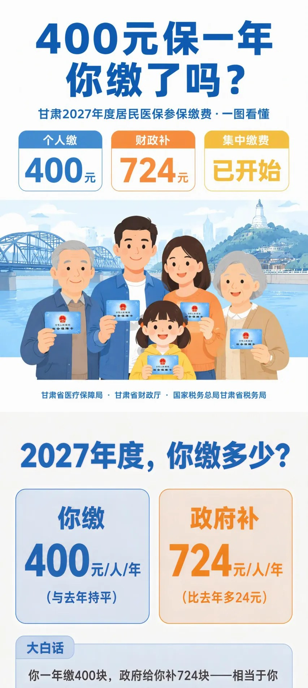
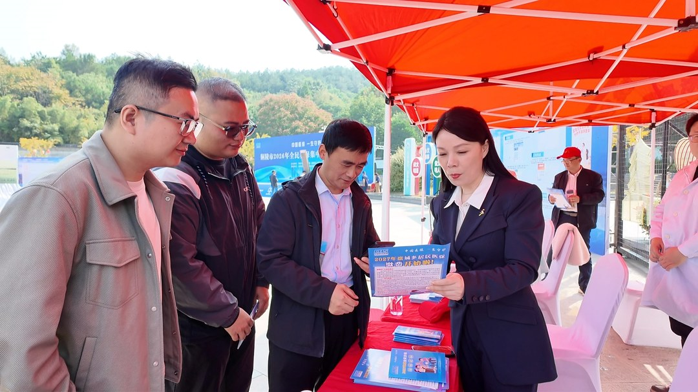

# 11月5日医保局回应8300万：13.28亿参保连涨两年

11 月 6 日，百度热搜第 1 位挂着一条「参保人数减少 8300 万？医保局回应」，微博同一话题排在第 2。

「居民医保参保人数连续 7 年下降、累计减少 8300 万」，这句话在网上转了不止一轮。

配上「医保要撑不住」的联想，正在缴费季的人看了，很难不多想一下。

11 月 5 日，国家医保局在医保钱包 2.0 版媒体解读会上把账摊开了。规财法规司副司长张晨光给了几组数。

我按公开资料重算了一遍。8300 万这个数对得上，它讲的那一栏，跟很多人以为的并不一样。

## 一、8300万说的是哪一栏

先把口径摆清楚。基本医保分两栏，职工医保和居民医保。传言里「七连降」的那一栏，是居民医保。

截至 2026 年 9 月底，基本医保参保 13.28 亿人。其中职工医保 3.91 亿人，居民医保 9.37 亿人。

3.91 加 9.37 等于 13.28，两项正好合上。这是同一次发布给出的数，我拿它做了校验。

张晨光说，9 月底的参保人数已超过 2024 年全年，10 月底达到 2025 年全年水平。全年超过去年已成定局，将连续两年正增长。

我的判断是，拿一个分项的下滑去讲整个制度的收缩，中间缺了一步。那一栏减了，另一栏可以加。

## 二、少的人去了哪里

张晨光把下降拆成三条原因，每条都带数。

一条是治理重复参保。国家医保局成立初期，全国统一的信息平台还没建成，城乡居民医保整合也没完成。

同一个人在两地各登一份，这种情况当时存在。

2019 至 2024 年，全国剔除居民医保重复参保及无效数据超过 2500 万人。清掉的是重复记录，人仍在参保。

一条是居民转职工。2019 至 2025 年，职工医保参保人数从 3.29 亿增至 3.89 亿，增加 6000 万人。

占全部参保人数的比重从 24.3% 提到 29.2%。张晨光说，职工医保新增的人里，绝大部分由居民医保转入。

第三条是人口。2021 年全国人口达峰，到 2025 年末累计减少 771 万人。

我算了一遍。2500 万加 6000 万是 8500 万，比 8300 万还多 200 万。6000 万占 8300 万的 72.3%，2500 万占 30.1%，771 万占 9.3%。

三个比例加起来超过了一百个百分点。这三个数的统计区间并不重合，前两条分别截至 2024 年和 2025 年，第三条从 2021 年算起。

所以它们不能当成 8300 万的拆分表相加，官方也没有这么拆。我把它摆出来，只想说明量级：光前两条，就够覆盖那个「减少」。

把换了参保类型念成退保，偏差出在这里。

## 三、400元这笔账

再看钱。2025 至 2027 年，居民医保个人缴费标准都是 400 元，连续两年不涨、三年保持不变。财政补助从每人每年 670 元提高到 724 元。

400 加 670 是 1070 元，400 加 724 是 1124 元。总筹资涨了 5.05%，个人缴费没动。

个人那 400 元占筹资的比重，从 37.4% 降到 35.6%。财政补的部分多了 54 元，涨 8.06%。

甘肃税务的参保缴费图解把这笔账写成一句大白话，花 400 块买一份价值 1124 元的医疗保障。我核过，跟上面的加法一致。

报销端也有数。2025 年居民医保享受门诊报销待遇 4.93 亿人，除以参保的 9.37 亿人是 52.6%，过了一半。

近五年享受报销待遇的超过 8.3 亿人，官方口径是 80% 以上的参保人近五年享受过报销。

「年轻人不生病不用参保」这句，张晨光也回了。2025 年 20 至 50 岁人群门诊就诊 2.8 亿人，住院 3700 万人，人均住院费用 11421 元。

该年龄段全国约 5.5 亿人。我算下来，50.9% 的人去年去过门诊，6.7% 住过院。

还有一笔能对上的数。2025 年全国职工医保个人账户给近亲属代缴居民医保个人缴费 3425.78 万人次，金额 142.27 亿元。

142.27 亿除以 3425.78 万，人均 415.3 元，贴着 400 元的标准。

基金这边，2026 年 1 至 9 月统筹基金总收入 23028.33 亿元，总支出 17515.19 亿元。相减结余 5513.14 亿元，支出占收入 76.1%。

## 四、我更在意分母

「七连降」这三个字，把注意力放在一条向下的曲线上。可参保结构这几年在换。

职工医保从 3.29 亿到 3.89 亿，增幅 18.2%，占比提高 4.9 个百分点。一个人从居民医保转到职工医保，多半是有了单位，缴费基数变了，待遇也跟着变。

这件事在居民医保那栏记 -1，在职工医保那栏记 +1。两栏合起来，人还在 13.28 亿里。

我的判断是，这条说法经不起查的地方，在分母被换了。分项减、总盘子增，两句话可以同时成立。

有个数我没查到，8300 万「累计减少」对应的逐年原始统计表。官方这次回应没有给逐年数，我也不去凑那条曲线。

缺的部分就空着，比补一个数稳妥。

## 五、下次看见「少了N万」

先问四句。

这个数是分项还是总盘子。

分母是哪个口径，截止到哪一天。

少掉的人是换了账户，还是真的没参保。

同期的缴费标准、报销人数、基金收支有没有跟着掉。

四句问完，再看那句结论还站不站得住。今年缴费季还没结束，400 元交不交，靠这四句比靠一条热搜稳。

---

参数是我按公开资料算的，欢迎在评论区指正。
