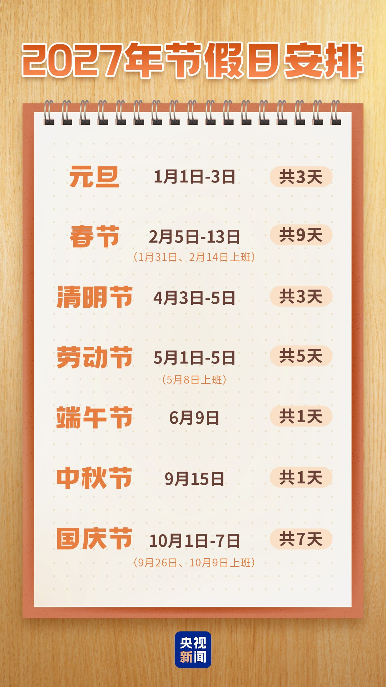
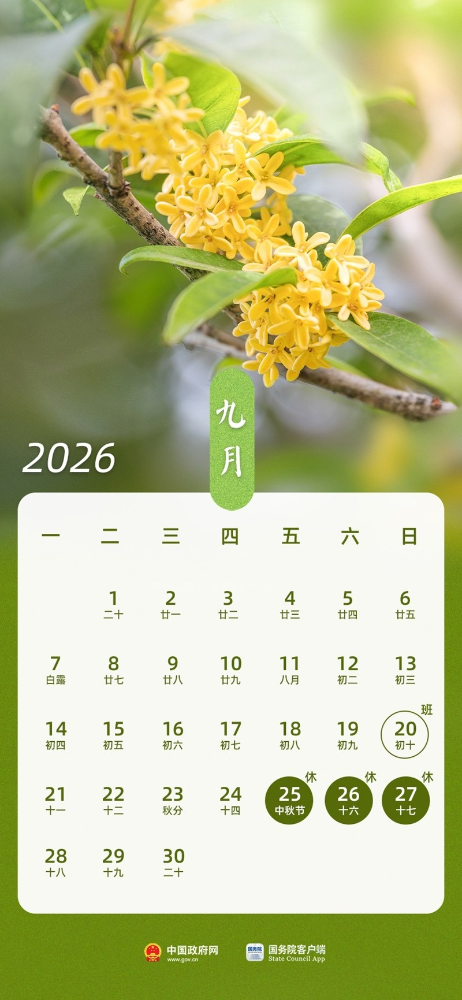
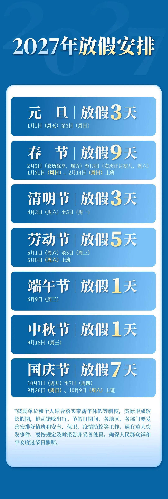

# 11月5日放假表：春节连休9天，全年少休4天

11月5日下午，国务院办公厅挂出2027年放假安排。

春节2月5日到13日，连休9天。

「调休减少」「9天超长假期再次回归」跟着一起刷了屏。

我把2027和2026两份通知摊开，逐日数了一遍。

9天是真的，返乡能从容一点也是真的。

我停在通知中间那两行。端午节6月9日，共1天。中秋节9月15日，共1天。

两个日子都落在周三。

## 一、9天拆开是六天

先把2月5日到13日这9天摆出来。

5日周五是除夕，6日周六、7日周日，8日周一到12日周五，13日周六。

9天里有3天是原本就休的周末，6日、7日、13日。

剩下6个工作日放假，来源不一样。

国务院令第795号写着，春节法定放假4天，农历除夕、正月初一到初三。

5日和8日是法定假日，落在工作日，占2天。

6日、7日也是法定假日，但撞上周末。按《全国年节及纪念日放假办法》第六条，这种要在工作日补假，再占2天。

还有2天，是拿1月31日和2月14日两个周日上班换来的。通知里那句「上班」写的就是这两天。

2加2加2，6个工作日。加上3天周末，凑成9天。

把9天逐日落一遍更清楚。

2月5日周五，除夕，法定假日。

6日周六、7日周日，初一初二，法定假日撞上周末。

8日周一，初三，法定假日。

9日到12日，周二到周五，四个工作日。

13日周六，原本就休。

中间那四个工作日，两天来自法定假撞周末的补假，两天来自两个周日的调休。通知没有写哪天对应哪笔，我按天数对上，不去替它指定。

我更愿意换个算法。9天减掉3天本来就要休的周末，再减掉2天借来要还的，净多出4天。

4天，正好等于法定春节假的天数。

拼法换来换去，落到手里的增量没变。

2024年那次修改，把全体公民放假的假日从11天加到13天，多的是农历除夕和5月2日。13天这个总数，2027年一个字没动。

## 二、两个小长假各少两天

去年那份通知是2025年11月4日发的，国办发明电〔2025〕7号。

端午节6月19日到21日，共3天。中秋节9月25日到27日，共3天。

都是周五接周末，不用补班，白得一个三天连休。

2027年这两个节都挪到了周三。端午6月9日，中秋9月15日，各放1天。

中国政府网去年那套图解日历上，6月19、20、21三个格子标着「休」，9月25、26、27也是三个。

央视新闻今年的日历上，6月只剩9日一个「休」，9月只剩15日一个。

我把两套日历并排数了一遍，两年之间差的4天全在这里。

央视新闻的解读给了原因，逢周三不调休，短假不硬拼3天。

这个理由我认。为凑一个三天假把前后两个周末拆开，确实不划算。

只是标题里没人写这4天。

## 三、全年加一遍少4天

把七个节日的天数抄下来相加。

2027年是元旦3、春节9、清明3、劳动节5、端午1、中秋1、国庆7，共29天。

2026年是元旦3、春节9、清明3、劳动节5、端午3、中秋3、国庆7，共33天。

差4天。

再看补班。2027年要上班的日子是1月31日、2月14日、5月8日、9月26日、10月9日，5天。

2026年是1月4日、2月14日、2月28日、5月9日、9月20日、10月10日，6天。

少补1天班。

「调休减少」这四个字，落到日历上就是这1天。

少补1天班，同时少连休4天。这两件事写在同一份通知里，标题只挑了前一件。

我没有找到哪份官方文件说2027年多给了假。全年13天法定假日，两年一样。

## 四、调休少的那一天

这1天省在哪，值得单独看。

2026年元旦是1月1日周四，放到3日周六，得借1月4日周日补回来。

2027年元旦是1月1日周五，接着周末自然连成3天，不用补。

省下的这1天来自日历位置，放假政策没多给一天假。

顺便说一句1月31日。那天是周日，要上班，为的是把2月的9天拼出来。

春节的两次补班，2026年是2月14日和28日，2027年是1月31日和2月14日，数量一样。

9天也不新。2026年春节2月15日到23日，就是9天。

央视新闻2024年11月解读国务院令第795号时已经写明，除夕逢周五与周末顺连，可实现放假9天，例如2027年。

那句「连续工作一般不超过6天」，是795号令第七条的原话，2025年1月1日起施行。

顺着这条再数一遍2月14日。那天周日补班，接着15日到19日是周一到周五，20日周六才休。

从14日连上19日，正好6天。

要是没有14日这次补班，9天里就得少一天，或者挪到别处再借一个周末。

央视新闻把这个说成「为了避免节后连续上班7天，特意在春节前后的两个周末各调休一天」。我核对了日历，14日到19日是6天，没有7天。

这里得说清，7天是「不这样安排会出现」的算法。通知只列了哪天放假、哪天上班，没给这个天数。

央视新闻请了国家发展改革委国土开发与地区经济研究所的刘敏解读，说法是全年4个假期零调休，短假尽量不调、长假严控调休量。

我数了数，零调休的是元旦、清明、端午、中秋。

其余三个节日要补班：春节2天、劳动节1天、国庆2天，加起来5天，和通知里的5个「上班」日子对得上。

我不觉得2027年的排布不好。少挪班、不硬拆周末，比凑长假如实。

我介意的是把日历刚好顺讲成假期变多了。

通知末尾还有一句，鼓励结合带薪年休假实际形成较长假期。

要做到媒体说的15天，得自己贴5天年假。这部分不在这份通知里。

## 五、下回先算三笔

看放假表，我会先算三笔，顺序不换。

先算净增。连休天数减掉本来就休的周末，再减掉标「班」的周末，剩下的才是多出来的。

再算全年。把七个节日的天数加一遍，跟去年比，别只盯春节那一个大数。

末了算补班。通知末尾那几个「上班」的日子，抄进日历，别到那天才发现要出门。

今年这份表里，三笔算完是净增4天、全年29天、补班5天。

而「调休减少」说的是5比6，少的1天在元旦。

---

参数是我按公开资料算的，欢迎在评论区指正。
