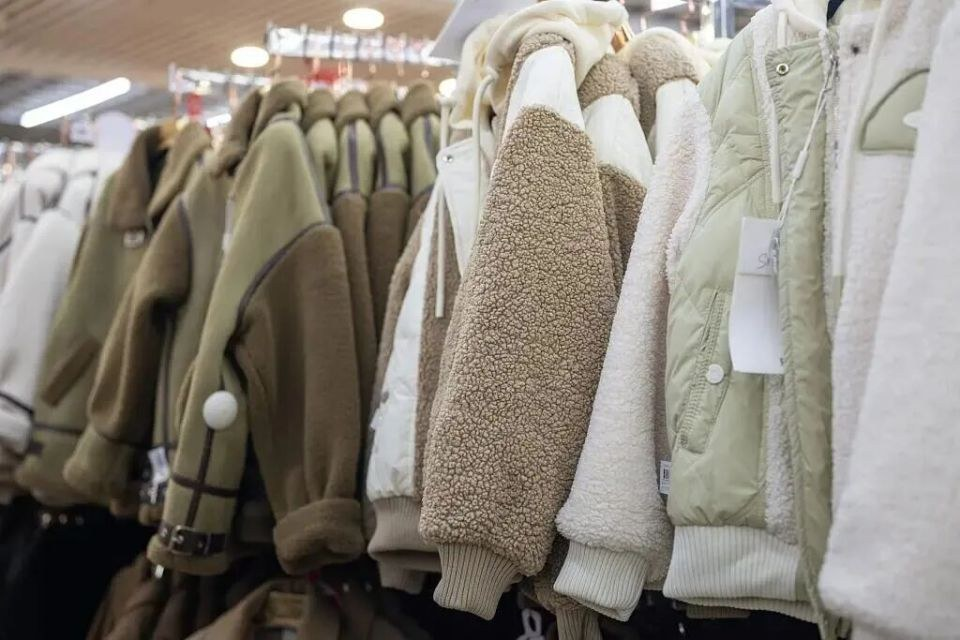
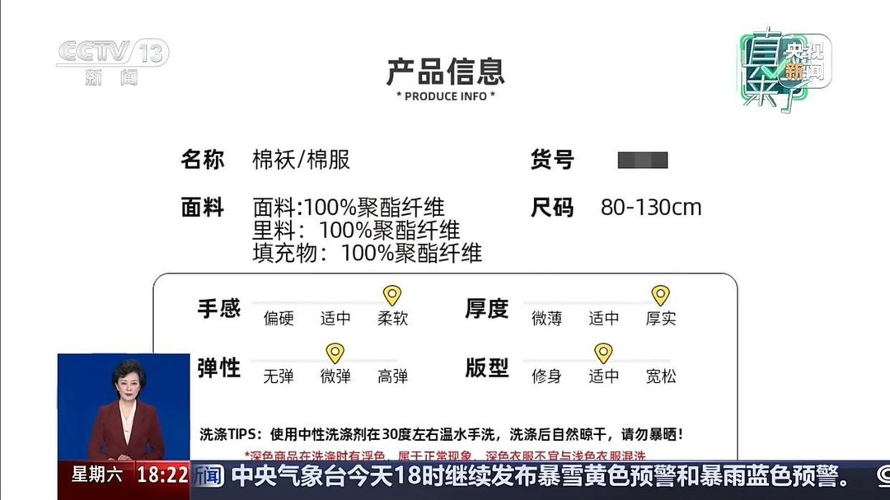
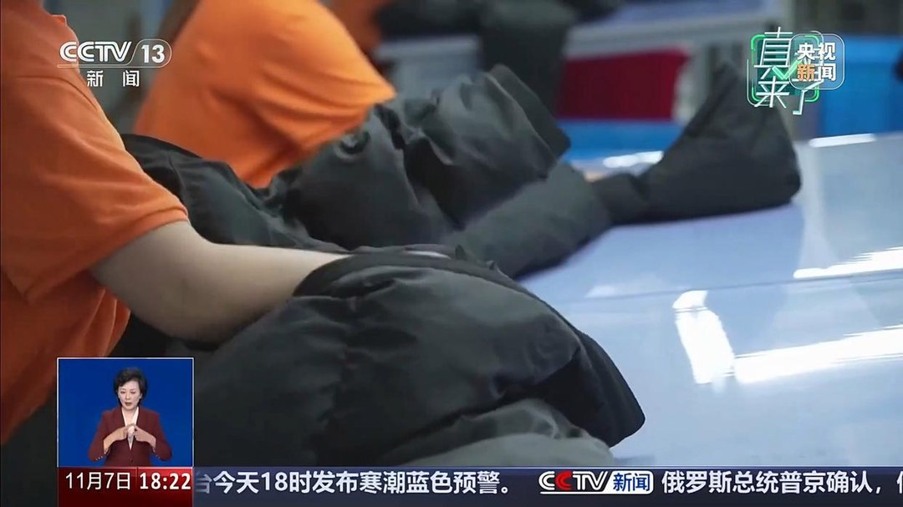
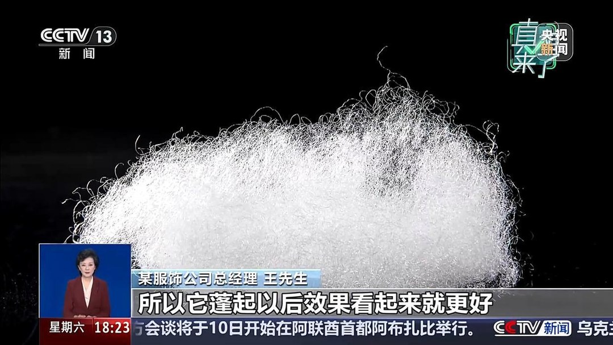
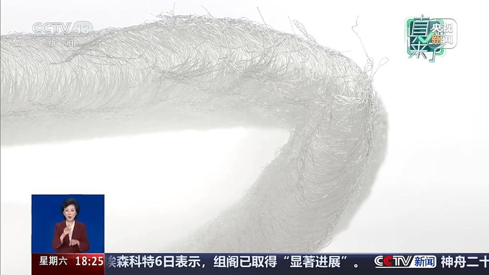
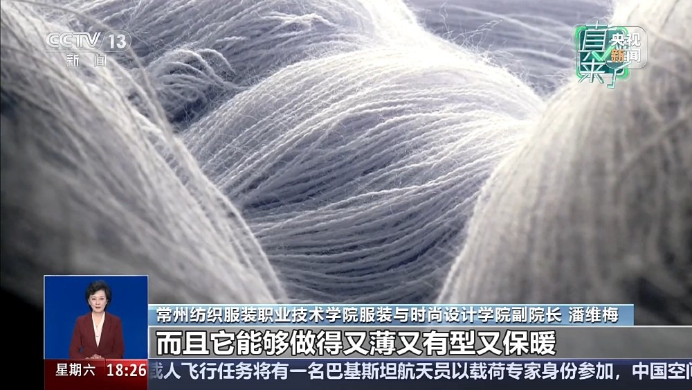
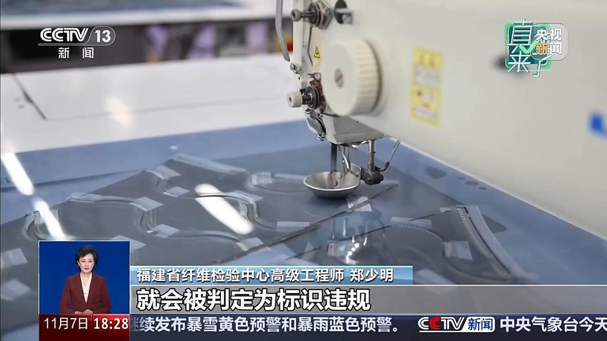

# 11月8日买棉服：0克棉花合规，75%叫全棉违规

11 月 7 日立冬，微博热搜榜首是「8 省份大到暴雪」。中央气象台 18 时发的暴雪黄色预警，局地特大暴雪 30 到 32 毫米。

保暖服饰跟着进入旺季。中新网、重庆日报、腾讯新闻在 11 月 8 日同步转载央视《真相来了》那段棉服调查，百度热搜辟谣位挂着「名字带棉不一定是棉花」。

挑衣服的时候，商品标题里排着羽绒棉、云朵棉、空气棉、太空棉、石墨烯云绒。百来块一件，看着厚实。

有家长买回去翻吊牌，面料、里料、填充物三行写的都是聚酯纤维，一点棉花没有，直呼上当。

我把两份国标的公开条文化了一晚上对，先给结论：这件衣服按现行国标不违规。

会被判违规的地方，在另外几行字里。

## 一、两个国标管两件事

「棉服装」在服装专业领域是品类名。GB/T 2662—2017《棉服装》管的是这类服装的质量和检验要求，不限定填充物材质。

福建省纤维检验中心高级工程师郑少明在央视里说得直白。棉服沿用了传统填棉棉衣的叫法，是历史延续下来的行业品类叫法。

核心是夹层有填充物的保暖服装。

早期填充物一般用棉。后来化纤和羽绒产业发展，填充物扩展开，名字留了下来。天然纤维、化学纤维、动物毛皮，都适用这份标准。

GB/T 29862—2013《纺织品 纤维含量的标识》管的是吊牌和水洗标怎么写。郑少明的原话：必须使用规范名称，如实标注，标注与实际不符或名称不符合标准要求，就会被判定为标识违规。

所以「棉服」这两个字不承诺棉花。承诺棉花的是「纯棉」「全棉」「棉 100%」这一组。

今年 7 月 1 日，《纤维制品质量监督管理办法》和国标 GB 18383—2025 施行。学生服、内衣、婴幼儿制品要明确标注纤维成分和安全类别。

电商平台和直播营销一并纳入重点监管。

这是一层新加的约束，管的是标注和原料，仍然没改「棉服装」的品类定义。

## 二、名字里的棉都不作数

央视记者走访线下市场，四个商家给了四种叫法：超轻棉、丝绒棉、蓬松棉、石墨烯云绒。

某服饰公司总经理王先生说，这类东西完全是化纤，跟棉不沾边。螺旋状的化纤纤维组成各种组织，可以起各种名字，太空棉、仿丝棉、云朵棉大同小异。

新华网今年 7 月 1 日采访江苏省纺织产品质量监督检验研究院高级工程师徐亚军，把边界讲得更细。GB/T 29862 允许在纤维名称后加如实描述形态的术语，例如涤纶（七孔）、棉（丝光）。

「亲肤」「云朵」「柔软」「水洗」不在这个范围里。徐亚军说这些是厂家为吸引眼球加的形容词，通常带「棉」「绵」的原料大多数是聚酯纤维，与天然棉纤维无关。

中国羽绒信息网那份《羽绒制品消费警示》给了一个能算的数：羽绒棉、羽丝棉、羽丝绒实为粉碎毛加化纤棉，这类产品大多数含绒量不足 1%。

名字里写着羽绒，实测不到百分之一。差的 99 个百分点，在吊牌上找不到。

## 三、0 克棉花怎么算

吊牌那三行，面料、里料、填充物都写聚酯纤维。按成分反推，天然棉是 0 克。

保暖跟材料名字无关。央视的解释是，热量流失主要靠空气对流，纤维越蓬松，锁住的静止空气越多，棉花和聚酯纤维都靠这个原理。

常州纺织服装职业技术学院服装与时尚设计学院副院长潘维梅，补了一段棉花的老毛病。

棉服穿得越久越硬，出汗以后越穿越冷，吸湿和回弹差，所以民间要弹棉花。

化纤便宜，能做得又薄又有型又保暖，耐洗，机洗完就好。

我算了一笔原料账，只能算到原料这一层。

全国棉花交易市场 11 月 5 日的 CC Index 3128B 是 16778 元一吨，涤纶短纤 11 月 4 日 8820 元一吨。一吨差 7958 元，棉花是涤纶的 1.90 倍，贵 90.2%。

这个数只说明两种原料的价差，跟成衣成本差是两回事。填充克重、工费、面料、物流都没进去。我查了一圈，没有哪家棉服公布过填充物用量，所以不往下推。

但方向能对上王先生那句「价格越低，肯定销量就越高」。化纤填充成为市场主流，有价格上的理由。

徐亚军和同事肖航还提醒了一句，我认这个判断：纯棉只说明材质属性，品质好不好还看原料等级、纱支密度、纺织和后整理工艺。同样标纯棉，价格和品质可以差得很远。

## 四、违规点在标注

郑少明在央视里点了一个具体的数：棉的含量只有 75% 以上，就把它称为全棉，这样不符合规范。

75% 到 100%，差 25 个百分点。这一句把「纯棉」「全棉」「棉 100%」为什么等价讲清楚了。只有一种纤维组分的产品，才能在名称前后加百分号，或者加「纯」「全」。

徐亚军给过两个口子。仅有一种纤维且为棉纤维时，允许含微量其他纤维，上限 0.5%。产品或某一部分含装饰线、特性纤维，总含量不超过 5% 时，可以用「纯」「全」，但要注明「某某纤维除外」。

所以「100% 全棉」「100% 纯棉」「100% 精梳全棉」这类写法字面重复，也不规范。「100% 新疆长绒棉」多写了产地和品种，标准并不要求。

国家市场监管总局《2025 年儿童及婴幼儿服装等 41 种产品质量国家监督抽查情况通报》里，359 批次儿童及婴幼儿服装，42 批次不合格，占 11.7%。

其中 18 批次是纤维含量不合格，占不合格批次的 42.9%。新华网今年 5 月 29 日归因写了两条：原辅料进货检验没执行到位，以及个别生产单位为降低成本虚标天然纤维百分比。

这是童装口径，不能当成棉服的抽检结果。但「虚标天然纤维百分比」这一条，和郑少明说的 75% 是同一件事。

## 五、我买的时候看什么

先翻吊牌和水洗标，找「填充物」那一行。写的是棉还是聚酯纤维，比例多少，一眼能看到。

看到「纯棉」「全棉」，核对后面有没有跟着具体百分比。写 75% 却叫全棉，属于标识违规，可以留着截图。

商品标题里的羽绒棉、云朵棉、空气棉，一律当形容词处理，不当成分。郑少明说得很清楚，以吊牌上的规范纤维名称为准。

再看执行标准和安全类别。GB/T 2662—2017 是品类标准，成人棉服一般标 C 类。2021 年京津冀消协那次加绒保暖内衣比较试验里，29 款样品有 8 款宣称加绒保暖，却没执行考核保温率和透气率的 FZ/T 73022—2019。

那次试验里，一款标称唐狮的样品保温率实测 21.87%，标准下限 30%；透气率 125mm/s，标准下限 180mm/s。宣称有，标准不考核，就无从核对。

新华网那次访谈里，肖航还给了三步手感辨别。抓握后起皱回弹慢、触感柔软带涩、纱线燃烧有烧纸味。这三步我留着验货用，不当维权依据。

再按压一下。手拿开 1 到 2 秒能复原，说明回弹和蓬松度不错。

网页宣称和实物吊牌对不上，以吊牌为准。

---

参数是我按公开资料算的，欢迎在评论区指正。
